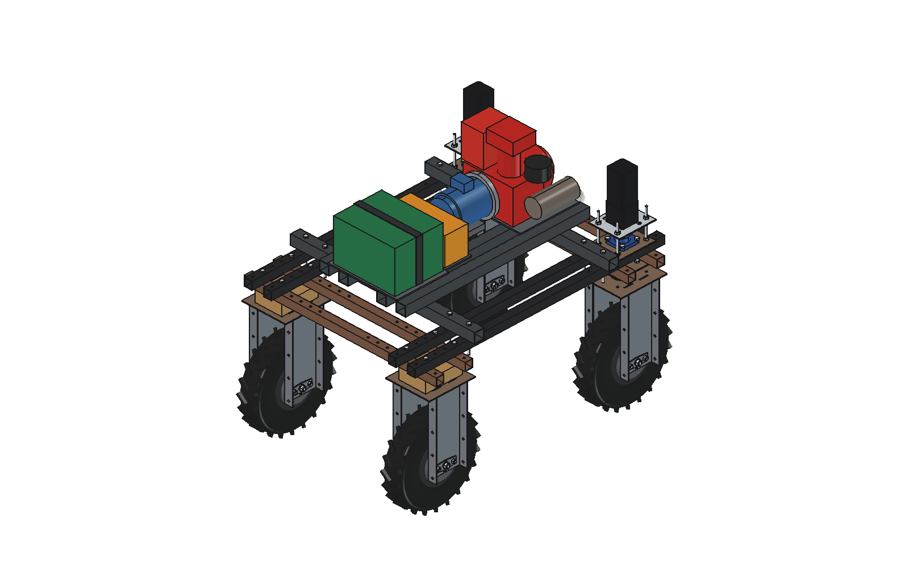

#hybrid setup 

this folder is for building on a iron base of 2 long and 4 short base ijzeren kokers to place on the robot in the width.
Hierop staat geplaats een benzine of diesel motortje, een generator die vervolgens een accu van stroomvoorziet,
het hele idee is dat de motor de robot van stroomvoorziet om de accu bij te laden tijdens het rijden bij normale lichte taken.
Bij zware taken mag de motor constant draaien om de accu op een hoog percentage te houden de accu's zijn er dan om de hubmotors genoeg stroom te kunnen geven om bij trekvermogen de volle peak te kunnen geven constant. Accu is hier echt om het peak vermogen te laten leveren en op kopakker op weinig vermogen kan de accu extra bijladen in draaien en zo weer op de zware stukken het vermogen weer kan leveren

---

# Hybrid range extender: FreeCAD model

Compact in-line train on a steel tube base on top of the Bruut OpenAgbot: **battery - controller - generator -
jaw coupling - petrol engine**. Generated from Python (`hyb_params.py` is the single source of truth), in robot
coordinates (x right, y front, z up, ground z 0).

- **Base:** 2 long tubes (across the width, y = ±350) bolted with 8 x M10 to the upper beams, 4 short tubes along y on top.
  Square tube 50 x 50 x 3, deck at z 799.
- **Engine:** 212 cc petrol, horizontal shaft, 4.8 kW (estimated), 3 L tank.
- **Generator:** 3 kW permanent-magnet alternator on the engine shaft via a jaw coupling.
- **Controller:** rectifier / DC-DC / contactor box. **Battery:** 16S 59 V 40 Ah = 2.4 kWh.
- **Clear of** the steering stacks of the front wheels (about 30 mm minimum to any robot part).

## Files

| File | Contents |
| --- | --- |
| `hyb_params.py` | all dimensions and estimated figures |
| `hyb_parts.py` | one function per part (robot coordinates) |
| `build_hyb.py` | model tree, `check_interference()`, `clearance()`, `mass_properties()`, `render_all()`, STEP export |
| `hyb_calc.py` | energy balance, fuel use (pure Python) |
| `run_in_freecad.py` | macro: reload, build, print the key figures |
| `RATIONALE.md` | why it is like this |

Run in FreeCAD: `exec(open(r"F:\veldrobot\aanbouwdelen\Hybrid\run_in_freecad.py", encoding="utf-8").read())`.
There is no animation (static add-on).

## Key figures (current build)

- Interference: none (hybrid among itself and against the robot).
- Mass: about 76 kg (frame 27 + engine 18 + generator 9 + controller 5 + battery 17), centre of gravity x 7, y -5, z 868 mm.
- Light task 900 W: battery charges +2.1 kW. Heavy task 2.2 kW: +0.8 kW. Peak 4.4 kW: -1.4 kW, usable battery lasts about 81 min.
- Fuel about 1.5 L/h at full output.

## Estimated, not measured

Engine mass, power and shape (Honda GX200 type), fuel use, generator mass / power / efficiency, battery mass and
size, controller size and mass, hub motor power and peak factor, robot mass (150 kg), light and heavy task loads,
weld and bolt details of the frame.
