# Bruut Implements

Open-source implements (attachments) for the **[Bruut OpenAgbot](https://github.com/JacobsFarm/Bruut_OpenAgbot)**, an open-source agricultural field robot. Want to know more about the project? Go to **[openagbot.com](https://openagbot.com)**.

Every design is parametric: change a number, rebuild, and the whole model follows. They are built in FreeCAD from Python scripts, come with the calculations behind them and, for the advanced variants, an animation on the robot. Everything bolts onto the 50 mm hole grid of the robot's chassis beams.

   
  <i>Dockweed drill: finds a dock plant and mills out its root</i>

**Jump to:** [Gallery](#gallery) · [Animations](#animations) · [Implements](#implements) · [Build it yourself](#build-it-yourself) · [Related](#related)

## Gallery

<table>
  <tr>
    <td align="center" width="50%">
      <a href="overseeder/">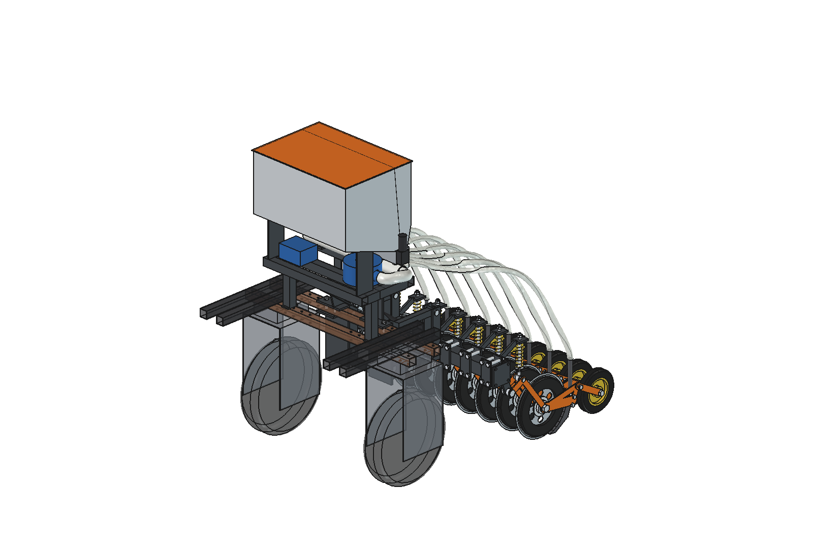</a> 
      <b><a href="overseeder/advanced/">Overseeder (advanced)</a></b> 8-row slit seeder with an air seeder
    </td>
    <td align="center" width="50%">
      <a href="overseeder/">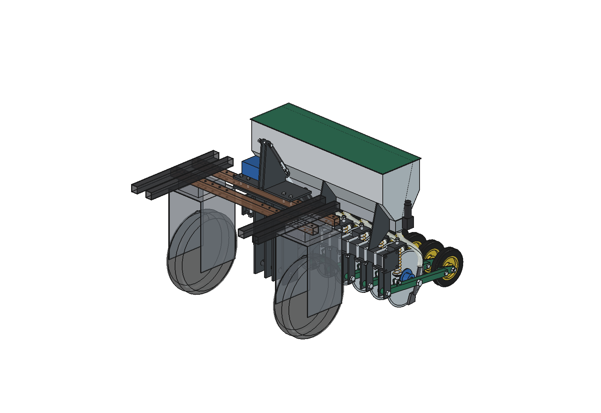</a> 
      <b><a href="overseeder/simple/">Overseeder (simple)</a></b> Angled discs with a gravity hopper
    </td>
  </tr>
  <tr>
    <td align="center">
       
      <b><a href="liquid%20fertilizer%20applicator/">Liquid fertilizer applicator</a></b> Disc and knife units on spring arms
    </td>
    <td align="center">
       
      <b><a href="dockweed%20drill/">Dockweed drill</a></b> Finds a dock plant and mills out its root
    </td>
  </tr>
  <tr>
    <td align="center">
       
      <b><a href="liquid%20fertilizer%20applicator/precision_applicator/">Precision liquid applicator</a></b> Roller pump on the robot, discs, knives and press wheels on an actuator linkage
    </td>
    <td align="center">
       
      <b><a href="liquid%20fertilizer%20applicator/precision_applicator/roller_pump/">Roller pump</a></b> Modular peristaltic pump, 10 ml per revolution per tube
    </td>
  </tr>
  <tr>
    <td align="center">
      <a href="trencher/">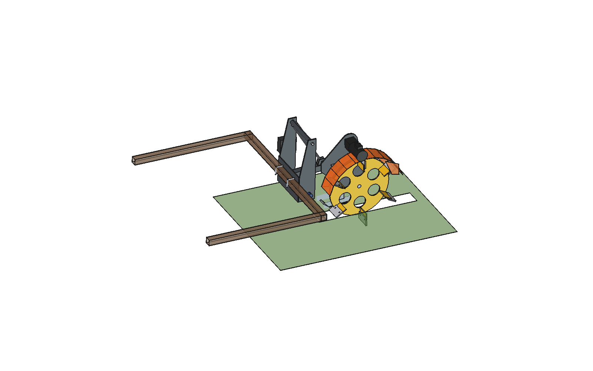</a> 
      <b><a href="trencher/">Trencher</a></b> Wheel trencher for cutting narrow trenches
    </td>
    <td align="center">
       
      <b><a href="feed%20pusher%20auger/advanced/">Feed pusher auger</a></b> Pushes feed back to the feed fence
    </td>
  </tr>
  <tr>
    <td align="center">
       
      <b><a href="brushes/">Disc brushes</a></b> 2 × Ø650/750: windrow or spread wide
    </td>
    <td align="center">
       
      <b><a href="brushes/simple/">Disc brush Ø850</a></b> Sweeps the robot's own width to one side
    </td>
  </tr>
  <tr>
    <td align="center">
       
      <b><a href="marker/">Field marker</a></b> Marks GPS points with paint, via an XYZ stage
    </td>
    <td align="center">
      <a href="marker/simple/">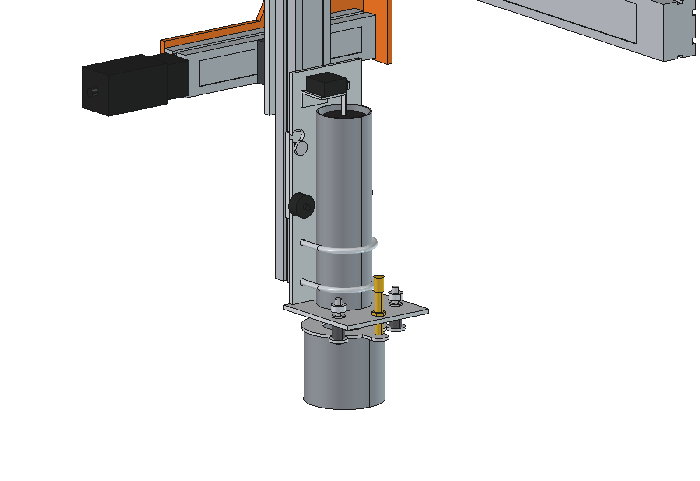</a> 
      <b><a href="marker/simple/">Field marker paint head</a></b> Spray can, servo and a sprung shroud that senses the ground
    </td>
  </tr>
  <tr>
    <td align="center">
       
      <b><a href="mobile%20refiller/">Mobile refiller</a></b> Support robot: 515 l, boom with spout, powered trailer
    </td>
    <td align="center">
       
      <b><a href="mobile%20refiller/liquid/">Mobile refiller, docked</a></b> RTK antenna on the spout, camera checks the funnel
    </td>
  </tr>
  <tr>
    <td align="center">
       
      <b><a href="mobile%20refiller/simple/">Mobile refiller (simple)</a></b> Standard 1000 l IBC, pump, mast with a hanging hose
    </td>
    <td align="center">
       
      <b><a href="mobile%20refiller/simple/">Mobile refiller (simple), refill</a></b> Inside the U-turn: the working robot stops under the nozzle
    </td>
  </tr>
  <tr>
    <td align="center">
       
      <b><a href="mobile%20refiller/stationary/">Stationary refill station</a></b> IBC trailer (1 or 2 IBCs): the working robot drives to it
    </td>
    <td align="center">
       
      <b><a href="mobile%20refiller/stationary/">Stationary refill station, flat wagon</a></b> 6 IBCs on a standard bale wagon; also a three-point frame
    </td>
  </tr>
  <tr>
    <td align="center">
      <a href="around_pole_mower/simple/">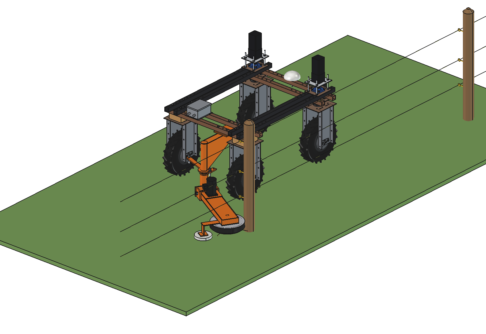</a> 
      <b><a href="around_pole_mower/">Around-pole fence mower</a></b> String head under the electric fence, swings around the posts
    </td>
    <td align="center">
      <a href="around_pole_mower/simple/">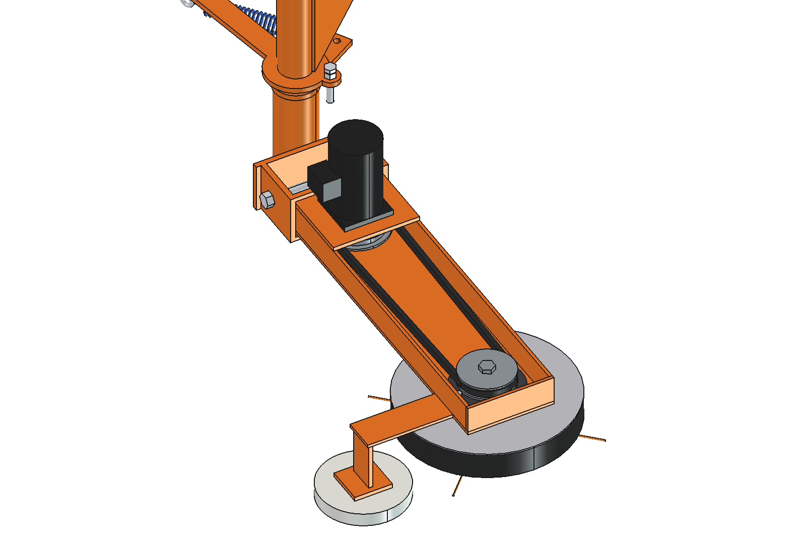</a> 
      <b><a href="around_pole_mower/simple/">Fence mower arm</a></b> 48 V motor, V-belt in the arm, deck spindle, PE guard ring
    </td>
  </tr>
  <tr>
    <td align="center">
       
      <b><a href="weed%20picker/">Weed picker</a></b> Twin-rotor mowing deck: cuts thistles, ragwort and dock into one windrow
    </td>
    <td align="center">
       
      <b><a href="weed%20picker/mowing_deck/">Weed picker linkage</a></b> Parallel linkage, actuator with float link: cut height 100–400 mm
    </td>
  </tr>
  <tr>
    <td align="center">
       
      <b><a href="irrigation/">Irrigation hose reel</a></b> 150 m lay-flat hose, laid out empty, floods a 4 m strip at 0.17 bar
    </td>
    <td align="center">
       
      <b><a href="irrigation/stationary%20+%20roller/">Hose reel pinch rollers</a></b> Clamp the hose shut while irrigating, squeeze it empty while winding
    </td>
  </tr>
  <tr>
    <td align="center">
       
      <b><a href="spotspray%20unit/">Spot sprayer</a></b> Camera in front, 120 l tank, 3.75 m boom with 15 PWM nozzles
    </td>
    <td align="center">
       
      <b><a href="spotspray%20unit/boom/">Spot sprayer, wings folded</a></b> Each 1.25 m wing folds up in 3.2 s, also in the field
    </td>
  </tr>
  <tr>
    <td align="center">
       
      <b><a href="in%20row%20weeder/">In-row finger weeder</a></b> 2 rows of broccoli, a stepper-driven finger per row, camera under the robot
    </td>
    <td align="center">
       
      <b><a href="in%20row%20weeder/finger/">In-row weeder knives</a></b> One knife out beside a plant, the other in the row line
    </td>
  </tr>
  <tr>
    <td align="center">
      <a href="bandrake/electric/">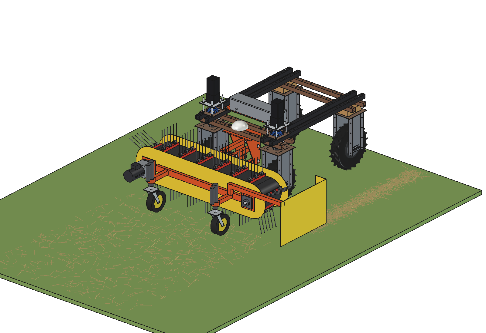</a> 
      <b><a href="bandrake/">Electric belt rake</a></b> 1.5 m, 48 V drive, castors on actuators: one windrow from outside to inside
    </td>
    <td align="center">
      <a href="bandrake/electric/">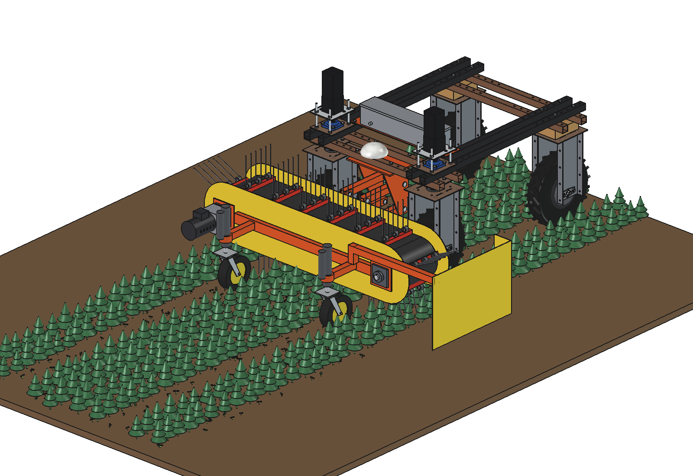</a> 
      <b><a href="bandrake/electric/">Belt rake in a nursery bed</a></b> Combs out weed seedlings between young trees
    </td>
  </tr>
  <tr>
    <td align="center">
       
      <b><a href="weeds%20burner/">Flame weeder</a></b> Hooded 1.5 m, 6 burners, 2 × 18 kg propane on the robot
    </td>
    <td align="center">
       
      <b><a href="weeds%20burner/propane_hood/">Flame weeder, flames</a></b> Pre-emergence: burns the seedlings on a freshly sown bed
    </td>
  </tr>
  <tr>
    <td align="center">
       
      <b><a href="sickle%20bar%20mower/">Triple sickle bar mower</a></b> 1.25 m in front + 2 × 1.0 m wings in the middle: 3.25 m
    </td>
    <td align="center">
       
      <b><a href="sickle%20bar%20mower/triple/">Sickle bar mower, transport</a></b> Front bar up 300 mm, wings folded up: 1.59 m wide
    </td>
  </tr>
  <tr>
    <td align="center">
       
      <b><a href="push%20blade/simple/">Push blade</a></b> Dozer / grader blade, angle +-25 degrees, rubber edge
    </td>
    <td align="center">
       
      <b><a href="fertilizer%20spreader/simple/">Fertilizer spreader</a></b> 88 l hopper, metering roller, spinning disc
    </td>
  </tr>
  <tr>
    <td align="center">
       
      <b><a href="grassland%20harrow/simple/">Grassland harrow</a></b> Levelling board and spring tines: molehills, moss
    </td>
    <td align="center">
       
      <b><a href="soil%20sampler/simple/">Soil sampler</a></b> Gouge on a ball-screw Z axis, 10-cup carousel
    </td>
  </tr>
  <tr>
    <td align="center">
       
      <b><a href="inter%20row%20hoe/simple/">Inter-row hoe</a></b> Camera-steered side shift +-75 mm, 2 units at 75 cm
    </td>
    <td align="center">
       
      <b><a href="grassland%20aerator/simple/">Grassland aerator</a></b> Slitter roller between the axles, 1.2 m, 70 mm deep
    </td>
  </tr>
  <tr>
    <td align="center">
       
      <b><a href="three%20point%20hitch/simple/">Three-point hitch</a></b> Category 0, electric lift rods, with a 5-tine cultivator
    </td>
    <td align="center">
       
      <b><a href="crate%20carrier/simple/">Crate carrier</a></b> 8 harvest crates, follow-me by UWB
    </td>
  </tr>
  <tr>
    <td align="center">
       
      <b><a href="counterweights/simple/">Counterweights</a></b> Stackable 11 kg plates, front and rear, no tools
    </td>
    <td align="center">
       
      <b><a href="battery%20pack/simple/">Battery pack</a></b> 2 x 2.56 kWh LiFePO4 pods between the wheels
    </td>
  </tr>
  <tr>
    <td align="center">
      <a href="solar/">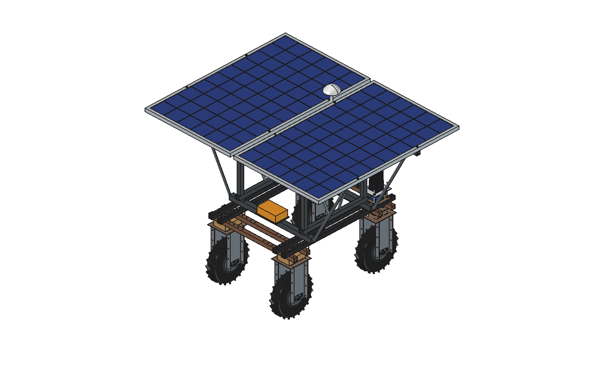</a> 
      <b><a href="solar/">Solar canopy</a></b> 2 panels, 640 Wp, MPPT, GNSS on the roof
    </td>
    <td align="center">
       
      <b><a href="compost%20spreader/simple/">Compost spreader</a></b> Moving-floor bin and beater, 150 kg, 1..3 kg/m2
    </td>
  </tr>
  <tr>
    <td align="center">
       
      <b><a href="stone%20picker/simple/">Stone picker</a></b> Tine rotor and sieve basket between the axles
    </td>
    <td align="center">
       
      <b><a href="mulch%20layer/simple/">Mulch layer</a></b> Foil roll, press wheels and covering discs on the hitch
    </td>
  </tr>
  <tr>
    <td align="center">
       
      <b><a href="grass%20meter/simple/">Grass meter</a></b> NDVI boom and sledge plate meter, dry-matter maps
    </td>
    <td align="center">
       
      <b><a href="soil%20compaction%20meter/simple/">Soil compaction meter</a></b> Cone penetrometer to 600 mm with load cell and moisture probe
    </td>
  </tr>
  <tr>
    <td align="center">
       
      <b><a href="charging%20dock/simple/">Charging dock</a></b> Contact dock with a 1 kW charger, catches 75 mm
    </td>
    <td align="center">
       
      <b><a href="uv%20mildew%20light/simple/">UV-C mildew light</a></b> UV-C hood between the axles, night work against mildew
    </td>
  </tr>
  <tr>
    <td align="center">
       
      <b><a href="sawdust%20spreader/simple/">Sawdust spreader</a></b> Bin, cross auger and side spinner for cubicles
    </td>
    <td align="center">
       
      <b><a href="bedding%20rake/simple/">Bedding rake</a></b> Side-arm tine rotor for cubicle beds
    </td>
  </tr>
  <tr>
    <td align="center">
       
      <b><a href="dumper%20barrow/simple/">Dumper barrow</a></b> Tipping skip, 353 l, tips 48 degrees
    </td>
    <td align="center">
       
      <b><a href="biocontrol%20spreader/simple/">Biocontrol spreader</a></b> Hoppers and blower for predatory mites
    </td>
  </tr>
  <tr>
    <td align="center">
       
      <b><a href="bag%20trailer/simple/">Bag trailer</a></b> 12 bags of 25 kg on the tow ball
    </td>
  </tr>
</table>

## Animations

The advanced designs are animated on the real robot model, with the loads and forces calculated per frame.

   
  <i><a href="liquid%20fertilizer%20applicator/concept%20versions/advanced/">Liquid fertilizer applicator</a>: every element follows the bumpy ground on its own arm</i>

   
  <i><a href="liquid%20fertilizer%20applicator/precision_applicator/">Precision liquid applicator</a>: the actuator lowers the discs and knives, the roller pump follows the speed and the press wheels close the slot</i>

   
  <i><a href="feed%20pusher%20auger/advanced/">Feed pusher auger</a>: pushing feed back to the fence, with the forces on the auger and the robot's reaction</i>

   
  <i><a href="brushes/simple/">Disc brushes</a>: two Ø750 brushes turn inwards and sweep a layer of loose material into a windrow</i>

   
  <i><a href="marker/simple/">Field marker</a>: the robot stops a few centimetres off, the stage puts the nozzle exactly on each point</i>

   
  <i><a href="mobile%20refiller/">Mobile refiller</a>: tops up the working robot in the straight part of its turn, while both drive</i>

   
  <i><a href="mobile%20refiller/simple/">Mobile refiller (simple)</a>: the working robot skips passes and turns in one go; it stops under the hanging nozzle in the middle of the U-turn, and the refiller moves 1 m per refill</i>

  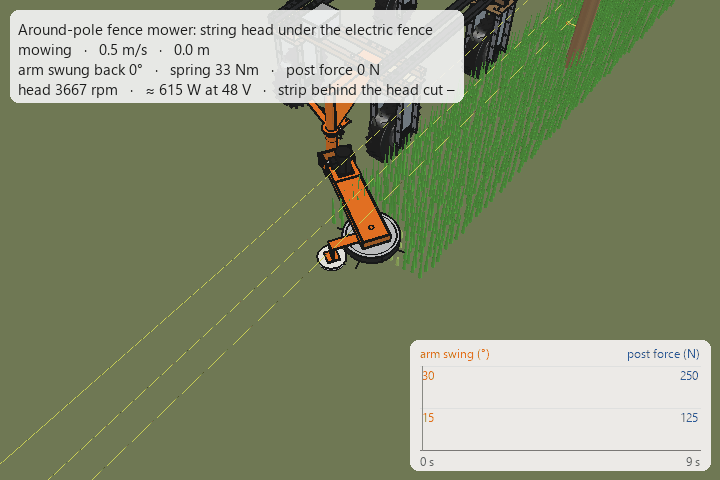 
  <i><a href="around_pole_mower/simple/">Around-pole fence mower</a>: the post pushes the head back and in, it slides around and the spring swings it back behind the post</i>

   
  <i><a href="weed%20picker/mowing_deck/">Weed picker</a>: two rotors turn inwards and throw the chopped weed into one windrow; the robot slows down in thick weed and raises the cut height while driving</i>

   
  <i><a href="irrigation/stationary%20+%20roller/">Irrigation hose reel</a>: the robot lays the empty hose, the pump at the ditch floods a 4 m strip, the hose runs empty and the robot winds it up again</i>

   
  <i><a href="spotspray%20unit/boom/">Spot sprayer</a>: the camera finds the docks, only the nozzles above a plant open; the right wing folds up for a fence post</i>

   
  <i><a href="in%20row%20weeder/finger/">In-row finger weeder</a>: the camera finds the broccoli, each stepper swings its knife out around every plant and back into the row line</i>

   
  <i><a href="in%20row%20weeder/double_arm/">In-row weeder, double arms</a>: two knives per row open to both sides of every plant and close behind it, each on its own stepper</i>

  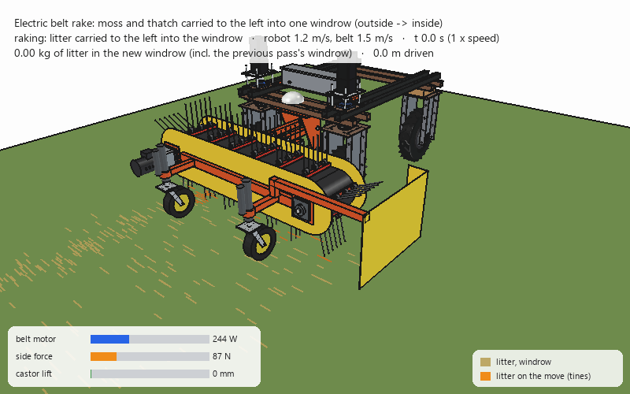 
  <i><a href="bandrake/electric/">Electric belt rake</a>: the tines carry the litter and the previous pass's windrow to the left into one windrow; at the headland the castor actuators lift the rake</i>

   
  <i><a href="weeds%20burner/propane_hood/">Flame weeder</a>: six burners under the hood kill the seedlings on a sown bed; when the robot stops only the pilot flames stay on</i>

   
  <i><a href="sickle%20bar%20mower/triple/">Triple sickle bar mower</a>: three double-knife bars mow a 3.25 m strip; at the headland the front bar lifts and the wings fold up</i>

## Implements

| Implement | Variants | What it does |
|---|---|---|
| [**Overseeder**](overseeder/) | [simple](overseeder/simple/) · [advanced](overseeder/advanced/) | Grassland slit seeder. 1 m modules with 8 rows at 125 mm and coupling flanges. Cuts a 15 mm slot, places seed about 12 mm deep and closes the slot with a sprung press wheel. Simple: angled single disc, gravity hopper, about €1,675 in parts. Advanced: parallel linkage, depth bands, curved seed coulter and an air seeder, about €2,280 |
| [**Cambridge roll and overseeder**](overseeding/) | [Cambridge roll](overseeding/cambridge%20roll/) · [overseeder (drop seeder)](overseeding/overrseeder/) · [combination](overseeding/overseeder%20with%20cambridge%20roll/) | Simple trailed lawn-repair implements on a 50 mm tow ball under the rear beams. Cambridge roll: 20 cast-iron rings Ø280 on a Ø40 shaft, 1 m, 178 kg, 100 … 250 N draft, about €850 with the hitch. Overseeder: 1 m drop seeder, 49 l hopper, fluted roller on a 24 V worm gearmotor that a camera switches on only over bare soil, two small wheels, about €500. Combination: the seeder unit hangs between the arms of the roll, seed falls 300 mm in front of the rings and is rolled in; 216 kg, about €1,200. Includes the turn kinematics of the trailer and an animation with bare patches |
| [**Liquid fertilizer applicator**](liquid%20fertilizer%20applicator/) | [simple](liquid%20fertilizer%20applicator/concept%20versions/simple/) · [simple v2](liquid%20fertilizer%20applicator/concept%20versions/simple_v2/) · [advanced](liquid%20fertilizer%20applicator/concept%20versions/advanced/) · **precision (production):** [roller pump](liquid%20fertilizer%20applicator/precision_applicator/roller_pump/) · [applicator](liquid%20fertilizer%20applicator/precision_applicator/applicator/) · [applicator V2](liquid%20fertilizer%20applicator/precision_applicator/applicator_v2/) · [on the robot](liquid%20fertilizer%20applicator/precision_applicator/combined/) · [V2 on the robot](liquid%20fertilizer%20applicator/precision_applicator/combined_v2/) | Injects liquid fertilizer into the soil. Simple: fixed knives, two gauge wheels and a 12 V pump, about €600 in parts. Simple v2: adds a cutting disc in front of each knife, about €900. Advanced: disc and knife units on spring arms, a ground-wheel-driven 5-channel peristaltic pump and a parallel linkage. Precision (the first production version, built with Herre Bartlema, from measured parts): a modular roller pump on the robot (10 ml per revolution per tube, stepper-driven, follows the speed), Ø 325 discs with injector knives behind them on a parallel linkage with an electric actuator, 5 rows or 2 rows in the middle; V2 adds a press wheel behind every knife that closes the slot. Includes the hoses and an animation on the robot |
| [**Feed pusher auger**](feed%20pusher%20auger/) | [simple](feed%20pusher%20auger/simple/) · [advanced](feed%20pusher%20auger/advanced/) | Pushes feed back to the feed fence. Simple: cheap version from flat plate and sectional flights. Advanced: Ø320 auger under a folded 2 mm hood, 24 V gearmotor with chain drive, open discharge end. Includes a feed-transport model and a force animation |
| [**Disc brushes**](brushes/) | [simple](brushes/simple/) (2 × Ø650, 2 × Ø750, 1 × Ø850) | Sweeper disc brushes for loose material on concrete. Each brush on its own 48 V worm gearmotor; reverse the motors and the pair makes a windrow in the middle or spreads material wide. Units slide on U-bolts along an 80 × 80 toolbar under the rear beams. Includes an animation with a particle model of the material |
| [**Dockweed drill**](dockweed%20drill/) | one design | Dock (broad-leaved dock) removal mill on a CNC gantry. Renders, animations, DXF and STEP files |
| [**Trencher**](trencher/) | one design | Wheel trencher for narrow trenches. Renders and STEP export |
| [**Field marker**](marker/) | [simple](marker/simple/) | Stakes out points from a coordinate list (piles, posts, planting positions, plot corners). The robot stops roughly behind the point; an XYZ stage from bought linear modules puts a spray-paint head exactly on it, with a GNSS antenna on a mast straight above the nozzle. Sprung spray shroud senses the ground. About €1,450 in parts. The concept README lists flag, peg, punch and soil-probe heads and 20 more functions |
| [**Mobile refiller**](mobile%20refiller/) | [liquid](mobile%20refiller/liquid/) · [simple](mobile%20refiller/simple/) · [stationary](mobile%20refiller/stationary/) | Support robot that brings liquid (and in concept seed, granular fertilizer, water, batteries) to the working robots, so they never leave the field. Liquid: 268 l T-shaped tank with a pump below the liquid level, slewing boom with a trolley and a spout, RTK antenna on the spout and a camera for confirmation, powered trailer of 246 l (6 driven wheels). Tops up the working robot in the straight reverse of its headland turn while both drive: about 25 l per turn, ≈ 3 s standstill. About €6,000 in parts. Simple: a standard 1000 l IBC set on with pallet forks, pump under the IBC, fixed mast with a hanging hose and the RTK antenna above the nozzle. The working robot skips passes so that every turn is a U-turn; the refiller stands inside the turn and the working robot stops ≈ 13 s under the nozzle; 1 m further per refill. About €1,650 in parts. Stationary: refill stations that stand on the headland (IBC trailer for 1 or 2 IBCs, three-point frame, 6 IBCs on a standard flat wagon), each with its own control box (pump, motor, battery, RTK receiver) and the RTK antenna above the nozzle; the working robot drives to them for 120 l per visit. The concept README lists all uses and variants (gravity buffer, on a tractor, docking station) |
| [**Around-pole fence mower**](around_pole_mower/) | [simple](around_pole_mower/simple/) | Mows the strip under an electric fence and goes around the posts by itself. Trailing swing arm on a post behind the right rear wheel, held on a rest stop by a spring; a Ø400 nylon-string head (non-conductive, safe on wire and posts) under a guard ring cut from PE pipe 315 slides along each post. 48 V BLDC motor at the root of the arm, V-belt inside the arm to a bought lawn-tractor deck spindle; head 182 mm high, floats on an HDPE skid. ≈ 615 W at 0.5 m/s, 1.8 km of fence per hour, about €575 in parts. Includes the arm dynamics around a post and an animation with grass |
| [**Weed picker**](weed%20picker/) | [mowing deck](weed%20picker/mowing_deck/) | Tops thistles, ragwort and dock above the grass and gathers them in one windrow, no bin. Two rotors with free-swinging blades (Ø510, 990 mm cut) in front of the robot turn inwards and throw the chopped weed out of a centre discharge between the front wheels. Each rotor: a 48 V BLDC motor straight on a lawn-tractor deck spindle; the left rotor runs 24 mm higher so the blades may overlap without timing. Cut height 100–400 mm from a 4000 N actuator on a parallel linkage, with a float link for humps. ≈ 1 kW at 0.5 m/s in scattered weeds, slower in dense patches; 82 kg (counterweight at the rear advised), about €1,040 in parts |
| [**Irrigation**](irrigation/) | [stationary pump + hose reel](irrigation/stationary%20+%20roller/) | Irrigates grassland by flooding at low pressure from a petrol pump at the ditch. The robot carries a reel with 150 m of 3" lay-flat hose, lays it out empty over the field, and after the gift winds it up empty again: it never carries water. Outlets every 2 m (3.5 mm restrictor, flat drop tail) flood a 4 m strip with 7.4 m³/h at 0.17 bar, CU ≈ 99 % on level ground. Pinch rollers keep the reel dry while irrigating and squeeze the hose while winding. 122 min per strip of 500 m² at 25 mm; one robot keeps about 4 ha wet in a dry summer. 146 kg, about €1,900 in parts on the robot. Includes the hydraulics and an animation of one strip |
| [**Spot sprayer**](spotspray%20unit/) | [folding boom](spotspray%20unit/boom/) | Sprays weeds plant by plant. A wide-angle global-shutter camera on a mast in front of the robot (1.48 m, 55° down) sees the whole 3.75 m strip from 1.8 m ahead; 2.65 s later the boom behind the robot opens only the nozzles above the plant. 15 clamp-on PWM nozzle bodies at 250 mm on a stainless wet pipe, 40° flat fans at 400 mm. Centre section 1.25 m, two 1.25 m wings that fold up in 3.2 s with a 24 V actuator each, also in the field for posts and trees. 120 l tank on the robot, diaphragm pump with bypass under the rear beams; the GNSS antenna moves to the mast top. ≈ 20 l/ha at 5 % weed cover, 1.1 ha/h; 91 kg, about €3,580 in parts. Includes an animation with docks and a fence post |
| [**In-row weeder**](in%20row%20weeder/) | [finger, 2 rows](in%20row%20weeder/finger/) · [double arms](in%20row%20weeder/double_arm/) | Hoes inside two rows of broccoli (375 mm apart, the wheels in the inter-rows). Two row units under the belly, each on a parallelogram with a gauge wheel in the robot's wheel track: a NEMA 23 closed-loop stepper with a 10:1 gearbox swings a 220 mm arm with a spring-steel finger and a flat knife 20 mm deep. Between the plants the knife is in the row line; it swings out in 98 ms before each plant and back in 148 ms after it, never closer than 50 mm to a stem. A global-shutter camera with LED bars under the front beams finds the plants 0.84 s ahead. 0.5 m/s, 6,400 plants/h; 55 kg, about €2,240 in parts. Double arms: two knives per row (4 steppers) that open to both sides of each plant and close behind it, timed by the real distance to the stem: 90 % of the row band outside the safe zones hoed, 68 kg, about €2,820. Includes the stepper move, the zone around each plant and animations |
| [**Belt rake**](bandrake/) | [electric](bandrake/electric/) | Band rake in front of the robot: a 260 mm rubber belt with 15 tine bars around two drums (1.52 m working width), 48 V 750 W gearmotor on the drive drum, swath board at the left end. Combs weed seedlings out of nursery beds between young trees (10 mm deep, 0.6 m/s) or rakes moss and thatch out of grassland from the outside inwards into one windrow (1.2 m/s, 0.49 ha/h). Two swivel castors on 24 V actuators carry the 110 kg rake, set the depth and lift it 100 mm for the headland, so the robot never carries it; a free parallelogram pushes it. About €2,380 in parts. Includes the tine forces, side force on the robot and an animation |
| [**Weeds burner**](weeds%20burner/) | [propane hood](weeds%20burner/propane_hood/) | Pre-emergence flame weeder for freshly sown beds: an insulated 1.5 × 0.8 m hood behind the robot with 6 flat-flame burners (13 kg/h, 167 kW), 34 kg/ha at 0.7 m/s. Two 18 kg forklift cylinders with liquid withdrawal on the robot, a vaporiser coil inside the hood, two main solenoid valves, a motorised regulator, pilots with igniters and flame sensors; the valves close at once when the robot stops. The hood rides on two steel swivel castors, pulled by a free parallelogram, with a heat shield towards the robot. 0.84 ha per filling, gas ≈ €55/ha; 131 kg empty, about €3,400 in parts. Includes dose, gas supply, safety and an animation |
| [**Sickle bar mower**](sickle%20bar%20mower/) | [triple](sickle%20bar%20mower/triple/) | Mows grass with three double-knife cutter bars: 1.25 m in front of the robot and two 1.0 m wings in the middle of the frame, 3.25 m in one pass. One module for all three: flat bar with an RHS behind it, upper and lower knife (50 mm pitch, stroke 50, 600 rpm), a crank gearbox with two cranks 180° apart (the knife forces cancel) and a 48 V 1000 W BLDC motor. Front bar on a parallel linkage with a float link and a roll pin; the wings hang on a mid frame under the top beams and fold up with a 4000 N actuator each (anchor in a slot: they float −9° … +17°). ≈ 2.2 kW for mowing at 1 m/s, 1.0 ha/h, transport 1.59 m wide; 210 kg, of which 163 kg rests on the shoes while mowing; about €3,200 in parts. Includes the knife drive, actuator forces, axle loads and an animation |
| [**Push blade**](push%20blade/) | [simple](push%20blade/simple/) | Front-mounted dozer / grader blade: pushes feed back to the feed fence, scrapes slurry and snow, grades soil and paths (also covers the manure scraper idea). 1100 × 450 moldboard on R700 with a bolted 110 × 15 rubber edge (steel edge for soil), angle ±25° in 12.5° steps on an M30 king pin with a lock pin. Two lift arms on a front toolbar 80 × 80 under the front lower beams, 24 V 1500 N actuator with a 40 mm float slot: lifts 159 mm, the blade floats on its edge in work. Net push 801 N on dry concrete (motor-limited), 348 N with manure (grip-limited); clears the front tyres by 148 mm at 30° steering. 81 kg |
| [**Fertilizer spreader**](fertilizer%20spreader/) | [simple](fertilizer%20spreader/simple/) | Spinning-disc spreader for granular fertilizer (granular lime with a coarser roller). 88 l PE hopper over and behind the rear axle on rails on the upper beams, fluted metering roller Ø80 on a 12 V gearmotor that follows the driving speed and a task map, vaned disc Ø400 on a 48 V BLDC motor behind the robot, guard towards the robot. Driving width 4.1 … 6.7 m (500 … 900 rpm), 100 … 541 kg/ha at 1 m/s, ≈ 1.6 ha/h, 74 W at 300 kg/ha. 130 kg full; a 2 × 20 kg front counterweight keeps 24 % on the front axle |
| [**Grassland harrow**](grassland%20harrow/) | [simple](grassland%20harrow/simple/) | Pasture harrow behind the robot (also covers the molehill spreader idea): an angle-iron levelling board spreads molehills and dung pats, 32 double spring tines Ø8 in two rows (a track every 37.5 mm) rake out moss and work seed in. 1.3 m, floats on the sward, lifted by a 24 V actuator on two arms from a rear toolbar (the push blade geometry, mirrored). Pull 629 N on grass, grip margin 1.44, 0.56 ha/h at 1.5 m/s. 85 kg |
| [**Soil sampler**](soil%20sampler/) | [simple](soil%20sampler/simple/) | Takes soil cores at GPS points from the middle of the robot, so the whole robot weight pushes. SBR20 rails and an SFU1605 ball screw with a NEMA23 on a mast plate between two bridges on the upper beams; Ø25 gouge with an ejector rod, sprung foot that senses the ground, swing chute and funnel; carousel of 10 cups of 1.3 l, one composite sample of 40 cores per plot. 0-10 cm grass needs 0.5 … 0.8 kN (1.3 kN available), 38 s per core, 25 min per plot. 33 kg |
| [**Inter-row hoe**](inter%20row%20hoe/) | [simple](inter%20row%20hoe/simple/) | Single-axis guided hoe for row crops (maize at 75 cm): the robot straddles a row, two hoe units work the two inter-rows behind the wheels (and loosen the wheel tracks). Rear toolbar and lift arms of the grassland harrow with a 24 V 3000 N actuator; a carrier with 2 HGR15 rails carries an 8 mm shift plate that an SFU1610 ball screw and a closed-loop NEMA23 move ±75 mm at 80 mm/s. Each unit hangs on a parallelogram with a gauge wheel Ø250 and has a goosefoot 250 and two L-blades with the wall on the row side: 550 mm hoed, 100 mm left each side of the row. A camera on the shift plate looks straight down at the middle row and closes the loop (RTK row map as fallback). 1.5 m per pass, ~0.43 ha/h at 1 m/s; pull 764 N at 20 mm deep (grip margin 1.23). 119 kg; needs the 2 × 20 kg front counterweight (front axle 16 % in transport) |
| [**Grassland aerator**](grassland%20aerator/) | [simple](grassland%20aerator/simple/) | Slitter aerator in the middle of the robot, between the axles, so the robot weight and ballast press and both axles share the reaction (front 47 % in transport). A passive roller with 8 stars of 6 slitting knives (Ø450, 6 mm plate) cuts slits 150 × 236 mm, 70 mm deep, 1.2 m wide (the wheel tracks too). Two side arms pivot on hangers under the ends of a front bridge on the upper beams (outside the steering sweep), a cross beam carries 4 × 20 kg ballast between the upper beams; a 24 V 2000 N actuator from a mast on the rear bridge lifts the roller 14° and can add down force. Needs ~1980 N for the knives, the weight gives 1790 N; pull 325 N, grip margin 2.0, ~0.41 ha/h at 1.2 m/s. 201 kg incl. ballast |
| [**Three-point hitch**](three%20point%20hitch/) | [simple](three%20point%20hitch/simple/) | Category 0 three-point linkage at the rear (also covers the small cultivator idea): the rear toolbar of the grassland harrow / inter-row hoe carries 2 lower links 50 × 20 (Ø16 pins, 500 mm hitch spacing), a top link turnbuckle and two 24 V 3000 N actuators as lift rods with a 40 mm slot in the rod eye, so the implement floats on its own wheels. Lower pins 220 mm in work, 425 mm lifted, implement level within 2°. The rods lift ~270 kg, but the front axle sets the limit: ~56 kg can hang lifted with the 2 × 20 kg front counterweight (front ≥ 20 %), ~25 kg without. Drawn with a 1.0 m cultivator: 5 S-tines with 100 mm duckfoot shares, 40 mm deep, 2 gauge wheels, 28 kg; draft 808 N (grip margin 1.29), ~0.29 ha/h. 71 kg in all |
| [**Crate carrier**](crate%20carrier/) | [simple](crate%20carrier/simple/) | Flat deck on the upper beams for 8 harvest crates 600 × 400 × 300 (2 × 2 per layer, 2 layers), from the rows to the field edge following a picker (UWB anchors on the headboard) or on a fixed RTK route; the same deck carries tools, stakes or water (covers the tool and material cart idea). 3 bearers 40 × 40 between the rear unit bolts, side rails, 18 mm plywood 1300 × 1000 at 757 mm loading height, angle guides and a divider, a mesh headboard that keeps the stack off the steering motors, 2 ratchet straps, a stop / go / follow box at the rear and the GNSS antenna on a mast above the stack. Apples: 141 kg, 48 % on the front axle, cg 714 mm, side tip angle 28°; ~107 crates per hour on a 150 m shuttle, ~19 Wh per trip. 51 kg |
| [**Counterweights**](counterweights/) | [simple](counterweights/simple/) | Stackable 11 kg steel ballast plates on the lower cross beams, front and rear, both sides of the GNSS dome (x 100..280): a 15 mm base plate bolted into the hole grid (with holes over the push blade / toolbar hanger nuts, so both fit together), 2 M16 studs, up to 4 plates of 170 × 200 × 50 with open slots that slide on from the side, a clamp bar and 2 knob nuts: no tools, one person lifts a plate. 0..99 kg per axle end. Balances the rear implements (inter-row hoe: 2 plates per stack front, front axle 5 % → 21 %; grassland harrow, three-point hitch and full fertilizer spreader: 1 plate) and the push blade (1 plate per stack rear, rear axle 15 % → 25 %) |
| [**Battery pack**](battery%20pack/) | [simple](battery%20pack/simple/) | Two exchangeable 48 V LiFePO4 pods (16 cells of 50 Ah, 51.2 V, 2.56 kWh each) hanging under the upper beams between the front and rear wheels, one per side: low (cg 438 mm), centred between the axles, and free of the toolbars, decks and counterweights (not together with the grassland aerator). Aluminium box with a 16S BMS, hook strips on two hangers bolted through the upper beams, over-centre latches, handles and an Anderson SB50 connector: swap in a few minutes, ~2.8 h to charge at 1 kW. With the robot's own ~1.9 kWh usable: inter-row hoe 1.8 → 6.0 h, grassland harrow 1.4 → 4.9 h, cultivator 1.7 → 5.7 h; the 52 kg add ~230 N of grip. 52 mm from the tyres with the front wheels steered 30° |
| [**Solar canopy**](solar/) | [canopy](solar/) | Roof of 2 solar panels (1000 × 1650 mm, 320 Wp each, 3 possible) on a steel tube frame above the robot, 2040 × 1650 mm: base tubes on the upper beams clear of the steering stacks, 4 posts, diagonal struts to the overhangs, MPPT charge controller, GNSS antenna on a mast through the gap between the panels. 640 Wp, ~384 W at the battery in clear sky, ~480 kWh per year (NL): 2.3 kWh per day in June, 0.2 in December; a light task at 900 W lasts 2.1 h without and 3.7 h with solar at noon. 91 kg, cg 1309 mm, tips over at ~29° static, wind safety factor 1.8 at a 20 m/s gust |
| [**Compost spreader**](compost%20spreader/) | [simple](compost%20spreader/simple/) | Top-dresses beds, orchard strips and grassland with compost: a 299 l bin on 3 bearers on the upper beams (150 kg payload, 250 l of moist green compost), a moving floor belt 920 wide on a UHMW slide bed round 2 drums O100 (24 V worm gearmotor, up to 30 mm/s) carries the load under a slide gate (30..150 mm) to a paddle beater O280 at 300 rpm behind the rear tyres (48 V 1 kW BLDC, poly-V belt) that throws it down under a hood in an even 1.1 m layer between the wheel tracks. Dose from the belt speed and a task map: 1 kg/m2 at 0.8 m/s, 3 kg/m2 at 0.3 m/s; one bin covers 50..150 m2, ~1.1 t/h with refilling, 46..57 Wh per bin. 190 kg empty with the cg behind the rear axle: needs 1 counterweight plate per stack (front axle 22 % -> 33 %); climbs 8 degrees full |
| [**Stone picker**](stone%20picker/) | [simple](stone%20picker/simple/) | Picks stones out of seedbeds, paddocks and lawns from under the robot, between the axles (no tyres there, so the axle loads hardly change: front axle 45 % empty, 41 % full, no counterweights). A tube rotor 990 long with 6 rows of double spring tines O9 (tip radius 150, 20 mm in the soil, 250 rpm on a 48 V 750 W gearmotor) turns backwards at the bottom and flicks the stones over a comb of 12 mm bars into a 40 l basket with a sieve floor (bars O12, 25 mm gaps: soil falls back); side deflectors guide the stones from the rotor ends. The frame hangs on 4 swing links outside the wheel line (parallelogram, +100 mm and level when lifted by one 24 V 1500 N actuator from a bearer on the upper beams). At the heap the floor drops 20 degrees and the stones roll out between the rear wheels. ~44 kg per basket, 1200..1700 m2 per hour, ~1 ha per 8 h day, 525 W rotor. 92 kg, 43 mm from the tyres with the wheels steered 30 degrees |
| [**Mulch layer**](mulch%20layer/) | [simple](mulch%20layer/simple/) | Lays mulch foil (PE or biodegradable, 1.2 m wide) over the bed behind the robot, as a category 0 implement on the [three-point hitch](three%20point%20hitch/simple/) (its model is imported, not copied). Toolbar 60 x 60 with an A-frame mast and 50 x 50 side beams, foil roll O200 on a core O76 (1075 m of PE 25 um, 30 kg) in open V-holders with a band brake, a low guide bar, 2 semi-pneumatic press wheels O250 on the foil edges and 2 concave covering discs O350 (22 degrees to the travel, tilted 15, 50 mm deep) that throw soil onto the edges. 12 beds of 100 m per hour (0.5 m/s, 90 s per bed end), ~10 beds per roll; pull 730 N, grip margin 1.51, ~27 Wh per bed. 94 kg with a full roll 1.6 m behind the robot centre: lifted the robot would tip backwards, 3 counterweight plates per front stack (154 kg) give 26 % on the front axle |
| [**Grass meter**](grass%20meter/) | [simple](grass%20meter/simple/) | Maps grass cover while driving (also covers the NIR sensor idea): a front boom on two flat brackets on the front outer lower beam, above the tyres (181 mm from them with the wheels steered 30 degrees), with 2 active NDVI sensors (red / NIR with their own light, so also at night) at x +-550, a lidar for canopy height and an RGB camera; and a sledge plate meter between the axles: a 0.1 m2 plate at 5 kg/m2 on a 350 mm parallelogram from a post under the upper beams, an angle sensor on the pivot (0..200 mm compressed height, 0.3..0.5 mm resolution) and a 24 V actuator to lift it. Dry matter from the compressed height (140 x h(cm) + 500 kg DM/ha, to calibrate). 4.4 ha per hour on 10 m transects at 1.5 m/s, ~35 ha per battery; the maps become task maps for the fertilizer spreader and the liquid applicator. 22 kg |
| [**Soil compaction meter**](soil%20compaction%20meter/) | [simple](soil%20compaction%20meter/simple/) | Automatic cone penetrometer in the middle of the robot, on the Z axis of the [soil sampler](soil%20sampler/simple/) (2 bridges on the inner upper beams, mast z 120..1150 with 2 stays, SBR20 rails, SFU1605 ball screw, NEMA23). Pushes a rod O9.5 x 700 with an ASABE small cone (30 degrees, O12.83, 1.29 cm2) at a constant 30 mm/s to 600 mm; an S-type 2 kN load cell reads the force (every 0.4 mm), the screw the depth. A sprung foot sets depth zero at the surface, guides the rod in a PTFE bush (buckling 3.3 kN) and carries a capacitive moisture probe. 1320 N push (70 % of the robot weight): up to 10.2 MPa. 35 s per profile, ~47 points per hour (~12 ha/h at 4 points per ha), ~750 points per battery. 32 kg |
| [**Charging dock**](charging%20dock/) | [simple](charging%20dock/simple/) | Fixed docking station at the field edge or in the shed (the contact version of the wireless charging dock idea; inductive would need a coil within ~50 mm of the ground). On the robot: a 3.9 kg bracket on the front face of the front outer lower beam (2 x M10, notched round the GNSS mount) with a PE carrier, 2 sprung copper pads and a pilot pin. Station: base plate 1000 x 500 with 4 ground anchors, post 80 x 80 with a 48 V 1 kW IP65 charger and a roof, an arm that reaches back between the front wheels (above the tyres, under the beams) to a PE head with 2 copper bars 150 wide and a V-funnel that catches 75 mm sideways. The bars are dead until the pilot handshake. 17 A at 54 V (0.3 W loss), 20 -> 100 % in 2 h (7 h with the battery pack); the robot works ~76 % of the day with the grass meter, ~48 % with the inter-row hoe. 33 mm from the wheel units with the wheels steered 30 degrees |
| [**UV-C mildew light**](uv%20mildew%20light/) | [simple](uv%20mildew%20light/simple/) | Reflecting aluminium hood (580 x 440, between the axles, inside the tyres) with 6 compact UV-C tubes (PL-L 55 W class, ~17 W UV-C each) 290 mm above the canopy, rubber side skirts and brush curtains front and rear, on 4 slotted hangers from 2 bearers on the upper beams (height +-75 mm); ballasts and an interlock (lamps only on with the hood down and the robot moving) in a box on the rear bearer. Driven at night against powdery mildew (strawberries, cucurbits, roses): ~300 W/m2 on the canopy, the robot sets its speed for the dose: 200 J/m2 at 0.58 m/s, ~1020 m2 per hour, 489 W, ~4000 m2 per battery charge. 21 kg, 25 mm from the tyres with the front wheels steered 30 degrees |
| [**Sawdust spreader**](sawdust%20spreader/) | [simple](sawdust%20spreader/simple/) | Bedding spreader for loose housing: a 308 l bin (2 mm, 45 degree front and rear walls to a U-trough) on 2 bearers across the upper beams, front wall 25 mm short of the steering stacks; an auger O150 across the robot (24 V worm gearmotor on the left) feeds through a tube over the right upper beams into a spinner housing outside the robot on the right, where a O320 disc with 4 vanes (350 rpm, tip 5.9 m/s) throws the material ~1.3 m beyond the wheel line into the cubicles while the robot drives along the alley. Dose per cubicle from auger speed and driving speed: 62 kg of sawdust = 61 cubicles at 1 kg, ~570 cubicles per hour with refilling from a big bag; also chopped straw (22 kg) and a lime-sawdust mix (139 kg). 75 kg empty, 104 mm from the steered front wheel units |
| [**Bedding rake**](bedding%20rake/) | [simple](bedding%20rake/simple/) | Cubicle groomer on a side arm (right): a plate bracket with pivot lugs on the right outer upper beam, the arm (60 x 40) runs from a pivot above the beams steeply down past the curb and then out over the bed under the cantilever divider loops (90 mm under the bottom rail), with a tine rotor along the bed (tube O60 x 970, 64 spring tines O7, tip O240, 180 rpm, 48 V 400 W gearmotor) that loosens and levels the bedding from 100 to 1070 mm behind the curb. A 24 V actuator across the robot top to a crank above the pivot swings the arm up 40 degrees at the row end. A row of cubicles (curb, beds, divider loops) is modelled, and the checks pass the loops along the arm. ~300 W, 4 s per cubicle at 0.3 m/s, ~655 cubicles per hour. 37 kg, side tip angle 27 degrees towards the cubicles |
| [**Dumper barrow**](dumper%20barrow/) | [simple](dumper%20barrow/simple/) | Tipping skip on the upper beams: a 2 mm steel bin (900 x 1020 x 350, 353 l, rear lip sloping out 30 degrees so the load slides off behind the rear wheels) on a subframe of 2 rails 40 x 40 that hinges on a bearer at the rear end of the robot and rests on rubber pads on the front bearer; 2 x 24 V 3000 N actuators (stroke 300) from lugs in front of the middle bearer tip it to 48 degrees in ~36 s (2.1 kN each with 150 kg in). 150 kg payload: ~100 l of soil or gravel, 250 l of compost, the full bin of wood chips or green waste; 39 % on the front axle loaded, the cg stays ~220 mm in front of the rear axle at full tip. ~950 kg of soil per hour on 100 m trips. 72 kg, 45 mm from the steering stacks |
| [**Biocontrol spreader**](biocontrol%20spreader/) | [simple](biocontrol%20spreader/simple/) | Releases beneficials over the two rows of the bed between the wheels: 2 PE hoppers (7.9 l each, agitator in the lid) on a bearer across the upper beams, a NEMA17 metering wheel under each cone that drops the carrier (bran, vermiculite, sawdust) into a venturi, a 24 V 60 W centrifugal fan that carries it at ~8 m/s through hoses O40 to deflector nozzles 450 mm above the ground (no impeller in the product path). The dose follows the driving speed or a pest-count map: predatory mites at 2 ml/m2 need 5.6 rpm of the wheel at 0.5 m/s; a fill covers 0.8 ha of cucumeris, 1.6 ha of swirskii or 6 ha of wasp mummies. ~1350 m2 per hour, ~160 W. 18 kg |
| [**Bag trailer**](bag%20trailer/) | [simple](bag%20trailer/simple/) | Two-wheeled trailer behind the robot on the 50 mm tow ball of the [cambridge roll](overseeding/cambridge%20roll/): hitch, coupling head, drawbar, braces and parking leg are imported from build_cbr. Frame of 40 x 40 side rails and cross members (the roll frame section), plywood deck 1110 x 1410 at 358 mm with side and front boards and a drop tailgate, axle tube 50 x 50 on hanger plates, 2 x 4.00-8 wheels with mudguards. Carries 12 bags of 25 kg (300 kg) low, with 24 kg on the ball; yawed +-75 and pitched +-8 degrees it stays clear of the robot. Pull 421 N on dry grass (margin 2.6); the robot's grip and motors limit loaded slopes to 3.5 degrees on wet grass, 6.5 dry, 9.5 on concrete. 110 kg empty |
| [Mower unit](mower%20unit/) | notes only | General mower unit |

**Not worked out yet:** [implement ideas/](implement%20ideas/) holds one folder with a `README.md` per attachment from the website's list that has no model yet. **Overview document** with every implement and variant on its own page: [docs/bruut_implements.pdf](docs/bruut_implements.pdf) ([HTML](docs/bruut_implements.html)), generated with `node docs/build_docs.mjs --pdf`.

Each folder holds its own requirements and notes (`*_requirements.md`, `README.md`, `RATIONALE.md` or `info.txt`). `RATIONALE.md` explains why the dimensions and choices are what they are.

## Build it yourself

1. Install [FreeCAD](https://www.freecad.org/) 1.1.
2. Open a variant folder, for example `feed pusher auger/advanced/`, and run `run_in_freecad.py` in FreeCAD. It rebuilds the model and prints the key numbers.
3. Change a dimension in the `*_params.py` file and run it again. Never edit the `.FCStd` by hand: it is generated.

What is in a variant folder:

| File | Contents |
|---|---|
| `*_params.py` | all dimensions, including the interface to the robot |
| `*_parts.py` | one function per part |
| `build_*.py` | model tree, colors, interference check, mass, renders, STEP export |
| `*_calc.py` | the calculations (capacity, forces, torque, springs, axle loads) |
| `animate_*.py`, `make_gif_*.py` | animation on the robot and the GIF |
| `previews/` | renders and animations |

The robot model itself lives in the [Bruut_OpenAgbot](https://github.com/JacobsFarm/Bruut_OpenAgbot) project. AI agents: see [AGENTS.md](AGENTS.md) for the workflow.

## Related

- **Robot design:** [JacobsFarm/Bruut_OpenAgbot](https://github.com/JacobsFarm/Bruut_OpenAgbot), the base robot these implements mount on
- **Website:** [openagbot.com](https://openagbot.com)

## Notes

- Models are stored as `.FCStd` (FreeCAD) with `.step` exports where available.
- `inspiration/` folders and `agbots/` (the base robot models and their comparison) are excluded from the repository via `.gitignore`.
- Code comments, docstrings and the older dockweed drill and trencher scripts are still partly in Dutch.
- Licensed under the terms in [LICENSE](LICENSE).
