# Bruut Implements

Open-source implements (attachments) for the **[Bruut OpenAgbot](https://github.com/JacobsFarm/Bruut_OpenAgbot)**, an open-source agricultural field robot. Want to know more about the project? Go to **[openagbot.com](https://openagbot.com)**.

Every design is parametric: change a number, rebuild, and the whole model follows. They are built in FreeCAD from Python scripts, come with the calculations behind them and, for the advanced variants, an animation on the robot. Everything bolts onto the 50 mm hole grid of the robot's chassis beams.

   
  <i>Dockweed drill: finds a dock plant and mills out its root</i>

**Jump to:** [Gallery](#gallery) · [Animations](#animations) · [Implements](#implements) · [Ideas](#ideas-not-worked-out-yet) · [Build it yourself](#build-it-yourself) · [Related](#related)

## Gallery

<table>
  <tr>
    <td align="center" width="50%">
      <a href="overseeder/">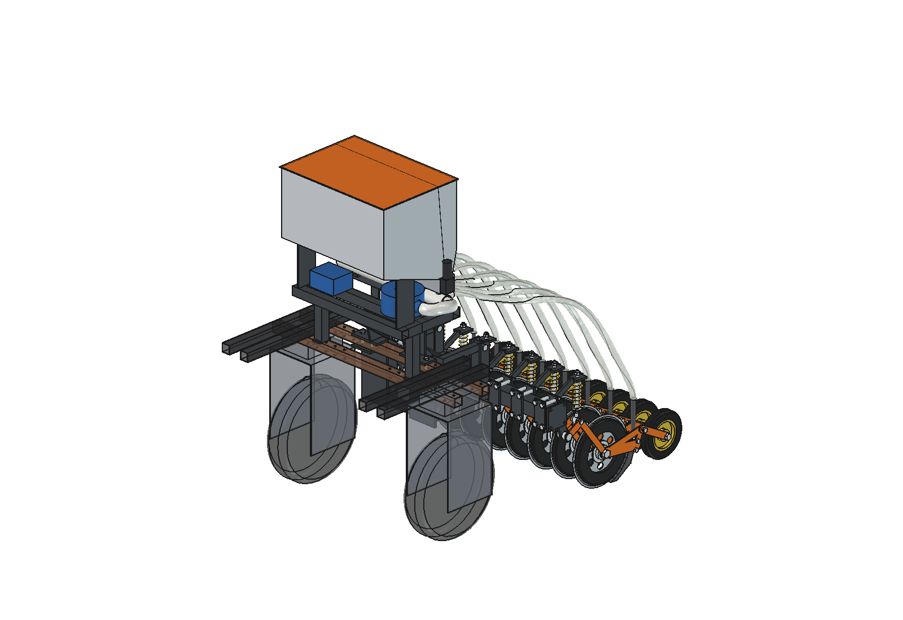</a> 
      <b><a href="overseeder/advanced/">Overseeder (advanced)</a></b> 8-row slit seeder with an air seeder
    </td>
    <td align="center" width="50%">
      <a href="overseeder/">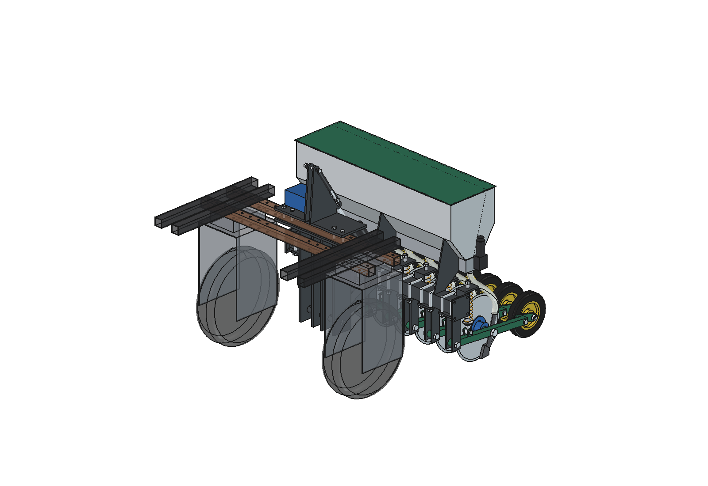</a> 
      <b><a href="overseeder/simple/">Overseeder (simple)</a></b> Angled discs with a gravity hopper
    </td>
  </tr>
  <tr>
    <td align="center">
       
      <b><a href="liquid%20fertilizer%20applicator/">Liquid fertilizer applicator</a></b> Disc and knife units on spring arms
    </td>
    <td align="center">
       
      <b><a href="dockweed%20drill/">Dockweed drill</a></b> Finds a dock plant and mills out its root
    </td>
  </tr>
  <tr>
    <td align="center">
       
      <b><a href="liquid%20fertilizer%20applicator/precision_applicator/">Precision liquid applicator</a></b> Roller pump on the robot, discs, knives and press wheels on an actuator linkage
    </td>
    <td align="center">
       
      <b><a href="liquid%20fertilizer%20applicator/precision_applicator/roller_pump/">Roller pump</a></b> Modular peristaltic pump, 10 ml per revolution per tube
    </td>
  </tr>
  <tr>
    <td align="center">
      <a href="trencher/">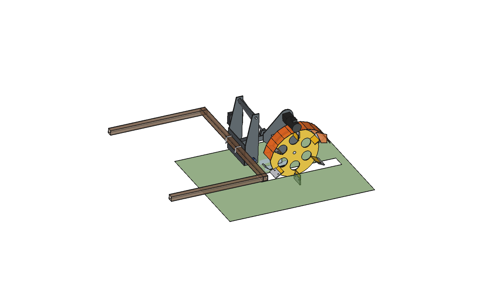</a> 
      <b><a href="trencher/">Trencher</a></b> Wheel trencher for cutting narrow trenches
    </td>
    <td align="center">
       
      <b><a href="feed%20pusher%20auger/">Feed pusher auger</a></b> Pushes feed back to the feed fence
    </td>
  </tr>
  <tr>
    <td align="center">
      <a href="brushes/simple/">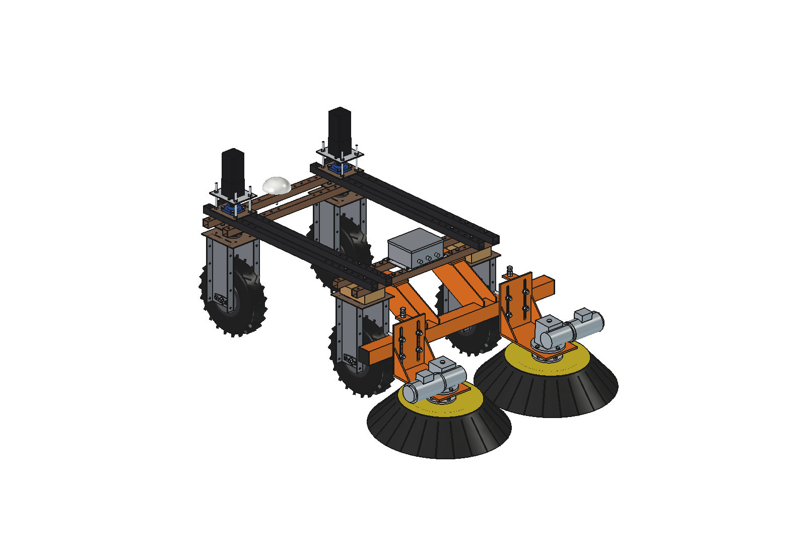</a> 
      <b><a href="brushes/">Disc brushes</a></b> 2 × Ø650/750: windrow or spread wide
    </td>
    <td align="center">
      <a href="brushes/simple/">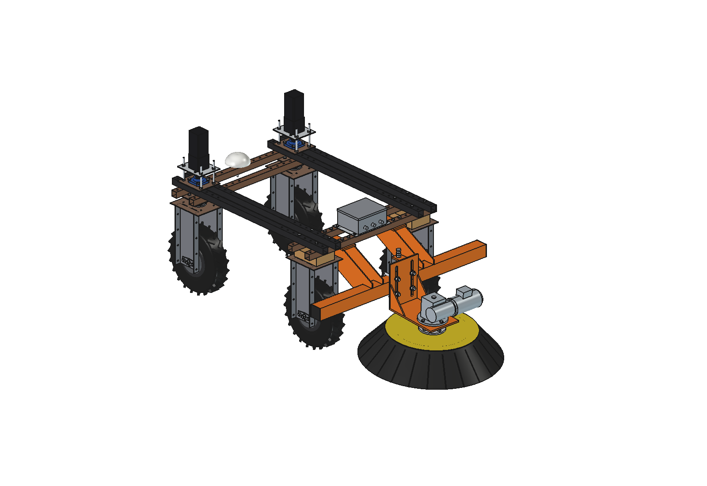</a> 
      <b><a href="brushes/simple/">Disc brush Ø850</a></b> Sweeps the robot's own width to one side
    </td>
  </tr>
  <tr>
    <td align="center">
      <a href="marker/simple/">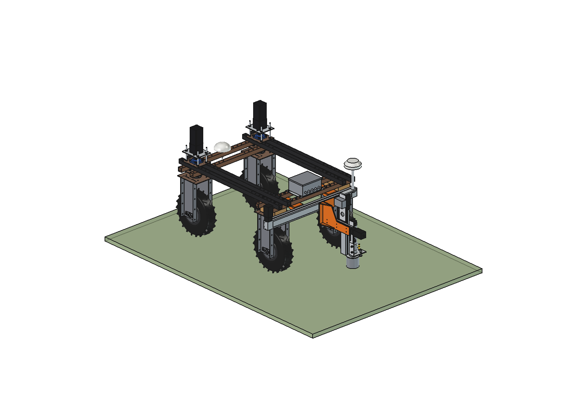</a> 
      <b><a href="marker/">Field marker</a></b> Marks GPS points with paint, via an XYZ stage
    </td>
    <td align="center">
      <a href="marker/simple/">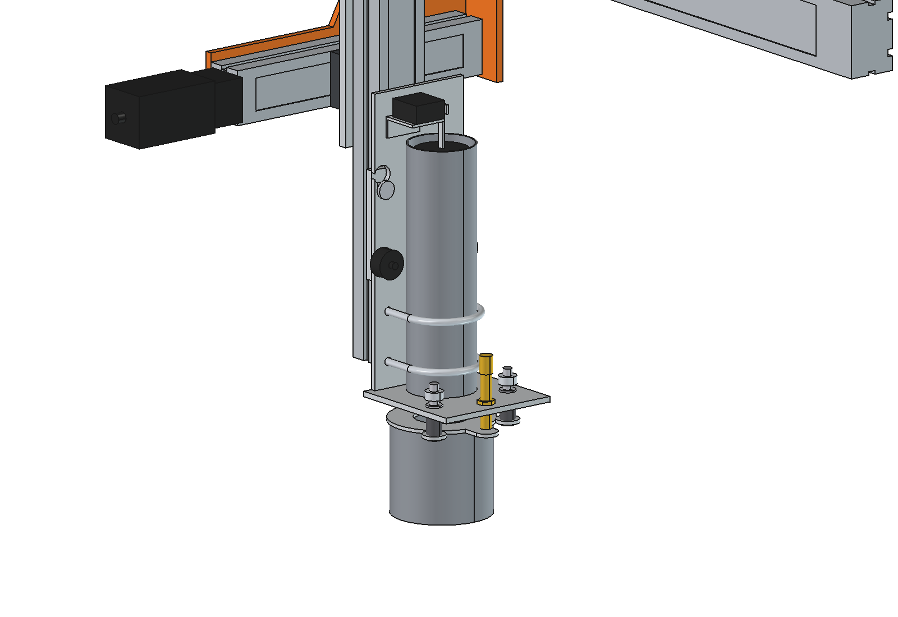</a> 
      <b><a href="marker/simple/">Field marker paint head</a></b> Spray can, servo and a sprung shroud that senses the ground
    </td>
  </tr>
  <tr>
    <td align="center">
       
      <b><a href="mobile%20refiller/">Mobile refiller</a></b> Support robot: 515 l, boom with spout, powered trailer
    </td>
    <td align="center">
       
      <b><a href="mobile%20refiller/liquid/">Mobile refiller, docked</a></b> RTK antenna on the spout, camera checks the funnel
    </td>
  </tr>
  <tr>
    <td align="center">
       
      <b><a href="mobile%20refiller/simple/">Mobile refiller (simple)</a></b> Standard 1000 l IBC, pump, mast with a hanging hose
    </td>
    <td align="center">
       
      <b><a href="mobile%20refiller/simple/">Mobile refiller (simple), refill</a></b> Inside the U-turn: the working robot stops under the nozzle
    </td>
  </tr>
  <tr>
    <td align="center">
       
      <b><a href="mobile%20refiller/stationary/">Stationary refill station</a></b> IBC trailer (1 or 2 IBCs): the working robot drives to it
    </td>
    <td align="center">
       
      <b><a href="mobile%20refiller/stationary/">Stationary refill station, flat wagon</a></b> 6 IBCs on a standard bale wagon; also a three-point frame
    </td>
  </tr>
  <tr>
    <td align="center">
      <a href="around_pole_mower/simple/">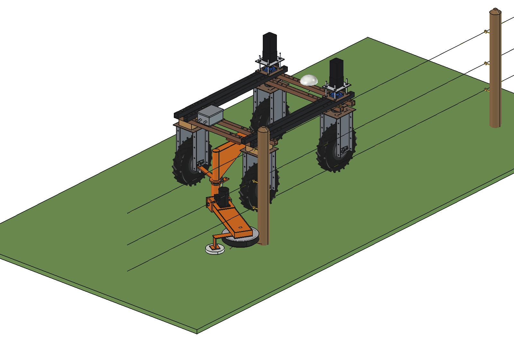</a> 
      <b><a href="around_pole_mower/">Around-pole fence mower</a></b> String head under the electric fence, swings around the posts
    </td>
    <td align="center">
      <a href="around_pole_mower/simple/">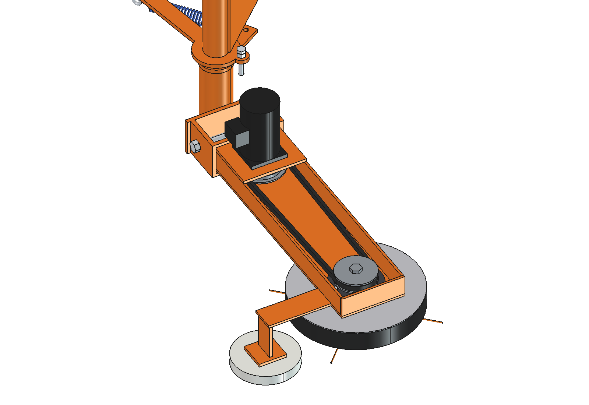</a> 
      <b><a href="around_pole_mower/simple/">Fence mower arm</a></b> 48 V motor, V-belt in the arm, deck spindle, PE guard ring
    </td>
  </tr>
  <tr>
    <td align="center">
       
      <b><a href="weed%20picker/">Weed picker</a></b> Twin-rotor mowing deck: cuts thistles, ragwort and dock into one windrow
    </td>
    <td align="center">
       
      <b><a href="weed%20picker/mowing_deck/">Weed picker linkage</a></b> Parallel linkage, actuator with float link: cut height 100–400 mm
    </td>
  </tr>
  <tr>
    <td align="center">
       
      <b><a href="irrigation/">Irrigation hose reel</a></b> 150 m lay-flat hose, laid out empty, floods a 4 m strip at 0.17 bar
    </td>
    <td align="center">
       
      <b><a href="irrigation/stationary%20+%20roller/">Hose reel pinch rollers</a></b> Clamp the hose shut while irrigating, squeeze it empty while winding
    </td>
  </tr>
  <tr>
    <td align="center">
       
      <b><a href="spotspray%20unit/">Spot sprayer</a></b> Camera in front, 120 l tank, 3.75 m boom with 15 PWM nozzles
    </td>
    <td align="center">
       
      <b><a href="spotspray%20unit/boom/">Spot sprayer, wings folded</a></b> Each 1.25 m wing folds up in 3.2 s, also in the field
    </td>
  </tr>
  <tr>
    <td align="center">
       
      <b><a href="cauliflower%20applicator/simple/">Cauliflower root-crown applicator</a></b> 2 floating row units, pulsed drop nozzles beside every stem
    </td>
    <td align="center">
       
      <b><a href="cauliflower%20applicator/simple/">Cauliflower applicator, row unit</a></b> Parallelogram on skids, leaf lifters, 2 solenoid valves per row
    </td>
  </tr>
  <tr>
    <td align="center">
       
      <b><a href="in%20row%20weeder/">In-row finger weeder</a></b> 2 rows of broccoli, a stepper-driven finger per row, camera under the robot
    </td>
    <td align="center">
       
      <b><a href="in%20row%20weeder/finger/">In-row weeder knives</a></b> One knife out beside a plant, the other in the row line
    </td>
  </tr>
  <tr>
    <td align="center">
      <a href="bandrake/electric/">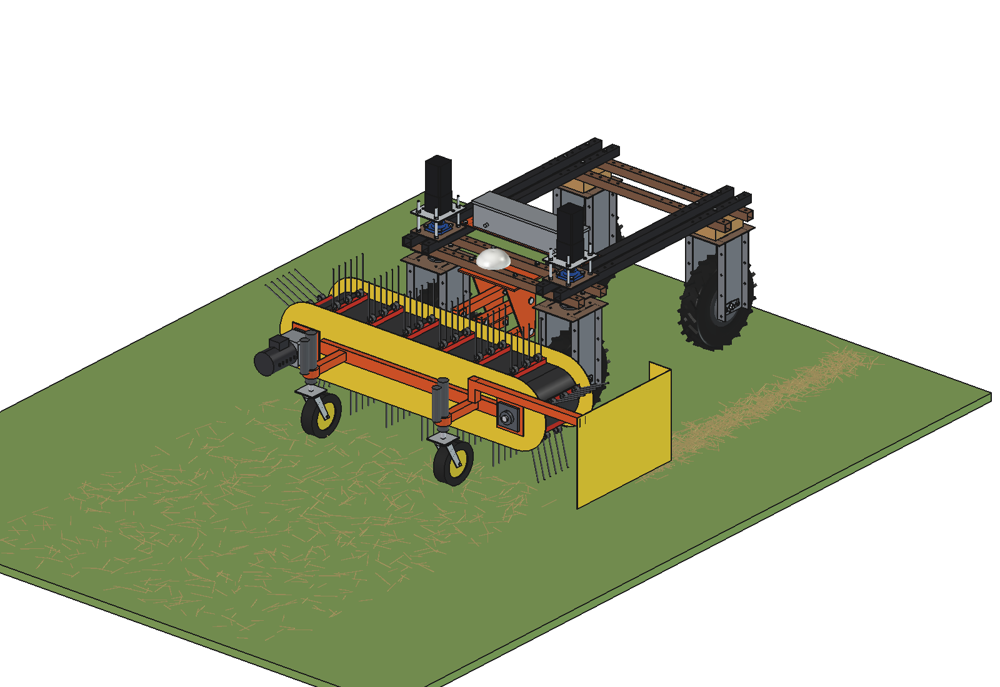</a> 
      <b><a href="bandrake/">Electric belt rake</a></b> 1.5 m, 48 V drive, castors on actuators: one windrow from outside to inside
    </td>
    <td align="center">
      <a href="bandrake/electric/">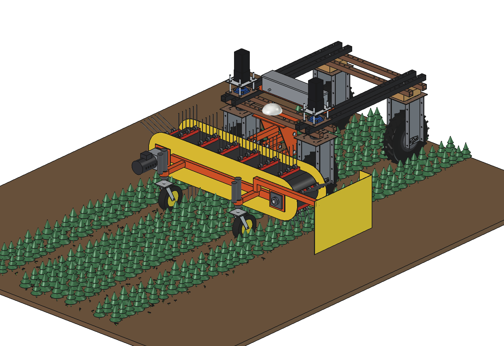</a> 
      <b><a href="bandrake/electric/">Belt rake in a nursery bed</a></b> Combs out weed seedlings between young trees
    </td>
  </tr>
  <tr>
    <td align="center">
       
      <b><a href="weeds%20burner/">Flame weeder</a></b> Hooded 1.5 m, 6 burners, 2 × 18 kg propane on the robot
    </td>
    <td align="center">
       
      <b><a href="weeds%20burner/propane_hood/">Flame weeder, flames</a></b> Pre-emergence: burns the seedlings on a freshly sown bed
    </td>
  </tr>
  <tr>
    <td align="center">
       
      <b><a href="sickle%20bar%20mower/">Triple sickle bar mower</a></b> 1.25 m in front + 2 × 1.0 m wings in the middle: 3.25 m
    </td>
    <td align="center">
       
      <b><a href="sickle%20bar%20mower/triple/">Sickle bar mower, transport</a></b> Front bar up 300 mm, wings folded up: 1.59 m wide
    </td>
  </tr>
  <tr>
    <td align="center">
       
      <b><a href="push%20blade/simple/">Push blade</a></b> Dozer / grader blade, angle +-25 degrees, rubber edge
    </td>
    <td align="center">
       
      <b><a href="fertilizer%20spreader/simple/">Fertilizer spreader</a></b> 88 l hopper, metering roller, spinning disc
    </td>
  </tr>
  <tr>
    <td align="center">
       
      <b><a href="grassland%20harrow/simple/">Grassland harrow</a></b> Levelling board and spring tines: molehills, moss
    </td>
    <td align="center">
       
      <b><a href="soil%20sampler/simple/">Soil sampler</a></b> Gouge on a ball-screw Z axis, 10-cup carousel
    </td>
  </tr>
  <tr>
    <td align="center">
       
      <b><a href="inter%20row%20hoe/simple/">Inter-row hoe</a></b> Camera-steered side shift +-75 mm, 2 units at 75 cm
    </td>
    <td align="center">
       
      <b><a href="grassland%20aerator/simple/">Grassland aerator</a></b> Slitter roller between the axles, 1.2 m, 70 mm deep
    </td>
  </tr>
  <tr>
    <td align="center">
       
      <b><a href="three%20point%20hitch/simple/">Three-point hitch</a></b> Category 0, electric lift rods, with a 5-tine cultivator
    </td>
    <td align="center">
       
      <b><a href="crate%20carrier/simple/">Crate carrier</a></b> 8 harvest crates, follow-me by UWB
    </td>
  </tr>
  <tr>
    <td align="center">
      <a href="counterweights/simple/">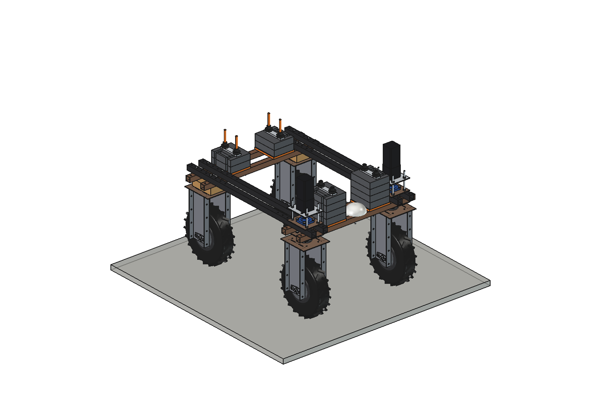</a> 
      <b><a href="counterweights/simple/">Counterweights</a></b> Stackable 11 kg plates, front and rear, no tools
    </td>
    <td align="center">
       
      <b><a href="battery%20pack/simple/">Battery pack</a></b> 2 x 2.56 kWh LiFePO4 pods between the wheels
    </td>
  </tr>
  <tr>
    <td align="center">
      <a href="solar/">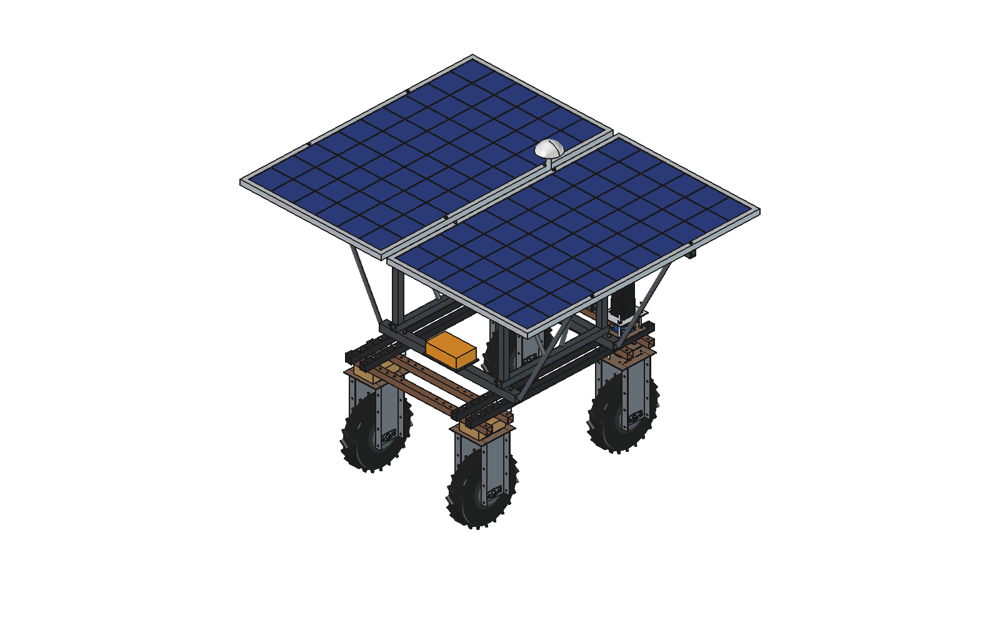</a> 
      <b><a href="solar/">Solar canopy</a></b> 2 panels, 640 Wp, MPPT, GNSS on the roof
    </td>
    <td align="center">
       
      <b><a href="compost%20spreader/simple/">Compost spreader</a></b> Moving-floor bin and beater, 150 kg, 1..3 kg/m2
    </td>
  </tr>
  <tr>
    <td align="center">
       
      <b><a href="stone%20picker/simple/">Stone picker</a></b> Tine rotor and sieve basket between the axles
    </td>
    <td align="center">
       
      <b><a href="mulch%20layer/simple/">Mulch layer</a></b> Foil roll, press wheels and covering discs on the hitch
    </td>
  </tr>
  <tr>
    <td align="center">
       
      <b><a href="grass%20meter/simple/">Grass meter</a></b> NDVI boom and sledge plate meter, dry-matter maps
    </td>
    <td align="center">
       
      <b><a href="soil%20compaction%20meter/simple/">Soil compaction meter</a></b> Cone penetrometer to 600 mm with load cell and moisture probe
    </td>
  </tr>
  <tr>
    <td align="center">
       
      <b><a href="charging%20dock/simple/">Charging dock</a></b> Contact dock with a 1 kW charger, catches 75 mm
    </td>
    <td align="center">
       
      <b><a href="uv%20mildew%20light/simple/">UV-C mildew light</a></b> UV-C hood between the axles, night work against mildew
    </td>
  </tr>
  <tr>
    <td align="center">
       
      <b><a href="sawdust%20spreader/simple/">Sawdust spreader</a></b> Bin, cross auger and side spinner for cubicles
    </td>
    <td align="center">
       
      <b><a href="bedding%20rake/simple/">Bedding rake</a></b> Side-arm tine rotor for cubicle beds
    </td>
  </tr>
  <tr>
    <td align="center">
       
      <b><a href="dumper%20barrow/simple/">Dumper barrow</a></b> Tipping skip, 353 l, tips 48 degrees
    </td>
    <td align="center">
       
      <b><a href="biocontrol%20spreader/simple/">Biocontrol spreader</a></b> Hoppers and blower for predatory mites
    </td>
  </tr>
  <tr>
    <td align="center">
       
      <b><a href="bag%20trailer/simple/">Bag trailer</a></b> 12 bags of 25 kg on the tow ball
    </td>
    <td align="center">
       
      <b><a href="broom%20sweeper/simple/">Broom / sweeper</a></b> Angle broom O400 x 1000 on the push-blade lift
    </td>
  </tr>
  <tr>
    <td align="center">
       
      <b><a href="lime%20spreader/simple/">Lime spreader</a></b> 178 l centre hopper, 1.3 m drop auger
    </td>
    <td align="center">
       
      <b><a href="cover%20crop%20undersower/simple/">Cover crop undersower</a></b> 3 seed bands between the crop rows
    </td>
  </tr>
  <tr>
    <td align="center">
       
      <b><a href="straw%20spreader/simple/">Straw spreader</a></b> 2 small bales to a mulch strip
    </td>
    <td align="center">
       
      <b><a href="electric%20weeder/simple/">Electric weeder</a></b> 5 kV comb, HV only on a weed
    </td>
  </tr>
  <tr>
    <td align="center">
       
      <b><a href="hydraulic%20pump/simple/">Hydraulic power pack</a></b> 11 l/min at 150 bar, 2 valve sections
    </td>
    <td align="center">
       
      <b><a href="irrigation%20pump/simple/">Irrigation pump</a></b> Self-priming pump with suction reel
    </td>
  </tr>
  <tr>
    <td align="center">
       
      <b><a href="overseeding/">Cambridge roll and overseeder</a></b> Trailed on a 50 mm tow ball, seed only over bare patches
    </td>
    <td align="center">
      <a href="Hybrid/">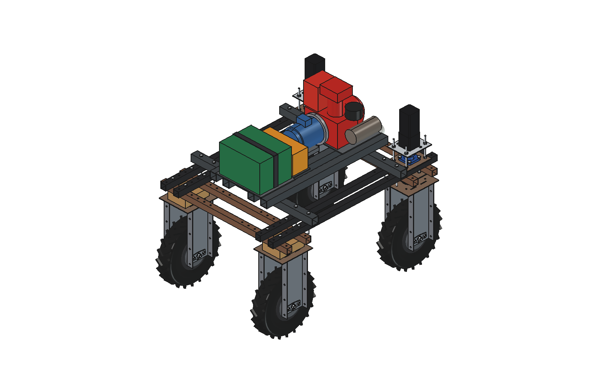</a> 
      <b><a href="Hybrid/">Hybrid range extender</a></b> 212 cc petrol engine and 3 kW generator charge the battery
    </td>
  </tr>
  <tr>
    <td align="center">
       
      <b><a href="disease%20scout/potato/">Potato disease scout</a></b> 3.0 m camera hood, 10 cameras and LED flash over 4 rows
    </td>
    <td align="center">
       
      <b><a href="disease%20scout/potato/">Disease scout, folded</a></b> Wings swing forward round a kingpin: 1.20 m wide
    </td>
  </tr>
  <tr>
    <td align="center">
       
      <b><a href="magnet%20sweeper/simple/">Magnet sweeper</a></b> Flat NdFeB magnet 20 mm over the grass picks up loose iron
    </td>
    <td align="center">
       
      <b><a href="magnet%20sweeper/simple/">Magnet sweeper, release</a></b> Core lifted 100 mm: the iron drops into a flat tray
    </td>
  </tr>
  <tr>
    <td align="center">
       
      <b><a href="drop%20on%20demand%20boom/simple/">Drop-on-demand boom</a></b> Hood under the belly: camera, LEDs and 24 drop injectors
    </td>
    <td align="center">
       
      <b><a href="drop%20on%20demand%20boom/simple/">Drop-on-demand, inside</a></b> 5 ul drops at 25 mm pitch, ~3 l/ha instead of 200
    </td>
  </tr>
  <tr>
    <td align="center">
       
      <b><a href="hot%20foam%20weeder/simple/">Hot foam weeder</a></b> 96 C water with foam under the flame-weeder hood
    </td>
    <td align="center">
       
      <b><a href="hot%20foam%20weeder/simple/">Hot foam, rear rack</a></b> 40 kW propane coil boiler, pump and foam doser
    </td>
  </tr>
  <tr>
    <td align="center">
       
      <b><a href="metal%20detector/simple/">Metal detector</a></b> 600 x 400 PI coil on a floating GFRP boom, a GNSS point per hit
    </td>
    <td align="center">
       
      <b><a href="metal%20detector/simple/">Metal detector, root</a></b> Steel only behind the pivot; 500 N actuator with a float slot
    </td>
  </tr>
  <tr>
    <td align="center">
       
      <b><a href="debris%20vacuum/simple/">Debris vacuum</a></b> Nozzle with brush, O125 hose, 270 l bin with a clean-air fan
    </td>
    <td align="center">
       
      <b><a href="debris%20vacuum/simple/">Debris vacuum, side</a></b> Litter and solar-panel glass up the hose, never through the fan
    </td>
  </tr>
  <tr>
    <td align="center">
       
      <b><a href="biostimulant%20sprayer/simple/">Biostimulant sprayer</a></b> Spot-sprayer boom, all nozzles open, coarse tips, weather mast
    </td>
    <td align="center">
       
      <b><a href="biostimulant%20sprayer/simple/">Biostimulant, aerator</a></b> Air pump and diffuser ring keep compost tea aerobic
    </td>
  </tr>
  <tr>
    <td align="center">
       
      <b><a href="fence%20inspector/simple/">Fence inspector</a></b> Contactless voltage and current per metre along an electric fence
    </td>
    <td align="center">
       
      <b><a href="fence%20inspector/simple/">Fence inspector, rear view</a></b> Head 80 mm from the wire, any height 300-1100 mm
    </td>
  </tr>
  <tr>
    <td align="center">
       
      <b><a href="drinker%20check/simple/">Drinking trough check</a></b> Level, photo and top-up from a 160 l tank
    </td>
    <td align="center">
       
      <b><a href="drinker%20check/simple/">Trough check, driving</a></b> Head up, arm swung back along the robot
    </td>
  </tr>
  <tr>
    <td align="center">
       
      <b><a href="soil%20moisture%20placer/simple/">Soil moisture sensor placer</a></b> Soil-sampler Z axis with a gripper and a star of 6 sensors
    </td>
    <td align="center">
       
      <b><a href="soil%20moisture%20placer/simple/">Sensor placed</a></b> O20 x 300 stem pushed in by the robot's weight
    </td>
  </tr>
  <tr>
    <td align="center">
       
      <b><a href="mole%20mapper/simple/">Mole and tunnel mapper</a></b> Cameras map fresh hills over 2.5 m
    </td>
    <td align="center">
       
      <b><a href="mole%20mapper/simple/">Mole mapper, tunnel probe</a></b> Cone resistance drops in a tunnel
    </td>
  </tr>
  <tr>
    <td align="center">
       
      <b><a href="windbreak%20inspector/simple/">Windbreak inspector</a></b> Lidar profile and photos of a row, per tree
    </td>
    <td align="center">
       
      <b><a href="windbreak%20inspector/simple/">Windbreak inspector, head</a></b> 2D lidar, stereo pair and crown camera at 2.1 m
    </td>
  </tr>
  <tr>
    <td align="center">
       
      <b><a href="tray%20setter/simple/">Tray setter</a></b> Gantry picks plugs from 2 trays, drop tubes to 2 shoes
    </td>
    <td align="center">
       
      <b><a href="tray%20setter/simple/">Tray setter, planting units</a></b> Runner shoe and 2 tilted press wheels per row
    </td>
  </tr>
  <tr>
    <td align="center">
       
      <b><a href="yield%20estimator/simple/">Yield estimator</a></b> Counts and sizes every head in 4 rows
    </td>
    <td align="center">
       
      <b><a href="yield%20estimator/simple/">Yield estimator, sensors</a></b> RGB, ToF depth and LED flash on the bridge
    </td>
  </tr>
  <tr>
    <td align="center">
      <a href="speaker/simple/">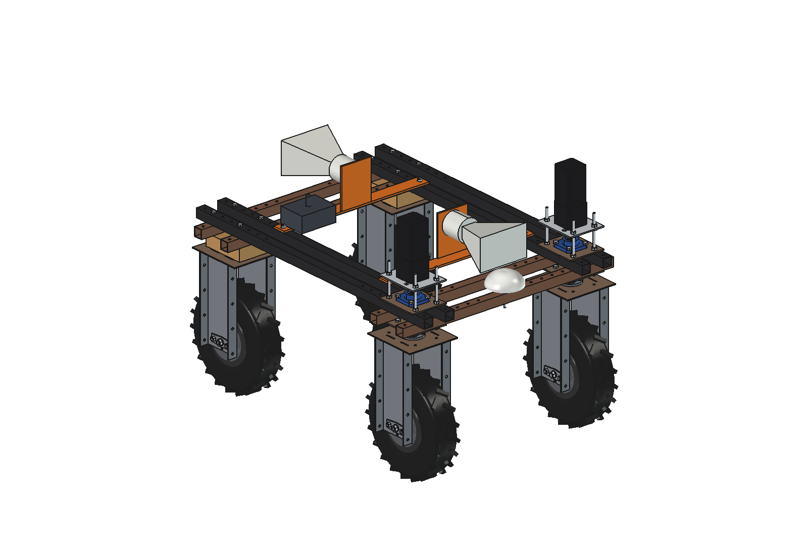</a> 
      <b><a href="speaker/simple/">Speech speaker</a></b> Horns front and rear, volume follows the distance
    </td>
    <td align="center">
      <a href="speaker/simple/">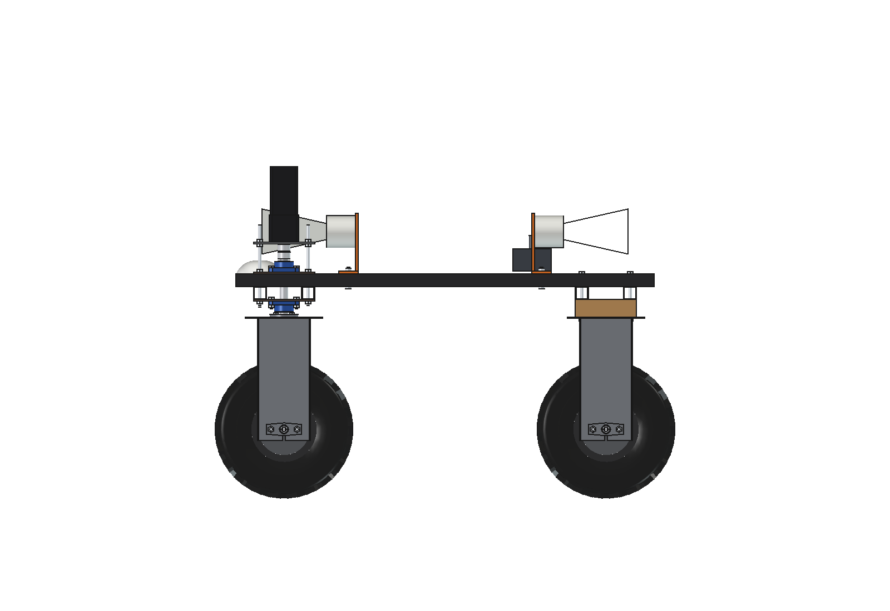</a> 
      <b><a href="speaker/simple/">Speech speaker, side</a></b> Front horn over the GNSS dome
    </td>
  </tr>
  <tr>
    <td align="center">
       
      <b><a href="laser%20weeder/simple/">Laser weeder</a></b> Galvo heads under a light-tight hood
    </td>
    <td align="center">
       
      <b><a href="laser%20weeder/simple/">Laser weeder, laser box</a></b> 2 x 60 W diode lasers, fibres down to the heads
    </td>
  </tr>
  <tr>
    <td align="center">
       
      <b><a href="security%20patrol/simple/">Security patrol</a></b> 2 m mast, thermal and zoom camera on pan/tilt
    </td>
    <td align="center">
       
      <b><a href="security%20patrol/simple/">Security patrol, head</a></b> Zoom camera, thermal camera, IR light
    </td>
  </tr>
  <tr>
    <td align="center">
       
      <b><a href="seat%20frame%20extension/simple/">Seat and canopy</a></b> Ride and drive by hand: seat switch, joystick, e-stop, roll bar
    </td>
    <td align="center">
       
      <b><a href="seat%20frame%20extension/simple/">Frame extensions</a></b> Rear pair of cross tubes to x +-800 for wide implements
    </td>
  </tr>
  <tr>
    <td align="center">
       
      <b><a href="pheromone%20trap%20service/simple/">Pheromone trap service</a></b> Pulls out the trap drawer, photographs the card
    </td>
    <td align="center">
       
      <b><a href="pheromone%20trap%20service/simple/">Pheromone trap service, head</a></b> Lure revolver pushes a new capsule into the clip
    </td>
  </tr>
  <tr>
    <td align="center">
       
      <b><a href="drone%20combination/simple/">Drone combination</a></b> Landing platform and charger on the robot
    </td>
    <td align="center">
       
      <b><a href="drone%20combination/simple/">Drone platform, top</a></b> Guide wedges, charging strips, AprilTag
    </td>
  </tr>
  <tr>
    <td align="center">
       
      <b><a href="chicken%20house%20robot/simple/">Chicken house robot</a></b> Litter turning, climate and flock watch
    </td>
    <td align="center">
       
      <b><a href="chicken%20house%20robot/simple/">Chicken house robot, rotor</a></b> Spring tines instead of bristles
    </td>
  </tr>
  <tr>
    <td align="center">
       
      <b><a href="charging%20robot/simple/">Charging robot</a></b> Mobile charger, a working robot docked behind
    </td>
    <td align="center">
       
      <b><a href="charging%20robot/simple/">Charging robot, deck</a></b> 4 pods (10.2 kWh) and a 1.5 kW DC/DC
    </td>
  </tr>
  <tr>
    <td align="center">
       
      <b><a href="swarm%20operation/simple/">Swarm operation</a></b> Units share the passes of one field
    </td>
    <td align="center">
       
      <b><a href="swarm%20operation/simple/">Swarm kit</a></b> Mesh radio and status light tower
    </td>
  </tr>
  <tr>
    <td align="center">
       
      <b><a href="heavy%20duty%20motors/simple/">Heavy-duty motors</a></b> Bought 2 kW tool motor on a quick-change plate, 48 V bus
    </td>
    <td align="center">
       
      <b><a href="heavy%20duty%20motors/simple/">Motor module</a></b> Dovetail receiver and lock pin, demonstrator mower deck
    </td>
  </tr>
</table>

## Animations

The advanced designs are animated on the real robot model, with the loads and forces calculated per frame. The GIFs
are generated and are **not in git** (too large): build them with `animate_
.render_all(folder)` and
`make_gif_
.main(folder, "previews/....gif")` in the variant folder. Every `make_gif_
.py` also copies its GIF to
`animations/` in the repository root, so all animations end up together there; `python collect_animations.py` copies
any GIF that is still missing.

| Implement | What the animation shows | File in `animations/` |
|---|---|---|
| [Liquid fertilizer applicator](liquid%20fertilizer%20applicator/concept%20versions/advanced/) | every element follows the bumpy ground on its own arm (also for simple and simple v2) | `liquid fertilizer applicator concept versions advanced - animation_strip_ground_following.gif` |
| [Precision liquid applicator V2](liquid%20fertilizer%20applicator/precision_applicator/combined_v2/) | the actuator lowers the discs and knives, the roller pump follows the speed and the press wheels close the slot | `liquid fertilizer applicator precision_applicator combined_v2 - animation_inject_press_strip.gif` |
| [Precision liquid applicator V3](liquid%20fertilizer%20applicator/precision_applicator/combined_v3/) | double knives inject two liquids at once from the 10-section roller pump | `liquid fertilizer applicator precision_applicator combined_v3 - animation_two_liquids.gif` |
| [Roller pump](liquid%20fertilizer%20applicator/precision_applicator/roller_pump/) | the rollers squeeze the tubes, 5 and 10 sections | `liquid fertilizer applicator precision_applicator roller_pump 5ch - animation_pump_running.gif` |
| [Feed pusher auger](feed%20pusher%20auger/V1/) | pushing feed back to the fence, with the forces on the auger and the robot's reaction | `feed pusher auger V1 - animation_feed_pushing.gif` |
| [Dockweed drill](dockweed%20drill/v4/) | finds three dock plants and mills out the roots (v1 to v4; v2 also mows nettles) | `dockweed drill v4 - animation_three_plants.gif` |
| [Disc brushes](brushes/simple/) | two Ø750 brushes turn inwards and sweep loose material into a windrow (also spreading and the single Ø850) | `brushes simple - animation_windrow_double_750.gif` |
| [Field marker](marker/simple/) | the robot stops a few centimetres off, the stage puts the nozzle exactly on each point | `marker simple - animation_staking_out.gif` |
| [Mobile refiller](mobile%20refiller/liquid/) | tops up the working robot in the straight part of its turn, while both drive | `mobile refiller liquid - animation_refill_in_turn.gif` |
| [Mobile refiller (simple)](mobile%20refiller/simple/) | the working robot stops under the hanging nozzle in the middle of its U-turn | `mobile refiller simple - animation_refill_in_u_turn.gif` |
| [Stationary refill station](mobile%20refiller/stationary/ibc_trailer/) | the working robot drives to the IBC trailer to refill (also flat wagon and three-point frame) | `mobile refiller stationary ibc_trailer - animation_refill_visit.gif` |
| [Around-pole fence mower](around_pole_mower/simple/) | the post pushes the head back and in, it slides around and the spring swings it back behind the post | `around_pole_mower simple - animation_around_posts.gif` |
| [Weed picker](weed%20picker/mowing_deck/) | two rotors throw the chopped weed into one windrow; slows down in thick weed and raises the cut height | `weed picker mowing_deck - animation_topping_windrow.gif` |
| [Irrigation hose reel](irrigation/stationary%20+%20roller/) | lays the empty hose, the pump floods a 4 m strip, the hose runs empty and is wound up again | `irrigation stationary + roller - animation_one_strip.gif` |
| [Spot sprayer](spotspray%20unit/boom/) | only the nozzles above a dock open; the right wing folds up for a fence post | `spotspray unit boom - animation_spot_spraying.gif` |
| [In-row finger weeder](in%20row%20weeder/finger/) | each stepper swings its knife out around every broccoli plant and back into the row line | `in row weeder finger - animation_in_row_weeding.gif` |
| [In-row weeder, double arms](in%20row%20weeder/double_arm/) | two knives per row open to both sides of every plant and close behind it | `in row weeder double_arm - animation_double_arm_weeding.gif` |
| [Electric belt rake](bandrake/electric/) | the tines carry the litter into one windrow; at the headland the castor actuators lift the rake | `bandrake electric - animation_raking_windrow.gif` |
| [Flame weeder](weeds%20burner/propane_hood/) | six burners under the hood kill the seedlings on a sown bed; pilot flames only when stopped | `weeds burner propane_hood - animation_flaming_bed.gif` |
| [Triple sickle bar mower](sickle%20bar%20mower/triple/) | three double-knife bars mow a 3.25 m strip; at the headland the front bar lifts and the wings fold up | `sickle bar mower triple - animation_mow_fold.gif` |
| [Overseeder with Cambridge roll](overseeding/overseeder%20with%20cambridge%20roll/) | the camera switches the seeder on over bare patches, the roll presses the seed in | `overseeding overseeder with cambridge roll - animation_spot_seeding.gif` |
| [Potato disease scout](disease%20scout/potato/) | the hood photographs 4 potato rows, suspect plants appear in the map; at the headland both wings swing forward to 1.20 m | `disease scout potato - animation_potato_scouting.gif` |
| [Drop-on-demand boom](drop%20on%20demand%20boom/simple/) | the hood camera finds the weeds in a lettuce bed, only the injectors above them fire single drops; weeds too close to the crop are left | `drop on demand boom simple - animation_drop_on_demand.gif` |
| [Hot foam weeder](hot%20foam%20weeder/simple/) | the foam bar lays hot foam over a paved path; weeds under it heat up and die after 2 s | `hot foam weeder simple - animation_hot_foam.gif` |

## Implements

| Implement | Variants | What it does |
|---|---|---|
| [**Overseeder**](overseeder/) | [simple](overseeder/simple/) · [advanced](overseeder/advanced/) | Grassland slit seeder. 1 m modules with 8 rows at 125 mm and coupling flanges. Cuts a 15 mm slot, places seed about 12 mm deep and closes the slot with a sprung press wheel. Simple: angled single disc, gravity hopper, about €1,675 in parts. Advanced: parallel linkage, depth bands, curved seed coulter and an air seeder, about €2,280 |
| [**Cambridge roll and overseeder**](overseeding/) | [Cambridge roll](overseeding/cambridge%20roll/) · [overseeder (drop seeder)](overseeding/overrseeder/) · [combination](overseeding/overseeder%20with%20cambridge%20roll/) | Simple trailed lawn-repair implements on a 50 mm tow ball under the rear beams. Cambridge roll: 20 cast-iron rings Ø280 on a Ø40 shaft, 1 m, 178 kg, 100 … 250 N draft, about €850 with the hitch. Overseeder: 1 m drop seeder, 49 l hopper, fluted roller on a 24 V worm gearmotor that a camera switches on only over bare soil, two small wheels, about €500. Combination: the seeder unit hangs between the arms of the roll, seed falls 300 mm in front of the rings and is rolled in; 216 kg, about €1,200. Includes the turn kinematics of the trailer and an animation with bare patches |
| [**Liquid fertilizer applicator**](liquid%20fertilizer%20applicator/) | [simple](liquid%20fertilizer%20applicator/concept%20versions/simple/) · [simple v2](liquid%20fertilizer%20applicator/concept%20versions/simple_v2/) · [advanced](liquid%20fertilizer%20applicator/concept%20versions/advanced/) · **precision (production):** [roller pump](liquid%20fertilizer%20applicator/precision_applicator/roller_pump/) · [applicator](liquid%20fertilizer%20applicator/precision_applicator/applicator/) · [applicator V2](liquid%20fertilizer%20applicator/precision_applicator/applicator_v2/) · [on the robot](liquid%20fertilizer%20applicator/precision_applicator/combined/) · [V2 on the robot](liquid%20fertilizer%20applicator/precision_applicator/combined_v2/) · [applicator V3](liquid%20fertilizer%20applicator/precision_applicator/applicator_v3/) · [V3 on the robot](liquid%20fertilizer%20applicator/precision_applicator/combined_v3/) | Injects liquid fertilizer into the soil. Simple: fixed knives, two gauge wheels and a 12 V pump, about €600 in parts. Simple v2: adds a cutting disc in front of each knife, about €900. Advanced: disc and knife units on spring arms, a ground-wheel-driven 5-channel peristaltic pump and a parallel linkage. Precision (the first production version, built with Herre Bartlema, from measured parts): a modular roller pump on the robot (10 ml per revolution per tube, stepper-driven, follows the speed), Ø 325 discs with injector knives behind them on a parallel linkage with an electric actuator, 5 rows or 2 rows in the middle; V2 adds a press wheel behind every knife that closes the slot; V3 has 5 rows of trailing double knives and a 10-section pump for two liquids at once. Includes the hoses and an animation on the robot |
| [**Feed pusher auger**](feed%20pusher%20auger/) | [V1](feed%20pusher%20auger/V1/) · [V2](feed%20pusher%20auger/V2/) · [V3](feed%20pusher%20auger/V3/) | Pushes feed back to the feed fence. Ø320 auger under a folded 2 mm hood, 24 V gearmotor with chain drive, open discharge end, on the rear flange holes of the rear wheel modules; feed-transport model and force animation. V2: no through shaft, the auger hangs on a pin strap with bearings inside and slides out through the end plate, M6 shear bolt in the drive bush. V3: V2 with the existing, measured auger (Ø300 on a Ø60 core tube), M12 shear bolt and a plastic wear ring on a fixed pin instead of bearings |
| [**Disc brushes**](brushes/) | [simple](brushes/simple/) (2 × Ø650, 2 × Ø750, 1 × Ø850) | Sweeper disc brushes for loose material on concrete. Each brush on its own 48 V worm gearmotor; reverse the motors and the pair makes a windrow in the middle or spreads material wide. Units slide on U-bolts along an 80 × 80 toolbar under the rear beams. Includes an animation with a particle model of the material |
| [**Dockweed drill**](dockweed%20drill/) | [v1](dockweed%20drill/v1/) · [v2](dockweed%20drill/v2/) · [v3](dockweed%20drill/v3/) · [v4](dockweed%20drill/v4/) · [v5](dockweed%20drill/v5/) · [v6](dockweed%20drill/v6/) | Dock (broad-leaved dock) removal mill on a CNC gantry behind the robot: the robot is the Y axis, an X slide (stroke 1000 mm) and a Z axis bring a cutter Ø180 at 1500 rpm 150 mm deep into the root crown, inside a pot that lands on the sward. v1: X on HGR15 rails; v2: X on PTO tubes; v3: Z mast on corner rollers and a Ruud-style can; v4: drop-leg trailer jack as Z, gearmotor with chain; v5: motor directly on the spindle; v6: 40 x 40 frame, bolted PTO tubes, Z on HGR15 rails with a 24 V actuator, Ø30 spindle. Animations, DXF and STEP files |
| [**Trencher**](trencher/) | one design | Wheel trencher for narrow trenches. Renders and STEP export |
| [**Field marker**](marker/) | [simple](marker/simple/) | Stakes out points from a coordinate list (piles, posts, planting positions, plot corners). The robot stops roughly behind the point; an XYZ stage from bought linear modules puts a spray-paint head exactly on it, with a GNSS antenna on a mast straight above the nozzle. Sprung spray shroud senses the ground. About €1,450 in parts. The concept README lists flag, peg, punch and soil-probe heads and 20 more functions |
| [**Mobile refiller**](mobile%20refiller/) | [liquid](mobile%20refiller/liquid/) · [simple](mobile%20refiller/simple/) · [stationary](mobile%20refiller/stationary/) | Support robot that brings liquid (and in concept seed, granular fertilizer, water, batteries) to the working robots, so they never leave the field. Liquid: 268 l T-shaped tank with a pump below the liquid level, slewing boom with a trolley and a spout, RTK antenna on the spout and a camera for confirmation, powered trailer of 246 l (6 driven wheels). Tops up the working robot in the straight reverse of its headland turn while both drive: about 25 l per turn, ≈ 3 s standstill. About €6,000 in parts. Simple: a standard 1000 l IBC set on with pallet forks, pump under the IBC, fixed mast with a hanging hose and the RTK antenna above the nozzle. The working robot skips passes so that every turn is a U-turn; the refiller stands inside the turn and the working robot stops ≈ 13 s under the nozzle; 1 m further per refill. About €1,650 in parts. Stationary: refill stations that stand on the headland (IBC trailer for 1 or 2 IBCs, three-point frame, 6 IBCs on a standard flat wagon), each with its own control box (pump, motor, battery, RTK receiver) and the RTK antenna above the nozzle; the working robot drives to them for 120 l per visit. The concept README lists all uses and variants (gravity buffer, on a tractor, docking station) |
| [**Around-pole fence mower**](around_pole_mower/) | [simple](around_pole_mower/simple/) | Mows the strip under an electric fence and goes around the posts by itself. Trailing swing arm on a post behind the right rear wheel, held on a rest stop by a spring; a Ø400 nylon-string head (non-conductive, safe on wire and posts) under a guard ring cut from PE pipe 315 slides along each post. 48 V BLDC motor at the root of the arm, V-belt inside the arm to a bought lawn-tractor deck spindle; head 182 mm high, floats on an HDPE skid. ≈ 615 W at 0.5 m/s, 1.8 km of fence per hour, about €575 in parts. Includes the arm dynamics around a post and an animation with grass |
| [**Weed picker**](weed%20picker/) | [mowing deck](weed%20picker/mowing_deck/) | Tops thistles, ragwort and dock above the grass and gathers them in one windrow, no bin. Two rotors with free-swinging blades (Ø510, 990 mm cut) in front of the robot turn inwards and throw the chopped weed out of a centre discharge between the front wheels. Each rotor: a 48 V BLDC motor straight on a lawn-tractor deck spindle; the left rotor runs 24 mm higher so the blades may overlap without timing. Cut height 100–400 mm from a 4000 N actuator on a parallel linkage, with a float link for humps. ≈ 1 kW at 0.5 m/s in scattered weeds, slower in dense patches; 82 kg (counterweight at the rear advised), about €1,040 in parts |
| [**Irrigation**](irrigation/) | [stationary pump + hose reel](irrigation/stationary%20+%20roller/) | Irrigates grassland by flooding at low pressure from a petrol pump at the ditch. The robot carries a reel with 150 m of 3" lay-flat hose, lays it out empty over the field, and after the gift winds it up empty again: it never carries water. Outlets every 2 m (3.5 mm restrictor, flat drop tail) flood a 4 m strip with 7.4 m³/h at 0.17 bar, CU ≈ 99 % on level ground. Pinch rollers keep the reel dry while irrigating and squeeze the hose while winding. 122 min per strip of 500 m² at 25 mm; one robot keeps about 4 ha wet in a dry summer. 146 kg, about €1,900 in parts on the robot. Includes the hydraulics and an animation of one strip |
| [**Spot sprayer**](spotspray%20unit/) | [folding boom](spotspray%20unit/boom/) | Sprays weeds plant by plant. A wide-angle global-shutter camera on a mast in front of the robot (1.48 m, 55° down) sees the whole 3.75 m strip from 1.8 m ahead; 2.65 s later the boom behind the robot opens only the nozzles above the plant. 15 clamp-on PWM nozzle bodies at 250 mm on a stainless wet pipe, 40° flat fans at 400 mm. Centre section 1.25 m, two 1.25 m wings that fold up in 3.2 s with a 24 V actuator each, also in the field for posts and trees. 120 l tank on the robot, diaphragm pump with bypass under the rear beams; the GNSS antenna moves to the mast top. ≈ 20 l/ha at 5 % weed cover, 1.1 ha/h; 91 kg, about €3,580 in parts. Includes an animation with docks and a fence post |
| [**In-row weeder**](in%20row%20weeder/) | [finger, 2 rows](in%20row%20weeder/finger/) · [double arms](in%20row%20weeder/double_arm/) | Hoes inside two rows of broccoli (375 mm apart, the wheels in the inter-rows). Two row units under the belly, each on a parallelogram with a gauge wheel in the robot's wheel track: a NEMA 23 closed-loop stepper with a 10:1 gearbox swings a 220 mm arm with a spring-steel finger and a flat knife 20 mm deep. Between the plants the knife is in the row line; it swings out in 98 ms before each plant and back in 148 ms after it, never closer than 50 mm to a stem. A global-shutter camera with LED bars under the front beams finds the plants 0.84 s ahead. 0.5 m/s, 6,400 plants/h; 55 kg, about €2,240 in parts. Double arms: two knives per row (4 steppers) that open to both sides of each plant and close behind it, timed by the real distance to the stem: 90 % of the row band outside the safe zones hoed, 68 kg, about €2,820. Includes the stepper move, the zone around each plant and animations |
| [**Belt rake**](bandrake/) | [electric](bandrake/electric/) | Band rake in front of the robot: a 260 mm rubber belt with 15 tine bars around two drums (1.52 m working width), 48 V 750 W gearmotor on the drive drum, swath board at the left end. Combs weed seedlings out of nursery beds between young trees (10 mm deep, 0.6 m/s) or rakes moss and thatch out of grassland from the outside inwards into one windrow (1.2 m/s, 0.49 ha/h). Two swivel castors on 24 V actuators carry the 110 kg rake, set the depth and lift it 100 mm for the headland, so the robot never carries it; a free parallelogram pushes it. About €2,380 in parts. Includes the tine forces, side force on the robot and an animation |
| [**Weeds burner**](weeds%20burner/) | [propane hood](weeds%20burner/propane_hood/) | Pre-emergence flame weeder for freshly sown beds: an insulated 1.5 × 0.8 m hood behind the robot with 6 flat-flame burners (13 kg/h, 167 kW), 34 kg/ha at 0.7 m/s. Two 18 kg forklift cylinders with liquid withdrawal on the robot, a vaporiser coil inside the hood, two main solenoid valves, a motorised regulator, pilots with igniters and flame sensors; the valves close at once when the robot stops. The hood rides on two steel swivel castors, pulled by a free parallelogram, with a heat shield towards the robot. 0.84 ha per filling, gas ≈ €55/ha; 131 kg empty, about €3,400 in parts. Includes dose, gas supply, safety and an animation |
| [**Sickle bar mower**](sickle%20bar%20mower/) | [triple](sickle%20bar%20mower/triple/) | Mows grass with three double-knife cutter bars: 1.25 m in front of the robot and two 1.0 m wings in the middle of the frame, 3.25 m in one pass. One module for all three: flat bar with an RHS behind it, upper and lower knife (50 mm pitch, stroke 50, 600 rpm), a crank gearbox with two cranks 180° apart (the knife forces cancel) and a 48 V 1000 W BLDC motor. Front bar on a parallel linkage with a float link and a roll pin; the wings hang on a mid frame under the top beams and fold up with a 4000 N actuator each (anchor in a slot: they float −9° … +17°). ≈ 2.2 kW for mowing at 1 m/s, 1.0 ha/h, transport 1.59 m wide; 210 kg, of which 163 kg rests on the shoes while mowing; about €3,200 in parts. Includes the knife drive, actuator forces, axle loads and an animation |
| [**Push blade**](push%20blade/) | [simple](push%20blade/simple/) | Front-mounted dozer / grader blade: pushes feed back to the feed fence, scrapes slurry and snow, grades soil and paths (also covers the manure scraper idea). 1100 × 450 moldboard on R700 with a bolted 110 × 15 rubber edge (steel edge for soil), angle ±25° in 12.5° steps on an M30 king pin with a lock pin. Two lift arms on a front toolbar 80 × 80 under the front lower beams, 24 V 1500 N actuator with a 40 mm float slot: lifts 159 mm, the blade floats on its edge in work. Net push 801 N on dry concrete (motor-limited), 348 N with manure (grip-limited); clears the front tyres by 148 mm at 30° steering. 81 kg |
| [**Fertilizer spreader**](fertilizer%20spreader/) | [simple](fertilizer%20spreader/simple/) | Spinning-disc spreader for granular fertilizer (granular lime with a coarser roller). 88 l PE hopper over and behind the rear axle on rails on the upper beams, fluted metering roller Ø80 on a 12 V gearmotor that follows the driving speed and a task map, vaned disc Ø400 on a 48 V BLDC motor behind the robot, guard towards the robot. Driving width 4.1 … 6.7 m (500 … 900 rpm), 100 … 541 kg/ha at 1 m/s, ≈ 1.6 ha/h, 74 W at 300 kg/ha. 130 kg full; a 2 × 20 kg front counterweight keeps 24 % on the front axle |
| [**Grassland harrow**](grassland%20harrow/) | [simple](grassland%20harrow/simple/) | Pasture harrow behind the robot (also covers the molehill spreader idea): an angle-iron levelling board spreads molehills and dung pats, 32 double spring tines Ø8 in two rows (a track every 37.5 mm) rake out moss and work seed in. 1.3 m, floats on the sward, lifted by a 24 V actuator on two arms from a rear toolbar (the push blade geometry, mirrored). Pull 629 N on grass, grip margin 1.44, 0.56 ha/h at 1.5 m/s. 85 kg |
| [**Soil sampler**](soil%20sampler/) | [simple](soil%20sampler/simple/) | Takes soil cores at GPS points from the middle of the robot, so the whole robot weight pushes. SBR20 rails and an SFU1605 ball screw with a NEMA23 on a mast plate between two bridges on the upper beams; Ø25 gouge with an ejector rod, sprung foot that senses the ground, swing chute and funnel; carousel of 10 cups of 1.3 l, one composite sample of 40 cores per plot. 0-10 cm grass needs 0.5 … 0.8 kN (1.3 kN available), 38 s per core, 25 min per plot. 33 kg |
| [**Inter-row hoe**](inter%20row%20hoe/) | [simple](inter%20row%20hoe/simple/) | Single-axis guided hoe for row crops (maize at 75 cm): the robot straddles a row, two hoe units work the two inter-rows behind the wheels (and loosen the wheel tracks). Rear toolbar and lift arms of the grassland harrow with a 24 V 3000 N actuator; a carrier with 2 HGR15 rails carries an 8 mm shift plate that an SFU1610 ball screw and a closed-loop NEMA23 move ±75 mm at 80 mm/s. Each unit hangs on a parallelogram with a gauge wheel Ø250 and has a goosefoot 250 and two L-blades with the wall on the row side: 550 mm hoed, 100 mm left each side of the row. A camera on the shift plate looks straight down at the middle row and closes the loop (RTK row map as fallback). 1.5 m per pass, ~0.43 ha/h at 1 m/s; pull 764 N at 20 mm deep (grip margin 1.23). 119 kg; needs the 2 × 20 kg front counterweight (front axle 16 % in transport) |
| [**Grassland aerator**](grassland%20aerator/) | [simple](grassland%20aerator/simple/) | Slitter aerator in the middle of the robot, between the axles, so the robot weight and ballast press and both axles share the reaction (front 47 % in transport). A passive roller with 8 stars of 6 slitting knives (Ø450, 6 mm plate) cuts slits 150 × 236 mm, 70 mm deep, 1.2 m wide (the wheel tracks too). Two side arms pivot on hangers under the ends of a front bridge on the upper beams (outside the steering sweep), a cross beam carries 4 × 20 kg ballast between the upper beams; a 24 V 2000 N actuator from a mast on the rear bridge lifts the roller 14° and can add down force. Needs ~1980 N for the knives, the weight gives 1790 N; pull 325 N, grip margin 2.0, ~0.41 ha/h at 1.2 m/s. 201 kg incl. ballast |
| [**Three-point hitch**](three%20point%20hitch/) | [simple](three%20point%20hitch/simple/) | Category 0 three-point linkage at the rear (also covers the small cultivator idea): the rear toolbar of the grassland harrow / inter-row hoe carries 2 lower links 50 × 20 (Ø16 pins, 500 mm hitch spacing), a top link turnbuckle and two 24 V 3000 N actuators as lift rods with a 40 mm slot in the rod eye, so the implement floats on its own wheels. Lower pins 220 mm in work, 425 mm lifted, implement level within 2°. The rods lift ~270 kg, but the front axle sets the limit: ~56 kg can hang lifted with the 2 × 20 kg front counterweight (front ≥ 20 %), ~25 kg without. Drawn with a 1.0 m cultivator: 5 S-tines with 100 mm duckfoot shares, 40 mm deep, 2 gauge wheels, 28 kg; draft 808 N (grip margin 1.29), ~0.29 ha/h. 71 kg in all |
| [**Crate carrier**](crate%20carrier/) | [simple](crate%20carrier/simple/) | Flat deck on the upper beams for 8 harvest crates 600 × 400 × 300 (2 × 2 per layer, 2 layers), from the rows to the field edge following a picker (UWB anchors on the headboard) or on a fixed RTK route; the same deck carries tools, stakes or water (covers the tool and material cart idea). 3 bearers 40 × 40 between the rear unit bolts, side rails, 18 mm plywood 1300 × 1000 at 757 mm loading height, angle guides and a divider, a mesh headboard that keeps the stack off the steering motors, 2 ratchet straps, a stop / go / follow box at the rear and the GNSS antenna on a mast above the stack. Apples: 141 kg, 48 % on the front axle, cg 714 mm, side tip angle 28°; ~107 crates per hour on a 150 m shuttle, ~19 Wh per trip. 51 kg |
| [**Counterweights**](counterweights/) | [simple](counterweights/simple/) | Stackable 11 kg steel ballast plates on the lower cross beams, front and rear, both sides of the GNSS dome (x 100..280): a 15 mm base plate bolted into the hole grid (with holes over the push blade / toolbar hanger nuts, so both fit together), 2 M16 studs, up to 4 plates of 170 × 200 × 50 with open slots that slide on from the side, a clamp bar and 2 knob nuts: no tools, one person lifts a plate. 0..99 kg per axle end. Balances the rear implements (inter-row hoe: 2 plates per stack front, front axle 5 % → 21 %; grassland harrow, three-point hitch and full fertilizer spreader: 1 plate) and the push blade (1 plate per stack rear, rear axle 15 % → 25 %) |
| [**Battery pack**](battery%20pack/) | [simple](battery%20pack/simple/) · [mbh3_box](battery%20pack/mbh3_box/) | mbh3_box: open rack for BatteryLabs MBH3+ drop-in batteries (14S 48 V 50 Ah, 2.56 kWh each, own housing, so no closed box): tray segments of 100 mm (2 grid steps) so 2 batteries grow to 3 or 4, side guides, separators and a hinged hold-down bar, with an MBH3+ placeholder (FCStd/STEP) for other implements; three ideas on the robot: on top (cg 903 mm), sunk in the centre well (cg 502 mm, recommended) and side cradles; or a closed alu cabinet with the batteries lying flat, a level of 100 mm and a drop-down door per battery (grows in height, same mount), hanging in the centre with the doors to the side (cg 565 mm) or on top with the doors to the rear; or a wooden box of 18 mm multiplex with 2 compartments on the right upper beams, batteries upright with the plugs up (35 kg), also for the smaller MU3+ (MegaUMPF3+, 167 x 197 x 302, one behind the other, 34.5 kg) with its own placeholder; 2 / 4 batteries give 4.6 / 9.2 kWh usable, inter-row hoe 4.3 / 8.5 h. Simple: two exchangeable 48 V LiFePO4 pods (16 cells of 50 Ah, 51.2 V, 2.56 kWh each) hanging under the upper beams between the front and rear wheels, one per side: low (cg 438 mm), centred between the axles, and free of the toolbars, decks and counterweights (not together with the grassland aerator). Aluminium box with a 16S BMS, hook strips on two hangers bolted through the upper beams, over-centre latches, handles and an Anderson SB50 connector: swap in a few minutes, ~2.8 h to charge at 1 kW. With the robot's own ~1.9 kWh usable: inter-row hoe 1.8 → 6.0 h, grassland harrow 1.4 → 4.9 h, cultivator 1.7 → 5.7 h; the 52 kg add ~230 N of grip. 52 mm from the tyres with the front wheels steered 30° |
| [**Solar canopy**](solar/) | [canopy](solar/) | Roof of 2 solar panels (1000 × 1650 mm, 320 Wp each, 3 possible) on a steel tube frame above the robot, 2040 × 1650 mm: base tubes on the upper beams clear of the steering stacks, 4 posts, diagonal struts to the overhangs, MPPT charge controller, GNSS antenna on a mast through the gap between the panels. 640 Wp, ~384 W at the battery in clear sky, ~480 kWh per year (NL): 2.3 kWh per day in June, 0.2 in December; a light task at 900 W lasts 2.1 h without and 3.7 h with solar at noon. 91 kg, cg 1309 mm, tips over at ~29° static, wind safety factor 1.8 at a 20 m/s gust |
| [**Compost spreader**](compost%20spreader/) | [simple](compost%20spreader/simple/) | Top-dresses beds, orchard strips and grassland with compost: a 299 l bin on 3 bearers on the upper beams (150 kg payload, 250 l of moist green compost), a moving floor belt 920 wide on a UHMW slide bed round 2 drums O100 (24 V worm gearmotor, up to 30 mm/s) carries the load under a slide gate (30..150 mm) to a paddle beater O280 at 300 rpm behind the rear tyres (48 V 1 kW BLDC, poly-V belt) that throws it down under a hood in an even 1.1 m layer between the wheel tracks. Dose from the belt speed and a task map: 1 kg/m2 at 0.8 m/s, 3 kg/m2 at 0.3 m/s; one bin covers 50..150 m2, ~1.1 t/h with refilling, 46..57 Wh per bin. 190 kg empty with the cg behind the rear axle: needs 1 counterweight plate per stack (front axle 22 % -> 33 %); climbs 8 degrees full |
| [**Stone picker**](stone%20picker/) | [simple](stone%20picker/simple/) | Picks stones out of seedbeds, paddocks and lawns from under the robot, between the axles (no tyres there, so the axle loads hardly change: front axle 45 % empty, 41 % full, no counterweights). A tube rotor 990 long with 6 rows of double spring tines O9 (tip radius 150, 20 mm in the soil, 250 rpm on a 48 V 750 W gearmotor) turns backwards at the bottom and flicks the stones over a comb of 12 mm bars into a 40 l basket with a sieve floor (bars O12, 25 mm gaps: soil falls back); side deflectors guide the stones from the rotor ends. The frame hangs on 4 swing links outside the wheel line (parallelogram, +100 mm and level when lifted by one 24 V 1500 N actuator from a bearer on the upper beams). At the heap the floor drops 20 degrees and the stones roll out between the rear wheels. ~44 kg per basket, 1200..1700 m2 per hour, ~1 ha per 8 h day, 525 W rotor. 92 kg, 43 mm from the tyres with the wheels steered 30 degrees |
| [**Mulch layer**](mulch%20layer/) | [simple](mulch%20layer/simple/) | Lays mulch foil (PE or biodegradable, 1.2 m wide) over the bed behind the robot, as a category 0 implement on the [three-point hitch](three%20point%20hitch/simple/) (its model is imported, not copied). Toolbar 60 x 60 with an A-frame mast and 50 x 50 side beams, foil roll O200 on a core O76 (1075 m of PE 25 um, 30 kg) in open V-holders with a band brake, a low guide bar, 2 semi-pneumatic press wheels O250 on the foil edges and 2 concave covering discs O350 (22 degrees to the travel, tilted 15, 50 mm deep) that throw soil onto the edges. 12 beds of 100 m per hour (0.5 m/s, 90 s per bed end), ~10 beds per roll; pull 730 N, grip margin 1.51, ~27 Wh per bed. 94 kg with a full roll 1.6 m behind the robot centre: lifted the robot would tip backwards, 3 counterweight plates per front stack (154 kg) give 26 % on the front axle |
| [**Grass meter**](grass%20meter/) | [simple](grass%20meter/simple/) | Maps grass cover while driving (also covers the NIR sensor idea): a front boom on two flat brackets on the front outer lower beam, above the tyres (181 mm from them with the wheels steered 30 degrees), with 2 active NDVI sensors (red / NIR with their own light, so also at night) at x +-550, a lidar for canopy height and an RGB camera; and a sledge plate meter between the axles: a 0.1 m2 plate at 5 kg/m2 on a 350 mm parallelogram from a post under the upper beams, an angle sensor on the pivot (0..200 mm compressed height, 0.3..0.5 mm resolution) and a 24 V actuator to lift it. Dry matter from the compressed height (140 x h(cm) + 500 kg DM/ha, to calibrate). 4.4 ha per hour on 10 m transects at 1.5 m/s, ~35 ha per battery; the maps become task maps for the fertilizer spreader and the liquid applicator. 22 kg |
| [**Soil compaction meter**](soil%20compaction%20meter/) | [simple](soil%20compaction%20meter/simple/) | Automatic cone penetrometer in the middle of the robot, on the Z axis of the [soil sampler](soil%20sampler/simple/) (2 bridges on the inner upper beams, mast z 120..1150 with 2 stays, SBR20 rails, SFU1605 ball screw, NEMA23). Pushes a rod O9.5 x 700 with an ASABE small cone (30 degrees, O12.83, 1.29 cm2) at a constant 30 mm/s to 600 mm; an S-type 2 kN load cell reads the force (every 0.4 mm), the screw the depth. A sprung foot sets depth zero at the surface, guides the rod in a PTFE bush (buckling 3.3 kN) and carries a capacitive moisture probe. 1320 N push (70 % of the robot weight): up to 10.2 MPa. 35 s per profile, ~47 points per hour (~12 ha/h at 4 points per ha), ~750 points per battery. 32 kg |
| [**Charging dock**](charging%20dock/) | [simple](charging%20dock/simple/) | Fixed docking station at the field edge or in the shed (the contact version of the wireless charging dock idea; inductive would need a coil within ~50 mm of the ground). On the robot: a 3.9 kg bracket on the front face of the front outer lower beam (2 x M10, notched round the GNSS mount) with a PE carrier, 2 sprung copper pads and a pilot pin. Station: base plate 1000 x 500 with 4 ground anchors, post 80 x 80 with a 48 V 1 kW IP65 charger and a roof, an arm that reaches back between the front wheels (above the tyres, under the beams) to a PE head with 2 copper bars 150 wide and a V-funnel that catches 75 mm sideways. The bars are dead until the pilot handshake. 17 A at 54 V (0.3 W loss), 20 -> 100 % in 2 h (7 h with the battery pack); the robot works ~76 % of the day with the grass meter, ~48 % with the inter-row hoe. 33 mm from the wheel units with the wheels steered 30 degrees |
| [**UV-C mildew light**](uv%20mildew%20light/) | [simple](uv%20mildew%20light/simple/) | Reflecting aluminium hood (580 x 440, between the axles, inside the tyres) with 6 compact UV-C tubes (PL-L 55 W class, ~17 W UV-C each) 290 mm above the canopy, rubber side skirts and brush curtains front and rear, on 4 slotted hangers from 2 bearers on the upper beams (height +-75 mm); ballasts and an interlock (lamps only on with the hood down and the robot moving) in a box on the rear bearer. Driven at night against powdery mildew (strawberries, cucurbits, roses): ~300 W/m2 on the canopy, the robot sets its speed for the dose: 200 J/m2 at 0.58 m/s, ~1020 m2 per hour, 489 W, ~4000 m2 per battery charge. 21 kg, 25 mm from the tyres with the front wheels steered 30 degrees |
| [**Sawdust spreader**](sawdust%20spreader/) | [simple](sawdust%20spreader/simple/) | Bedding spreader for loose housing: a 308 l bin (2 mm, 45 degree front and rear walls to a U-trough) on 2 bearers across the upper beams, front wall 25 mm short of the steering stacks; an auger O150 across the robot (24 V worm gearmotor on the left) feeds through a tube over the right upper beams into a spinner housing outside the robot on the right, where a O320 disc with 4 vanes (350 rpm, tip 5.9 m/s) throws the material ~1.3 m beyond the wheel line into the cubicles while the robot drives along the alley. Dose per cubicle from auger speed and driving speed: 62 kg of sawdust = 61 cubicles at 1 kg, ~570 cubicles per hour with refilling from a big bag; also chopped straw (22 kg) and a lime-sawdust mix (139 kg). 75 kg empty, 104 mm from the steered front wheel units |
| [**Bedding rake**](bedding%20rake/) | [simple](bedding%20rake/simple/) | Cubicle groomer on a side arm (right): a plate bracket with pivot lugs on the right outer upper beam, the arm (60 x 40) runs from a pivot above the beams steeply down past the curb and then out over the bed under the cantilever divider loops (90 mm under the bottom rail), with a tine rotor along the bed (tube O60 x 970, 64 spring tines O7, tip O240, 180 rpm, 48 V 400 W gearmotor) that loosens and levels the bedding from 100 to 1070 mm behind the curb. A 24 V actuator across the robot top to a crank above the pivot swings the arm up 40 degrees at the row end. A row of cubicles (curb, beds, divider loops) is modelled, and the checks pass the loops along the arm. ~300 W, 4 s per cubicle at 0.3 m/s, ~655 cubicles per hour. 37 kg, side tip angle 27 degrees towards the cubicles |
| [**Dumper barrow**](dumper%20barrow/) | [simple](dumper%20barrow/simple/) | Tipping skip on the upper beams: a 2 mm steel bin (900 x 1020 x 350, 353 l, rear lip sloping out 30 degrees so the load slides off behind the rear wheels) on a subframe of 2 rails 40 x 40 that hinges on a bearer at the rear end of the robot and rests on rubber pads on the front bearer; 2 x 24 V 3000 N actuators (stroke 300) from lugs in front of the middle bearer tip it to 48 degrees in ~36 s (2.1 kN each with 150 kg in). 150 kg payload: ~100 l of soil or gravel, 250 l of compost, the full bin of wood chips or green waste; 39 % on the front axle loaded, the cg stays ~220 mm in front of the rear axle at full tip. ~950 kg of soil per hour on 100 m trips. 72 kg, 45 mm from the steering stacks |
| [**Biocontrol spreader**](biocontrol%20spreader/) | [simple](biocontrol%20spreader/simple/) | Releases beneficials over the two rows of the bed between the wheels: 2 PE hoppers (7.9 l each, agitator in the lid) on a bearer across the upper beams, a NEMA17 metering wheel under each cone that drops the carrier (bran, vermiculite, sawdust) into a venturi, a 24 V 60 W centrifugal fan that carries it at ~8 m/s through hoses O40 to deflector nozzles 450 mm above the ground (no impeller in the product path). The dose follows the driving speed or a pest-count map: predatory mites at 2 ml/m2 need 5.6 rpm of the wheel at 0.5 m/s; a fill covers 0.8 ha of cucumeris, 1.6 ha of swirskii or 6 ha of wasp mummies. ~1350 m2 per hour, ~160 W. 18 kg |
| [**Bag trailer**](bag%20trailer/) | [simple](bag%20trailer/simple/) | Two-wheeled trailer behind the robot on the 50 mm tow ball of the [cambridge roll](overseeding/cambridge%20roll/): hitch, coupling head, drawbar, braces and parking leg are imported from build_cbr. Frame of 40 x 40 side rails and cross members (the roll frame section), plywood deck 1110 x 1410 at 358 mm with side and front boards and a drop tailgate, axle tube 50 x 50 on hanger plates, 2 x 4.00-8 wheels with mudguards. Carries 12 bags of 25 kg (300 kg) low, with 24 kg on the ball; yawed +-75 and pitched +-8 degrees it stays clear of the robot. Pull 421 N on dry grass (margin 2.6); the robot's grip and motors limit loaded slopes to 3.5 degrees on wet grass, 6.5 dry, 9.5 on concrete. 110 kg empty |
| [**Broom / sweeper**](broom%20sweeper/) | [simple](broom%20sweeper/simple/) | Front angle broom on the toolbar, lift arms, carrier and king pin of the [push blade](push%20blade/simple/) (imported from build_pbl): the blade comes off the king pin, the broom head goes on (angle +-25 degrees, same lock pin). PP roller brush O400 x 1000 at 400 rpm in UCFL 208 bearings, 48 V 1000 W gearmotor with an HTD 8M belt, aluminium hood with a rubber flap, 2 swivel castors O125 that set the bristle contact while the actuator floats (3000 N version). ~910 W brush, ~2900 m2/h angled, ~4900 m2 per charge. Working, the castors carry 130 kg and the rear axle has 54 %; lifted, the robot would tip forward: 4 counterweight plates for a hop over a kerb, 9 for lifted transport. 124 kg |
| [**Lime spreader**](lime%20spreader/) | [simple](lime%20spreader/simple/) | Drop spreader for lime with the load centred over the robot: 2 rails on the inner upper beams (beam holes at y -625..-325 and 275), steel V-hopper 178 l (x +-450 at the top) down between the inner upper beams to a U-trough, trough auger O100 pitch 100 in a tube O114.3 under the rear lower beams to a drop chute, cross auger O100 x 1300 behind the rear tyres (y -840) with flights from the middle outward and 25 outlet holes O20, 2 x 24 V worm gearmotors, rubber dust skirt 20 mm above the ground. 205 kg granulated lime per fill (0.21 ha at 1000 kg/ha, max ~3.5 t/ha at 0.8 m/s), 0.30 ha/h, ~4.5 h per charge. Full 183 / 280 kg front / rear, tips sideways at 32 degrees. 97 kg empty |
| [**Cover crop undersower**](cover%20crop%20undersower/) | [simple](cover%20crop%20undersower/simple/) | Sows a cover crop into a standing crop of 2 rows (375 apart) between the wheels: bearer 40 x 40 across the upper beams at y -325 with a 28 l PE V-hopper, aluminium metering housing with 3 fluted rollers O40 x 30 on one shaft (12 V gearmotor, speed follows the driving speed), hoses O32 to fishtail deflectors in 3 bands: the free middle inter-row (150 mm) and behind both rear tyres (100 mm); the side hoses cross the crop rows above 544 mm. Tine bar at 430 mm on 2 hangers under the rear lower beams, 7 spring tines O8. `check_rows()` keeps the row space (x +-187.5 +-80, up to 400 mm) free. Ryegrass 25 kg/ha: 17 rpm, 0.43 ha per fill; rye 100 kg/ha: 36 rpm, 0.20 ha. 0.22 ha/h, ~370 W, ~1.1 ha per charge. 26 kg |
| [**Straw spreader**](straw%20spreader/) | [simple](straw%20spreader/simple/) | Straw mulch strip in the free middle inter-row of a 2-row bed: 2 bearers across the upper beams at y +-325, 2 rails 40 x 40 at x +-250 to y -900; slatted floor of 2 roller chains 08B on sprockets O80 (shafts in 4 UCP 204, 24 V gearmotor) moves 2 small bales (460 x 360 x 880, 13 kg) in an aluminium chamber back against a spiked drum O160 (tips O320, 250 rpm, 48 V 750 W) in a 3 mm housing; an aluminium chute takes the loose straw to a 160 x 60 outlet at z 300, x 0, out of the crop rows (`check_rows()`). 0.5 kg/m2 on a 0.2 m strip: floor 1.7 mm/s, 260 m per fill (9 min), drum ~440 W; ~3.5 km of strip per charge. Loaded 104 / 184 kg front / rear, side tipping at 28 degrees. 102 kg empty |
| [**Electric weeder**](electric%20weeder/) | [simple](electric%20weeder/simple/) | Spot electric weed control in the free middle inter-row: bearer across the upper beams at y -325 with the HV box (48 V -> 5 kV, 3 kW, insulation monitor) and a beacon; post at x 0 with a parallel-arm lift (arms 400 long, 24 V actuator, 137 mm lift) carrying a PE holder with 9 spring-steel fingers O4 over a 180 mm band and rubber curtains; coulter disc O250 behind as earth return; camera under the inner front lower beam. HV only while a detected weed is under the comb: 0.6 s at 0.2 m/s gives 1.8 kJ (4-leaf weeds; cotyledons allow 0.72 m/s). ~3000-3800 weeds per charge; at 5 weeds/m2 590 m2 of band (0.25 ha of field), broadcast would do 0.13 ha. Out of the crop rows (`check_rows()`). 27 kg |
| [**Hydraulic power pack**](hydraulic%20pump/) | [simple](hydraulic%20pump/simple/) | 48 V hydraulic power unit on the rear half: 2 bearers across the upper beams at y -325 / -475 with a 5 mm base plate, 16 l steel tank (return filter, filler, sight glass), BLDC 48 V 3.5 kW with bell housing and a 4 cc group-1 gear pump (11 l/min), motor controller, valve block at the rear edge with relief valve (150 bar), gauge and 2 double-acting 24 V sections, 2 pairs of ISO-A 1/2" quick couplers screwed into its rear face. 0.9 / 1.8 / 2.8 kW hydraulic at 50 / 100 / 150 bar (1.3 / 2.6 / 3.9 kW from the battery, 87 / 44 / 29 min of full flow per charge); cylinder 50/25 pushes 29.5 kN at 94 mm/s. Without a cooler 60 C after ~35 min at 50 % duty and 100 bar. 49 kg + 12 kg oil, rear axle 62 % |
| [**Irrigation pump**](irrigation%20pump/) | [simple](irrigation%20pump/simple/) | Direct pump from ditches and ponds on the bearers and base plate of the [hydraulic power pack](hydraulic%20pump/simple/) (imported): self-priming centrifugal pump 1.5" with priming chamber on a BLDC 48 V 1.5 kW, reel O520 with 8 m of 1.5" spiral suction hose (rotary union, strainer with foot valve), discharge to a Camlock coupling at the rear edge. Operating points from the pump curve against suction lift, end head and 50 m of lay-flat hose: 10.8 m3/h open hose at 1.5 m lift, 8.5 m3/h into a drip line at 3 m, 5.9 m3/h to a sprinkler; ~1.0-1.2 kW, 10-17 m3 (1000-1700 m2 at 10 mm) per charge. NPSH limits the lift to ~4 m. 62 kg |
| [**Cauliflower root-crown applicator**](cauliflower%20applicator/simple/) | [simple](cauliflower%20applicator/simple/) | Doses insecticide in pulses onto the soil 40 mm beside the stem of every cauliflower (mid-season, 40 x 40 cm), not over the crop. Two rows pass under the robot; per row a parallelogram unit on UHMW skids follows the soil, leaf lifter rods clear the stem base, and two 24 V solenoid valves fire 30° drop nozzles (1.6 mm, 2 bar, 77 ms) inside splash shrouds. A downward distance sensor finds the crown, wheel odometry times the pulse. 60 l tank on the robot, diaphragm pump, regulator and accumulator on the rear beams. 4 ml/plant = 250 l/ha, 0.11 ha/h, 0.24 ha per tank; 56.5 kg |
| [**Hybrid range extender**](Hybrid/) | [one design](Hybrid/) | Petrol generator set on a steel tube base on top of the robot (the generator / engine idea): battery, controller, 3 kW permanent-magnet generator, jaw coupling and a 212 cc petrol engine in line on 50 x 50 tubes bolted to the upper beams. The engine charges the battery while driving; the battery delivers the peak power for heavy pulling. 76 kg, light task +2.1 kW into the battery, about 1.5 l/h at full output |
| [**Potato disease scout**](disease%20scout/potato/) | [potato](disease%20scout/potato/) | A light-tight camera hood in front of the robot, 3.0 m over 4 potato rows at 750 mm (cf. Doorgrond Croptiscan). The haulm passes through strip curtains; 10 downward 5 MP cameras (12 mm, one per 300 mm) and 20 LED strobe bars (200 µs flash, ~98 klx) photograph every plant day and night, 0.16-0.24 mm/px, for virus (PVY, leaf roll), blackleg and late blight; suspect plants are stored with their GNSS position. Centre 1.2 m, two 0.9 m wings that swing forward round a kingpin on the roof (24 V actuator, 7.4 s): 1.20 m in transport. The hood rides on 4 castors in the furrows and is pushed by a parallelogram, so the robot carries almost nothing. 0.86 ha/h at 1 m/s, 3.9 ha per charge; 135 kg |
| [**Magnet sweeper**](magnet%20sweeper/) | [simple](magnet%20sweeper/simple/) | Flat permanent magnet on the toolbar, lift arms and king pin of the [push blade](push%20blade/simple/) and the castors of the [broom](broom%20sweeper/simple/) (imported). Aluminium box 1100 x 240 with a 3 mm stainless skin 20 mm over the floor; inside a 15 mm steel back plate with 2 rows of 10 NdFeB N35 blocks 100 x 100 x 10, opposite poles for a strong field gradient. Nails are picked up 35-56 mm from the magnet face (factor 2 on the weight): everything on a hard floor, under the poles in mown grass. Emptying: the robot drives the box over a 10 mm PE tray, a 3000 N actuator lifts the core 100 mm inside the box and the field at the skin drops from 140 to 20 mT, so the iron falls off; no lift and no ballast needed. ~0.41 ha/h, ~2.2 ha per charge, empty every ~0.75 ha. 125 kg |
| [**Drop-on-demand boom**](drop%20on%20demand%20boom/) | [simple](drop%20on%20demand%20boom/simple/) | Light-tight aluminium hood (600 x 524 mm) under the belly of the robot, between the wheels over one bed, on 2 rails under the lower beams and 4 posts with 3 height steps. Inside: a 5 MP camera straight down (0.29 mm/px, LED light day and night) and, 465 mm behind its image edge, a rail of 24 solenoid micro-injectors at 25 mm pitch that fire single 5 ul drops from 80 mm onto each weed (impact 1.6 m/s, no splash, no drift); drops within 40 mm of a crop plant are not fired. Tank, pump, regulator and control box of the [spot sprayer](spotspray%20unit/boom/) (imported) plus a 0.5 bar regulator and accumulator. ~3 l/ha against 200 l/ha broadcast, 0.08 ha/h (1350 m of bed) at 0.5 m/s, ~4.4 h per charge; 74 kg empty |
| [**Metal detector**](metal%20detector/) | [simple](metal%20detector/simple/) | Pulse-induction detector that maps buried metal and logs a GNSS point with the signal at every hit (for the field marker or the [magnet sweeper](magnet%20sweeper/simple/)). Mono loop 600 x 400 (24 turns litz) in an ABS housing on 2 PE skids, 1.2 m in front of the robot on a floating boom of 2 GFRP tubes 50 x 50 that pivots on 2 steel brackets on the front outer lower beam; no metal in front of the pivot. A 500 N actuator with a 40 mm float slot lifts the boom 14 degrees at the headland. Finds a drink can to ~0.49 m, a horseshoe ~0.42 m, a plough point ~0.71 m, bolts and tent pegs ~0.15 m; single nails are too small for this coil. Robot disturbance 5 % of the threshold at 1.31 m. Hit position ~0.1 m. 0.18 ha/h, ~1.8 ha per charge. 18 kg |
| [**Hot foam weeder**](hot%20foam%20weeder/) | [simple](hot%20foam%20weeder/simple/) | Hot water (96 C) with 0.5 % foam concentrate under the insulated 1.5 m hood of the [flame weeder](weeds%20burner/propane_hood/) (hood, castors, parallelogram and the 2 x 18 kg propane cylinders imported): a foam bar with 12 nozzles replaces the burners. A 40 kW propane coil boiler, the 24 V pump and a foam can with doser on a rear rack; a ~95 l water tank under the belly on the rails of the [drop-on-demand boom](drop%20on%20demand%20boom/simple/). 6.8 l/min gives 0.4 l/m2 at 0.19 m/s (~1000 m2/h); the foam keeps the leaves above ~60 C for ~20 s. No flame on the ground: paths, yards, fence lines and tree rows where flaming is a fire risk. 240 m2 per tank of water, propane ~36 kg/ha, ~1.9 EUR per 100 m2; 224 kg empty |
| [**Debris vacuum**](debris%20vacuum/) | [simple](debris%20vacuum/simple/) | Litter and shard vacuum for grassland after a festival or a roof fire (solar-panel glass). A steel nozzle 1030 x 300 with rubber flaps and a PP brush roller O200 (48 V 250 W worm gearmotor, 400 rpm) hangs on the head frame and castors of the [magnet sweeper](magnet%20sweeper/simple/) and the arms and king pin of the [push blade](push%20blade/simple/); a PU hose O125 goes up to a 270 l aluminium bin on 2 cross bars on the upper beams. A centrifugal fan O420 (48 V 1.2 kW) on the lid sucks clean air out through a screen, so glass and cans never pass the impeller; a liner bag comes out through the rear door. 0.27 m3/s at 22 m/s in the hose carries everything up to PV glass 50 x 50 (terminal 10.9 m/s). ~1.43 kW: 0.26 ha/h, 0.34 ha per charge (range extender for big sites). 156 kg |
| [**Biostimulant sprayer**](biostimulant%20sprayer/) | [simple](biostimulant%20sprayer/simple/) | Compost tea, seaweed extract or nitrogen-fixing bacteria over the whole field at the right moment. The [spot sprayer](spotspray%20unit/boom/) as it is (120 l tank, pump, 50-mesh filter, 3.75 m folding boom, imported) with all 15 nozzles open and size 02 twin flat-fan turbulence tips at 1.5 bar (coarse, gentle for living organisms, no blocking): 186 l/ha at 2 m/s. A 30 l/min air pump with a diffuser ring on the tank floor keeps compost tea aerobic; an all-in-one weather sensor on a mast on the rear beams lets the controller spray only inside the weather window (wind, temperature, humidity, rain) and logs each pass with weather and GNSS track. 0.64 ha per tank, ~1.5 ha/h with refills, ~3.4 ha per charge; 83 kg empty |
| [**Fence inspector**](fence%20inspector/) | [simple](fence%20inspector/simple/) | Electric-fence inspector: the robot drives with the fence 1.0 m to its right; a sensor head on a side arm stays 80 mm from the live wire and reads every pulse without touching it (E-field plate on a 1 nF integrator for the voltage, pickup coil for the current, ToF sensor for the distance), one reading per metre with GNSS, so breaks, leaks and shorts show on a map; a camera on the mast top photographs every post. Mast 60 x 60 on a base plate on the right upper beams (y +-300 grid holes), carriage on a Tr16 x 4 lead screw with a stepper (wires 300-1100 mm, 20 s), arm on a spring hinge that swings back up to 80 degrees. Voltage +-9 %, 1.3-19 mV from the coil for 1-15 A. ~163 W: ~42 km of fence per charge. 23 kg |
| [**Drinking trough check**](drinker%20check/) | [simple](drinker%20check/simple/) | Visits drinking troughs at stored GNSS positions and parks with the trough to its right. On the mast, lead screw, carriage and spring hinge of the [fence inspector](fence%20inspector/simple/) (imported) a 635 mm arm puts a head over the water: ultrasonic level sensor (+-5 mm, +-4 l), camera (dirt, algae, float valve) and a 3/4 inch fill nozzle fed by a 24 V 20 l/min pump from a 160 l PE tank on cross bars on the left upper beams. Tops up 85 l per 100 mm in ~4 min when the float valve or the supply has failed. Arm swings back and the head goes up while driving. ~11 rounds of 6 troughs per charge. 43 kg empty |
| [**Soil moisture sensor placer**](soil%20moisture%20placer/) | [simple](soil%20moisture%20placer/simple/) | Places wireless soil moisture sensors at set GNSS points, reads them by radio and picks them up again. The Z axis of the [soil sampler](soil%20sampler/simple/) (bridges, SBR20 rails, ball screw, NEMA23, carriage; imported) with a 24 V gripper instead of the gouge, and a magazine star of 6 fork arms on its own shaft from the rear bridge. The gripper lifts a sensor out of the index fork by its knob, the star turns half a step, and the ball screw pushes the O20 x 300 stem into the soil with the weight of robot and placer (850-1320 N needed, ~1350 N available). Sensor: cap with LoRa radio and 2 AA lithium cells (~10 years), rings at 100 and 250 mm. ~64 s per sensor, 6 per trip (3 ha at 2 per ha); 36 kg |
| [**Mole and tunnel mapper**](mole%20mapper/) | [simple](mole%20mapper/simple/) | Maps molehills and tunnels in grassland. An aluminium camera bridge on the front outer lower beam carries 3 RGB 4K cameras and a thermal camera at 1.4 m: a 2.5 m strip at 0.3 mm/px, fresh hills (dark, moist, a different temperature, not on the last map) get a GNSS point. The cone penetrometer of the [soil compaction meter](soil%20compaction%20meter/simple/) (imported) probes a ring of 16 points (r 300 mm) around a fresh hill: a resistance drop 50-250 mm deep is a tunnel, found ~85 % of the time. 1.26 ha/h mapping, ~9 ha per charge; ~7 min per probed hill. 40 kg |
| [**Windbreak and tree-row inspector**](windbreak%20inspector/) | [simple](windbreak%20inspector/simple/) | Drives along hedgerows, windbreaks and orchard rows. On the mast and base plate of the [fence inspector](fence%20inspector/simple/) (imported) an extension tube carries a sensor head at 2.1 m: a 270 degree 2D lidar scanning a vertical plane across the row (height, width, density and gaps, a profile every 150 mm at 1.5 m/s, up to the top of a 6 m tree), a vertical stereo camera pair (0.8-3.1 m, trunk distance +-1 mm, so every tree gets its own GNSS point) and a crown camera tilted up 35 degrees. ~40 km of row per charge. 26 kg |
| [**Tray setter**](tray%20setter/) | [simple](tray%20setter/simple/) | Transplanter for 2 rows (x +-150, 300 mm in the row). An XYZ gantry on a tray table on top of the robot (Y rails on the table edges, X beam, picker with a 4-needle gripper; GT2 belts and NEMA17) takes plug seedlings out of 2 trays of 128 cells and drops them through a funnel and a O50 tube into the boot of a runner shoe under the belly; 2 press wheels tilted 15 degrees close the slot. The shoes hang from belly rails as on the [drop-on-demand boom](drop%20on%20demand%20boom/simple/). 1.6-3.0 s per pick sets the pace: 0.048 m/s, ~780 plants/h, 256 plants (38 m of bed) per set of trays; 68 kg with full trays |
| [**Yield estimator**](yield%20estimator/) | [simple](yield%20estimator/simple/) | Counts and sizes the crop (cauliflower and cabbage heads, lettuce, pumpkins) and logs each plant with GNSS, diameter, height and ripeness. On the camera bridge of the [mole mapper](mole%20mapper/simple/) (imported): 4 RGB 4K cameras looking down at 1.4 m (one per row at 450 mm, 0.25 mm/px), 2 ToF depth cameras and 3 LED flash bars so sun and shade do not matter. Head mass from size +-12 % per head, +-0.4 % on the sum of 1000 heads after calibration. 0.65 ha/h (~29 000 plants/h), ~4.9 ha per charge. 10 kg |
| [**Speech speaker**](speaker/) | [simple](speaker/simple/) | Two 30 W horn speakers (front and rear) on flat bars across the inner upper beams, an IP65 2 x 30 W amplifier and a microphone: offline text-to-speech warnings, status messages and an operator talk-through over the radio link. 120 dB at 1 m, ~300 m reach on a farmyard; the volume follows the distance to the nearest person (0.03 W at 10 m) and is capped at 0.25 W near animals. ~13 kg |
| [**Laser weeder**](laser%20weeder/) | [simple](laser%20weeder/simple/) | Kills weed seedlings without chemicals or soil movement. Under the light-tight hood of the [drop-on-demand boom](drop%20on%20demand%20boom/simple/) (imported) 2 galvo scan heads (304 mm scan field each, one per half of the 0.6 m bed) aim the beam of a fibre-coupled 60 W diode laser at the growing point of each weed the camera finds: ~19 J and 0.33 s per weed. The lasers sit in an air-cooled box on top; class 4, so it fires only with the hood down and the robot level. 0.2 m/s at 20 weeds/m2 (max ~0.5 m/s), ~990 m2 of bed per charge. ~48 kg |
| [**Security patrol**](security%20patrol/) | [simple](security%20patrol/simple/) | Night patrol of the farmyard, sheds and field edges. A 2 m mast (60 x 60 x 3 on an 8 mm plate across the 4 upper beams behind the centre) carries a pan/tilt head with a 4 MP 30x zoom day/night camera, a 640 x 512 thermal camera and an 850 nm IR illuminator; 4 fixed wide cameras watch all round, 2 horn speakers (from the [speech speaker](speaker/simple/)) and a beacon warn intruders, an IP65 box holds the recorder and LTE router. Thermal detection of a person at ~780 m, recognition ~195 m; a 360 degree sweep takes ~14 s at each viewpoint. A 2 km round with a sweep every 80 m takes ~47 min: ~12 rounds per charge. ~38 kg, tips only above ~48 m/s side wind |
| [**Seat, canopy and frame extension**](seat%20frame%20extension/) | [simple](seat%20frame%20extension/simple/) | A seat so a person can ride on the robot and drive it by hand: tractor seat with a seat switch over the rear axle, a console with joystick and emergency stop on the right armrest, a checker-plate footplate, and a roll bar O42 at x +-600 with a polycarbonate canopy. Cross tubes on the upper beams; the 2 rear ones are 1600 mm long side extensions (x +-800, 50 mm hole grid) for wider implements (no room over the front wheels: steering stacks and GNSS). With a 90 kg operator: 114 / 231 kg front / rear, centre of gravity 889 mm high, tip 23 degrees sideways; manual mode only, at most 1.5 m/s and 10 degree side slopes. 94 kg |
| [**Pheromone trap service**](pheromone%20trap%20service/) | [simple](pheromone%20trap%20service/simple/) | Weekly round of the insect traps on the field edges. On the mast and Z carriage of the [fence inspector](fence%20inspector/simple/) (imported) a fixed arm with an MGN12 guide and a 24 V actuator (stroke 220) carries a service head: a hook pulls the drawer of a robot-friendly delta trap out 160 mm, a 12 MP camera with LED ring photographs the sticky card (7 px/mm: moths and flies countable), and a plunger pushes a fresh capsule from a revolver of 12 into the lure clip, which pushes the old one into a bin. ~50 s per trap; 40 traps in ~2.4 h on 22 % of a charge. ~27 kg |
| [**Drone combination**](drone%20combination/) | [simple](drone%20combination/simple/) | Landing platform that makes the robot a mobile base station for a mapping drone (Mavic-3-class). Aluminium plate 1000 x 1000 x 6 at z 1100 above the steering stacks, on 4 posts and 2 cross bars bolted to the upper beams (y +-325); 4 PE guide wedges centre a landing up to 0.25 m off, 2 copper charging strips with magnets charge and hold the drone, an AprilTag guides the last metres, the GNSS antenna moves to a platform corner. ~97 ha mapped per flight; a charge takes ~60 min and 4.6 % of the robot battery. 42 kg |
| [**Chicken house robot**](chicken%20house%20robot/) | [simple](chicken%20house%20robot/simple/) | Drives at 0.3 m/s through a broiler or layer house. The broom head of the [broom sweeper](broom%20sweeper/simple/) (imported) gets a tine rotor instead of bristles: 60 spring tines O6, tip circle O360, 150 rpm, sweeping the 60 mm litter down to 10 mm above the concrete (~810 W in caked litter). A sensor box under the rear beam measures NH3, CO2, temperature and humidity at 300 mm (bird height); a 360 degree camera at 1.4 m logs the flock, dead birds and floor eggs. A 1500 m2 house in ~1.5 h, ~1.4 houses per charge. 122 kg |
| [**Charging robot**](charging%20robot/) | [simple](charging%20robot/simple/) | A second Bruut as a mobile charger. A deck on the upper beams carries 4 pods of the [battery pack](battery%20pack/simple/) (10.2 kWh, 9.2 kWh usable), a 54 V CC/CV DC/DC charger of 1.5 kW and a fuse box; behind it an arm under the rear beam holds the contact head of the [charging dock](charging%20dock/simple/) (imported), so a working robot docks nose-first exactly as into the fixed dock. ~73 min per charge (20 -> 100 %), ~5.6 charges per trip; the inter-row hoe works 12.8 h a day instead of 9.8 h. ~135 kg on the robot, 75 kg per tyre |
| [**Swarm operation**](swarm%20operation/) | [simple](swarm%20operation/simple/) | Several units work one field as a swarm (mostly software: pass allocation, shared position and intent, reserved headland corridors, hand-over when a unit stops). Per robot a swarm kit: a 1.5 m post on a bar across the inner upper beams (y -325) with a 868 MHz mesh radio, a status light tower and a computer box. 10 ha in 13.8 h with 1 unit, 3.7 h with 4 (95 % efficient), 2.0 h with 8; from 4 units one charger becomes the bottleneck. Radio 15 kbit/s for 4 units. 16 kPa per unit against 42 kPa for a tractor. 14 kg kit |
| [**Heavy-duty electric motors**](heavy%20duty%20motors/) | [simple](heavy%20duty%20motors/simple/) | A universal quick-change module for bought battery garden-tool motors (EGO / Greenworks class 56-60 V brushless lawnmower motors, ~2 kW): an aluminium interface plate with a brand adapter ring slides into a dovetail receiver on the implement and is held by one lock pin; a 75 V-class BLDC controller runs the motor from the robot's 48 V bus (the tool battery in a clip is an option for short jobs). Demonstrator: a 530 mm mid-mower deck under the belly on the belly rails, 3 cutting heights; blade tip 78-92 m/s, ~1.55 kW electric (32 A), ~1350 m2/h, ~1750 m2 per robot charge (a tool battery alone: ~11 min). Module 8 kg, deck 39 kg |
| [Mower unit](mower%20unit/) | notes only | General mower unit |

**Overview document** with every implement and variant on its own page, followed by the ideas:
[docs/bruut_implements.pdf](docs/bruut_implements.pdf) ([HTML](docs/bruut_implements.html)), generated with
`node docs/build_docs.mjs --pdf`.

## Ideas (not worked out yet)

<!-- ideas:start -->
<!-- generated by docs/build_docs.mjs from docs/data_ideas*.mjs: edit those, not this list -->
**73 implements are worked out** (96 variants, see [Implements](#implements)) and
**0 ideas are not worked out yet**. Each idea has a folder in [implement ideas/](implement%20ideas/) with a
`README.md`: what it does, a first concept, what can be reused and the open questions. Ideas marked * come from own
brainstorming, the others from the website's list.

<!-- ideas:end -->

Each folder holds its own requirements and notes (`*_requirements.md`, `README.md`, `RATIONALE.md` or `info.txt`). `RATIONALE.md` explains why the dimensions and choices are what they are.

## Build it yourself

1. Install [FreeCAD](https://www.freecad.org/) 1.1.
2. Open a variant folder, for example `feed pusher auger/advanced/`, and run `run_in_freecad.py` in FreeCAD. It rebuilds the model and prints the key numbers.
3. Change a dimension in the `*_params.py` file and run it again. Never edit the `.FCStd` by hand: it is generated.

What is in a variant folder:

| File | Contents |
|---|---|
| `*_params.py` | all dimensions, including the interface to the robot |
| `*_parts.py` | one function per part |
| `build_*.py` | model tree, colors, interference check, mass, renders, STEP export |
| `*_calc.py` | the calculations (capacity, forces, torque, springs, axle loads) |
| `animate_*.py`, `make_gif_*.py` | animation on the robot and the GIF |
| `previews/` | renders (PNG, in git) and animation GIFs (generated, not in git, also copied to `animations/`) |

The robot model itself lives in the [Bruut_OpenAgbot](https://github.com/JacobsFarm/Bruut_OpenAgbot) project. AI agents: see [AGENTS.md](AGENTS.md) for the workflow.

## Related

- **Robot design:** [JacobsFarm/Bruut_OpenAgbot](https://github.com/JacobsFarm/Bruut_OpenAgbot), the base robot these implements mount on
- **Website:** [openagbot.com](https://openagbot.com)

## Notes

- Models are stored as `.FCStd` (FreeCAD) with `.step` exports where available.
- Animation GIFs (`*.gif`) and the `animations/` folder are excluded via `.gitignore` to keep the repository small; see [Animations](#animations) for how to generate them.
- `inspiration/` folders and `agbots/` (the base robot models and their comparison) are excluded from the repository via `.gitignore`.
- Code comments, docstrings and the older dockweed drill and trencher scripts are still partly in Dutch.
- Licensed under the terms in [LICENSE](LICENSE).
