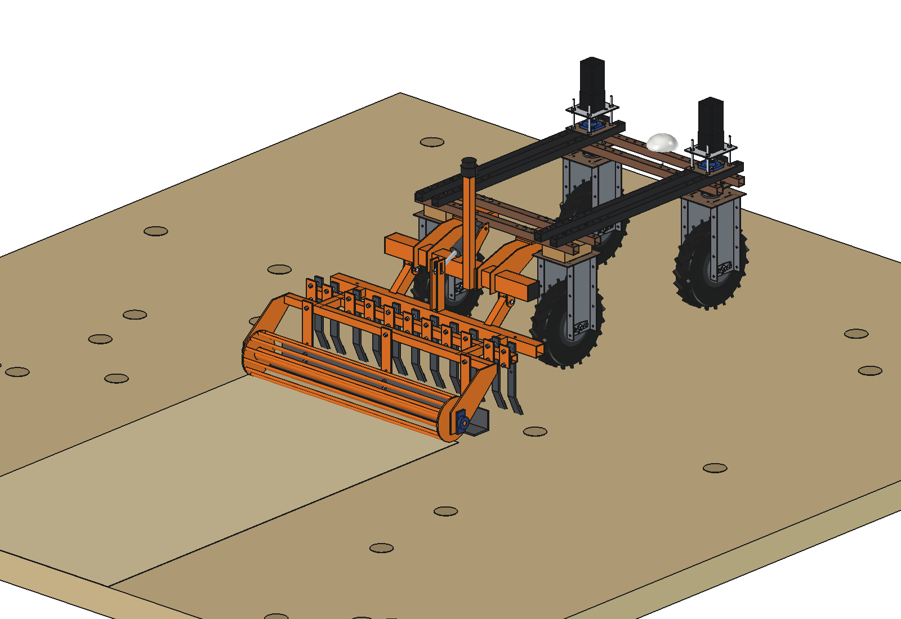
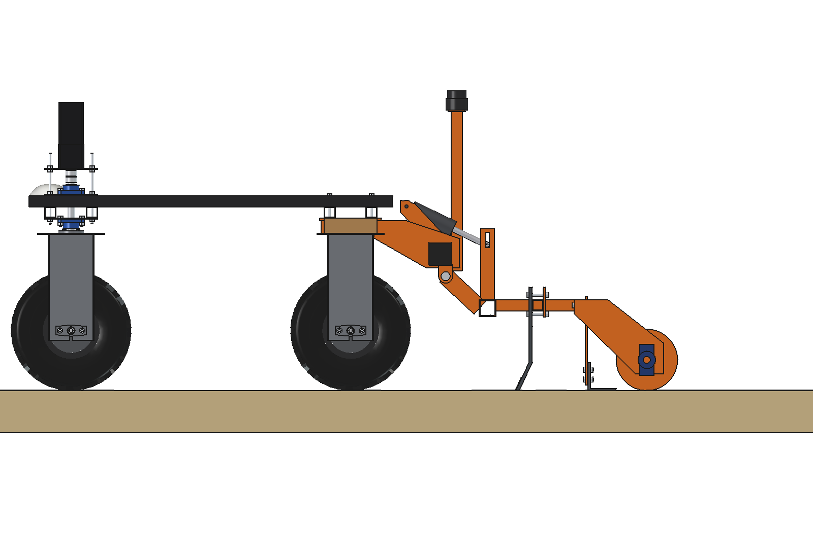
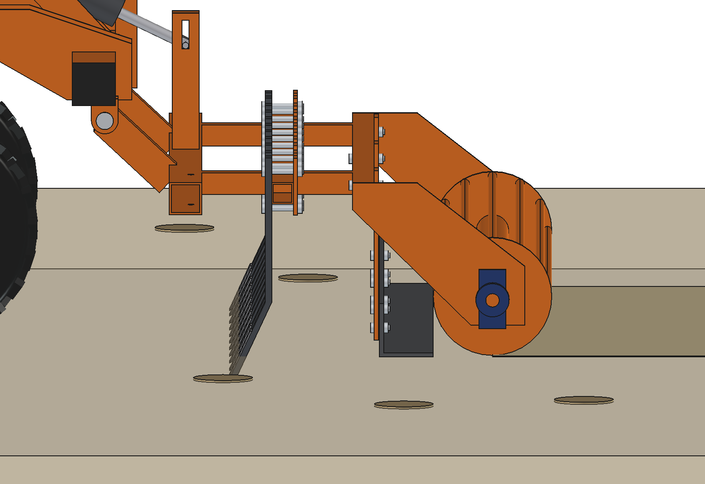
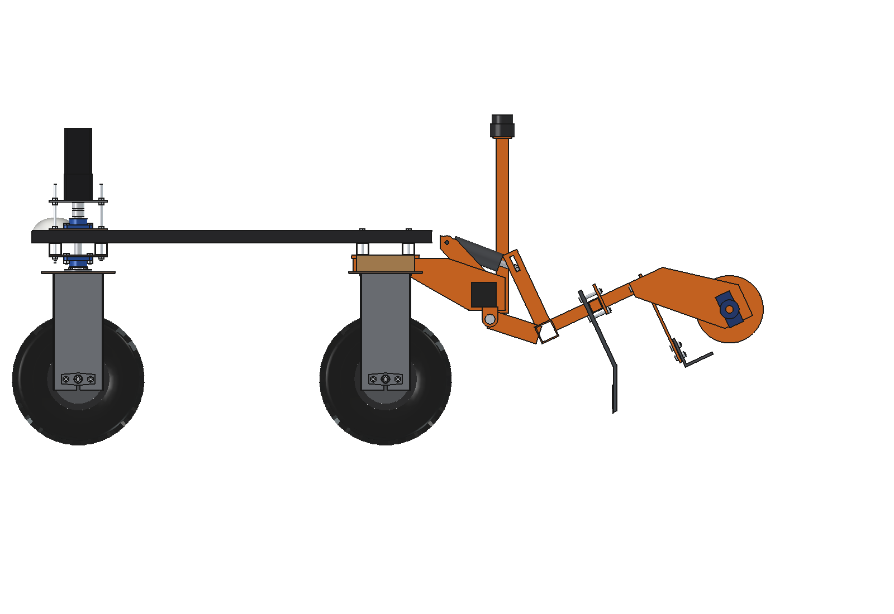
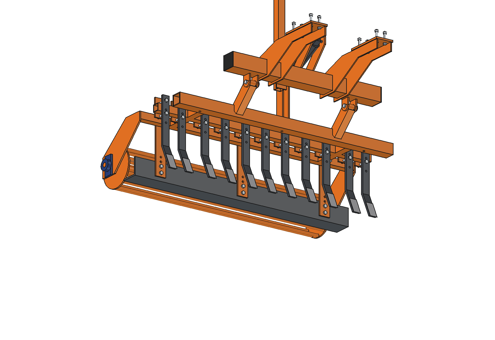
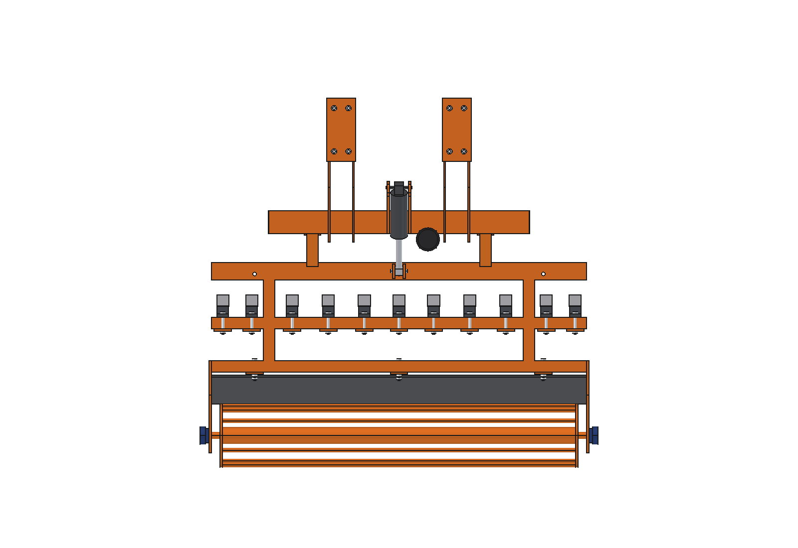

# Riding arena leveller (simple): FreeCAD model

Loosens and levels the footing of a horse riding arena (sand, sand with fibres) at night, so it is ready every
morning. Rear-mounted on the **toolbar, hangers, pivot lugs, lift arms, actuator and the welded frame of the
[grassland harrow](../../grassland%20harrow/simple/README.md)** (imported, not copied). New tools on that frame:

- **11 rigid loosening tines** (flat bar 40 × 12, lower shank leaning 25° forward, reversible hardened point) on the
  front tine bar, 35 mm deep. A second hole pair in each shank puts the tine 50 mm higher (tips 15 mm over the ground)
  for driving over the hard yard to and from the arena.
- **Levelling board** (angle 100 × 100 × 8, 1300 long) behind the rear tine bar on 3 straps with height holes: it pulls
  the loosened sand flat and fills hoof prints.
- **Rod roller** O220 (12 rods O16) on 2 side plates and UCFL 205 bearings: it carries the frame (actuator in its float
  slot) and so sets the tine depth, and it firms the surface so hooves do not sink in.
- **360° lidar** on a post on the toolbar: an indoor arena has no RTK. The lidar matches the arena walls (a rectangle
  is an easy map), optionally helped by UWB anchors in the corners; the robot drives a fixed pattern of passes.

Why it is designed this way: [RATIONALE.md](RATIONALE.md).

| | | |
| --- | --- | --- |
|  |  |  |
| side, at work | tines 35 mm in the sand, board, roller | lifted 25° (only with heavy ballast, see below) |
|  |  | |
| tines, board, roller from below | from above | |

## Key figures

From the model (`build_arl.mass_properties`, `ground_contact`, checks) and `arl_calc.report()`.

| | |
| --- | --- |
| Mass | 158 kg (mount 22 kg, leveller on the pivot 130 kg, actuator 2.6 kg, lidar post 3 kg) |
| Working width | 1300 mm (passes 1200 mm apart) |
| Draft at 35 mm (estimated) | tines 385 N + board 159 N + roller 115 N = ~660 N |
| Traction | with 44 kg front ballast (4 plates of the [counterweights](../../counterweights/)): 234 kg on the wheels, grip 917 N on sand, hubs 1100 N, minus 229 N rolling = ~690 N |
| Depth limit | ~38 mm at the grip limit: one pass loosens 3-4 cm; deeper work needs passes on successive nights |
| Arena 20 × 40 | 17 passes, ~17 min; 20 × 60: ~24 min |
| Energy | ~990 W, ~280 Wh per 20 × 40 arena: ~6.8 arenas per charge |
| Lifting | the leveller (130 kg, 870 mm behind the rear axle) cannot be lifted by the standard robot: it would need ~165 kg front ballast. It stays on its roller; the tines go into the transport holes for the yard |
| Size | 1380 × 1280 × 1112 mm (lidar at z 1075) |

Checks: `check_interference()` = [], `check_holes()` = {}, `check_poses()` = {} (lift −4 / 0 / 12 / 25°),
`ground_contact()`: points at −37, board heel and roller at 0 in work.

## Files

| File | Contents |
| --- | --- |
| `arl_params.py` | all dimensions; imports `gha_params` (grassland harrow) |
| `arl_parts.py` | tines and points, clamps, frame with strap holes, board and straps, side plates, bearings, roller, lidar post, scene |
| `build_arl.py` | model (mount and actuator from `build_gha`), `set_pose`, checks, `ground_contact`, mass, `render_all` |
| `arl_calc.py` | draft, traction, depth limit, balance when lifted, time and energy per arena |
| `run_in_freecad.py` | reload, build, print the report |
| `Arena_Leveller.FCStd`, `.step` | generated |

## Estimated, not measured

- Specific draft of a narrow tine in loose arena sand (0.025 N/mm² on width × depth), board friction 0.5 on a quarter
  of the frame weight, roller rolling resistance 0.12, tyre grip 0.40 and rolling resistance 0.10 on sand.
- Robot 161.5 kg; the hub torque 55 Nm per wheel (grassland harrow).
- Speed 0.8 m/s, 10 s per turn; lidar + computer 40 W.
- Not modelled: watering the footing (a spray bar on the board would be the next step), the edges along the wall
  (the board ends 160 mm outside the tyres, the last 0.2 m along the kickboard stay for a hand rake or a side blade).
