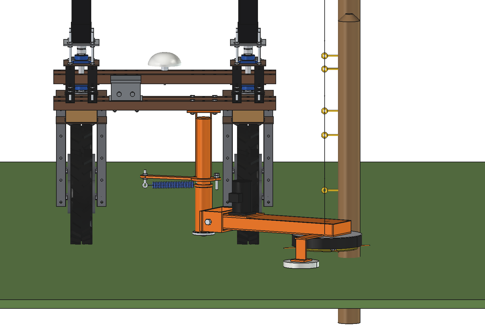
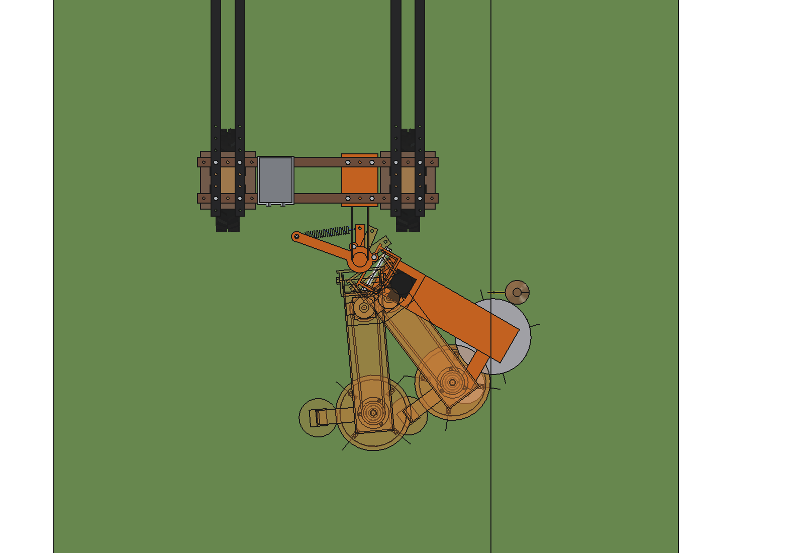
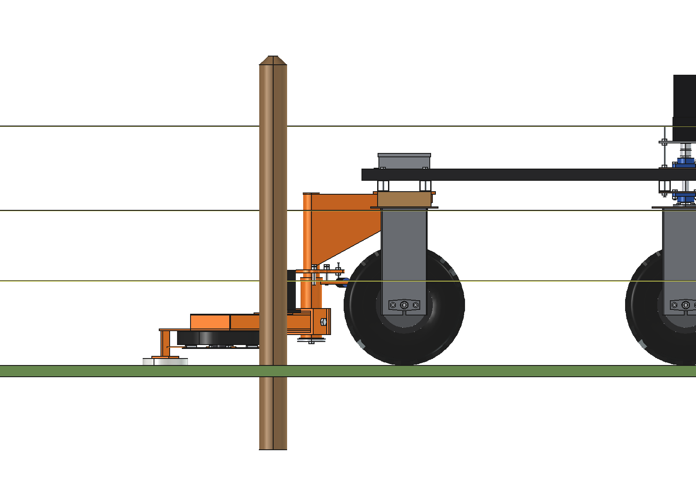
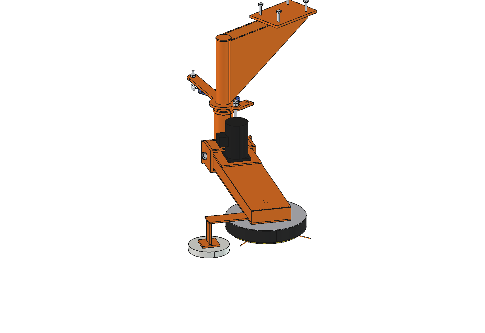
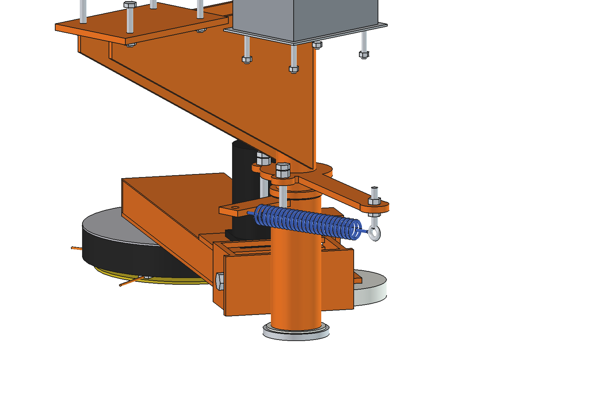
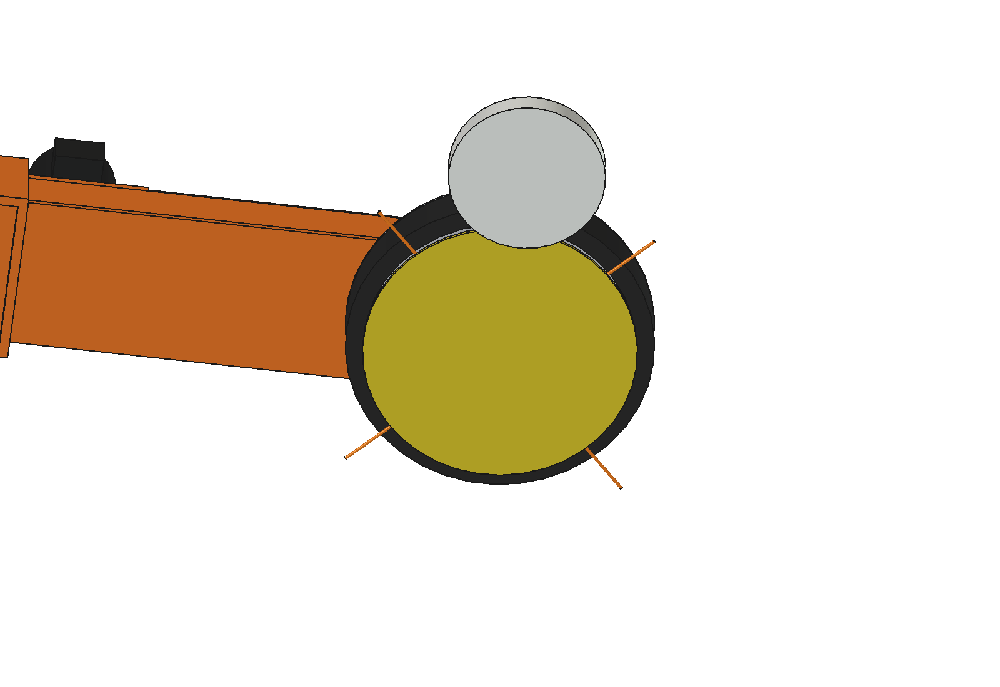

# Around-pole fence mower (simple): FreeCAD model

Mows the strip under an **electric fence**, behind the standard Bruut OpenAgbot. The robot drives along the fence;
a trailing swing arm holds a low **string-trimmer head straight under the wire**. At every post the post pushes the
head back and in, the head slides around the post on its PE guard ring, and a spring swings it back out behind the
post. No sensor, no actuator, no software: the robot only has to keep its line next to the fence.

- **String, not a blade:** nylon line does not conduct, does not cut the wire and does not hurt a wooden post. It
  reaches 42 mm past the guard, so it cuts right up to the post.
- **Low:** the head is 182 mm high, the motor stands at the root of the arm, inside the fence line. A V-belt runs
  inside the arm to a bought lawn-tractor deck spindle.
- **Simple to make:** laser-cut plates, two standard tubes (60.3 and 76.1), flat bar, a slice of PE pressure pipe
  315 as the guard, an HDPE puck as the skid. Bought: a 48 V BLDC motor, a deck spindle, 2 V-pulleys, a V-belt, a
  spring. About **€575** in parts.

Why it is designed this way is explained in [RATIONALE.md](RATIONALE.md); designs found online and other variants in
the [concept README](../README.md).


*0.5 m/s along a fence with wooden posts Ø100 (2 m apart to keep it short). Panel: swing of the arm and the force of
the post on the guard ring. Cut tufts turn light green; the few that stay are right behind the posts.*

| | | |
| --- | --- | --- |
|  |  |  |
| from behind: head under the bottom wire, motor inside the fence line | from above: rest (30°), a post pass (53°, transparent) and the max stop (85°) | side view |
|  |  |  |
| the mower without the robot | cover off: motor, V-belt, deck spindle | pivot: sleeve on the post, lever, spring, stop bolts, eye bolt |
|  | | |
| from below: disc with 4 strings, guard ring, skid | | |

## Key figures

From the model (`build_apm.mass_properties`, `check_swing`, `clearance`, `fence_check`, `size`),
`apm_calc.report()` and `animate_apm.summary()`. Robot 161.5 kg (agbot comparison, not weighed).

| | |
| --- | --- |
| Head | Ø400 cutting circle (4 strings 3.3 mm on a Ø280 disc), 3667 rpm, string tip 77 m/s; 182 mm high at a 60 mm cut |
| Reach | head centre 10 mm outside the wire: 190 mm inside the wire, 100 mm beyond the post line (posts Ø100) |
| Position of the fence | post line at x 829 (right of the robot centre), wire at x 719 (insulators 110 mm); robot 279 mm from the post face |
| Wires | bottom wire ≥ 281 mm to mow straight under it (head + 49 mm float + 50 mm margin); lower wires: see below |
| Power | ≈ 500 W at the shaft at 0.5 m/s in tall grass (280 W cutting, 177 W air drag of the strings, 40 W idle); 615 W electric, 12.8 A at 48 V |
| Capacity | 1.8 km of fence per hour at 0.5 m/s; ≈ 2.4 h ≈ 4.3 km per charge (with driving) |
| Post pass at 0.5 m/s | arm swings back 16° (to 46°), peak force on the post ≈ 210 N (first contact), ≈ 20 N while sliding; never on the max stop |
| Uncut | ≈ 150 cm² per post, up to 90 mm behind it (the spring needs some time to swing the head back) |
| Return spring | 33 Nm at rest against 22 Nm grass drag (× 1.5), 36–40 Nm over the swing; 258–446 N |
| Mass | 50 kg (mount 15.5, swing group 31.4 of which arm 25.8, controller box 3.3) |
| Overall size | 1173 × 1039 × 754 mm (x × y × z), behind and right of the robot |
| Interference | none, at rest, over the swing range (30–85°) and at the float stops (± 5°); arm ≥ 44 mm from the posts during a pass |
| Clearance | ≥ 45 mm to the right rear tyre and wheel bracket |
| Arm | U section 160 × 56 (6 mm plate + 2 flats 6 × 50): 20 MPa hanging on a float stop (× 2 for bumps), 4 MPa from the post force, 26 MPa torsion from the skid |
| Axle loads | 212 kg in total: rear 135 kg, front 76 kg (36 % front), right side 61 %, right rear wheel 83 kg |

## How it goes around a post

1. **Mowing:** the arm trails 30° behind the +x axis, against the rest stop. The spring (33 Nm) holds it there
   against the grass drag (≈ 22 Nm). The skid carries the head; the hinge on the sleeve lets it follow the ground
   (± 5°, ± 49 mm at the head).
2. **Contact:** the post (on a line 100 mm outside the head centre) hits the PE guard ring on its outer front
   side, 29° off head-on. The normal force pushes the head back **and in**: the arm swings about the post.
3. **Around:** the head slides along the post on the PE ring while the robot drives on. The strings reach 42 mm past
   the ring and cut against the post.
4. **Back:** once the post is past the middle of the head, the spring swings the arm back out behind the post onto
   the rest stop (≈ 0.45 s). Contact lasts ≈ 0.65 s at 0.5 m/s.

The animation and the report use the same model: `apm_kin.simulate()` integrates the arm (inertia 6.5 kg m² from the
FreeCAD model, spring, grass drag, damping) and pushes it out of the post every millisecond.

### Lower wires (sheep, goats, wolf fences)

The head is 182 mm high. With a bottom wire lower than ≈ 280 mm, drive the robot further away from the fence so the
head runs just inside the wire: the strings still reach 200 mm from the head centre, and the grass that touches the
wire is the grass right under and inside it. Lower the cut height (skid leg) to 40 mm for a 162 mm head.

## Parts list

Quantities for one mower. Prices are rough estimates (2026) to give an idea of the total, not quotes.

| Qty | Part | Specification | Where to get it | Price (est.) |
| --- | --- | --- | --- | --- |
| 1 | BLDC motor + driver | 48 V, 750 W, 3000 rpm, square flange ≈ 90, shaft Ø19 with key; driver 48 V / 25 A with brake and enable | e-mobility / automation shops ("48V 750W BLDC motor") | €175 |
| 1 | Deck spindle | lawn-tractor mower deck spindle, 2 ball bearings, 3-bolt flange, shaft 3/4" / Ø19 with pulley thread on top, blade boss below | garden machinery parts shops | €35 |
| 2 + 1 | V-pulleys A, V-belt A | pitch Ø110 (motor) and Ø90 (spindle), taper lock; belt A ≈ 1195 mm pitch length (check after the motor plate is fitted) | bearing / transmission shops | €45 |
| 1 | Extension spring | wire 4.5, OD 32, k ≈ 1.8 N/mm, initial tension ≈ 140 N, 200 mm hook to hook, max extension ≥ 190 mm | spring catalogues | €12 |
| 1 | Tube 60.3 × 5 | 514 mm (pivot post) | steel merchant | €12 |
| 1 | Tube 76.1 × 5 | 202 mm (sleeve) | steel merchant | €8 |
| 2 | Flat bar 6 × 50 | 660 mm (ribs) | steel merchant | €8 |
| | Laser-cut steel S235 | hanger plate 10, 2 webs 6, stop plate 10, end plate 10, collar 10, clevis back plate + 2 lugs + 2 stop bars 10, lever 10, base plate 6 (with skid tab), motor plate 8 (slotted), guard cover 3, disc 4, string clamps 8, skid leg + foot 8, cover 2 (bent) | laser cutter, weld yourself | €120 |
| 1 | PE pressure pipe 315 SDR 17 | 47 mm slice (guard ring), 6 screws to the cover | drainage / water pipe supplier (offcut) | €15 |
| 1 | HDPE | puck Ø160 × 25 (skid), 2 bushes 66 / 60.5 × 40, thrust washer 3 mm | plastics supplier | €15 |
| | Bolts | 4 × M10 × 70 (hanger), M16 × 210 (hinge), M12 × 30 (end plate), 2 × M12 × 70 + lock nuts (stops), M10 eye bolt, 3 × M8 (spindle + guard), 8 × M6 (clamps), 4 × M8 (motor) | hardware store | €25 |
| 1 | Nylon line 3.3 mm | roll, 4 pieces of ≈ 110 mm per change | garden centre | €15 |
| 1 | Controller box | IP66 ≈ 130 × 180 × 80, fuse, relay, cable glands, cable | electronics shops | €45 |
| | Paint or galvanizing | welded parts | | €40 |
| | | | **total, roughly** | **≈ €575** |

## Making it

- **Laser cutting:** all plates are flat contours with holes. The base plate is one piece with the tab for the skid
  leg. Weld the ribs on the base plate (U), the motor plate across the ribs at the root and the end rib at the
  head end; the cover is a bent 2 mm sheet with 4 screws.
- **Pivot:** weld the webs to the hanger plate and the post, then the collar and the stop plate on the post (the
  sleeve goes on before the collar). Press the 2 PE bushes into the sleeve, slide it on the post with the thrust
  washer, bolt the end plate on (M12 into the welded plug). Grease nipple on the sleeve is optional.
- **Clevis:** back plate, 2 lugs and 2 stop bars welded to the sleeve, the lever welded on top. The M16 hinge bolt
  goes through the lugs and the ribs: the arm floats ± 5° until a stop bar touches the base plate or the motor plate.
- **Head:** the deck spindle goes through the base plate; its 3 flange bolts also clamp the guard cover under the
  plate. Screw the PE ring to the cover. Bolt the disc to the blade boss (as a blade); 4 clamps hold the folded
  strings.
- **Belt:** the motor plate has 4 slots along the arm: push the motor towards the root to tension the belt.
- **Robot:** 4 × M10 through the grid holes of the rear lower beams (x 125 and 225). Nothing to drill.

## Settings

| What | How |
| --- | --- |
| Cut height | skid leg slotted: disc 40–100 mm above the ground (model: 60) |
| Rest angle | rest stop bolt (M12, lock nut): 30° in the model; more angle = head further in |
| Swing limit | max stop bolt: 85° in the model (a pass needs ≈ 16°) |
| Spring force | eye bolt: 2 nuts on the stop plate, ± 15 mm = ± 3 Nm |
| Distance to the fence | robot path: head centre 10 mm outside the wire, i.e. the post line 100 mm outside the head centre |

## Files

| File | Contents |
| --- | --- |
| `Around_Pole_Mower.FCStd` | the model, with the robot model hidden next to it. Generated, so do not edit by hand |
| `Around_Pole_Mower.step` | the mower only, in robot coordinates, arm at rest |
| `apm_params.py` | all dimensions, the robot interface, the arm geometry, the spring, the fence and the operating values |
| `apm_parts.py` | one function per part; each returns a `Part` shape in robot coordinates (arm at rest) |
| `build_apm.py` | model tree with the moving sub-Parts, colours, `set_swing`, interference over the swing range, clearance, mass and inertia, images, STEP |
| `apm_kin.py` | spring torque, grass torque, the post pass (arm dynamics with contact), uncut area per post (pure Python) |
| `apm_calc.py` | head speed and reach, power, run time, spring, post pass at 4 speeds, strength, axle loads, fence, cost (pure Python) |
| `apm_grass.py` | grass tufts under the fence that are cut when the strings pass over them |
| `animate_apm.py` | animation: robot + mower along an electric fence with 2 posts, grass |
| `make_gif_apm.py` | frames to GIF with a caption and the swing / post-force panel |
| `run_in_freecad.py` | macro: open in FreeCAD and run (F6) to rebuild and print the key figures |
| `previews/` | images and the GIF |

## Axes

Robot coordinates: x = right, y = driving direction (front = +y), z = up, ground = z 0, mm, origin = centre of the
robot. Arm frame (in `apm_parts`): u along the arm from the post axis, v = u turned 90° to the left, z up. Swing angle
ψ = angle of the arm behind the +x axis (0 = straight out to the right, 90 = straight back); rest 30°.

## Rebuilding and using

```python
import sys; sys.path.insert(0, r"F:\veldrobot\aanbouwdelen\around_pole_mower\simple")
import build_apm, apm_calc
build_apm.build()                    # FCStd + STEP
build_apm.check_interference()       # []
build_apm.check_swing()              # all lists empty
build_apm.clearance(); build_apm.mass_properties(); build_apm.fence_check()
apm_calc.report()
build_apm.render_all()               # previews/
```

Or run `run_in_freecad.py` as a macro. Change a dimension in `apm_params.py`, rebuild, and run the checks again. After
a change of the arm, copy `swing_I_kgm2` and the masses from `mass_properties()` into `apm_kin.MODEL` and
`apm_calc.MODEL`.

## Animation

```python
import animate_apm, make_gif_apm
animate_apm.build(); animate_apm.play()          # live; animate_apm.stop()
animate_apm.summary(); animate_apm.check_fit(); animate_apm.post_gap()
animate_apm.render_all(r"C:\temp\apm_frames")
make_gif_apm.main(r"C:\temp\apm_frames", r"previews\animation_around_posts.gif")
```

`summary()`: 94 frames, 9.4 s, swing up to 15.7°, peak post force 209 N, spring 33–39 Nm, 98.6 % of the strip behind
the head cut. The rotor turns 33° per frame in the pictures (the real 3667 rpm would alias).

## Model tree

```
Around_pole_mower (around_pole_mower_simple)
  Mount        hanger plate 10 + 2 webs 6 + post 60.3 x 5 (welded), 4 x M10 into the rear lower beams, end plate,
               thrust washer, collar, stop plate with 2 stop bolts and the eye bolt, return spring
  Controller   control box on the rear lower beams (BLDC driver)
  Swing        turns about the post: sleeve 76.1 x 5 with 2 PE bushes, clevis (back plate, 2 lugs, 2 float stop
               bars), lever, M16 hinge bolt
    Arm        floats about the hinge: base plate 6 + 2 ribs 6 x 50 + end rib, cover, motor plate, BLDC motor,
               V-pulley, V-belt, deck spindle housing + 3 bolts, guard cover, PE guard ring, skid leg, HDPE skid
      Rotor    turns: spindle shaft, V-pulley + jam nut, blade boss, disc Ø280, 4 clamps, 4 strings
Robot (hidden in the FCStd; for checking only)
```

## Electric fence: safety and the robot

- **Switch the energizer off**, or at least accept the risk: if a sagging wire lands on the steel arm or the
  motor, the fence pulse goes into the robot frame. The tyres insulate the frame from the ground, so the pulse has
  no path and does no harm to the fence, but the robot electronics see it. The head itself only touches the wire
  with the PE ring and the nylon strings (both insulate). A PE strip on top of the cover is a cheap extra.
- Cut grass falls back down; it does not touch the wire any more.
- **Posts:** wood, concrete and steel posts are fine. Thin plastic step-in posts are pushed over by ≈ 200 N; for
  those, lower the spring force or drive slower (0.3 m/s: ≈ 100 N), or mow before setting up the temporary fence.
- **People and animals:** a string head throws stones. The guard covers the top; the robot should stop the motor
  (driver enable) when it stops driving, and nobody should stand within a few metres on the right-hand side.

## Maintenance

- **Strings:** worn strings are pulled out from under the clamps and replaced by folded 110 mm pieces (4 × M6). Check
  after every few km of fence.
- **Belt:** check the tension after the first hours (motor plate slots).
- **Pivot:** the PE bushes run dry; a few drops of oil or grease each season. The sleeve must swing back by itself
  from any angle; if it does not, check the bushes and the spring.
- **Guard ring and skid:** PE wears; both are cheap offcuts and are replaced with 6 screws or 1 bolt.

## Estimated, not measured

- Robot: 161.5 kg, centre of gravity y +95, z 543 (agbots/agbot comparison, not weighed).
- Motor: 48 V BLDC 750 W, 3000 rpm, 4.5 kg, Ø90 × 140, flange 90 (check with the supplier and adjust `motor_*`).
  Motor + driver efficiency 0.85, belt 0.95.
- Deck spindle: housing Ø62, flange Ø130, 3 bolts on Ø110, 2.6 kg (differs per make: adjust `spindle_*`).
- Pulleys modelled as solid with a density of 3500 kg/m³ (spoked cast iron).
- Grass: 1400 J/m² to cut (rotary impact cutting, ≈ 4 kW per metre width at 10 km/h), 40 N drag on the head in tall,
  dense grass, damping 6 Nm s/rad on the swinging arm. Air drag of the strings with Cd 1.2.
- Friction of the PE guard on a (wet) wooden post 0.25. The peak post force depends on how much the post and the PE
  give (30 ms filter in `apm_kin`).
- Spring: k 1.8 N/mm, initial tension 140 N, free 200 mm hook to hook (from a catalogue type, not chosen yet).
- Fence: wooden posts Ø100, wire 110 mm inside the post centre, wires at 300 / 550 / 850 mm.
- Power for driving along the fence 180 W; 80 % of the 2.4 kWh battery usable.

See RATIONALE § 9.
