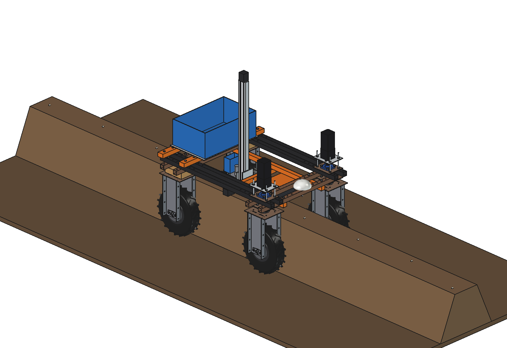
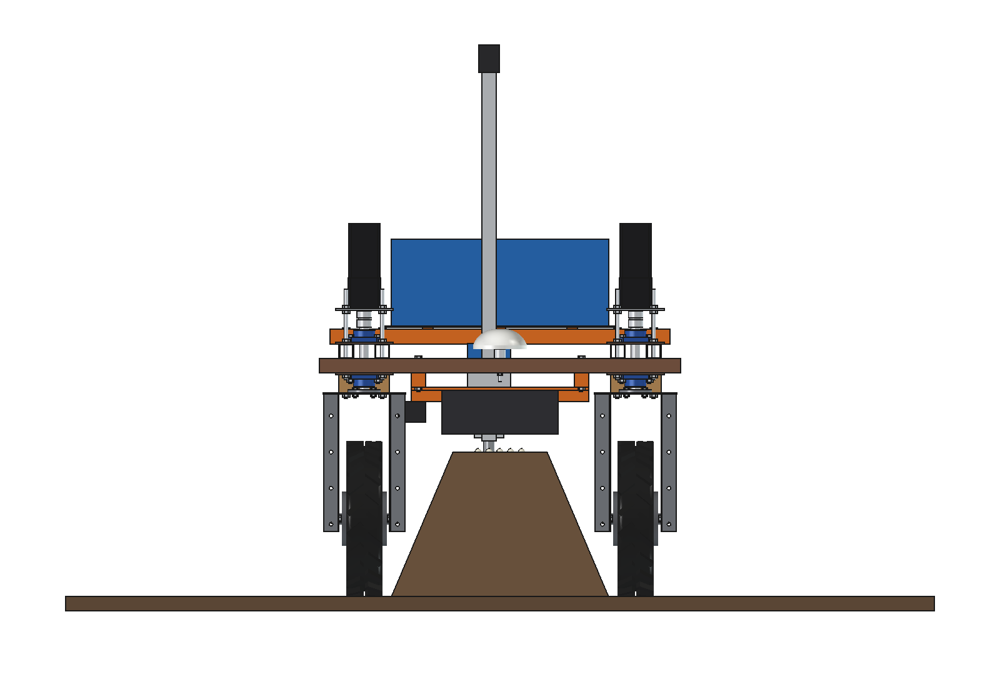
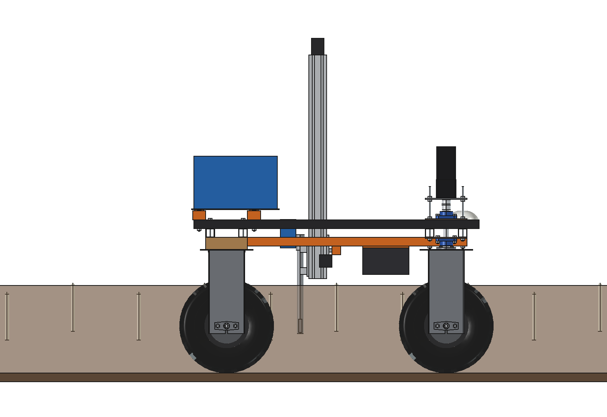
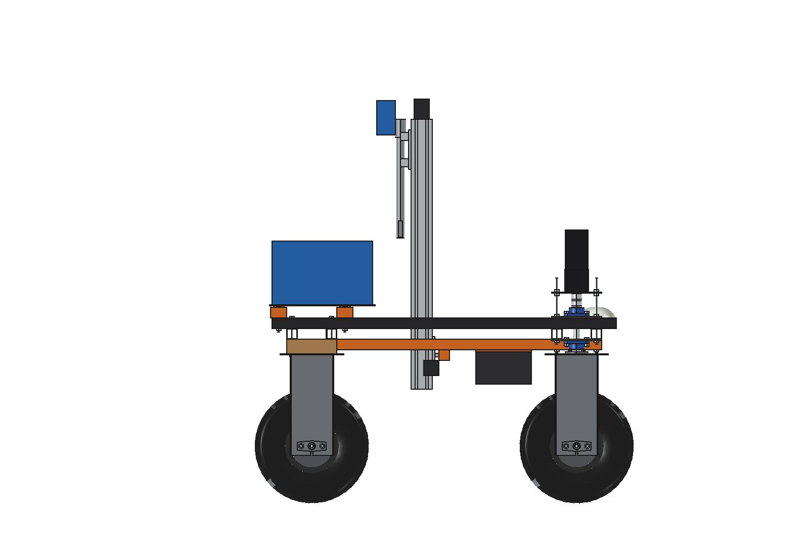
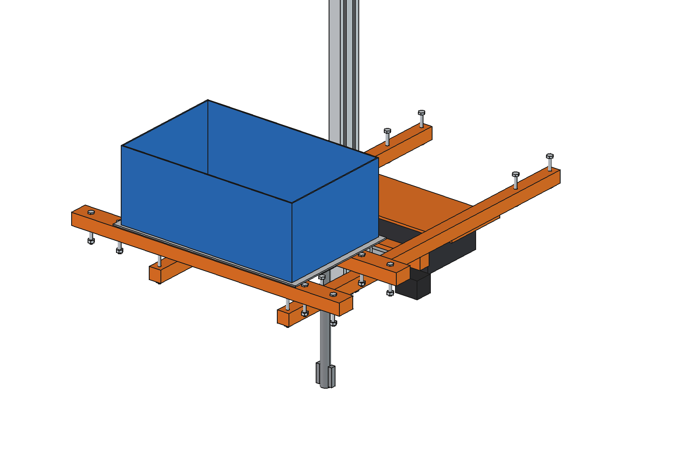

# Asparagus harvester (simple)

Finds white asparagus spears that crack the ridge top, cuts them 220 mm below the surface and lifts them out. The
module hangs under the belly of the Bruut OpenAgbot (standard robot) and straddles one ridge: the wheels run in the
furrows, the ridge (600 mm base, 400 mm high) passes between them under the lower beams.

- **Mount**: the flail mulcher's belly rails (imported) under the lower beams at x +-225.
- **X axis**: a gantry 40 x 40 x 3 at y 0 under the rails, an HGR15 rail on its rear face, a carriage with x +-120
  across the ridge top (NEMA 23 + belt).
- **Z axis**: a 40 x 80 profile behind the gantry from z 430 (above the ridge) up to 1.45 m: at y 0 there are no beams
  between x +-300, so the axis can stand through the robot. A slide carries a **knife tube** O30 (a rotating blade at
  the tip cuts the spear) with **2 gripper fingers**: tip from z 1000 down to z 180 (220 mm into the ridge).
- **Spear bin** on the slide (~15 spears); at the top it empties to the rear into a **crate** on a deck on the upper
  beams (cross tubes y -625, -375).
- **Camera hood** at the front (y 120-330) with a camera, 2 LED bars and a line laser: it looks for tips cracking the
  ridge top and for the small bumps they push up.

<p align="center">
  
</p>

| Front, cutting | Side, cutting (ridge transparent) |
| --- | --- |
|  |  |
|  |  |

## Key figures (`asp_calc.report()`)

| | |
| --- | --- |
| Cycle | full stroke 0.82 m at 0.5 m/s: 4.9 s; between spears only 250 mm over the ridge: ~3.5 s |
| Output | 3 spears/m per harvest day: ~13.5 s per metre, ~270 m of ridge and ~20 kg per hour |
| Field | 1 ha at 1.8 m rows = 5560 m of ridge: ~21 h per harvest day: one robot per ~0.3 ha, or 2 tool heads |
| Battery | ~250 W: ~6.5 h per charge |
| Crate | ~15 kg of spears, full after ~45 min |
| Mass | 44 kg (moving Z axis and tool 8 kg); front share 55 % |

Checks: `check_interference()` [], `check_poses()` {} (x +-120, tip 180 / 1000, front wheels at +-30 degrees),
`check_holes()` [] (8 rail bolts, 8 cross-tube bolts in grid holes). See [RATIONALE.md](RATIONALE.md), including the
list *Estimated, not measured*.

## Usage

```python
exec(open(r"F:\veldrobot\aanbouwdelen\asparagus harvester\simple\run_in_freecad.py").read())
import build_asp
build_asp.set_tool(x=60, tip=180)
build_asp.check_interference(); build_asp.check_poses(); build_asp.check_holes()
build_asp.render_all()
```

```bash
"C:/Program Files/FreeCAD 1.1/bin/python.exe" -B asp_calc.py
```

## Files

| File | Contents |
| --- | --- |
| `asp_params.py` | ridge, gantry, Z axis, tool, bin, deck and crate, camera hood, operation (flail mulcher on `sys.path`) |
| `asp_parts.py` | one function per part (rails from `flm_parts`); ridge and spears for the renders |
| `build_asp.py` | model tree (carriage and tool as sub-Parts), checks, mass, `render_all()`, STEP |
| `asp_calc.py` | cycle time, metres and kg per hour, hours per hectare, battery, crate, axle loads |
| `run_in_freecad.py` | reload, build, print the key figures |
| `Asparagus_Harvester.FCStd`, `Asparagus_Harvester.step` | generated model (robot hidden in the FCStd) |
| `previews/` | images |
