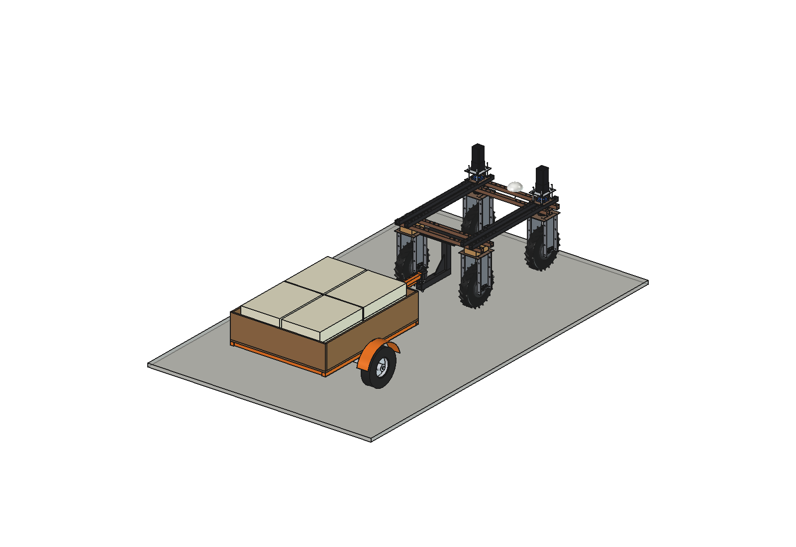
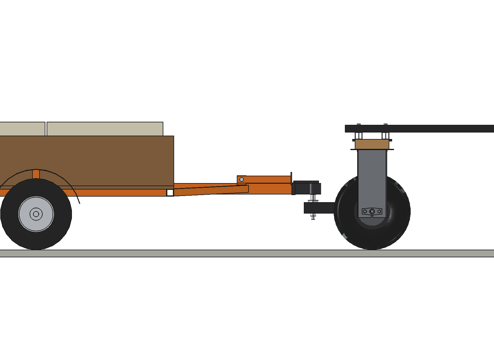
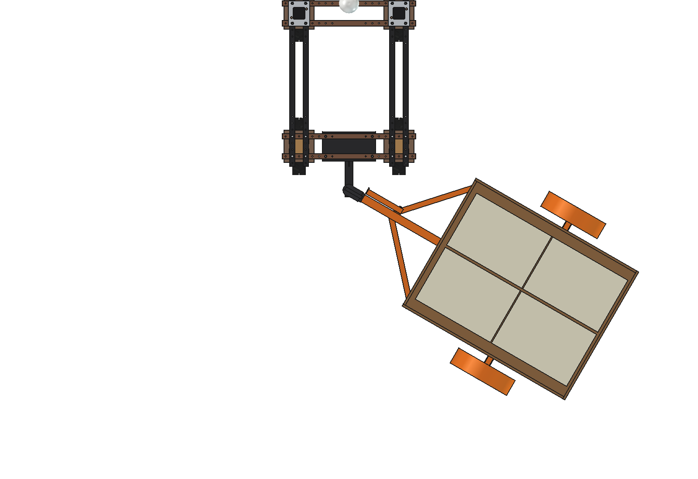
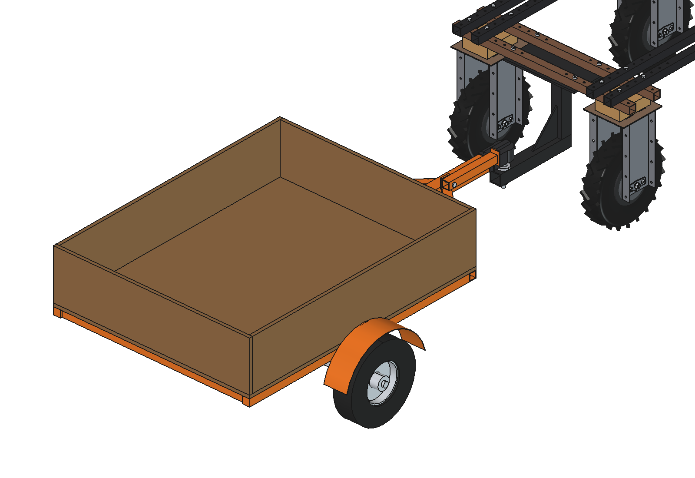
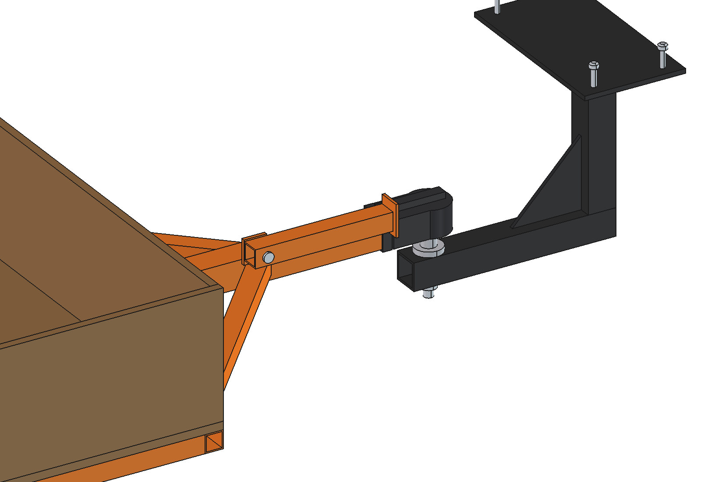

# Bag trailer (simple)

Small two-wheeled trailer behind the Bruut OpenAgbot (standard robot) on the 50 mm tow ball of the
[cambridge roll](../../overseeding/cambridge%20roll/) (hitch, coupling head, drawbar and braces imported from
`build_cbr`). A plywood deck with side boards and a drop tailgate carries 12 bags of 25 kg (seed, fertilizer, feed,
pellets) to a fixed point in the field or yard.

  

| Side, loaded | Top, turning 60 degrees |
| --- | --- |
|  |  |
|  |  |

## Build

- **Hitch** (from `overseeding/cambridge roll`): top plate under the rear lower beams, leg, bar and gusset, 50 mm ball.
- **Drawbar** (from `build_cbr`): square tube 60 x 60 with braces, coupling head and parking leg.
- **Frame**: 2 side rails and 4 cross members 40 x 40 x 3 behind the front cross beam, axle tube 50 x 50 x 4 on 2 hanger
  plates, spindles O30.
- **Deck**: plywood 18, 1110 x 1410 at 358 mm, side and front boards 280 high, drop tailgate.
- **Wheels**: 2 x 4.00-8 (O400 x 100) at x +-680, mudguards.
- **Load**: 12 bags of 25 kg (650 x 450 x 120), 2 x 2 per layer, 3 layers.

Trailer 110 kg empty, 410 kg loaded; hitch 17 kg. Size 1490 x 2630 x 716 mm (from the hitch). No interference straight
and yawed +-75 / pitched +-8 degrees.

## Key figures (`bgt_calc.report()`)

| | Wet grass | Dry grass | Concrete |
| --- | --- | --- | --- |
| Pull, flat, loaded | 536 N (margin 1.65) | 421 N (margin 2.61) | 115 N |
| Steepest slope, loaded | 3.5 deg | 6.5 deg | 9.5 deg |
| Holding the unbraked trailer, 8 deg downhill | ok | ok | ok |

Ball load 239 N loaded, 135 N empty; robot front axle 35 % loaded. ~156 Wh per km on dry grass.

Why and how these come out: see [RATIONALE.md](RATIONALE.md), including the list *Estimated, not measured*.

## Files

| File | Contents |
| --- | --- |
| `bgt_params.py` | trailer dimensions, bags and work parameters; hitch and drawbar geometry read from `cbr_params` |
| `bgt_parts.py` | frame, axle, wheels, deck, boards, bags; robot coordinates, trailer straight |
| `build_bgt.py` | model tree (hitch and drawbar from `build_cbr`), `set_articulation()`, `set_load()`, checks, mass, `render_all()`, STEP |
| `bgt_calc.py` | ball load, robot axle loads, pull and slope limit per surface, holding downhill |
| `run_in_freecad.py` | reload, build, print the key figures |
| `Bag_Trailer.FCStd`, `Bag_Trailer.step` | generated model (robot hidden in the FCStd) |
| `previews/` | images |

Needs the folder `overseeding/cambridge roll` (`bgt_params` puts it on `sys.path`).
