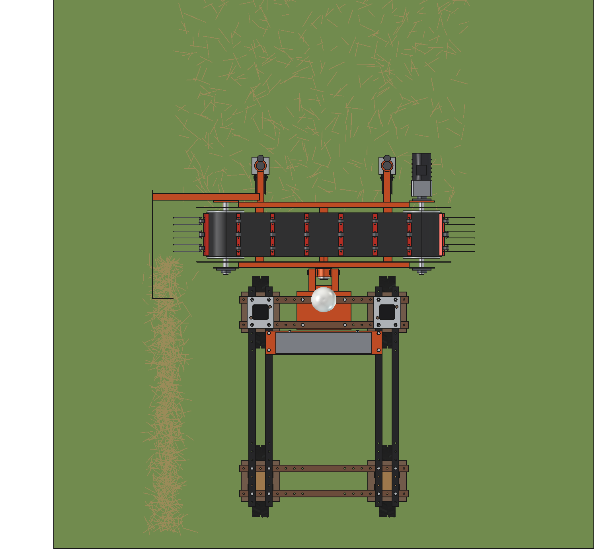
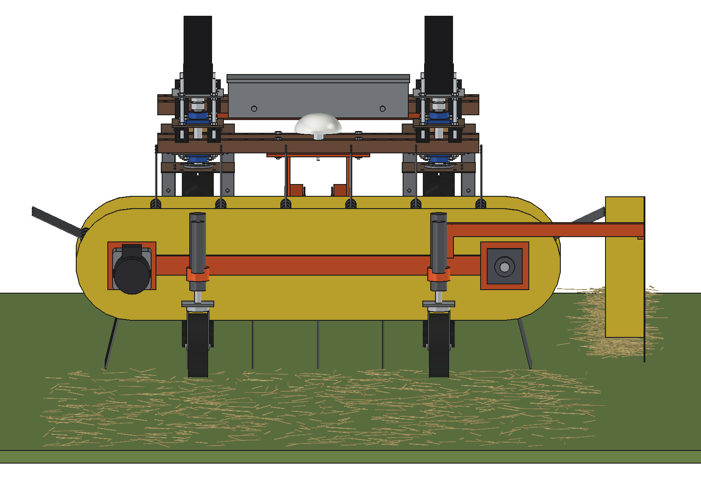
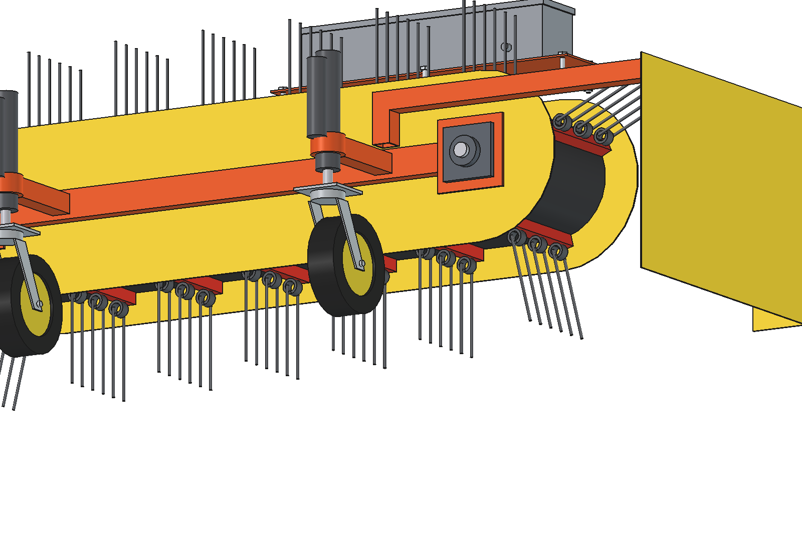
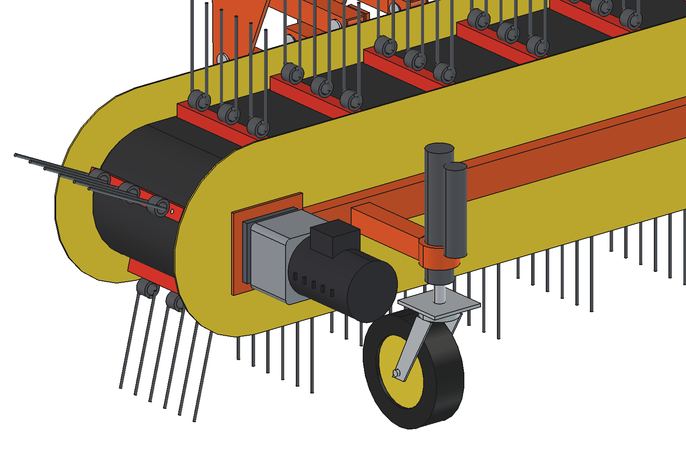
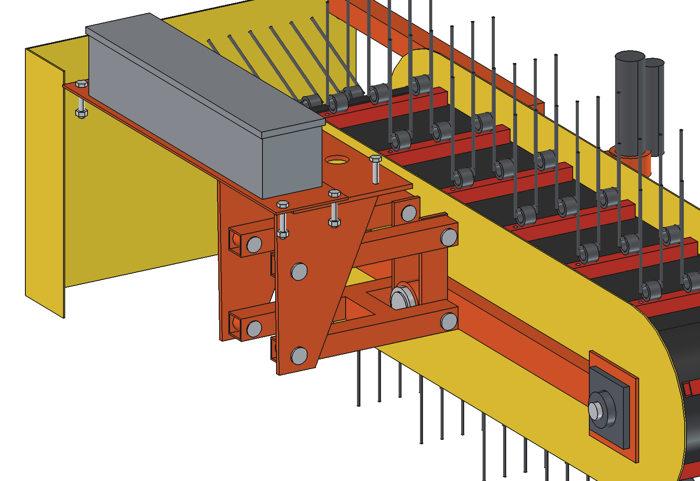
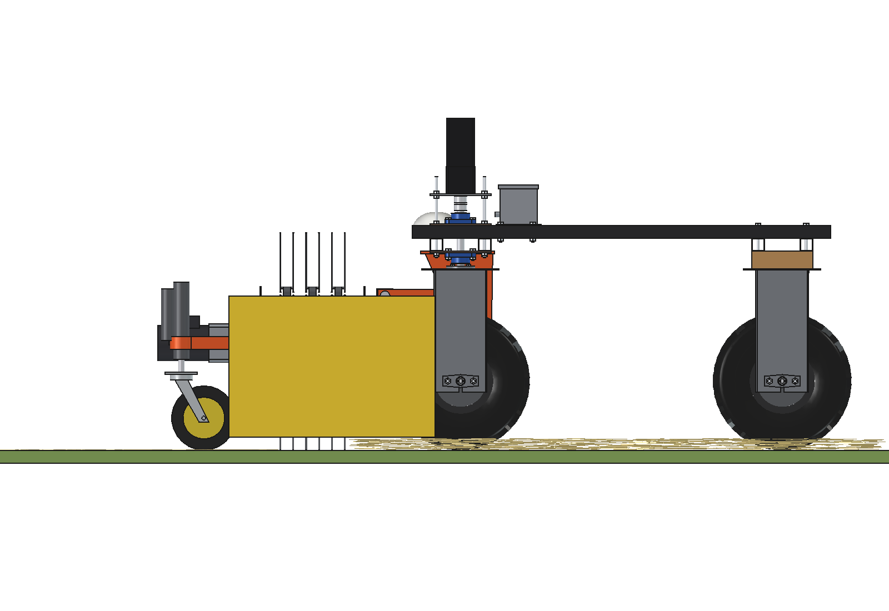
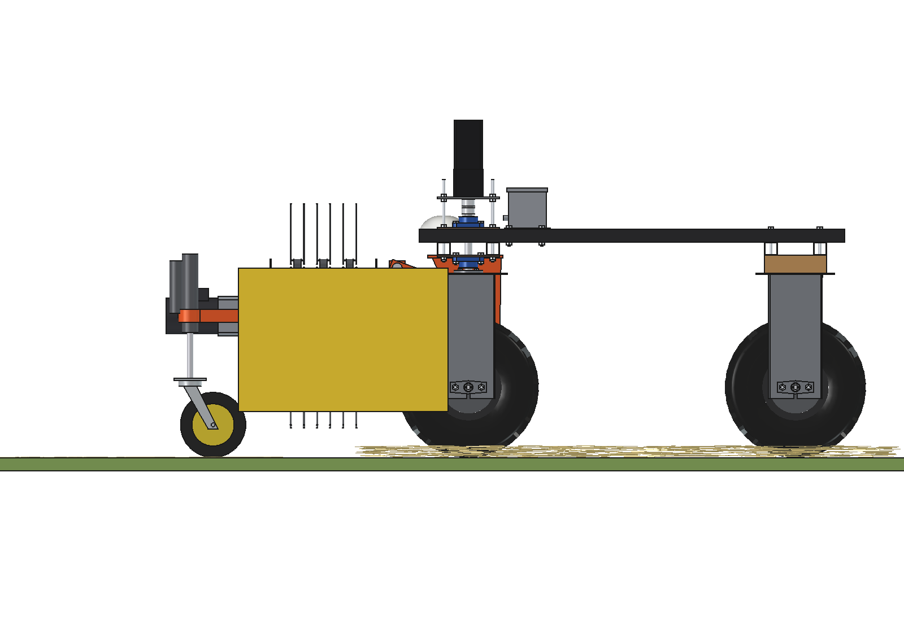

# Electric belt rake (band rake): FreeCAD model

A **belt rake in front of the standard Bruut OpenAgbot**, driven by a 48 V electric motor. A rubber belt runs around
two drums with their axes along the driving direction; 15 tine bars on the belt carry spring tines. On the bottom run
the tines comb the surface and carry everything sideways to the left end, where it is laid in a small windrow behind
a swath board.

- **Nursery beds (small trees):** the tines comb 10 mm deep between the young trees and pull out fine weed seedlings;
  the belt and the bars pass over trees up to ≈ 180 mm.
- **Grassland:** rake out dead grass, moss and thatch (after scarifying, before overseeding). The robot works from the
  outside of the field inwards and always lays the windrow on the inside: every pass carries the windrow of the
  previous pass along, so it ends as **one small windrow** in the middle. The same rake also makes small windrows of
  real hay or silage grass.
- **Working width 1.52 m** (comb mode), 1.41 m in rake mode; belt 1.0–1.5 m/s.
- **Drive:** 48 V BLDC gearmotor 750 W with a 20:1 planetary gearbox, straight on the right drum shaft.
- **Height:** two swivel castors, each on a **24 V linear actuator**: they set the working depth (comb / rake) and lift
  the tines 100 mm for the headland. The castors carry the whole rake, so the robot never carries its weight.
- **Mount:** a free parallelogram on a plate under the front beams pushes the rake, takes its side force and keeps it
  level; a roll stub lets it follow the ground across.

Why it is designed this way: [RATIONALE.md](RATIONALE.md); the concept and the uses: the
[belt rake README](../README.md).


*Grassland, rake mode: the robot drives at 1.2 m/s, the belt runs at 1.5 m/s. The litter that the tines take is
orange while it is on the move; it is thrown against the swath board into the windrow on the left. The windrow of the
previous pass lies inside this pass's width (right) and is carried into the new windrow too. At the headland the
castor actuators lift the rake 100 mm (3.3 s), then the belt stops. Real speed.*

| | | |
| --- | --- | --- |
|  |  |  |
| nursery bed: combing between rows of young trees; the robot wheels and the castors run in free lanes | from above: litter in front, the windrow on the left | from the front: the belt loop, the drive motor on the right drum |
|  |  |  |
| the bottom run: tine bars with 3 double tines each, the swath board | gearmotor on the drive drum, castor on its actuator | mount plate, headstock, parallelogram, rake head on the roll stub |
|  |  | |
| side view, working | headland: the castor actuators push the rake up 100 mm | |

## Key figures

From the model (`build_brk.mass_properties`, `check_fit`, `clearance`), `brk_calc.report()` and
`animate_brk.summary()`. Robot 161.5 kg (agbot comparison, not weighed).

| | Comb (nursery bed) | Rake (grassland) |
| --- | --- | --- |
| Speed / belt | 0.6 m/s / 1.0 m/s | 1.2 m/s / 1.5 m/s |
| Tine tips | 10 mm into the soil | 15 mm above the soil (in the litter) |
| Working width | 1.52 m | 1.41 m |
| Comb lines | 20 mm apart on average, every point combed by 1.7 bars | 27 mm, 1.3 bars |
| Tine force | 36 legs × 5 N: 156 N sideways, 94 N drag | 37 legs × 3 N: 87 N sideways, 69 N drag |
| Drive | drum 84 rpm, 18 Nm; motor 1,675 rpm; 277 W electric (37 % of 750 W) | drum 126 rpm, 10 Nm; motor 2,513 rpm; 244 W |
| Side force on the robot | 156 N: front tyres 50 % of their grip | 87 N: 28 % |
| Capacity | 0.33 ha/h gross, 0.26 net | 0.61 ha/h gross, 0.49 net |
| Battery 2.4 kWh | 733 W → 3.3 h, 0.9 ha | 972 W → 2.5 h, 1.2 ha |

| | |
| --- | --- |
| Belt loop | drums Ø220, 1,160 mm apart; belt 260 × 8, 3,036 mm; 15 bars every 202 mm, 6 tine legs Ø5.5 × 200 per bar |
| Castor actuators | 542 N each to carry the rake (× 1.8 of 1000 N); rod out 40 (comb) / 65 (rake) / 140 (headland) of 150 mm; 3.3 s up |
| Parallelogram | free; 20° at the headland, stop at 26° (130 mm) |
| Mass | 134 kg: rake 110 (drums, belt and drive 43, tine bars 14, castors 14), mount and control box 24 |
| Axle loads | the castors carry the rake: robot front 99 / rear 87 kg. Hung on the robot it would leave 6 kg on the rear axle: that is why the castors lift |
| Windrow (outside → inside, 0.1 kg/m² litter) | 0.14 kg/m after one pass, 0.57 kg/m after four |
| Clearances | rake ≥ 65 mm from the front tyres at 30° steering; mount 12 mm from the GNSS stem |

## How it works in the field

1. **Nursery bed:** the castor actuators set the tines 10 mm deep; the robot drives along the bed at 0.6 m/s with its
   wheels and the castors in the free lanes. The tines move sideways through the soil surface and the seedlings;
   the woody young trees bend the spring tines aside. The weeds end up in the windrow at the left of the bed.
2. **Grassland (thatch, moss):** tines just above the soil; the robot starts at the field edge and works round
   inwards, always with the windrow on the inside. At the end one windrow is left to pick up or mulch.
3. **Headland:** the actuators push the rake up 100 mm (3.3 s), the belt stops, the robot turns with the rake on its
   swivel castors.

## Parts list

Quantities for one rake. Prices are rough estimates (2026) to give an idea of the total, not quotes.

| Qty | Part | Specification | Price (est.) |
| --- | --- | --- | --- |
| 1 | Belt | rubber conveyor belt 260 × 8 (2 ply), endless 3,036 mm, vulcanised | €220 |
| 2 | Drums | tube Ø220 × 3 × 280, crowned, end discs with hubs, shafts Ø30 | €180 |
| 4 | Bearings | flange bearing UCF206 | €60 |
| 15 | Tine bars | square tube 25 × 25 × 2.5 × 250, 3 double spring tines Ø5.5 each (45 double tines), countersunk M8 | €340 |
| 1 | Frame, laser-cut and welded | 2 side rails 60 × 30 × 2, 4 bearing plates 6 mm, 3 cross tubes 50 × 50 × 3, roll stub Ø50, guide flat, castor arms, board arm, rake head, mount plate 8 mm, headstock; painted | €360 |
| 2 | Side plates | aluminium 3 mm, stadium shape (also the guards) | €90 |
| 1 | Swath board | aluminium 3 mm, hinge | €50 |
| 1 | Bottom-run guide | UHMW-PE 10 mm strip | €25 |
| 1 | Drive | 48 V BLDC motor 750 W 3000 rpm with controller, planetary gearbox 20:1 | €480 |
| 2 | Castors | swivel castor Ø200 × 60 | €70 |
| 2 | Castor actuators | 24 V linear actuator, 1000 N, stroke 150, 30 mm/s, hall sensor | €260 |
| 1 | Parallelogram | 4 arms 40 × 40 × 3, cross tube, 8 short pins Ø20 | €70 |
| 1 | Control box | IP66, contactor, actuator driver, fuse, wiring | €150 |
| | Bolts | M10, M8 | €25 |
| | **Total** | | **≈ €2,380** |

## Files

| File | Contents |
| --- | --- |
| `Belt_Rake_Electric.FCStd`, `.step` | the model (generated; robot hidden in the FCStd, not in the STEP) |
| `brk_params.py` | all dimensions, including the robot interface and the two modes |
| `brk_parts.py` | one function per part; one tine bar, placed along the belt by `bar_placement` |
| `build_brk.py` | model tree, colours, pose (lift, belt position), interference and fit check, clearances, mass, renders, STEP |
| `brk_calc.py` | belt path, working width, comb line spacing, tine forces, drive, side force, castor actuators, axle loads, capacity, windrow |
| `brk_field.py` | process model: litter, the previous windrow, the tine band, carrying and laying the windrow, headland lift |
| `animate_brk.py` | animation on the robot: `build()`, `play()`, `stop()`, `summary()`, `render_all(folder)` |
| `make_gif_brk.py` | frames to GIF with caption and drive panel |
| `run_in_freecad.py` | macro: reload, build, print the key figures |
| `previews/` | images and the GIF |

## Usage

In FreeCAD 1.1, run `run_in_freecad.py` (or in the Python console):

```python
import build_brk
build_brk.build()                     # FCStd + STEP
build_brk.set_pose(lift=100, phase=60) # rake up on its castors, belt moved 60 mm
build_brk.check_interference()        # []
build_brk.check_fit()                 # {} over the lift, the float and a bar pitch
build_brk.clearance()
build_brk.mass_properties()
build_brk.render_all()                # previews/
```

Animation:

```python
import animate_brk
animate_brk.build(); animate_brk.play()
animate_brk.render_all(r"C:\temp\brk_frames")
import make_gif_brk; make_gif_brk.main(r"C:\temp\brk_frames", r"previews\animation_raking_windrow.gif")
```

## Estimated, not measured

- Robot mass 161.5 kg and its centre of gravity (agbot comparison); drive power 320 W at 0.6 m/s, 500 W at 1.2 m/s.
- Tine force per working leg: 5 N at 10 mm in a loose bed, 3 N combing through a grass sward; litter 0.1 kg/m² with
  friction 0.6. Belt and bearing losses 60 W.
- Tyre grip μ 0.5 for the side force; castor rolling resistance 0.1.
- Motor 750 W / 3000 rpm, efficiency 0.85, gearbox 0.92; actuators 1000 N at 30 mm/s.
- Masses of the bought parts from catalogue classes (motor 5.5 kg, gearbox 4 kg, bearing 1.6 kg, castor 4.5 kg,
  actuator 2.6 kg); belt 1.3 kg/dm³; the side plates and the board aluminium.
- Not modelled: cables, the tension screws of the left drum, a cover over the top run, the roll stops.
