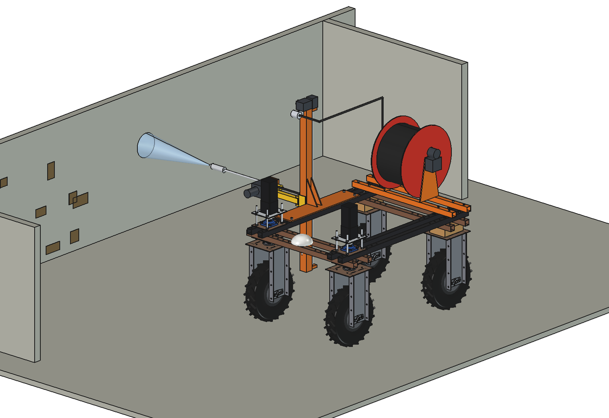
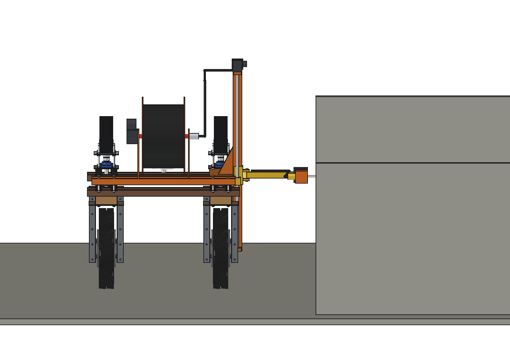
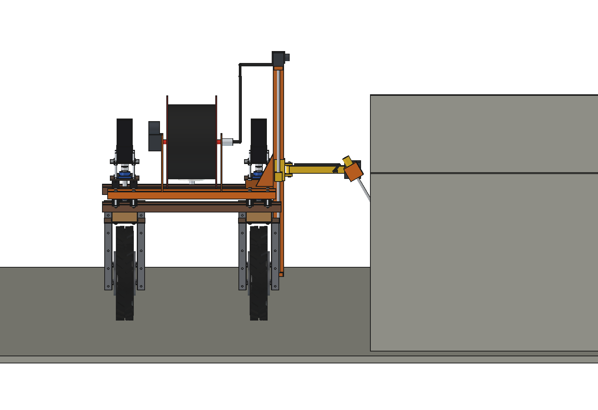
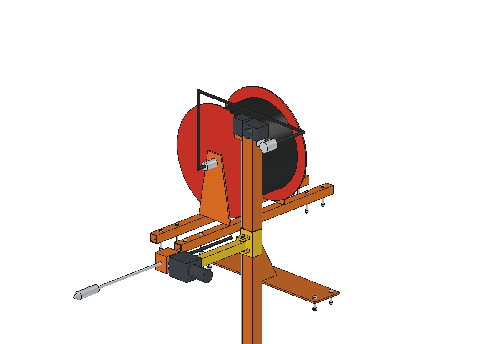
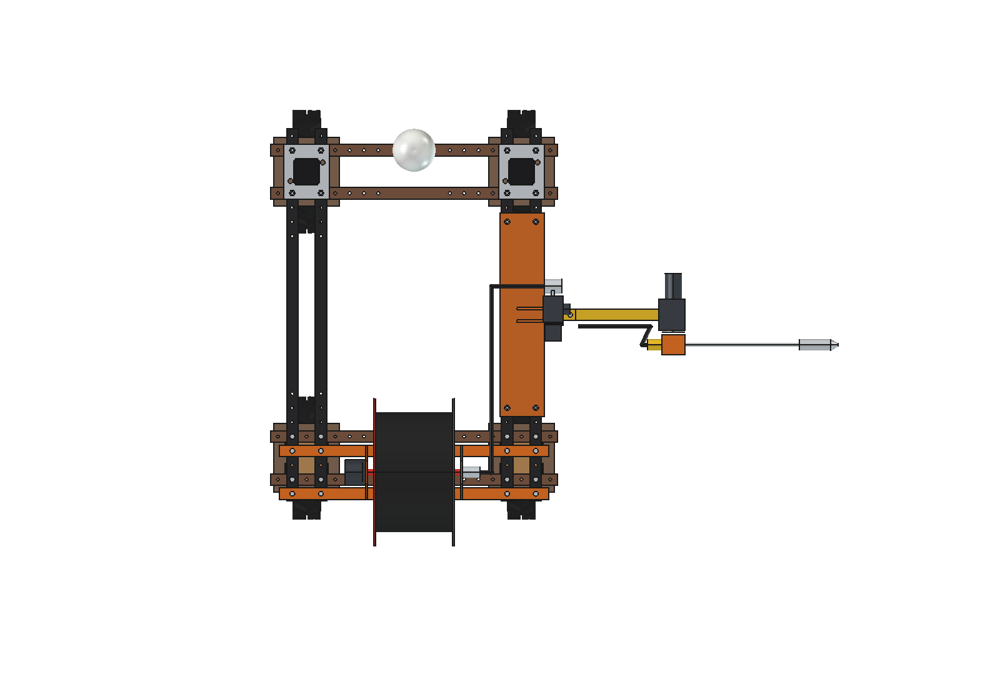

# Barn pressure washer (simple): FreeCAD model

Cleans pens, walls and floors with a high-pressure jet when the barn is empty (pig or calf pens between batches).
The **high-pressure water comes from the barn's own stationary washer** (150 bar, 15 l/min, mains power) through
**30 m of 3/8" HP hose on a powered reel** on the robot: an on-board pump for that jet needs ~5.8 kW and would empty the
robot battery in 20 minutes. The robot carries the reel and aims the nozzle:

- **Mast, lead screw, carriage and arm** of the [fence inspector](../../fence%20inspector/simple/README.md) and the
  **tilt head** of the [hedge trimmer](../../landscaping%20tools/simple/README.md) (imported, not copied): height
  0.3 … 1.3 m, tilt about the driving direction.
- On the tilt flange, instead of the trimmer bar: a clamp block, an **HP swivel**, a **lance O14 × 400** and a
  **rotating turbo nozzle**. Tilt 0 washes the wall beside the robot, +60 the floor (from an arm height of 650 mm),
  −45 the top of the partitions.
- **HP hose reel** at the rear of the upper beams: drum O360 × 280 with flanges O520 for 30 m of hose, 24 V gearmotor
  with a slip clutch (keeps the hose taut as the robot drives), HP rotary joint; the hose runs over a guide roller on the
  mast down to the arm.

Why it is designed this way: [RATIONALE.md](RATIONALE.md).

| | | |
| --- | --- | --- |
|  |  |  |
| tilt 0: the wall | tilt +60: the floor | HP hose reel, guide roller, mast |
|  | | |
| from above | | |

## Key figures

From the model (`build_bpw.mass_properties`, `nozzle_reach`, checks) and `bpw_calc.report()`.

| | |
| --- | --- |
| Mass | 69 kg (mast and plate 20 kg, carriage, arm, tilt head and lance 11 kg, reel with 30 m hose 38 kg) |
| Jet | 150 bar, 15 l/min: 173 m/s, 43 N reaction along the lance; 38 N up in the floor pose |
| Reach | lance tip to x 1.48 m (wall pose); floor pose from z 0.15 m; up to 1.7 m at −45° |
| Pen 3 × 4 m with 1 m walls | ~40 m² (floor and both faces of the partitions): ~41 min and ~600 l of water at 1 m²/min |
| Hose | 30 m: pens within ~28 m of the stationary washer, a second tap point for longer barns |
| Battery | the robot only drives, reels and aims: ~110 W, ~18 h per charge |
| On-board pump instead | 3.75 kW hydraulic, ~5.8 kW electric: 0.3 h per charge, so not an option |

Checks: `check_interference()` = [], `check_holes()` = {} (reel tubes in the upper-beam holes at y −475 / −625),
`check_poses()` = {} (arm 305 / 1290 × tilt −45 / 0 / +60 (floor pose from 650) × swing 0 / 45°).

## Files

| File | Contents |
| --- | --- |
| `bpw_params.py` | all dimensions and washing figures; imports `hdg_params` (and so `fin_params`) |
| `bpw_parts.py` | lance, clamp, swivel, jet (image), reel tubes and bolts, side plates, drum, wound hose, reel motor, rotary joint, hoses, guide roller, pen scene |
| `build_bpw.py` | model (mast and arm from `build_fin`, tilt head from `hdg_parts`), `set_pose(arm_z, tilt, swing)`, checks, `nozzle_reach`, mass, `render_all` |
| `bpw_calc.py` | jet speed and reaction, time and water per pen, hose reach, battery, the on-board pump comparison |
| `run_in_freecad.py` | reload, build, print the report |
| `Barn_Pressure_Washer.FCStd`, `.step` | generated |

## Estimated, not measured

- Cleaning rate 1 m²/min of soaked pen surface with a turbo nozzle; 60 s to move to the next pen.
- Reel 38 kg with the hose (drum as a 3 mm shell), slip-clutch motor 60 W.
- Not modelled: the hose loop from the guide roller down to the arm, soaking (low pressure) before washing, the
  waterproof covers (IP67) of the robot electronics and the wheel units.
