# Battery rack and cabinet MBH3+ (2, expandable to 3 and 4)

Three ways to carry BatteryLabs MBH3+ batteries: an **open rack** with the batteries upright (below), a **closed
aluminium cabinet** with the batteries lying flat and a door per battery ([Closed cabinet](#closed-cabinet-lying)), or a
**wooden box** for 2 on one side of the robot ([Wooden box](#wooden-box-on-one-side-wood_side-2-batteries)), also
for the smaller MU3+ ([MU3+](#wooden-box-for-the-mu3-wood_side_mu3-2-batteries)).

An **open rack** for BatteryLabs **MBH3+** drop-in batteries (14S 48 V 50 Ah, normally-off BMS, AS150U connector,
SKU 31107) on the Bruut OpenAgbot (standard robot). The MBH3+ has its own housing, so it gets no closed box: a tray with
side guides and separators holds it, a hinged hold-down bar over the tops keeps it in, and it is lifted out by its own
handle. The tray is made of **segments of 100 mm**, one battery each, between two end frames: start with 2, bolt in a
segment for 3 or 4. 100 mm is two steps of the 50 mm hole grid, so each extra battery moves each cross rail exactly
one hole outwards.

Three ideas for where the rack goes, all checked on the robot (no overlap, front wheels at -30 / 0 / 30 degrees):

| | 2 batteries | 4 batteries |
| --- | --- | --- |
| **top**: on 2 cross rails over the inner upper beams, lift out from above | 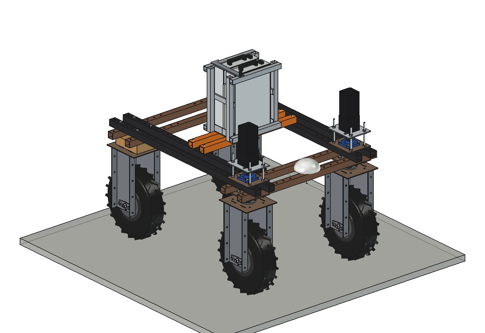 | 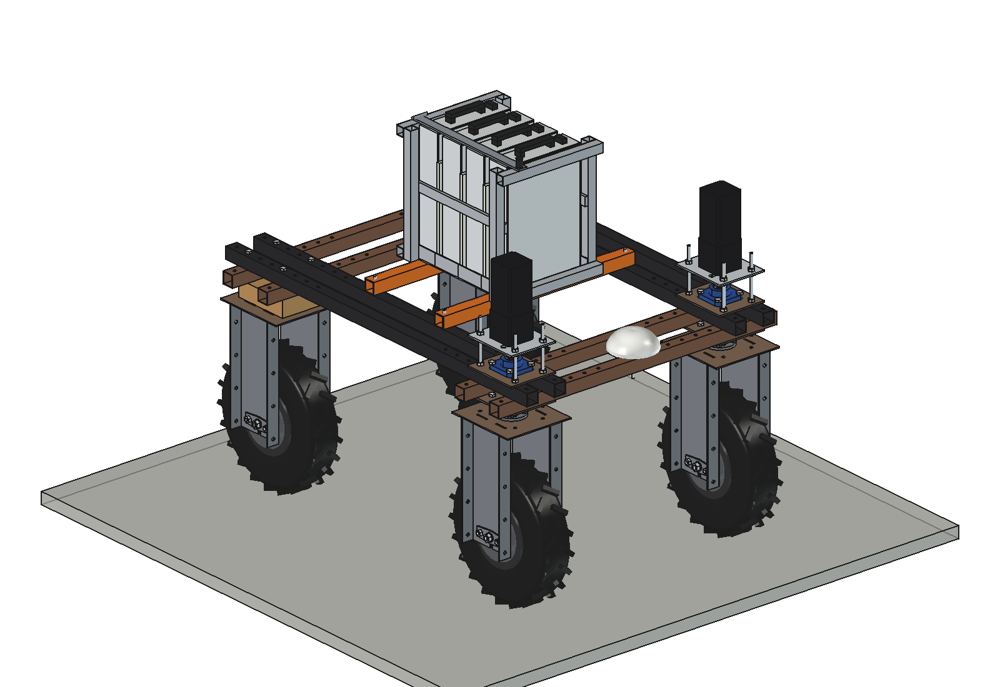 |
| **well**: sunk in the centre, hanging on 2 cross rails under the inner upper beams | 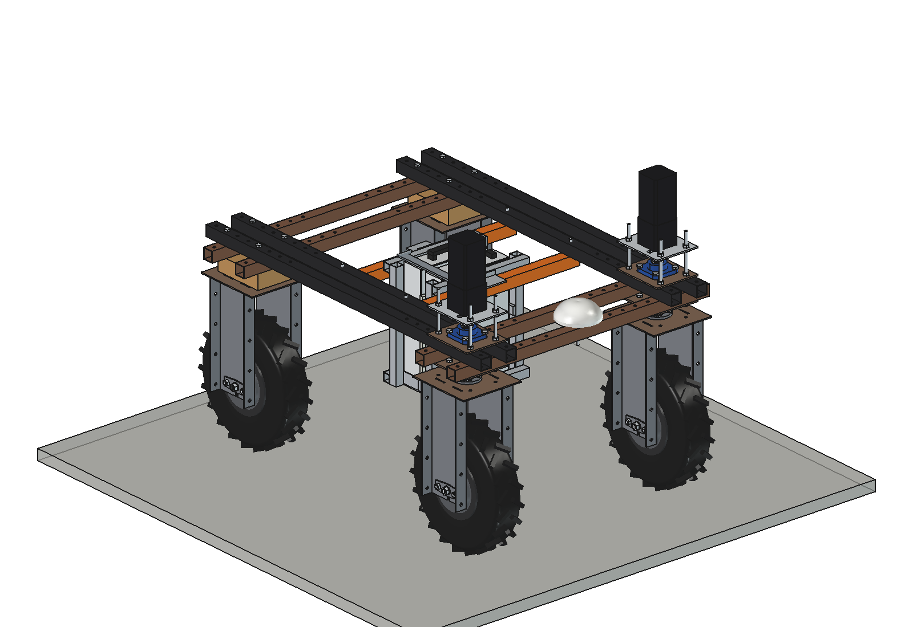 | 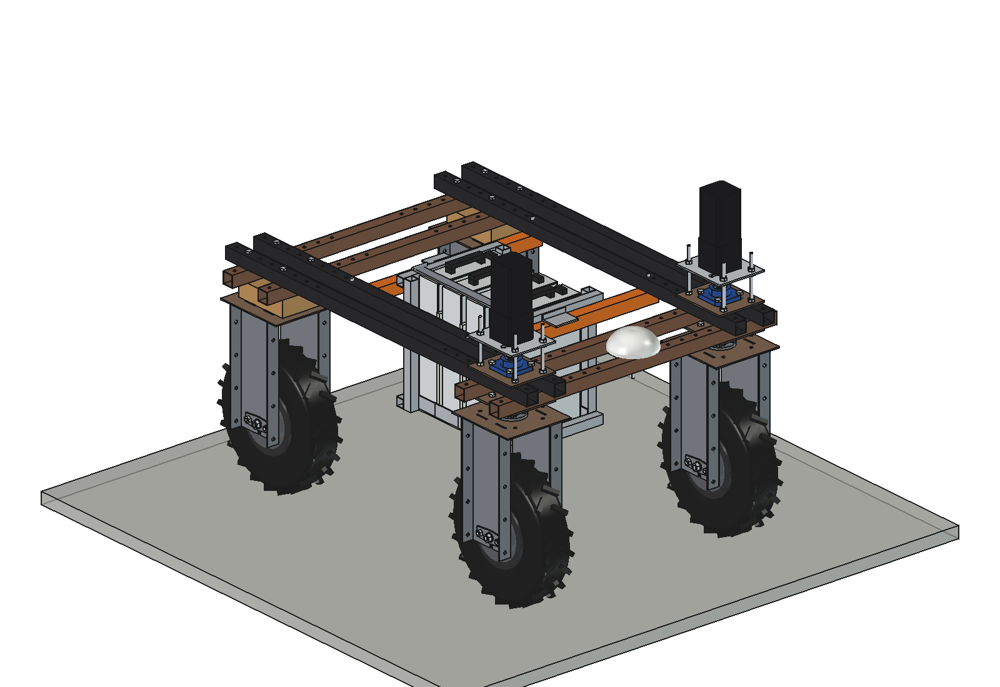 |
| **saddle**: a cradle per side under the upper beams, batteries lying, slide out sideways |  | 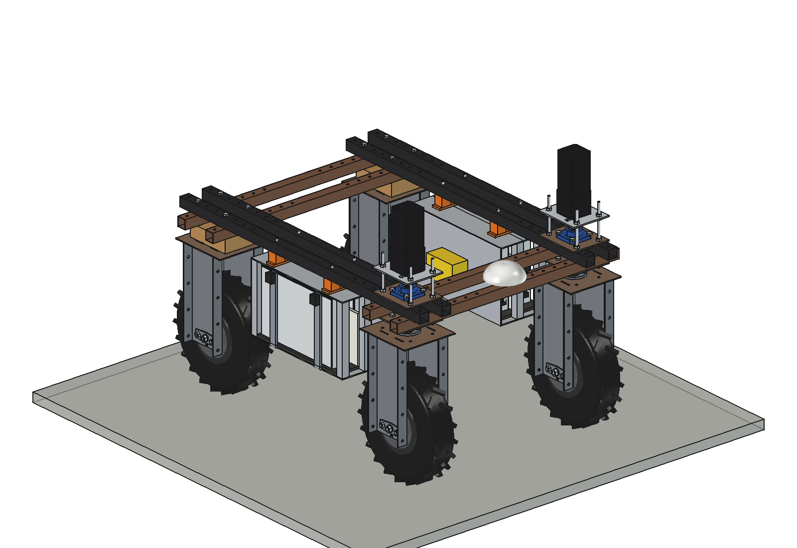 |

<p align="center">
  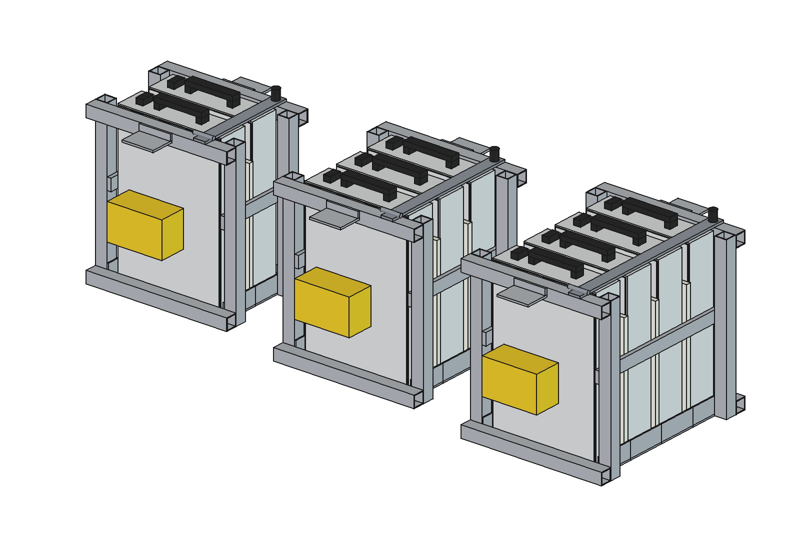
  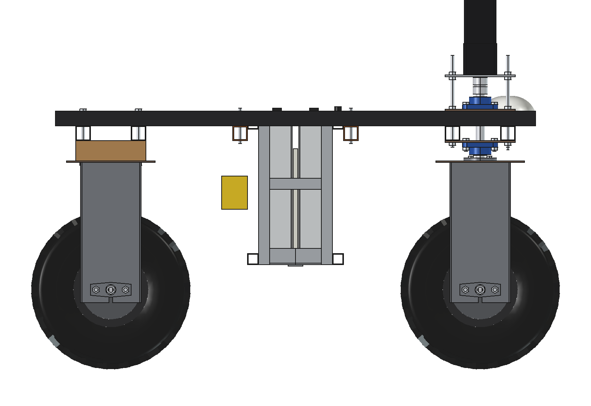
</p>

## Build (upright rack, top and well)

- **Tray segments**: alu 4 mm, 300 x 100 with 40 mm side lips, a joint strip under each seam; rubber mat 10 mm.
- **End frames**: alu tube 30 x 30 x 2, 2 posts beside the tray, bottom and top cross tube (end stops).
- **Side guides**: flat bar 30 x 10 along both sides at 190 mm, HDPE separators 12 mm between the batteries.
- **Hold-down bar**: alu 30 x 6 with a rubber strip, over the tops right of the handles, hinged on the rear top tube,
  star knob on the front one. Open it, swap one battery, close it.
- **Combiner box** on the rear end frame: an AS150U-F socket per slot (battery cable 500 mm), main fuse, CAN.
- **Mount**: 2 cross rails (tube 40 x 40 x 3, 4 x M10 through the inner upper beams), over the beams (top) or under
  them (well, the rack hangs on 2 ears on its top cross tubes).

Saddle: per side a cradle of a floor and a roof plate per segment, an inner plate, end posts and 2 retaining bars on
the outside (hinged at the bottom, over-centre latch); the roof plate hangs on 2 flat bars under the upper beams.

## Closed cabinet (lying)

A closed alu cabinet (3 mm) in which the batteries **lie flat** on a shelf each, handle and plug towards the door.
One level of 100 mm per battery (82 + shelf 4 + 14 play), each level with its own **drop-down door** (hinged at the
bottom, over-centre latch at the top): the open door is the ramp the battery slides out on, and only that battery is
opened. Levels are bolted on top of each other with a flange ring, so 2 -> 3 -> 4 makes the cabinet 100 mm higher;
the footprint (450 x 290 + flanges) and the mount stay the same.

| | 2 batteries | 4 batteries |
| --- | --- | --- |
| **cabinet_well**: hanging in the centre on 4 ears on 2 rails under the inner upper beams (y +-200), doors to the right, swap from the side between the wheels | 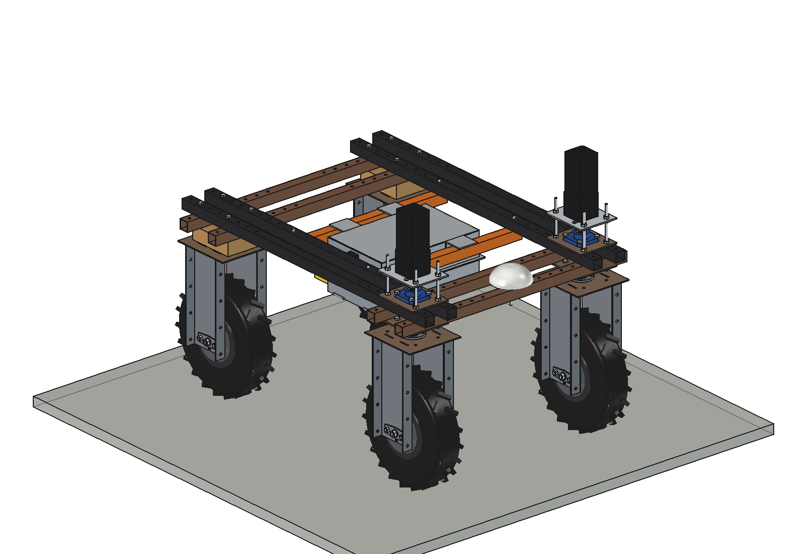 | 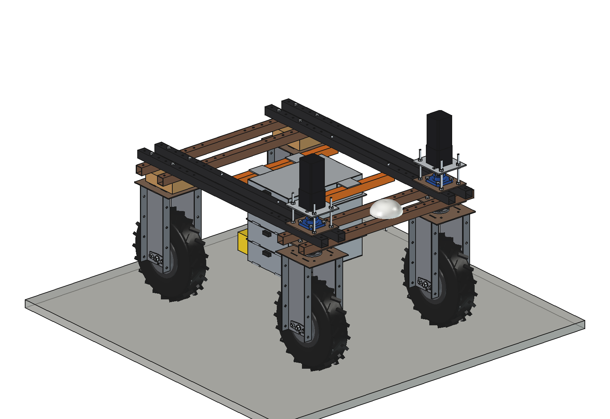 |
| **cabinet_top**: on 2 rails over the inner upper beams (y +-150), doors to the rear | 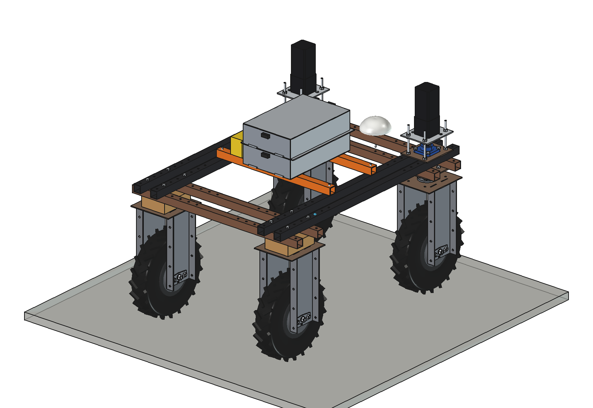 | 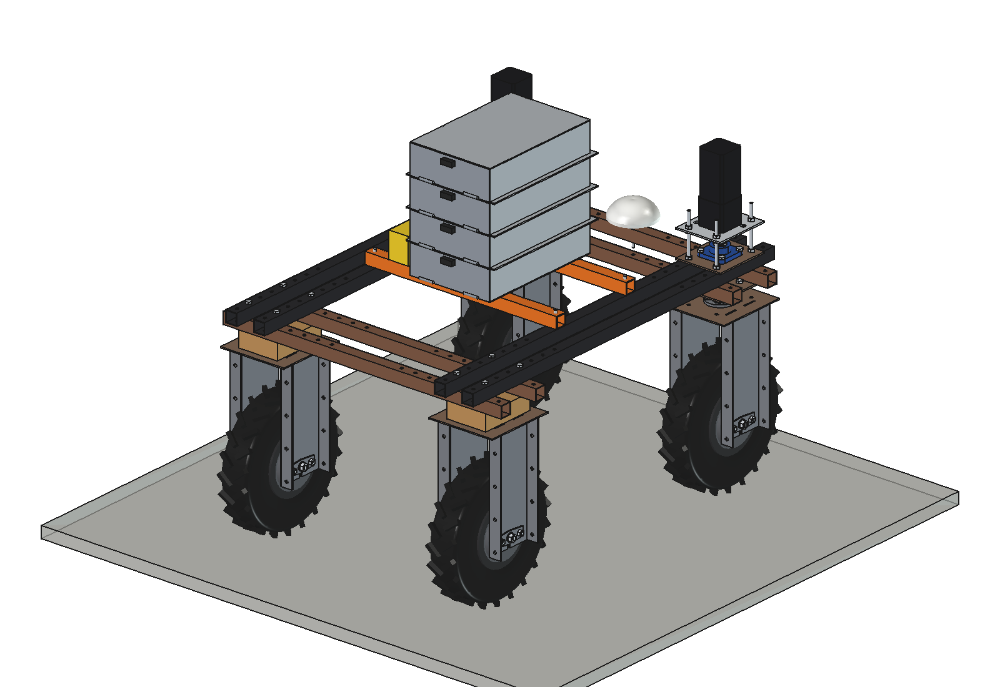 |

<p align="center">
  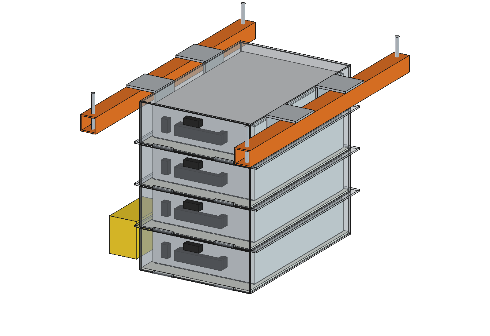
</p>

- Shelves alu 4 with an HDPE slide strip; combiner box (AS150U-F per level, fuse, CAN) on the left side wall near
  the doors, because the plugs face the doors.
- The hanging cabinet grows downwards from the frame: the roof stays at z 664, the bottom goes 458 -> 358 -> 258 mm.

## Wooden box on one side (wood_side, 2 batteries)

A simple box of **18 mm multiplex** with **2 compartments** (one battery each, divider between them) that stands on
the two upper beams of the right side, between the axles. The batteries stand upright side by side with the
**handle and AS150U plug up**; the cables leave through a slot at the top of the rear wall, under the lid.

| On the robot | Open, from the rear |
| --- | --- |
| 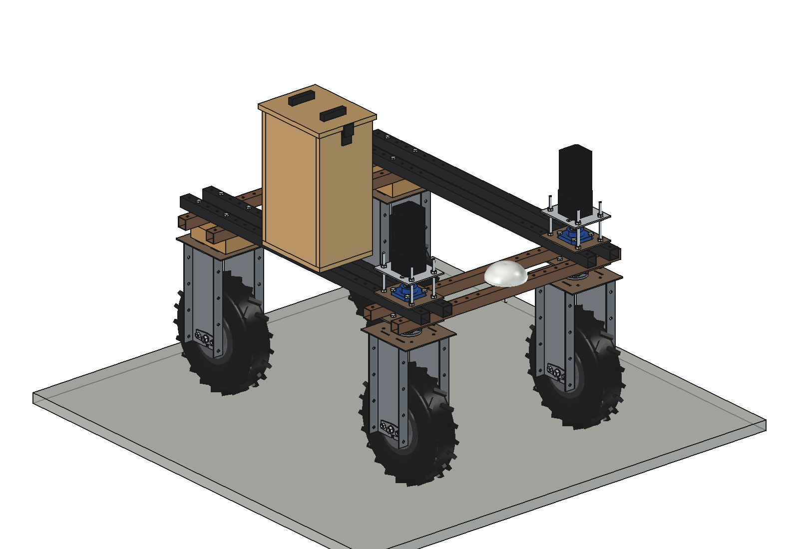 | 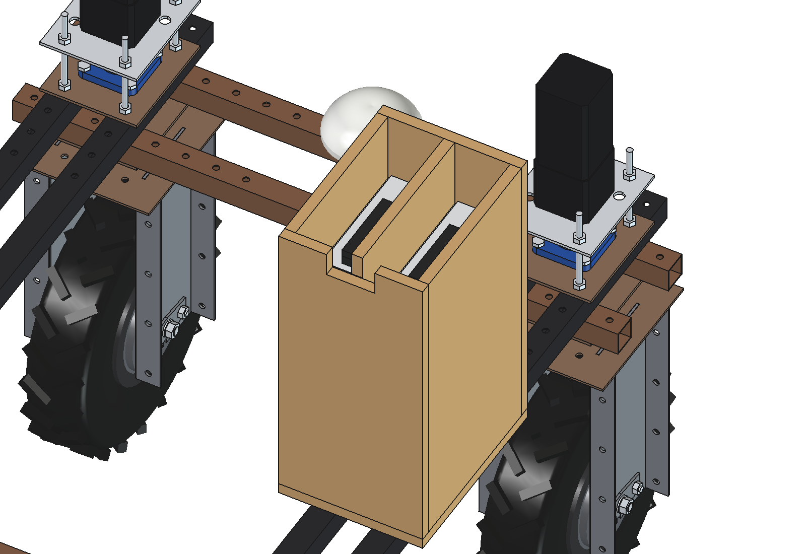 |

- Box 238 x 311 x 516 (outside, without lid): bottom, 4 walls and the divider glued and screwed, painted or epoxied.
  Compartment 92 x 275 (5 mm play, foam strips), EPDM mat 5 mm, 110 mm above the batteries for the plug and the
  cable bend.
- Loose lid 18 mm with 10 mm overhang (rain), 2 hinges at the rear, a hasp at the front, 2 handles.
- 4 x M10 countersunk through the bottom into the two right upper beams (x 325 / 425, y +-100, on the grid).
- 34.9 kg with 2 batteries (box 11.3 kg), cg 936 mm high and 370 mm to the right; the box top is at 1258 mm.

## Wooden box for the MU3+ (wood_side_mu3, 2 batteries)

The same box idea for the BatteryLabs **MU3+** (MegaUMPF3+, 48 V Li-ion 14S 50 Ah, 2.56 kWh, IP67, AS150U on top;
`Battery Labs/Flyer_MU3+.pdf`). The MU3+ is a short block of 167 x 197 x 292.4 (301.9 with the handle), so the two
batteries stand **one behind the other along the beams** (across they would make the box 408 wide, far outside the
robot). Handle and plug up, plug at the rear, cables out through the slot in the rear wall.

| On the robot | Open, from the rear |
| --- | --- |
| 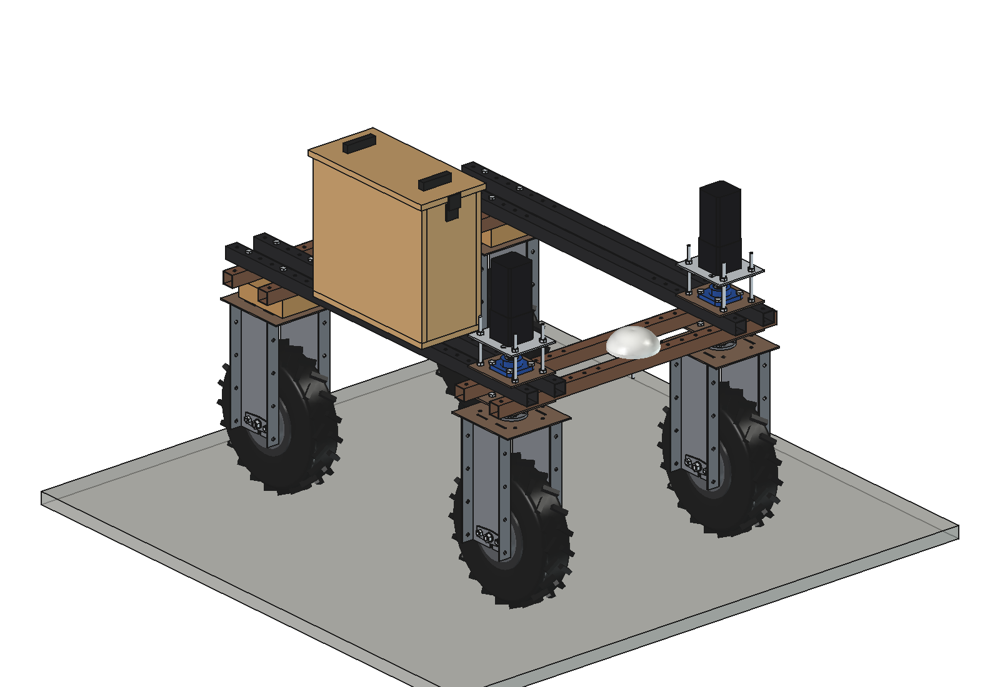 | 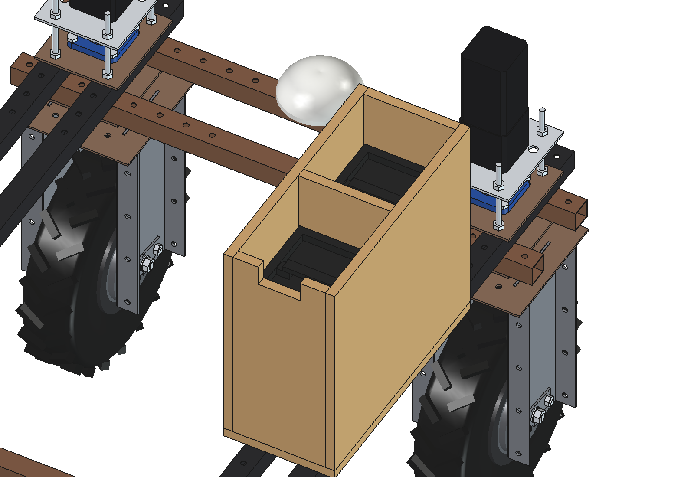 |

- Box 213 x 468 x 425 (outside, without lid), same build: 18 mm multiplex, divider across, compartments 177 x 207
  (5 mm play), EPDM mat, 110 mm above the batteries for the plug, loose lid with 10 mm overhang, hinges, hasp, handles.
- 4 x M10 countersunk into the two right upper beams at y +-150 (on the grid); the box spans y -234..234, clear of
  the stepper motors (y 405+) and the GNSS.
- 34.5 kg with 2 batteries (box 11.5 kg), cg 889 mm high and 370 mm to the right; the lid top is at 1142 mm, 116 mm
  lower than the MBH3+ box. 332 mm from the tyres with the front wheels steered 30 degrees.

## Battery placeholders

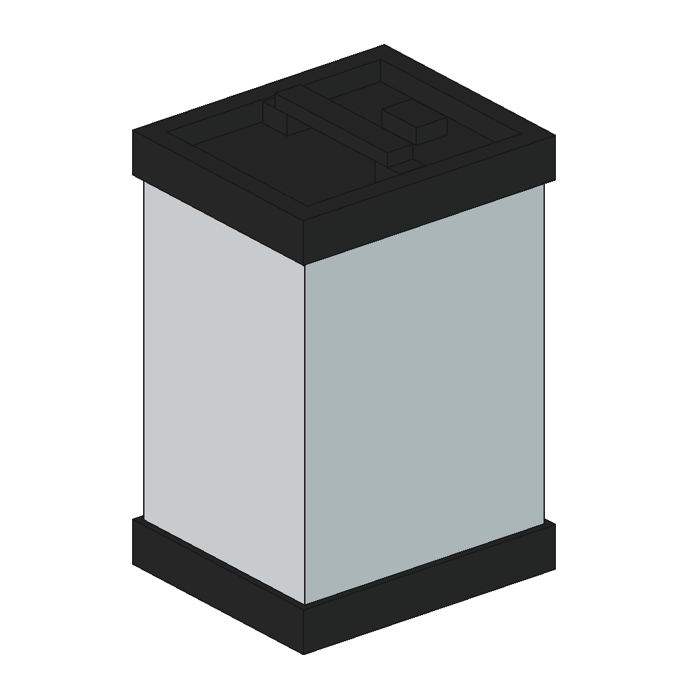

`MU3plus_placeholder.FCStd` / `.step`: the MU3+ as a plain block: 167 x 197 x 292.4 with the rubber bumper at the
bottom, the rubber frame round the recessed top, the handle 9.5 above it and the AS150U socket in the recess.
Origin = centre of the bottom face, x = 167, y = 197, z = up. From the flyer drawing (no vendor STEP yet).
In code: `bbx_parts.mu3_body_local()` and `mu3_top_local()`, or `battery_local("MU3+")`.

### MBH3+

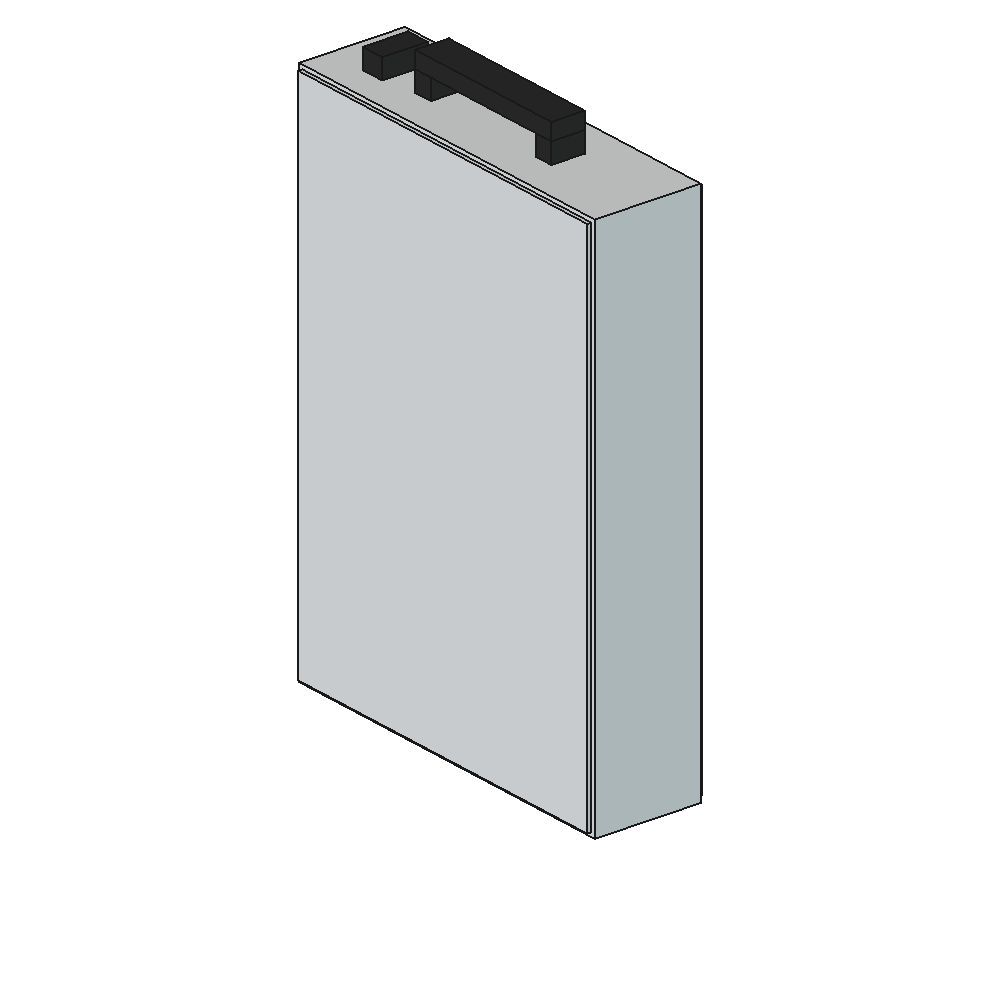

`MBH3plus_placeholder.FCStd` / `.step`: the battery as a plain block for other implements: body 265 x 82 x 383 with a
3 mm end frame, handle and AS150U socket on top, 409.6 high. Origin = centre of the bottom face, x = width,
y = thickness, z = up. Same outer size as the vendor STEP
(`Battery Labs/CAD/MBH3+_BSI_AS150U_mockup`, `build_bbx.compare_vendor()`); no details inside.
In code: `bbx_parts.battery_body_local()` and `battery_top_local()`.

## Key figures (`bbx_calc.report()`, `build_bbx.check_all()`)

| Batteries | 2 | 3 | 4 |
| --- | --- | --- | --- |
| Energy (usable 90 %) | 5.1 kWh (4.6) | 7.7 kWh (6.9) | 10.2 kWh (9.2) |
| Current continuous / peak | 120 / 200 A | 180 / 300 A | 240 / 400 A |
| Batteries (EUR, offer, excl. VAT) | 23.6 kg (1116) | 35.4 kg (1674) | 47.2 kg (2231) |
| Runtime inter-row hoe / harrow / cultivator | 4.3 / 3.5 / 4.0 h | 6.4 / 5.2 / 6.1 h | 8.5 / 7.0 / 8.1 h |
| Runtime push blade / crate carrier | 4.9 / 14.8 h | 7.3 / 22.3 h | 9.8 / 29.7 h |
| **top**: mass (rack empty), cg height | 35.1 kg (11.5), 903 mm, top 1167 | 48.9 kg (13.5), 910 mm | 62.7 kg (15.5), 915 mm |
| **well**: mass (rack empty), cg height | 35.2 kg (11.6), 502 mm, lowest 279 | 49.0 kg (13.6), 494 mm | 62.8 kg (15.6), 490 mm |
| **saddle**: mass (empty), cg height | 41.7 kg (18.1), 486 mm, 910 wide | 56.4 kg (21.0), cg x +108 | 71.1 kg (23.9), 473 mm, 974 wide |
| **cabinet_well**: mass (empty), cg height | 38.3 kg (14.7), 565 mm, lowest 458 | 52.7 kg (17.3), 516 mm, lowest 358 | 67.2 kg (20.0), 466 mm, lowest 258 |
| **cabinet_top**: mass (empty), cg height | 37.7 kg (14.1), 818 mm, top 945 | 52.1 kg (16.7), 866 mm, top 1045 | 66.6 kg (19.4), 915 mm, top 1145 |
| **wood_side**: mass (empty), cg | 34.9 kg (11.3), 936 mm high, x +370 | - | - |
| **wood_side_mu3** (MU3+): mass (empty), cg | 34.5 kg (11.5), 889 mm high, x +370 | - | - |
| Nearest tyre (front steered 30) top / well / saddle / cabinet_well / cabinet_top / wood_side / wood_side_mu3 | 405 / 208 / 57 / 202 / 338 / 370 / 332 mm | 370 / 166 / 57 / 157 / 338 mm | 338 / 123 / 57 / 136 / 338 mm |

Charging: ~2.1 h per battery at 25 A. Comparison and choice: see [RATIONALE.md](RATIONALE.md), including the list
*Estimated, not measured*.

## Files

| File | Contents |
| --- | --- |
| `bbx_params.py` | all dimensions: robot interface, MBH3+, slot pitch, rack, rails, saddle, cabinet, wooden box (per battery type), MU3+, loads |
| `bbx_parts.py` | battery placeholders (MBH3+, MU3+), upright rack (trays, end frames, guides, separators, hold-down, combiner, ears, rails), saddle cradle, closed cabinet (shell, shelves, doors, latches, combiner, ears), wooden box |
| `build_bbx.py` | `build(concept, n)`, checks (`check_interference`, `clearance`, `check_all`), mass, placeholder, `render_all()` |
| `bbx_calc.py` | energy, current, hot-swap margin, runtime per implement, charging, price |
| `run_in_freecad.py` | reload, build (`CONCEPT`, `N` at the top), print the key figures |
| `Battery_Rack_<concept>.FCStd` (top, well, saddle, cabinet_well, cabinet_top, wood_side, wood_side_mu3), `.step` | generated, 2 batteries (robot hidden in the FCStd) |
| `MBH3plus_placeholder.FCStd`, `MU3plus_placeholder.FCStd`, `.step` | the battery placeholders alone |
| `previews/` | images |

## Use

```python
exec(open(r"F:\veldrobot\aanbouwdelen\battery pack\mbh3_box\run_in_freecad.py").read())
import build_bbx
build_bbx.build("well", 3)          # top / well / saddle / cabinet_well / cabinet_top (2..4) / wood_side / wood_side_mu3 (2)
build_bbx.check_interference()      # must be []
```
