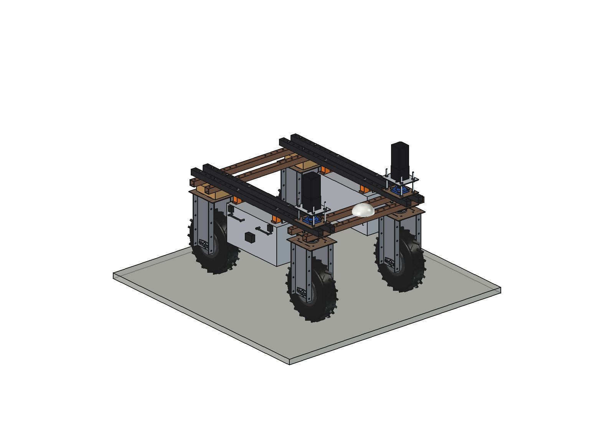
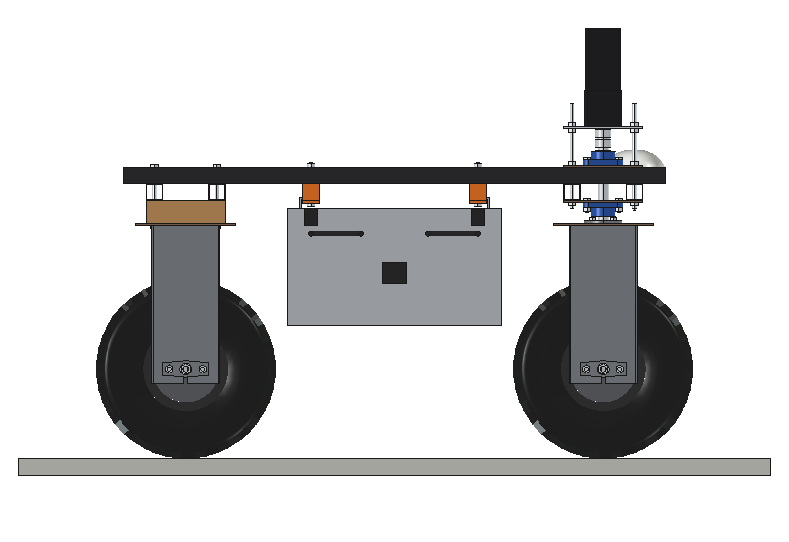
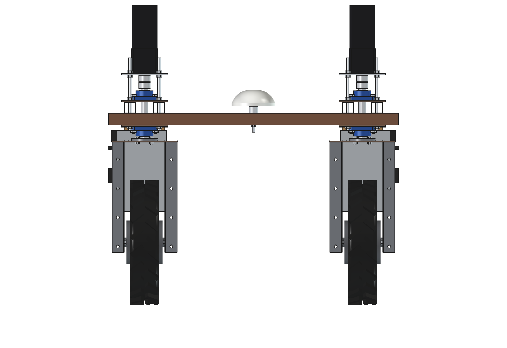
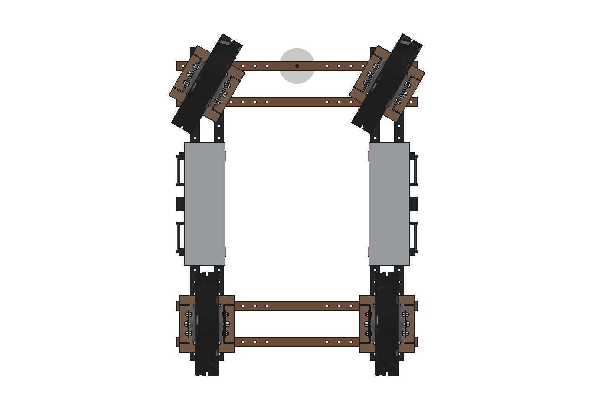
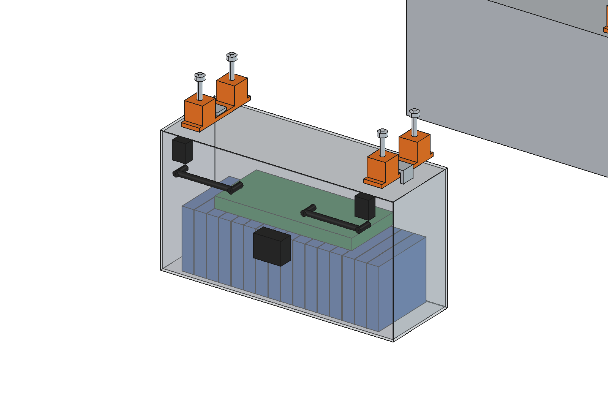

# Battery pack (simple)

Two exchangeable 48 V LiFePO4 pods (51.2 V, 50 Ah, 2.56 kWh each) for the Bruut OpenAgbot (standard robot), hanging
under the upper beams between the front and rear wheels, one per side: low, centred between the axles, and free of all
the toolbars and decks. Hook on, latch, plug in: a swap takes a few minutes.

<p align="center">
  
</p>

| Side | Front |
| --- | --- |
|  |  |
|  |  |

## Build (per side)

- **Hangers**: 2 x flat bar 40 x 8 with spacer blocks, 2 x M10 up through the two upper beams.
- **Pod**: aluminium box 3 mm, 170 x 510 x 280 mm, 16 prismatic LiFePO4 cells 50 Ah (16S), 16S BMS, 2 hook strips on the
  lid, 2 over-centre latches, 2 handles, Anderson SB50 connector on the outer face.

Mass 26 kg per pod with its hangers, 52 kg for the pair (cg 438 mm high, on the robot centre).

## Key figures (`bpk_calc.report()`)

| | |
| --- | --- |
| Per pod | 51.2 V, 2.56 kWh (2.3 kWh usable), 98 Wh/kg |
| Robot + 2 pods, usable | ~6.5 kWh (robot ~1.9 kWh usable, estimated) |
| Runtime inter-row hoe / harrow / cultivator | 1.8 -> 6.0 h / 1.4 -> 4.9 h / 1.7 -> 5.7 h |
| Runtime push blade / crate carrier shuttle | 2.0 -> 6.9 h / 6.1 -> 21.0 h |
| Extra grip from the weight | ~230 N |
| Charging | ~2.8 h per pod at 1 kW |
| Clearance to the tyres (front steered 30 degrees) | 52 mm |

Not together with the grassland aerator (same space between the axles). Why and how these come out: see
[RATIONALE.md](RATIONALE.md), including the list *Estimated, not measured*.

## Files

| File | Contents |
| --- | --- |
| `bpk_params.py` | all dimensions, robot interface, cells, implement loads, masses |
| `bpk_parts.py` | one function per part (hangers, bolts, box, hooks, cells, BMS, fittings), left or right |
| `build_bpk.py` | model tree, checks (`check_interference` with steering, `clearance`), mass, `render_all()`, STEP |
| `bpk_calc.py` | pod energy, runtime per implement, extra grip, charging |
| `run_in_freecad.py` | reload, build, print the key figures |
| `Battery_Pack.FCStd`, `Battery_Pack.step` | generated model (robot hidden in the FCStd) |
| `previews/` | images |

## Use

```python
exec(open(r"F:\veldrobot\aanbouwdelen\battery pack\simple\run_in_freecad.py").read())
import build_bpk
build_bpk.check_interference()   # front wheels at -30 / 0 / 30 degrees: must be []
```
