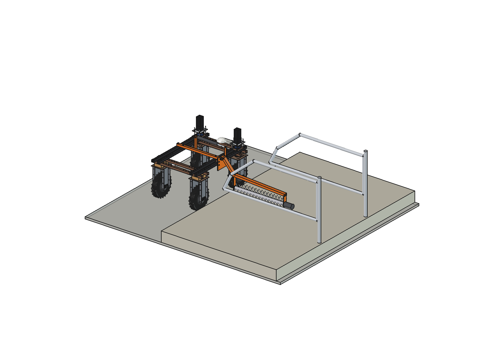
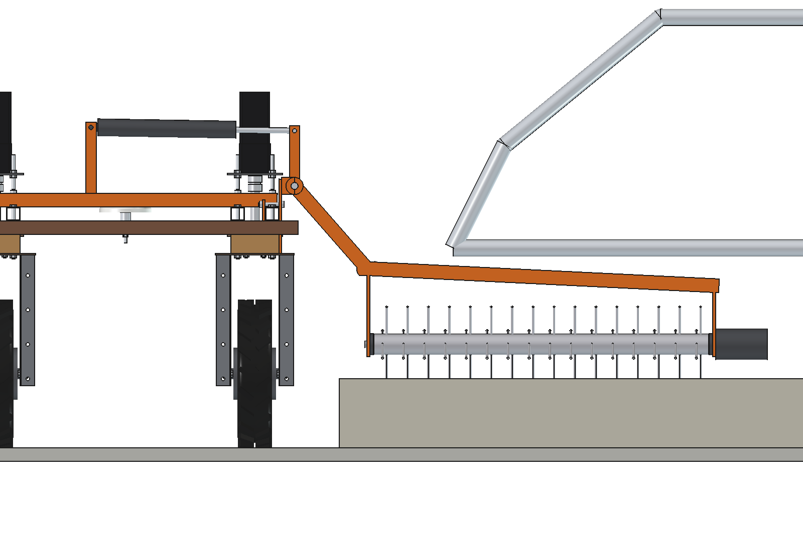
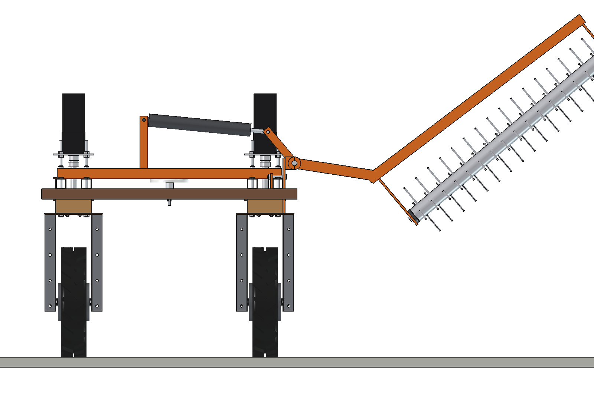
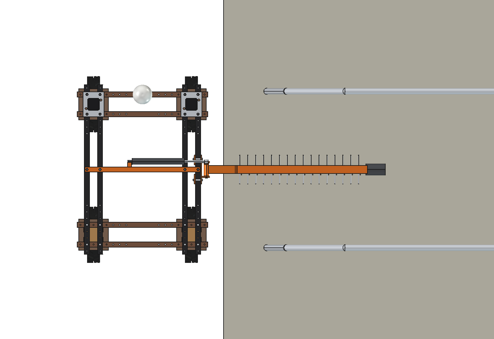
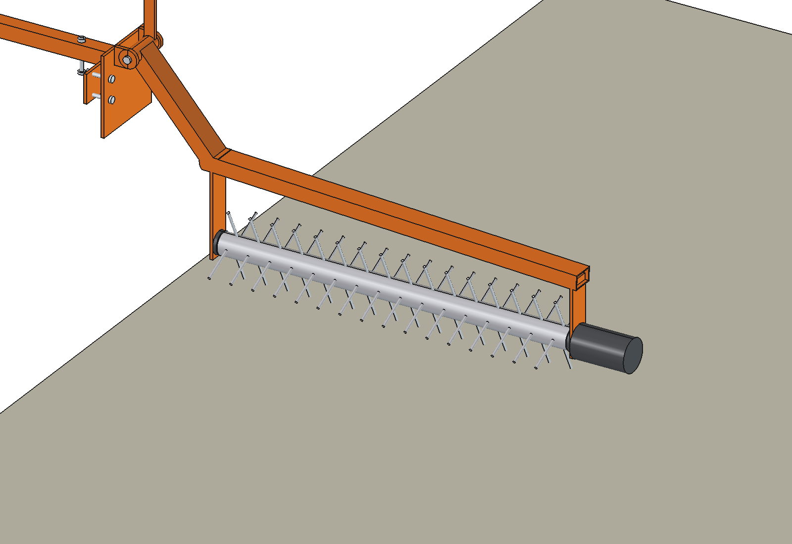

# Bedding rake (simple)

Cubicle groomer on a side arm of the Bruut OpenAgbot (standard robot): the arm reaches from the alley over the curb
into the cubicle beds, under the divider loops, with a tine rotor along the bed that loosens and levels the bedding in
the rear metre, where the cow lies. At the row end an actuator swings the arm up. A row of cubicles is drawn with it.

  

| Rear view, work | Rear view, arm lifted |
| --- | --- |
|  |  |
|  |  |

## Build

- **Mount**: plate 8 mm with 2 pivot lugs on the outer face of the right outer upper beam, clamped with a split back
  plate and 4 x M10; a bearer 40 x 40 x 3 across the upper beams with the actuator lug.
- **Arm**: tube 60 x 40 x 3 from the pivot (above the beams) steeply down to an elbow past the curb, then out over the
  bed to x 1720 at z 470..520; a crank plate 160 above the pivot; 2 hangers 8 mm for the rotor bearings.
- **Rotor**: tube O60 x 970 along the bed with 4 rows of 16 spring tines O7 (tip O240), shaft O20, 48 V 400 W gearmotor
  at the outer end.
- **Lift**: 24 V 1500 N actuator (stroke 150, uses 101) across the robot top to the crank pin: 0..40 degrees.
- **Barn** (for the checks): curb 200, beds 2.3 m, cantilever divider loops O48 every 1.2 m.

Mass 37 kg. No interference in work, while the divider loops pass the arm, and over the lift range.

## Key figures (`bdr_calc.report()`)

| | |
| --- | --- |
| Groomed | 100..1070 mm behind the curb; arm 90 mm under the loops |
| Rotor | 180 rpm, tip 2.3 m/s, ~300 W, 16 Nm, pushes ~134 N along the alley |
| Lift | ~1140 N on the actuator in work, rotor rises ~550 mm at 40 degrees |
| Stability | cg 167 mm right of the centre, side tip angle 27 degrees |
| Capacity | 4 s per cubicle at 0.3 m/s, ~655 cubicles per hour, ~3800 per battery |

Why and how these come out: see [RATIONALE.md](RATIONALE.md), including the list *Estimated, not measured*.

## Files

| File | Contents |
| --- | --- |
| `bdr_params.py` | all dimensions, robot interface, barn, arm, rotor, lift and work parameters (prefix `bdr`: `brk` is the belt rake) |
| `bdr_parts.py` | one function per part, robot coordinates (arm in work) |
| `build_bdr.py` | model tree with the barn, `set_pose(lift, barn_dy)`, checks (`check_interference`, `check_poses`, `actuator_range`), mass, `render_all()`, STEP |
| `bdr_calc.py` | reach, rotor power, lift force, stability, cubicles per hour |
| `run_in_freecad.py` | reload, build, print the key figures |
| `Bedding_Rake.FCStd`, `Bedding_Rake.step` | generated model (robot hidden in the FCStd, barn included) |
| `previews/` | images |
