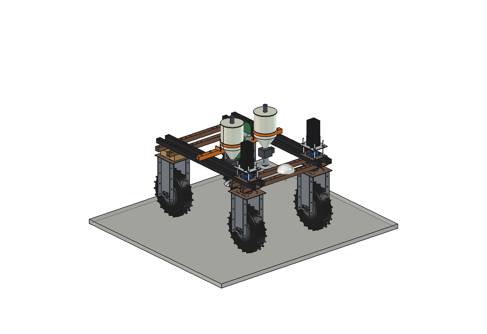
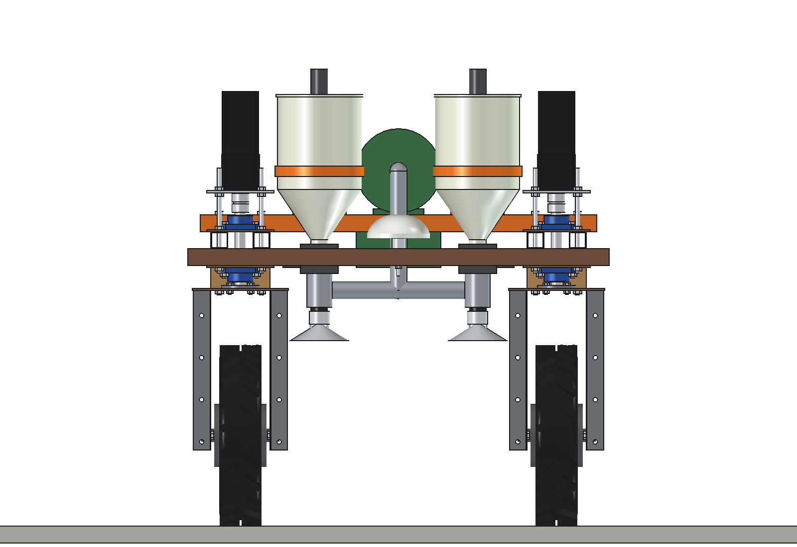
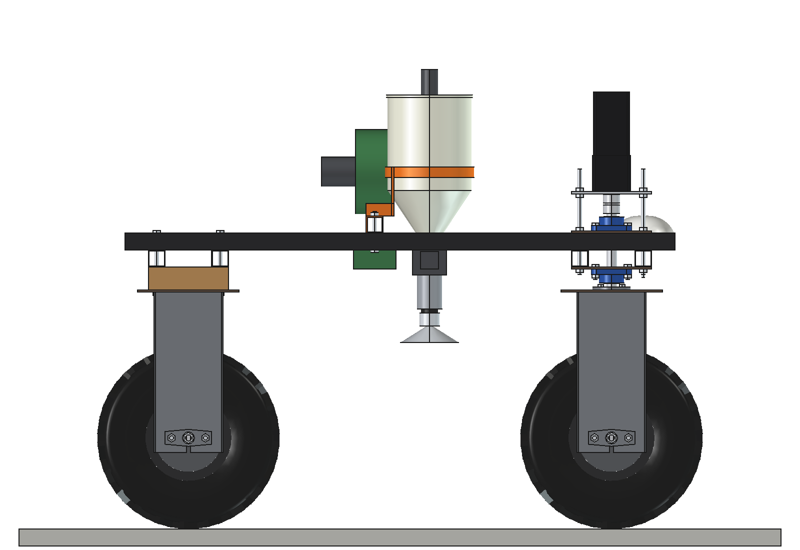
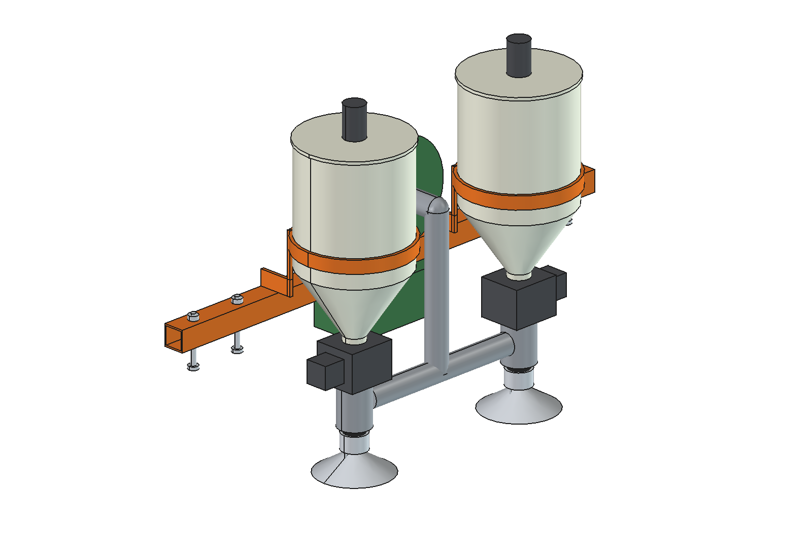
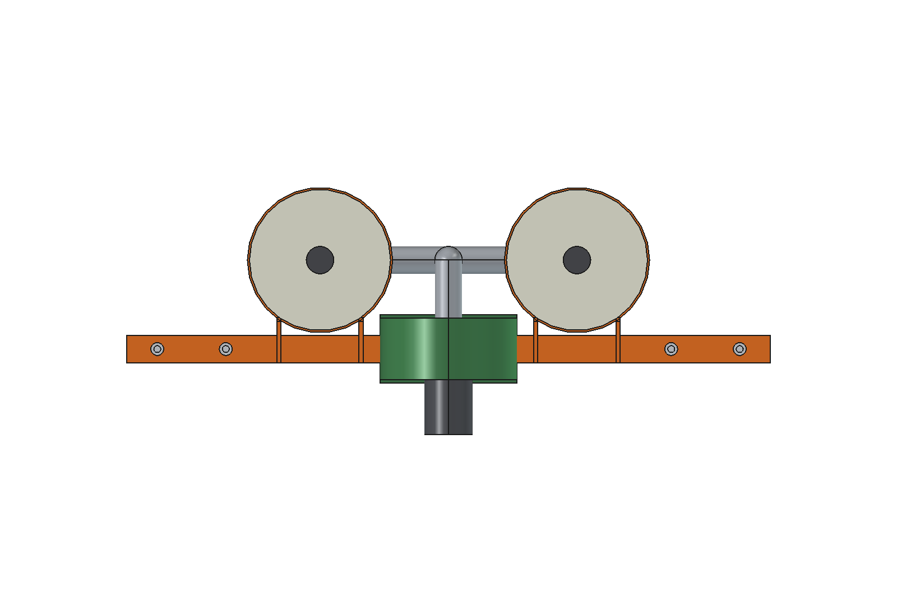

# Biological-control spreader (simple)

Releases beneficials (predatory mites in bran or vermiculite, parasitic-wasp mummies in sawdust) over two crop rows
between the wheels of the Bruut OpenAgbot (standard robot): 2 hoppers with an agitator and a metering wheel each, a
small blower whose air carries the carrier through 2 hoses to deflector nozzles just above the rows. The dose follows
the driving speed or a task map from pest counts.

  

| Front | Side |
| --- | --- |
|  |  |
|  |  |

## Build

- **Mount**: bearer 40 x 40 x 3 across the upper beams at y -60 (4 x M10), 2 pairs of flat arms 30 x 6 with rings for
  the hoppers, driver box under the bearer.
- **Hoppers**: 2 x PE O200 x 220 on a 60 degree cone (7.9 l each) at x +-187.5, lid with an agitator motor, metering
  wheel housing with a NEMA17 under each cone.
- **Air**: centrifugal fan O200 (24 V 60 W) on the bearer, air pipe O40 to 2 venturis under the metering boxes, hoses
  O40 down to deflector nozzles 450 mm above the ground.

Mass 18 kg. Size 940 x 361 x 646 mm. No interference; clear of the front wheels steered +-30 degrees.

## Key figures (`bcs_calc.report()`)

| | *A. cucumeris* | *A. swirskii* | Wasp mummies |
| --- | --- | --- | --- |
| Dose | 100 /m2 = 2 ml/m2 | 50 /m2 = 1 ml/m2 | 5 /m2 = 0.25 ml/m2 |
| Metering wheel at 0.5 m/s | 5.6 rpm | 2.8 rpm | 0.7 rpm |
| Area per fill (2 x 7.9 l) | 0.79 ha | 1.59 ha | 6.3 ha |

0.75 m of bed per pass, ~1350 m2 per hour at 0.5 m/s, ~160 W: ~12 h per battery charge. Air ~8 l/s per hose.

Why and how these come out: see [RATIONALE.md](RATIONALE.md), including the list *Estimated, not measured*.

## Files

| File | Contents |
| --- | --- |
| `bcs_params.py` | all dimensions, robot interface, products and work parameters |
| `bcs_parts.py` | one function per part, robot coordinates |
| `build_bcs.py` | model tree, checks (`check_interference`, `check_poses`), mass, `render_all()`, STEP |
| `bcs_calc.py` | hopper volume, metering per product, air, area per fill and per battery |
| `run_in_freecad.py` | reload, build, print the key figures |
| `Biocontrol_Spreader.FCStd`, `Biocontrol_Spreader.step` | generated model (robot hidden in the FCStd) |
| `previews/` | images |
