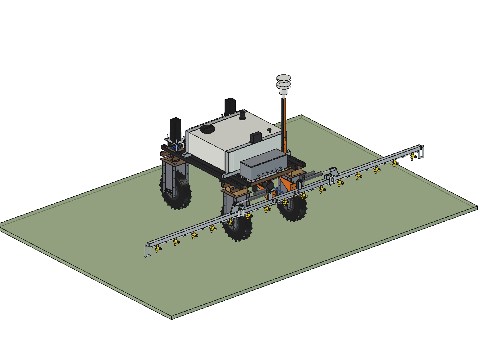
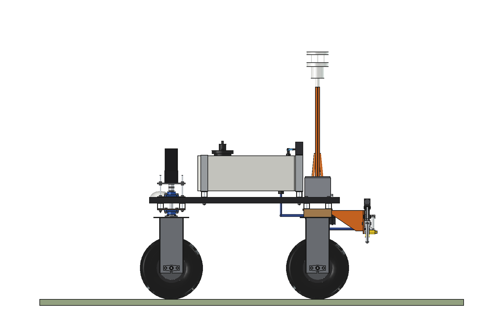
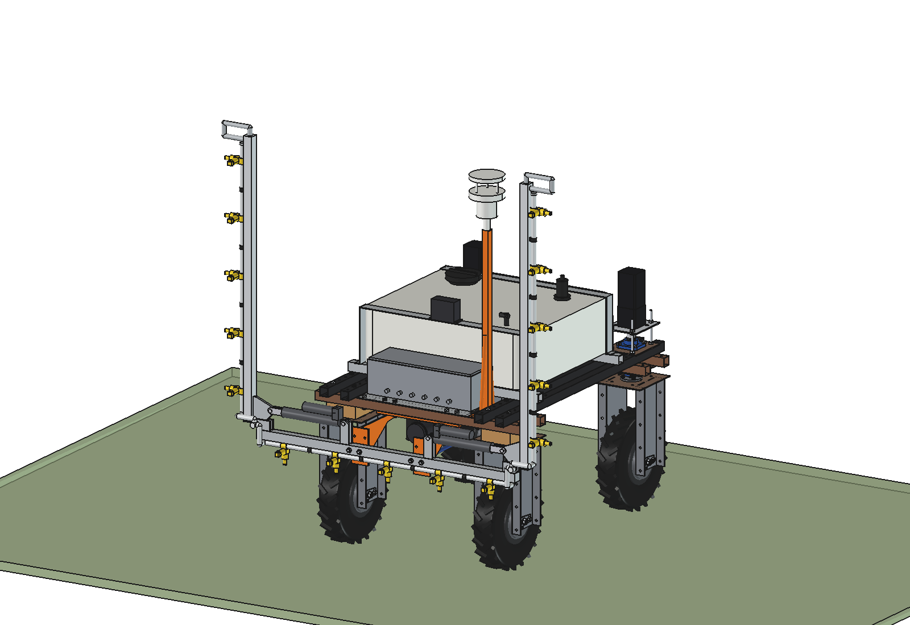
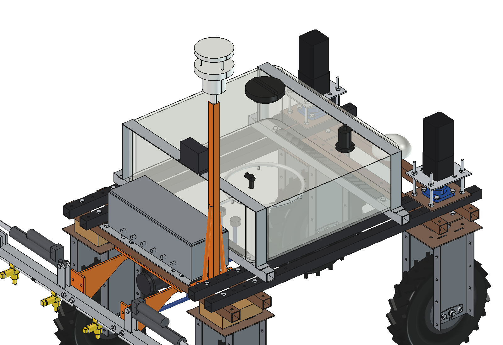
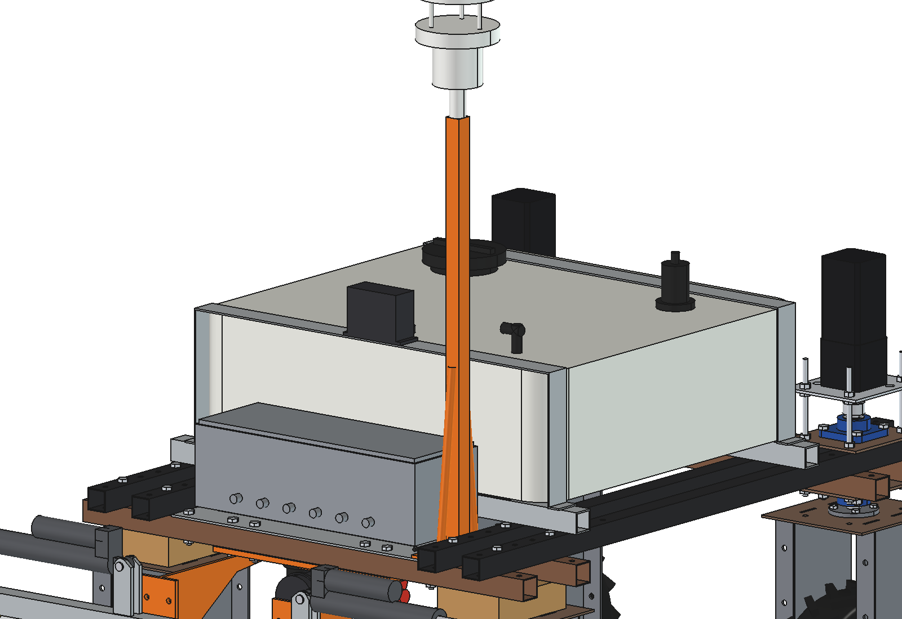

# Biostimulant sprayer (simple)

Sprays biostimulants over the whole field at the right moment: compost tea, seaweed extract, or nitrogen-fixing
bacteria (products of the Utrisha N class). No plant-by-plant precision: all 15 nozzles of the 3.75 m boom are open,
and every pass is logged (product, rate, time, weather, GNSS track) so treated and untreated strips can be compared.

The [spot sprayer](../../spotspray%20unit/boom/README.md) is used as it is - 120 l tank, pump, filter, regulator,
control box and the folding 3.75 m boom, imported, not copied - with three changes:
- **coarse tips**: twin flat-fan turbulence tips size 02 (orifice ~0.9 mm, coarse drops from 1 bar) at 1.5 bar,
  instead of the 015 flat fans: compost tea through the 50-mesh filter does not block them, drift is low and the
  living organisms see little shear;
- **aerator**: a 12 V air pump (30 l/min) clamped on the rear tank strap, a bulkhead in the tank top and a stainless
  down-tube to a diffuser ring on the tank floor: keeps compost tea aerobic and keeps products mixed;
- **weather mast** instead of the camera mast: an all-in-one weather sensor (ultrasonic wind, temperature, humidity,
  rain) on a 1.45 m mast on the rear lower beams. The controller only sprays inside the weather window and writes the
  weather into the log. The robot keeps its own GNSS antenna.

<p align="center">
  
</p>

| Side | Folded, weather mast |
| --- | --- |
|  |  |
|  |  |

## Build

- **Weather mast**: square tube 30 x 30 x 2 on a 6 mm foot plate on the control-box base plate at x 275; the two
  right-hand control-box bolts are longer and also clamp the foot. Two braces O16. Sensor on top at ~1.6 m.
- **Aerator**: air pump on the rear tank strap (y -375), air hose O10 into a bulkhead at (0, -300) in the tank top,
  stainless down-tube and diffuser ring O300 on 3 feet, 12 mm above the tank floor.
- Everything else: the spot sprayer (see its README), wings fold up for gates and transport as before.

Mass ~83 kg empty (spot sprayer without the camera mast ~76 kg + mast, sensor and aerator). Size 3820 x 1227 x 1309 mm
(wings out).

## Key figures (`bss_calc.report()`)

| | |
| --- | --- |
| Rate | 0.56 l/min per nozzle at 1.5 bar, **186 l/ha at 2 m/s**; 100 / 150 / 200 l/ha at 3.7 / 2.5 / 1.9 m/s |
| Pump | 15 nozzles 8.4 l/min, pump 9.5 l/min at 3 bar: OK |
| Filter and tip | 50 mesh (0.3 mm) = 1/3 of the 0.9 mm orifice: no bridging; 1.5 bar, gentle for bacteria and fungi |
| Aeration | 30 l/min air on 120 l = 0.25 vvm (compost tea brewers use 0.05-0.1 and more) |
| Tank | 120 l = 0.64 ha, 14 min of spraying at 2.7 ha/h; ~1.5 ha/h with refills at the field edge (8 min each) |
| Weather window (example May day) | wind < 3.5 m/s, 8-25 C, RH > 60 %, no rain: 4-10 h and 18-23 h, 11 hours = ~16 ha |
| Battery | ~1050 W at 2 m/s: ~2.3 h, ~3.4 ha per charge (the battery, not the window, limits a day) |
| Axle load front / rear | 153 / 211 kg full (rear 58 %), 98 / 146 kg empty |

Why and how these come out: see [RATIONALE.md](RATIONALE.md), including the list *Estimated, not measured*.

No animation: the boom works as the spot sprayer's with all nozzles open (see its animation); the fold is checked
statically with `check_fit()`.

## Files

| File | Contents |
| --- | --- |
| `bss_params.py` | mast, aerator, tips, spray settings, weather window, an example day, products; the rest via `ssp_params` |
| `bss_parts.py` | weather mast, longer box bolts, aerator (pump, bulkhead, hose, diffuser ring) |
| `build_bss.py` | model tree (tank, plumbing, boom from build_ssp), `set_fold()`, checks (`check_interference`, `check_holes`, `check_fit`), mass, `render_all()`, STEP |
| `bss_calc.py` | rate and speed, pump, filter vs tip, aeration, weather window, refills, battery, axle loads |
| `run_in_freecad.py` | reload, build, print the key figures |
| `Biostimulant_Sprayer.FCStd`, `Biostimulant_Sprayer.step` | generated model (robot hidden in the FCStd) |
| `previews/` | images |

## Use

```python
exec(open(r"F:\veldrobot\aanbouwdelen\biostimulant sprayer\simple\run_in_freecad.py").read())
import build_bss
build_bss.check_interference()  # []
build_bss.check_holes()         # {}
build_bss.check_fit()           # both wings 0..92 degrees against mast, aerator and robot: {}
```
