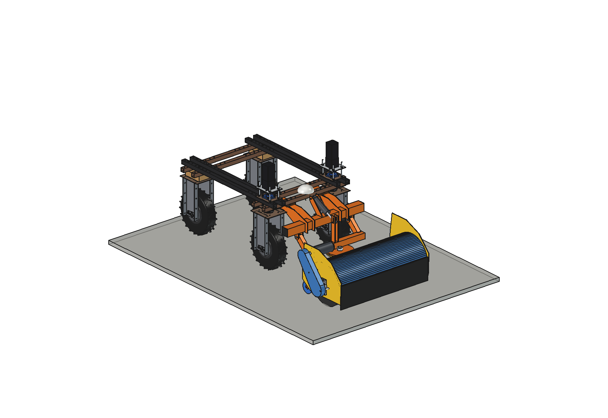
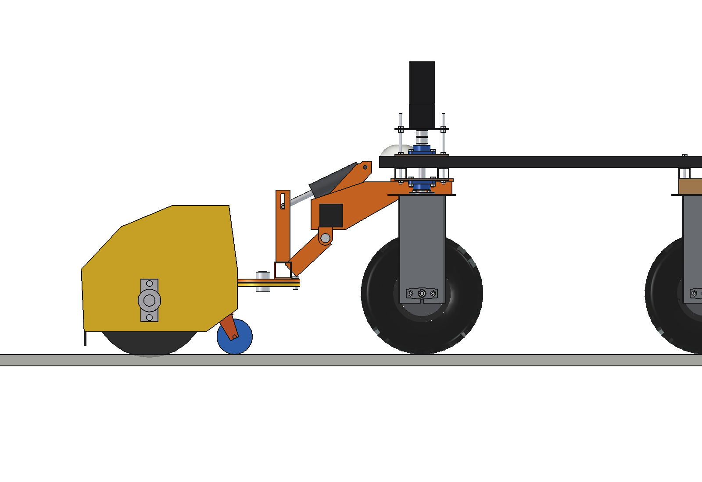
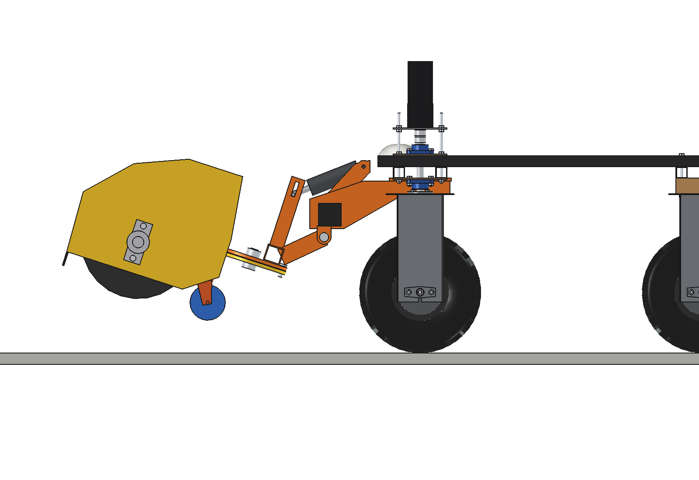
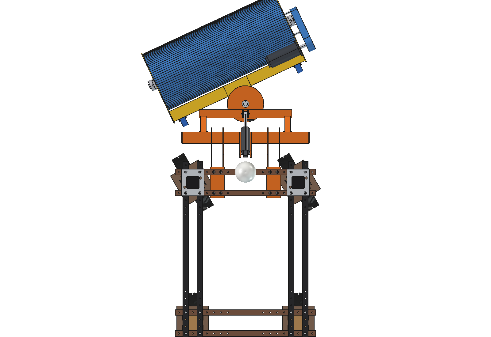
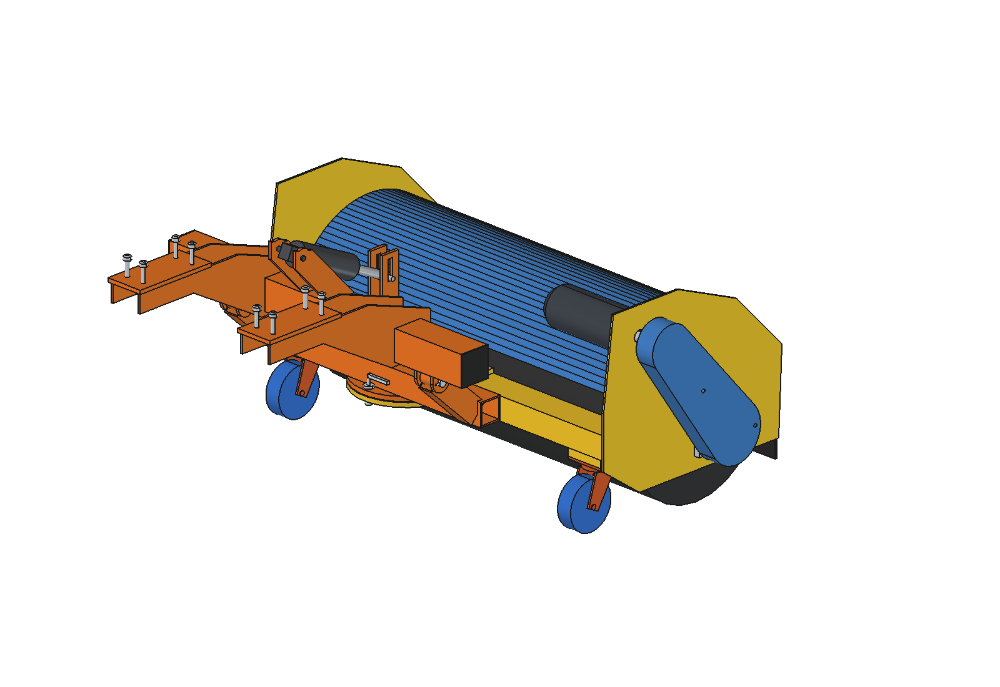
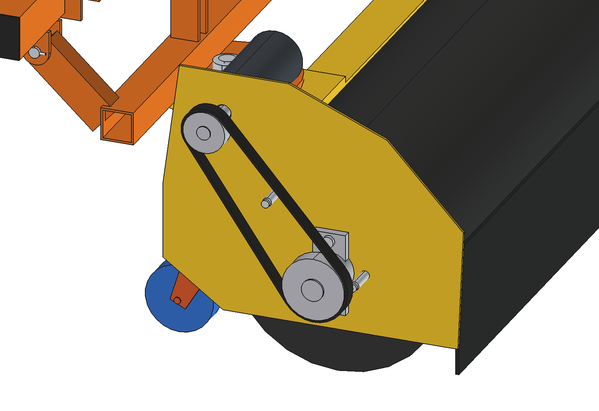

# Broom / sweeper (simple)

Front-mounted angle broom for the Bruut OpenAgbot (standard robot): sweeps yards, stable walkways, paths and light
snow. It is a roller brush O400 x 1000 under a hood, driven by a 48 V motor through a toothed belt, on the front
toolbar, lift arms and king pin of the [push blade](../../push%20blade/simple/README.md) (imported, not copied): the
blade comes off the king pin and the broom head goes on. Angled +-25 degrees, it throws the material to one side into a
windrow. Two castor wheels carry the head and set the bristle contact.

<p align="center">
  
</p>

| Work (on the castors, bristles 10 mm into the floor) | Lifted 18 degrees (only with ballast, see below) |
| --- | --- |
|  |  |
|  |  |



## Build

- **Mount, lift arms, carrier, king pin, lock pin**: from `push blade/simple` (`build_pbl.build_mount`, `pbl_parts`).
  Swapping blade and broom: take out the king pin (M30) and the lock pin, lift the head off.
- **Actuator**: same clevis and stroke as the push blade, but the 3000 N version: the broom head is heavier and further
  forward than the blade (~2760 N needed, the 1500 N actuator of the blade is not enough).
- **Head frame** (weldment): round swivel plate O260 x 12 with the 5 lock holes, spine plate, cross beam 80 x 60 x 4
  under the swivel plate, 2 end plates 5 mm.
- **Brush**: PP bristles O400 / O130 on a core tube O114.3 x 3, stub shafts O40 in 2 flange bearings UCFL 208.
  400 rpm, tip speed 8.4 m/s; the bottom turns forward.
- **Drive**: 48 V BLDC 1000 W with a 1:5 planetary gearbox inside the right end plate, above the hood;
  HTD 8M belt 30T -> 45T outside the right end plate under a guard on 2 standoffs.
- **Hood** aluminium 2 mm between the end plates, rubber flap 6 mm at the front.
- **Castors**: 2 swivel castors O125 x 40 PU on 20 mm spacers under the beam (x +-450). Bristle wear: thinner spacers.

Mass ~124 kg (lift group 98 kg, of which the brush 26 kg; mount 22 kg). Size 1185 x 1310 x 692 mm (x, y, z).

## Key figures (`bsw_calc.report()`)

| | |
| --- | --- |
| Brush | 400 rpm, tip 8.4 m/s, 15 Nm at 150 N bristle force |
| Brush power, sand / snow 30 mm | ~910 / ~930 W electric (motor at ~78 % of 1000 W) |
| Drag on the robot, angled 25 degrees | ~163 N along, ~32 N sideways (hub motors 1100 N continuous) |
| Work rate, angled 25 degrees / straight | 0.81 m effective, ~2900 m2/h / 0.90 m, ~3240 m2/h at 1 m/s |
| Per battery charge (1.9 kWh usable) | ~1.7 h, ~4900 m2 (brush ~910 W + drive ~220 W) |
| Axle load front / rear, working | 69 / 82 kg, 130 kg on the castors (rear 54 %) |
| Axle load front / rear, **lifted, no ballast** | 284 / **-4 kg: tips forward** |
| Ballast to lift | 4 plates (44 kg) for a short hop over a kerb (rear 12 %); 9 plates (99 kg) for lifted transport (rear 25 %) |
| Actuator | ~2760 N at work, 3000 N rating, lift time ~9 s |

**Use**: drive to the job with the head down on its castors and the brush stopped; lift only over kerbs or
thresholds, and only with at least 4 counterweight plates on the rear stacks
([counterweights](../../counterweights/simple/README.md)). The robot control must block the lift without ballast.

Why and how these come out: see [RATIONALE.md](RATIONALE.md), including the list *Estimated, not measured*.

## Files

| File | Contents |
| --- | --- |
| `bsw_params.py` | all broom dimensions; robot and push-blade interface from `pbl_params`, work parameters, masses from the model |
| `bsw_parts.py` | one function per head part, robot coordinates, work pose |
| `build_bsw.py` | model tree (mount, lift and actuator from build_pbl), `set_pose(lift, angle)`, checks (`check_interference`, `check_holes`, `check_poses`, `clearance`, `ground_contact`), mass, `render_all()`, STEP |
| `bsw_calc.py` | brush speed and power, axle loads and ballast, actuator, drag, work rate per charge |
| `run_in_freecad.py` | reload, build, print the key figures |
| `Broom_Sweeper.FCStd`, `Broom_Sweeper.step` | generated model (robot hidden in the FCStd) |
| `previews/` | images |

## Use

```python
exec(open(r"F:\veldrobot\aanbouwdelen\broom sweeper\simple\run_in_freecad.py").read())
import build_bsw
build_bsw.set_pose(lift=18, angle=25)
build_bsw.check_poses()        # lift -4..18 x angle -25..25 x steering -30..30: must be {}
build_bsw.clearance()          # 148 mm to the front tyres (carrier, lift -4, angle -25)
```

No animation yet (simple variant): the poses are checked statically with `check_poses()`.
