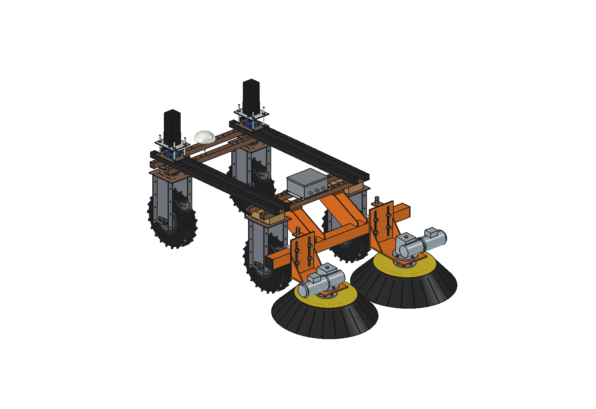
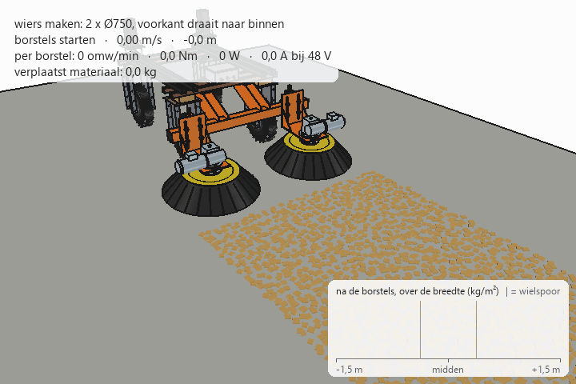
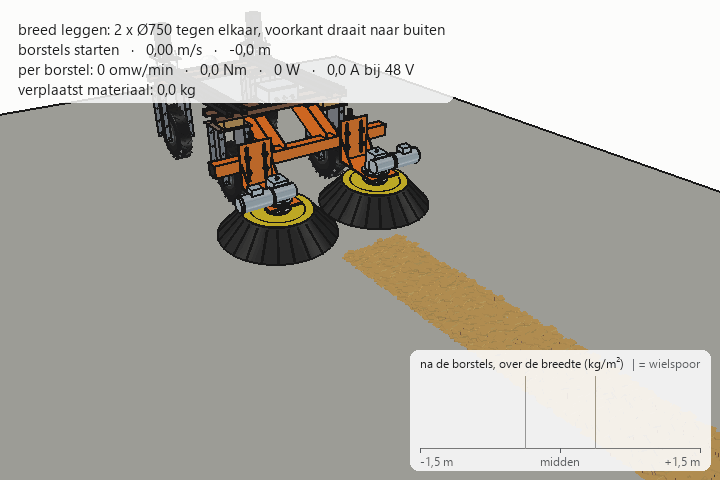
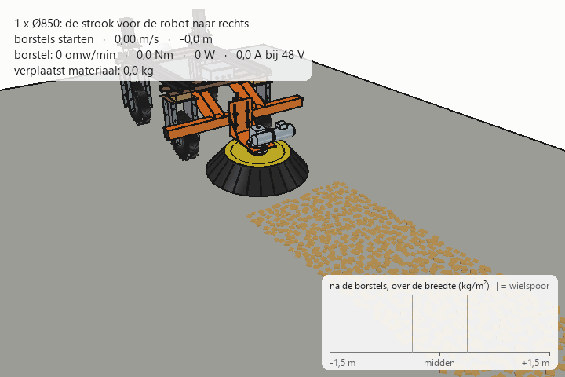
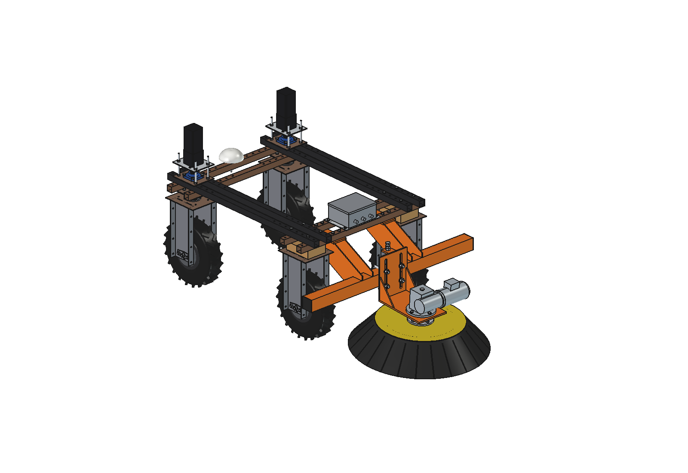
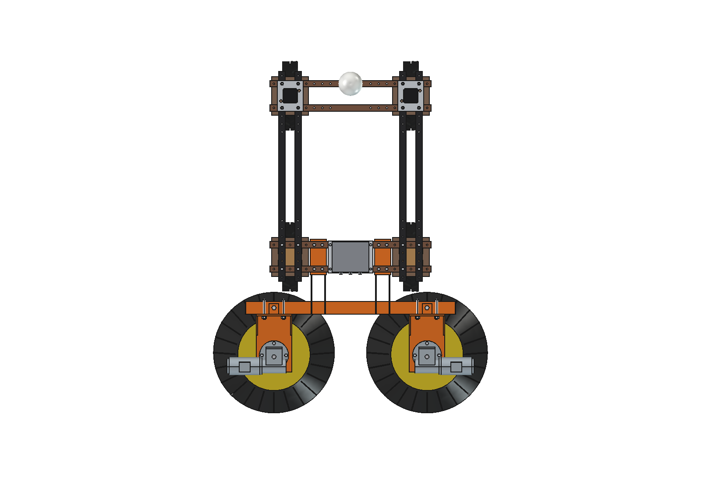
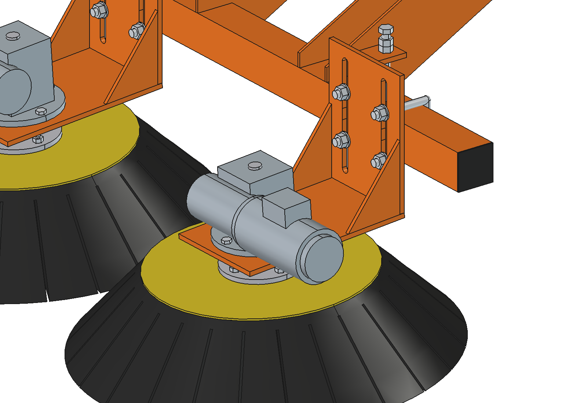
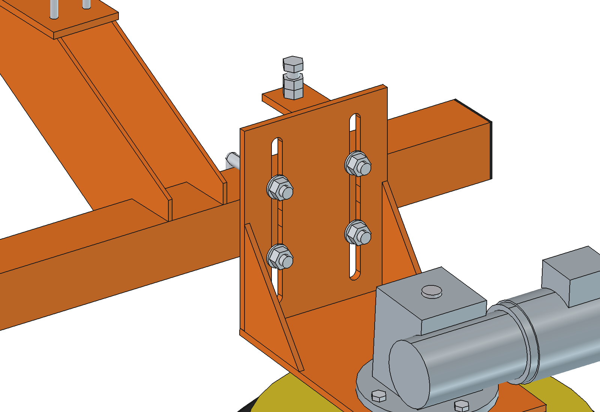
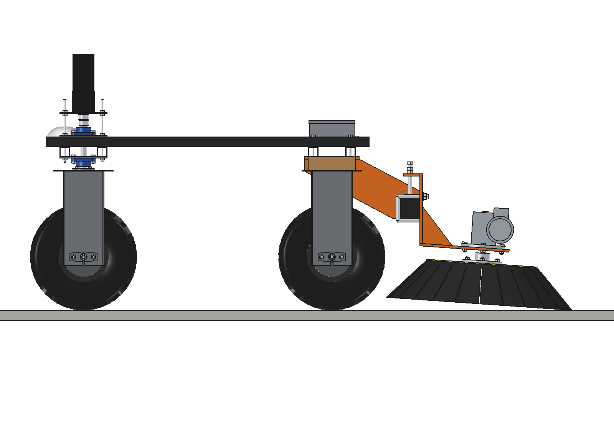

# Disc brushes (simple): FreeCAD model

Disc brushes for the standard Bruut OpenAgbot. One kit, three versions:

| Version | Brushes | Working width | Use |
| --- | --- | --- | --- |
| `double_750` (standard) | 2 × Ø750 | 1.50 m (brushes touching) to 1.70 m (200 mm apart) | spread wide **or** make a windrow |
| `double_650` | 2 × Ø650 | 1.30 m to 1.50 m | same, narrower and lighter |
| `single_850` | 1 × Ø850 | 0.85 m (the robot's own width) | sweep the strip in front of the robot to one side |

- **Brushes:** standard sweeper disc brushes (steel plate with PP or PP/steel-wire tufts), each on its own
  48 V worm gearmotor (NMRV063 i = 30, 550 W). The motor is reversible, so one switch in software changes the job:
  - **windrow:** the fronts of the brushes turn inwards. The material ends up in a windrow in the middle, which
    passes between the wheels under the robot;
  - **spread wide:** the fronts turn outwards. A windrow or heap is spread out to both sides, up to about ±1.2 m.
- **Mounting:** an 80 × 80 toolbar behind the fixed rear wheels, welded to 2 hangers. Each hanger is bolted with
  4 × M10 under the two rear lower beams, through the 50 mm hole grid. Nothing has to be drilled in the robot.
- **Brush unit:** a clamp plate with 4 slotted holes and 2 square U-bolts M16 around the toolbar. Loosen 4 nuts and
  the unit slides sideways (distance between the brushes) and up/down (brush wear, transport position), with a
  jack bolt that carries the unit while you adjust. The same unit and the same motor fit every brush.

Why it is designed this way is explained in [RATIONALE.md](RATIONALE.md).









| | | |
| --- | --- | --- |
|  |  |  |
| 2 × Ø650 | 1 × Ø850 | 2 × Ø750 set for a windrow (200 mm apart) |
|  |  |  |
| brush unit: head plate, gussets, worm gearmotor | clamp plate: slotted holes, U-bolts, jack bolt | side view: brush tilted 4° forwards |

## Key figures

From the model (`build_dbr.mass_properties`, `clearance`) and `dbr_calc.report()`. Robot 161.5 kg (agbot comparison).

| | 2 × Ø650 | 2 × Ø750 | 1 × Ø850 |
| --- | --- | --- | --- |
| Mass (without counterweight) | 104 kg | 110 kg | 75 kg |
| Overall size (w × l × h) | 1306 × 1029 × 764 mm | 1500 × 1078 × 764 mm | 1306 × 1127 × 764 mm |
| Brush centre | y −1110 (all versions) | | |
| Clearance brush – rear tire, new brush / highest position | 104 / 71 mm | 58 / 28 mm | 111 / 93 mm |
| Speed | 100 rpm (70 for a windrow) | 100 rpm (70 for a windrow) | 90 rpm |
| Torque per brush (estimated) | 19 Nm | 25 Nm | 31 Nm |
| Electrical power per brush | 340 W, 7.0 A at 48 V | 460 W, 9.5 A | 510 W, 10.7 A |
| Motor load | 49 % | 67 % | 75 % |
| Side force on the robot | 0 (brushes turn against each other) | 0 | 75 N; robot runs 1.0° skew, steers 1.7° against it |
| Front axle share working / brushes lifted | 33 % / 19 % | 35 % / 17 % | 40 % / 28 % |
| … with the counterweight (2 × 20 kg) | 44 % / 31 % | 45 % / 29 % | 51 % / 40 % |
| Run time on the robot battery (incl. driving) | 2.1 h | 1.6 h | 2.5 h |

The steering wheels need at least 20 % of the weight (agbot comparison). With the double versions, use the
counterweight (the same blocks as the feed pusher) when driving with the brushes lifted, or drive with the brushes
down and stopped.

## Setting up (by hand, one 24 mm spanner)

| What | How |
| --- | --- |
| Distance between the brushes | Loosen the 4 U-bolt nuts, slide the unit along the toolbar, tighten. Spread wide: brushes touching (gap 0). Windrow: 150–250 mm apart (standard 200). The U-bolts must stay clear of the hanger webs: unit centre at \|x\| ≤ 85 or ≥ 315 mm (Ø650 touching: 325) |
| Brush height (wear) | Loosen the U-bolt nuts, turn the jack bolt on top until the front of the brush presses about 20 mm into the floor, tighten, lock the jack bolt with its lock nut. Range ±60 mm in the slots |
| Transport | Same, brush up to the top of the slots (+60): 60 mm free at the front |
| Spread wide / windrow | Reverse the motors in the controller (software). No mechanical change |
| Swap the brush | 4 × M10 under the brush plate + the M10 end bolt in the shaft. The brush hub stays on the shaft |
| Ø650 ↔ Ø750 ↔ Ø850 | Same unit, same motor, same holes. Only the brush, the height in the slots and the position on the toolbar change |

## Files

| File | Contents |
| --- | --- |
| `Disc_Brushes_double_750.FCStd`, `…_double_650.FCStd`, `…_single_850.FCStd` | the models, with the robot model hidden next to it. Generated, so do not edit by hand |
| `Disc_Brushes_*.step` | the brushes only, in robot coordinates |
| `dbr_params.py` | all dimensions, the robot interface, the three versions (`CONFIGS`) and the operating parameters |
| `dbr_parts.py` | one function per part; each function returns a `Part` shape |
| `build_dbr.py` | model tree, colors, collision check, clearance to the tires, floor contact, mass, images, STEP |
| `dbr_calc.py` | torque, power, current, gearmotor, side force and skew, axle loads, hangers, toolbar, run time (pure Python) |
| `dbr_material.py` | material model for the animation: loose material as particles, picked up by the front arc of the brush (Python + numpy) |
| `animate_dbr.py` | animation: robot + brushes on a concrete floor, three runs (`RUNS`: windrow, spread, single) |
| `make_gif_dbr.py` | frames to GIF with a caption and the distribution of the material across the width |
| `run_in_freecad.py` | macro: open in FreeCAD and run (F6) to rebuild a version and print the key figures |
| `previews/` | images and the GIFs |

## Axes

Same as the robot model: x = right, y = driving direction of the robot (front = +y), z = up, ground = z 0, mm.
The origin is the centre of the robot, so the implement is directly in robot coordinates.

- Toolbar 80 × 80 × 4 at y −855 … −775, z 370 … 450, x ±650 (60 mm behind the rear tires).
- Brush centre at y −1110. The brush is tilted 4° forwards (towards −y); only the front of the brush touches the floor.
- While brushing the robot drives towards −y (brushes first); the steering wheels are then at the back.
- Rotation: + = anticlockwise seen from above. Windrow: left brush anticlockwise, right brush clockwise.

## Rebuilding and using

In FreeCAD's Python console (folder in `sys.path`, or via `run_in_freecad.py`):

```python
import build_dbr
build_dbr.build("double_750")                      # builds, saves FCStd and STEP (robot hidden)
build_dbr.build("double_750", mode="windrow")      # brushes 200 mm apart
build_dbr.build("double_650", gap=100, save=False, step=False)
build_dbr.build("single_850", h=60, show_robot=True, save=False, step=False)   # transport position
build_dbr.check_interference()                     # overlap among parts and with the robot (must be empty)
build_dbr.clearance()                              # smallest distance to the rear tires and wheel brackets
build_dbr.floor_contact()                          # lowest point of each brush (0) and the contact strip
build_dbr.mass_properties()                        # mass and centre of gravity
build_dbr.render_all()                             # all images in previews/, save FCStd + STEP of all versions
```

```python
import dbr_calc
dbr_calc.report("double_750")                      # key figures (also "double_650", "single_850")
dbr_calc.report_all()
dbr_calc.robot_reaction("single_850", "right")     # side force, skew and steering correction
dbr_calc.axle_loads("double_750", ballast=True, working=False)
```

## Animation

Builds a separate document `DBR_on_robot_animation` with the robot model from `agbot design` (not modified), the
brushes, a concrete floor and loose material as particles (`dbr_material`):

- **windrow** (2 × Ø750, 200 mm apart, 70 rpm): a 2 kg/m² layer becomes a windrow of about 0.4 m in the middle;
- **spread** (2 × Ø750 touching, 100 rpm): a windrow of 8 kg/m is spread out to both sides, up to about ±1.2 m;
- **single** (1 × Ø850, 90 rpm): the strip in front of the robot goes to the right.

Per frame (10 per second, 10 sub-steps): robot position and wheel rotation, brush rotation about the tilted axis, the
material, and the torque, power and current per brush from `dbr_calc` with the measured material flow.

```python
import animate_dbr
animate_dbr.build("windrow")
animate_dbr.play("windrow")                        # live, animate_dbr.stop()
animate_dbr.summary("windrow")                     # range of torque, power, current, material moved
animate_dbr.render_all("windrow", r"C:\temp\dbr_windrow")
import make_gif_dbr
make_gif_dbr.main(r"C:\temp\dbr_windrow", r"previews\animation_windrow_double_750.gif")
```

## Model tree

```
Disc_brushes (disc_brushes_<version>)
  Mount          toolbar 80x80x4 L1300 with end caps, 2 hangers (top plate 10 mm + 2 webs 6 mm), 8 x M10 into the beams
  Controller     IP66 box with 2 motor controllers 48 V / 30 A on a 3 mm plate, 4 x M8 through the hole grid
  Unit_left / Unit_right / Unit_centre
                 clamp plate 10 mm with 4 slots, jack tab + M16 jack bolt, 2 square U-bolts M16,
                 head plate 10 mm (4° tilt) + 2 gussets, worm gearmotor NMRV063 + 48 V 550 W, 4 x M10
    Brush_*      plug-in shaft D25, brush hub D160, brush plate, bristle ring (rotates along)
  Counterweight  2 blocks of 20 kg on the front lower beam (optional, same as the feed pusher)
Robot (hidden in the FCStd; for checking only)
```

## Maintenance

- **Brush:** replace when the unit is at the bottom of the slots: after about 45 mm of wear (Ø650), 60 mm (Ø750) or
  75 mm (Ø850). Until then, reset the height with the jack bolt when the brush no longer sweeps clean.
- **Gearmotor:** NMRV worm gearboxes are filled with synthetic oil for life. Check the shaft seal at the bottom
  (it sits above the brush, in the dust). The plug-in shaft: grease it when swapping, so it does not rust in place.
- **U-bolts and slots:** keep the threads greased; a seized U-bolt is the only thing that can stop you adjusting.
- **Spares that fit everything:** one gearmotor, one brush hub, one shaft. Left and right use the same gearmotor:
  for the other side turn the gearbox over and move the output flange (FA) to the other face of the housing.

## Estimated, not measured

- Robot: 161.5 kg, centre of gravity y +95, z 543 (agbots/agbot comparison, not weighed).
- Brush contact force 150 / 180 / 200 N (Ø650 / 750 / 850) at about 20 mm bristle deflection, bristle friction 0.4
  on concrete, effective contact radius 0.85 R.
- Material: 2 kg/m² (sawdust, sand, feed remains), friction 0.5 on concrete; material model in `dbr_material`
  (slip 30–60 %, contact arc ±75°) is a rough model, not calibrated.
- Gearmotor: NMRV063 i = 30 with FA flange and a 48 V DC motor 550 W IEC 71 B14 (mass 13 kg, efficiency
  0.72 × 0.80, dimensions approximated). Check the motor with the supplier.
- Brush masses (10–17 kg incl. hub): bristle ring as a solid with density 0.3 kg/dm³.
- Tires: stiffness 0.12 per degree per N of wheel load, grip 0.6 (as for the feed pusher).
- Driving power on concrete 250 W; battery 48 V 50 Ah, 80 % usable.

See RATIONALE § 7.
