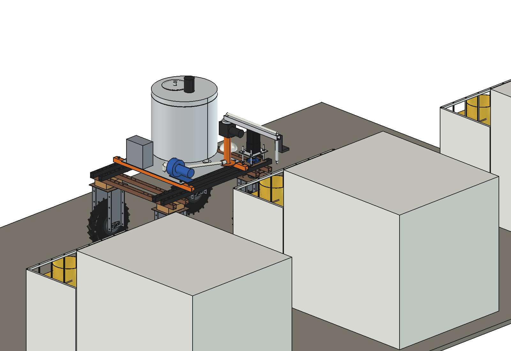
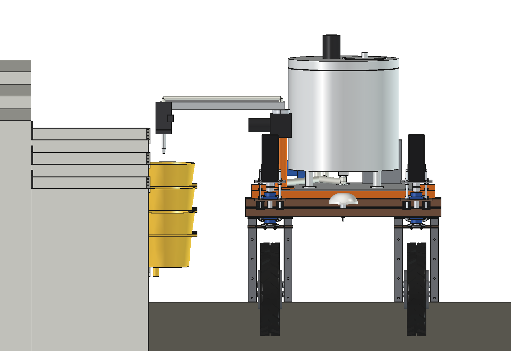
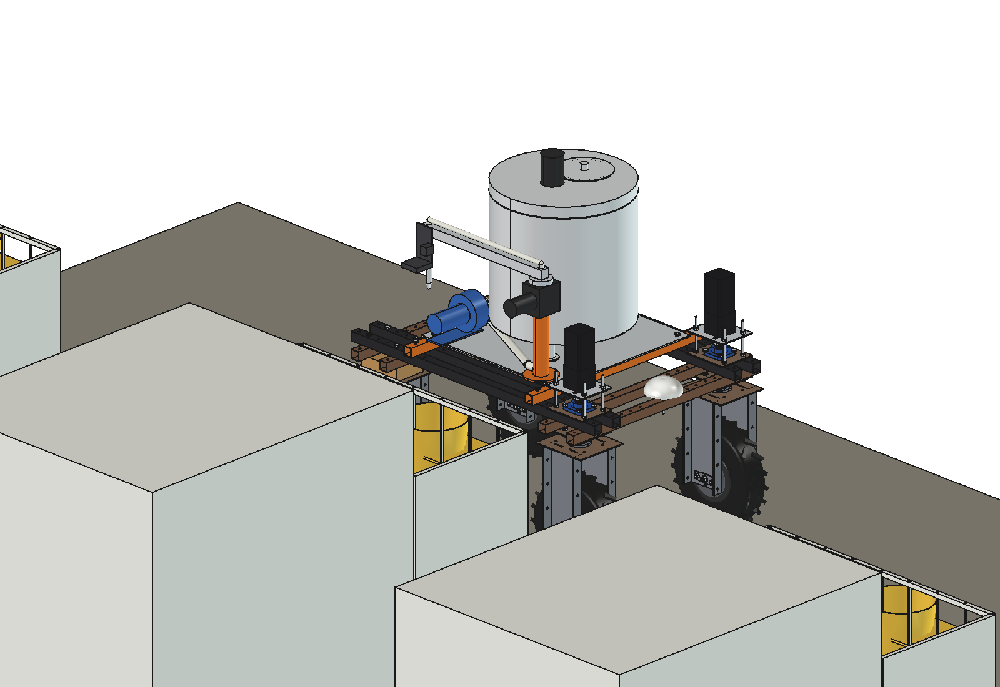
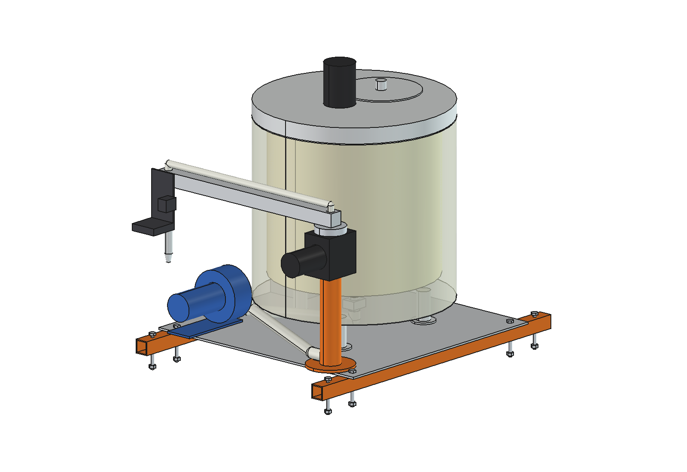
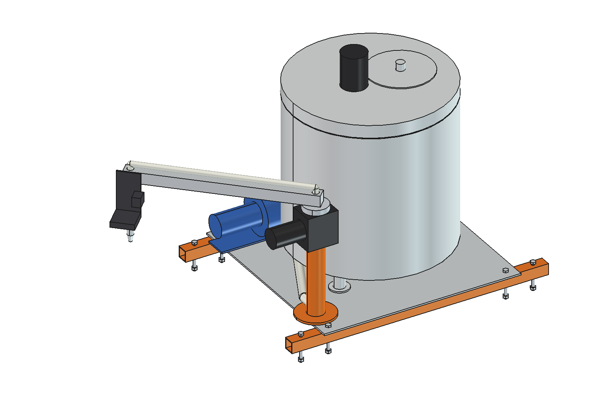
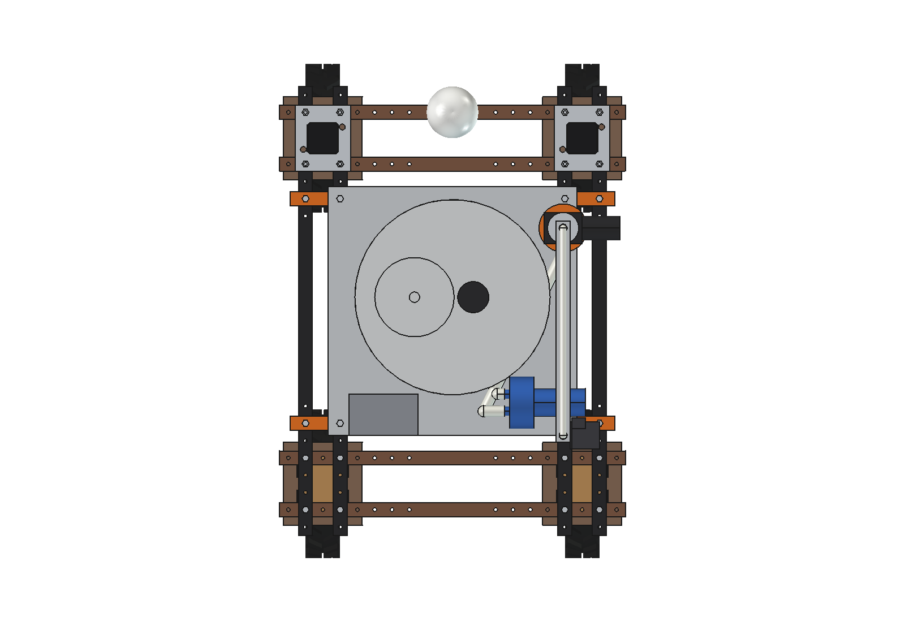
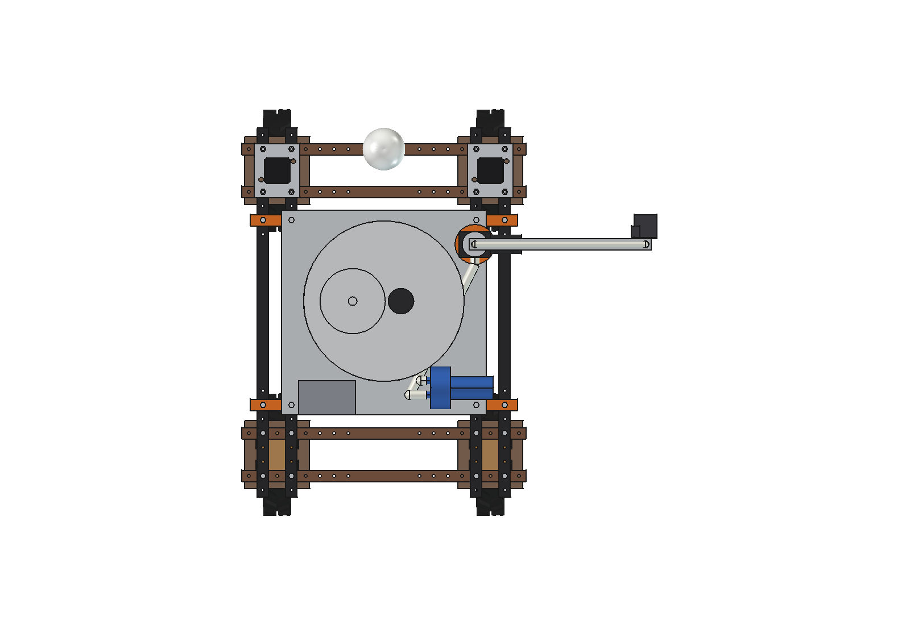

# Calf milk taxi (simple): FreeCAD model

Brings warm milk from the calf milk kitchen to the calves in their hutches and doses each calf's portion into the teat
bucket on the hutch fence, so the farmer does not carry buckets. The robot drives along the row of hutches on a stored
route, stops at each one, swings the arm out over the bucket, reads the bucket's tag and doses.

- **Insulated tank 83 l**: inner shell stainless O480 × 1.5 with a conical bottom, 40 mm PU, stainless jacket, insulated
  lid with a fill cover, a 24 V stirrer and a 300 W heating mat. In the middle of the robot on a 6 mm aluminium plate on
  2 cross tubes over the upper beams (y ±325).
- **Peristaltic pump** 24 V, ~6 l/min: dose by pump turns (100 ml per turn), self-priming, no valves; only the food tube
  touches the milk, and the same pump pumps the rinse water.
- **Swing arm** on the right: 40 × 40 aluminium, 620 mm, on a worm gearmotor with a hollow shaft and a rotary union on a
  post O60. Parked along −y inside the robot outline; swung out 90° the nozzle is at x 920, 175 mm over the bucket rim.
- **RFID reader and camera** at the arm tip: the tag on the bucket holder tells which calf (and so which dose); the
  camera checks that a bucket is there before the pump starts.

Why it is designed this way: [RATIONALE.md](RATIONALE.md).

| | | |
| --- | --- | --- |
|  |  |  |
| arm out: nozzle over the bucket | arm parked inside the outline | tank see-through: stirrer, cone, outlet |
|  |  |  |
| pump, post, gearmotor, arm at 45° | from above, parked | from above, arm out |

## Key figures

From the model (`build_cmt.mass_properties`, checks) and `cmt_calc.report()`.

| | |
| --- | --- |
| Mass | 76 kg empty (mount 16 kg, tank 40 kg, pump/post/box/hoses 18 kg, arm 2.6 kg); +86 kg milk |
| Tank | 83 l = 28 calves at 3 l |
| Warm | loss ~35 W at 40 °C in a 5 °C barn: −0.4 K/h, 11 h to 36 °C without the heater; 300 W reheats 3 K/h |
| Dose | 6 l/min: 30 s per 3 l, ±5 % (estimated: 1 turn resolution, tube wear) |
| Round | per calf 3 s driving + 6 s stop/swing/read + 30 s dosing = 39 s: 27 calves in ~18 min |
| Energy | ~125 W average, ~37 Wh per round (heater off): the battery is not the limit |
| Axle loads, full | +162 kg: front 84 / rear 78 kg; centre of gravity of the taxi at z 1.0 m |
| Nozzle, arm out | x 920, y 240, tip at z 925 (bucket rim 750) |
| Size | 955 × 760 × 875 mm above the beams (lid and stirrer at z 1.52 m) |

Checks: `check_interference()` = [], `check_holes()` = {} (8 M10 in the upper-beam holes at y ±325), `check_poses()` = {}
(arm 0 / 45 / 90° × steering −30 / 0 / 30°).

## Files

| File | Contents |
| --- | --- |
| `cmt_params.py` | all dimensions, calves, milk, temperatures |
| `cmt_parts.py` | cross tubes, plate, tank (shell, insulation, jacket, lid, stirrer, outlet), pump, post, gearmotor, hoses, arm, hutch scene |
| `build_cmt.py` | model, `set_arm(angle)`, checks, `nozzle_position`, mass, `render_all` (uses `spotspray unit/boom/build_ssp` for the robot and camera helpers) |
| `cmt_calc.py` | tank, heat loss and cooling, dose, round time, energy, axle loads |
| `run_in_freecad.py` | reload, build, print the report |
| `Calf_Milk_Taxi.FCStd`, `.step` | generated |

## Estimated, not measured

- Robot 161.5 kg; pump 6.5 kg, gearmotor 3.5 kg, control box 4 kg.
- 100 ml per pump turn (19 mm food tube), ±1.5 % tube wear and back pressure; stop time 6 s.
- 3 l per calf per feed, 2.5 m between hutches, barn at 5 °C, milk at 40 °C from the kitchen.
- PU λ 0.025 W/mK, +30 % heat loss for outlet, feet and lid rim.
- Hygiene: rinse and CIP (hot water + detergent through tank, pump, hoses and nozzle at the kitchen) are not modelled.
