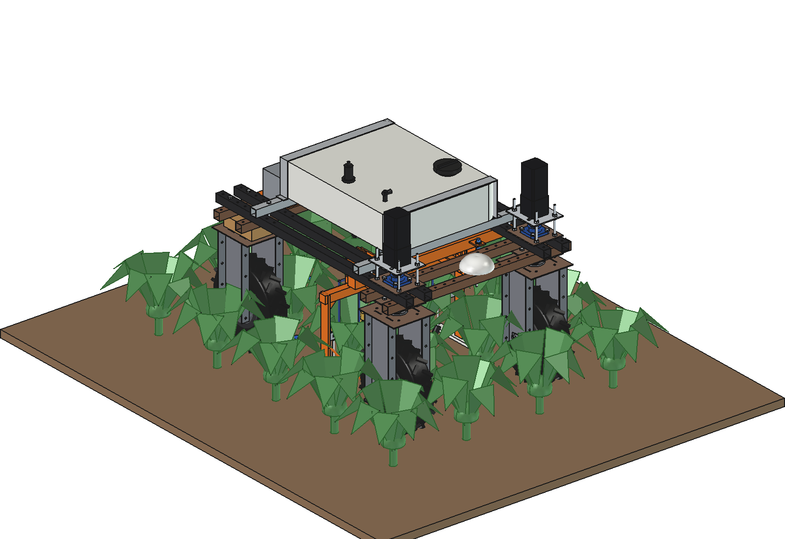
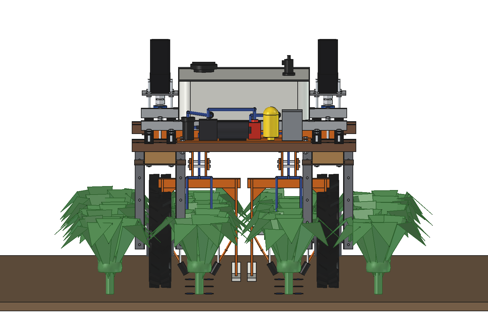
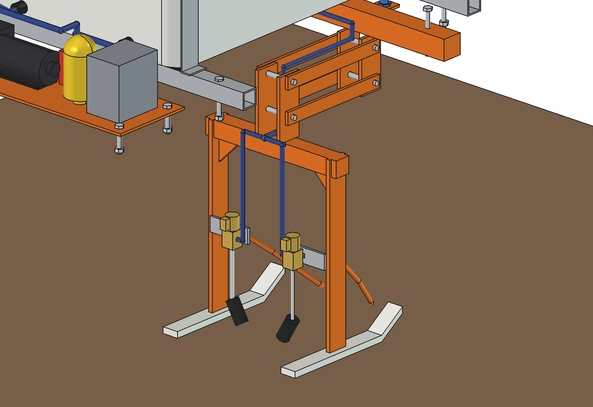
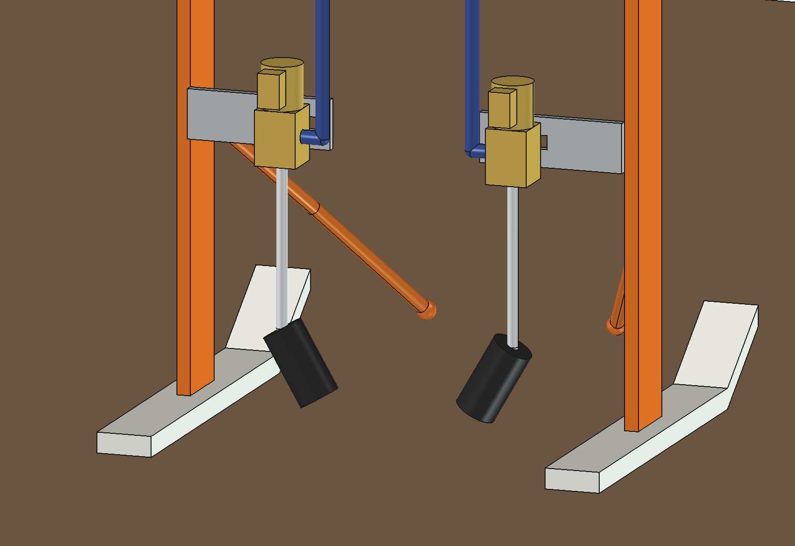
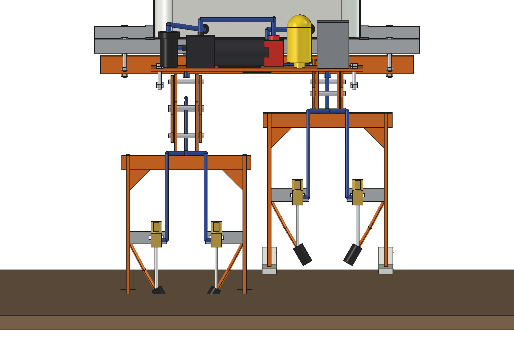
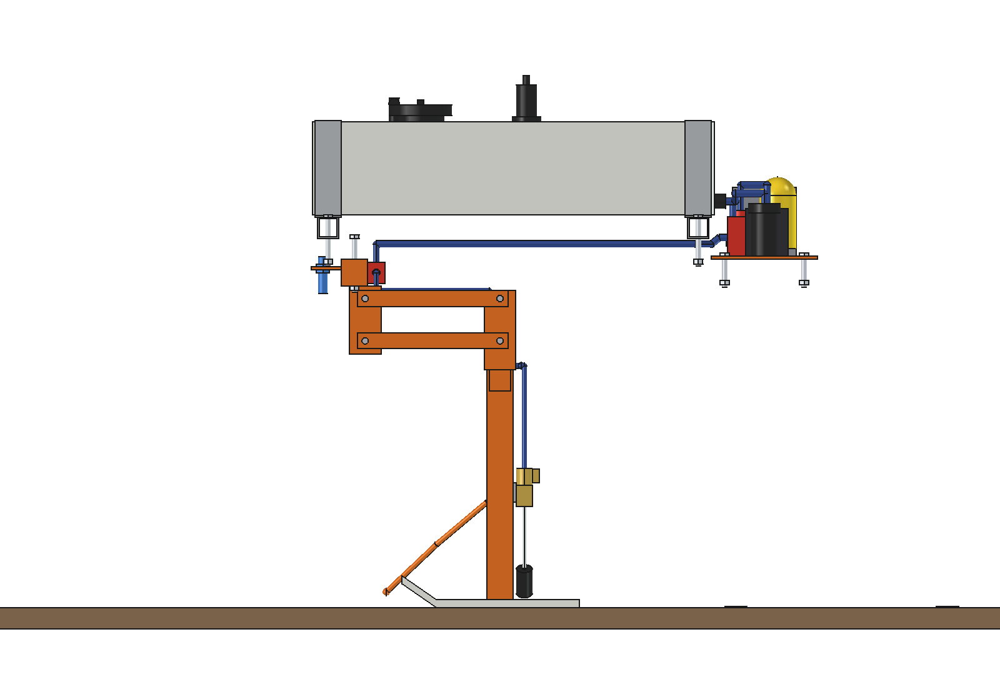
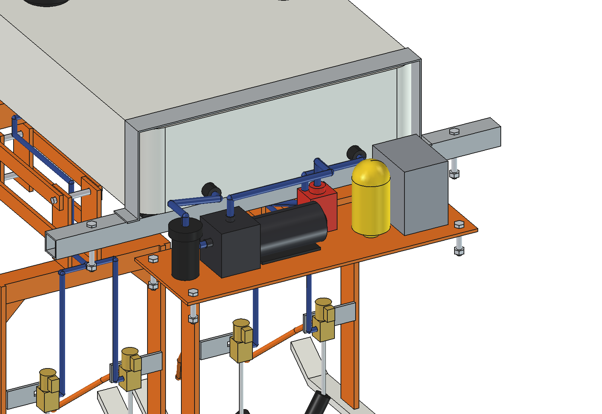

# Cauliflower root-crown applicator (simple)

Doses insecticide as short pulses onto the soil beside the stem of every cauliflower plant, instead of spraying it
over the crop. It is for mid-season cauliflower, with plants 25 to 35 cm high and 40 x 40 cm spacing. The Bruut
OpenAgbot straddles two rows, and the plants pass under the frame between the wheels. Each row has a floating row
unit on skids. Leaf lifters move the lower leaves away from the stem, and two solenoid valves fire one drop nozzle on
each side of the stem. The dose lands about 40 mm from the stem, inside a splash shroud.

Worked out from the idea in `docs/implement ideas/cauliflower insecticide application/`.



| | |
| --- | --- |
|  |  |
| Rear view: two rows at x ±200, the wheels run between the rows | Row unit: parallelogram, arch, skids, leaf lifters, valves |
|  |  |
| Drop nozzles at 30° aimed at the stem base, inside splash shrouds | Ground following: left unit 60 mm down, right unit 60 mm up |
|  |  |
| Side view (robot hidden): crown sensor in front, nozzles behind the lifters | Pump plate: filter, pump, regulator, accumulator, control box |

## How it works

1. **Tank (60 l)** on a cradle on the upper beams. It has a fill cap with a strainer, a vent and a level switch that
   stops the pump when the tank is empty.
2. **Pump plate** on the rear lower beams. Liquid flows from the tank through an 80-mesh filter to a 24 V diaphragm
   pump, then to a pressure regulator with bypass back to the tank. A 0.5 l accumulator keeps the pressure steady
   during pulses. The control box holds the controller, a 4-channel valve driver and the DC-DC converter.
3. **Main hose** runs under the tank to a manifold on the **toolbar**, a 50 x 50 tube under the upper beams at
   y 275, held by M10 bolts through the existing beam holes.
4. **Row unit** (one per row): a parallelogram of 2 x 2 flat bars (255 mm long) hangs from bracket plates under
   the toolbar. It carries an arch over the row, with its underside at z 410. The arch has two legs on UHMW skids that
   run 160 mm on each side of the stem and set the working height. The unit floats from 60 mm down to 80 mm up and
   rests on its own weight.
5. **Leaf lifters**: a D10 spring-steel rod in front of each leg. Its low tip runs 70 mm from the stem line, and the
   rod rises backwards and outwards, so the lower leaves are lifted off the stem base before the nozzles arrive.
6. **Valves and nozzles**: one 24 V direct-acting 2/2 valve on each side, mounted on a slotted bracket that adjusts
   sideways. A stainless drop tube leads to a 1.6 mm solid-stream nozzle aimed 30° inward. The nozzle sits 35 mm above
   the soil inside a splash shroud.
7. **Trigger**: an M18 distance sensor per row looks down from the toolbar and finds the crown, which is the highest
   point of the plant. The controller fires both valves 381 mm later, measured with wheel odometry. If a plant is not
   seen, the 40 cm pitch from odometry fills in. Missing plants in the row are skipped.

## Key figures (`cfa_calc.report()`)

| | |
| --- | --- |
| Rows / working width | 2 rows, 0.8 m |
| Dose | 2 ml per side, 4 ml per plant, 62 500 plants/ha → **250 l/ha** |
| Nozzle | 1.6 mm at 2 bar → 26 ml/s; pulse 77 ms open (87 ms with the valve), 38 mm band at 0.5 m/s |
| Landing point | 42 mm beside the stem (valve sideways: 50 .. 90 mm on the slotted bracket) |
| Pump | 4.5 l/min at 2 bar, mean use 0.6 l/min (13 %); 4 valves together need 105 ml/s, 2.3 ml from the accumulator |
| Tank | 60 l = 15 000 plants = 0.24 ha = 3 km of row, 100 min |
| Capacity | 0.5 m/s: 0.144 ha/h, 0.11 ha/h with headlands and refills |
| Power | ~330 W, 7 h per 2.4 kWh battery, ~0.8 ha per charge |
| Float | -60 .. +80 mm, arm angle ±13.6° at ±60 mm, 7 mm fore-aft shift |
| Skids | 58 N on 2 x 40 x 270 mm (2.7 kPa), drag ~23 N |
| Clearance | arch 60 mm above a 350 mm plant, toolbar 609 mm above the ground |
| Mass | 56.5 kg empty (row unit 8.2 kg floating), centre of gravity (7, -71, 586) |
| Axle loads | full tank: 149 kg front, 126 kg rear, 275 kg total |

## Checks (last run)

- `check_interference()`: empty, including against the robot.
- `check_poses()`: empty for both units at -60 / -30 / +30 / +60 / +80 mm, in opposite directions.
- `clearance()`: row units ≥ 87 mm from the wheel units (FL tyre at +80 mm float), ≥ 115 mm at ±30° steering;
  tank straps 55 mm from the stepper plates; pump plate 20 mm from the rear frame bolts.

## Files

| File | Contents |
| --- | --- |
| `cfa_params.py` | all dimensions, robot interface, crop, dose and operating values |
| `cfa_parts.py` | one function per part (tank, plumbing, toolbar, parallelogram, arch, skids, valves, nozzles, shrouds, hoses), plus a simple cauliflower for the images |
| `build_cfa.py` | model tree, `set_float()`, checks, mass, `render_all()`, STEP export |
| `cfa_calc.py` | nozzle flow and pulse, dose, pump and accumulator, tank, capacity, power, float, skids, timing, axle loads |
| `run_in_freecad.py` | macro: reload, build, print the key figures |
| `check_job.py`, `render_job.py` | the checks and `render_all()` as a QTimer job that writes JSON (MCP timeout workaround) |
| `Cauliflower_Applicator.FCStd`, `.step` | generated model (robot hidden in the FCStd, not in the STEP) |
| `RATIONALE.md` | why the dimensions and choices are what they are |
| `previews/` | images |

## Use

```python
exec(open(r"F:\veldrobot\aanbouwdelen\cauliflower applicator\simple\run_in_freecad.py").read())
import build_cfa
build_cfa.build(show_robot=True)
build_cfa.set_float(left=-60, right=60)
build_cfa.check_interference(); build_cfa.check_poses(); build_cfa.clearance()
```

The FCStd and STEP are generated. Change `cfa_params.py` / `cfa_parts.py` and rebuild instead of editing the model.

## Estimated, not measured

- Robot mass 161.5 kg and centre of gravity (agbot comparison), and the steering stack and stepper motor.
- Pump curve (4.5 l/min at 2 bar, 70 W), valve opening time 10 ms, discharge coefficient 0.65 of the 1.6 mm orifice.
- Dose 2 ml per side. This depends on the product label: change `dose_ml`.
- Plant size (350 mm high, 500 mm spread) and the leaf behaviour around the lifters. This needs a field test.
- Masses of the bought parts (pump, accumulator, valves, control box, sensors), and driving power on soil (300 W).
- Skid friction 0.4 on moist soil, and whether the unit's own weight is enough on rough ground (no spring yet).
