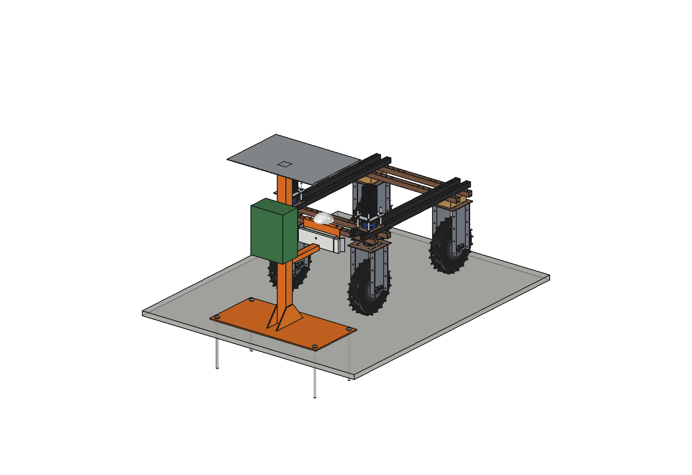
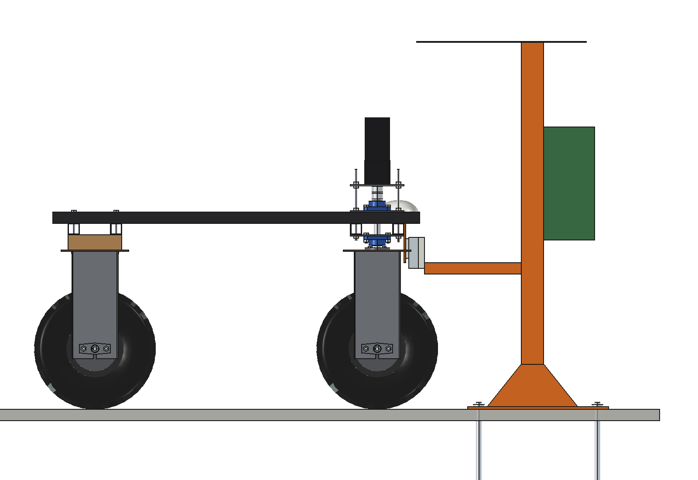
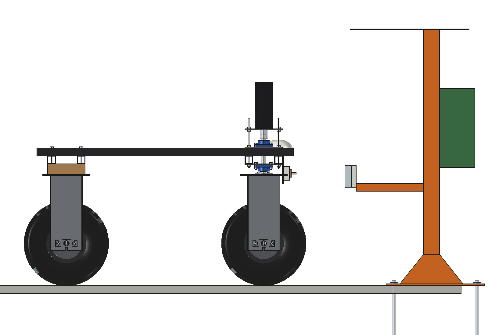
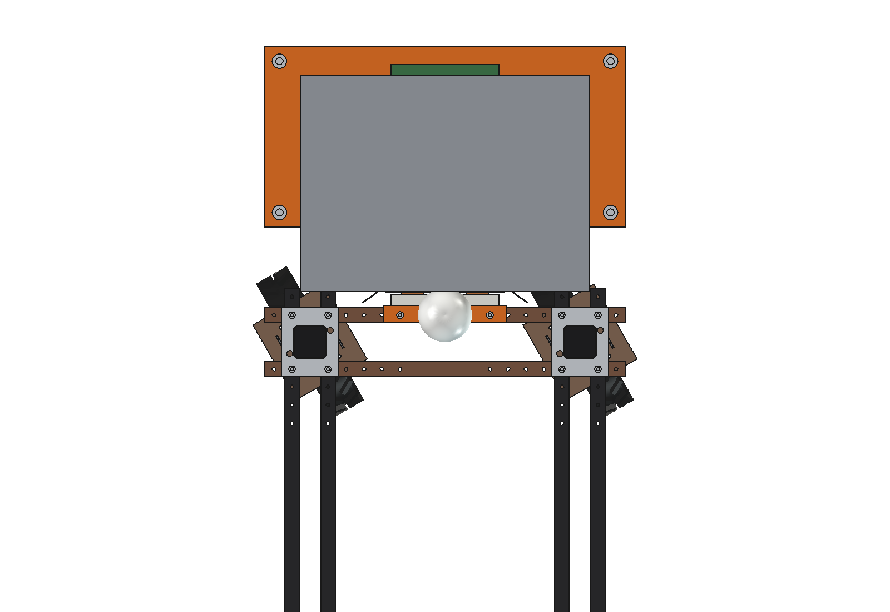
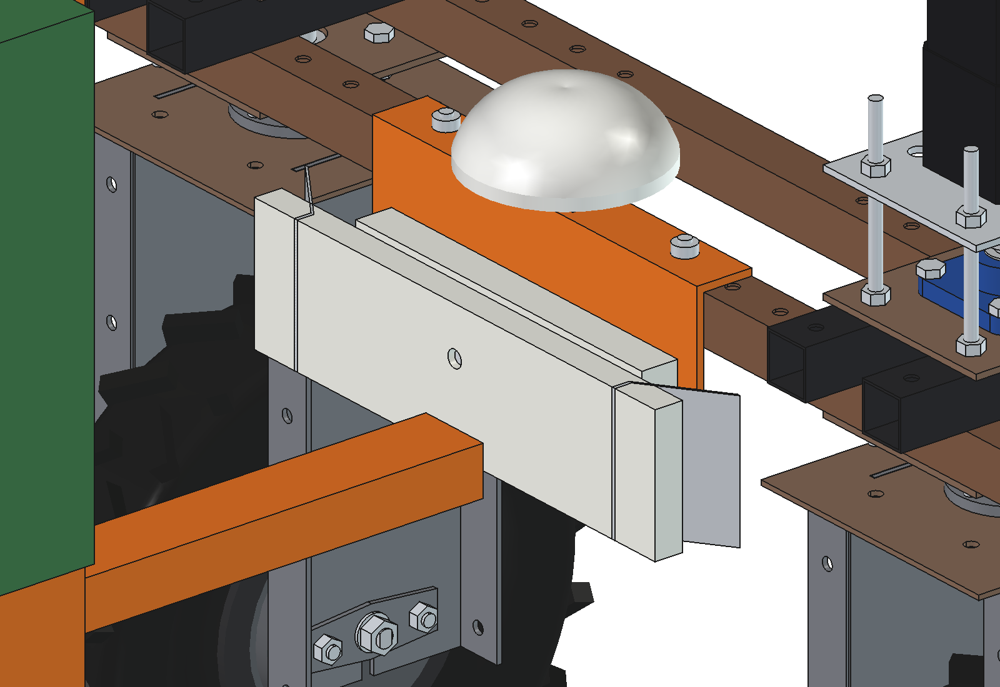
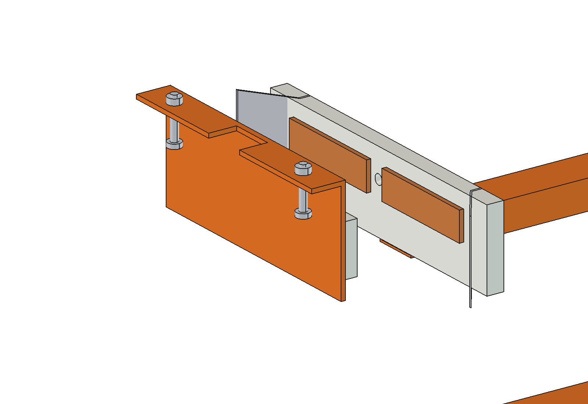

# Charging dock (simple)

Fixed docking station at the field edge or in the shed where the Bruut OpenAgbot (standard robot) drives in and
charges through sprung copper contacts. The robot carries a small contact bracket on its front beam; the station has a
48 V 1 kW charger on a post and a contact head on an arm that reaches back between the front wheels.

<p align="center">
  
</p>

| Side, docked | Side, approach (300 mm short) |
| --- | --- |
|  |  |
|  |  |



## Build

- **On the robot** (3.9 kg): bracket 6 mm on the front face of the front outer lower beam with a top flange (2 x M10,
  notched round the GNSS mount), PE carrier, 2 copper pads 60 x 40 on 2 springs each, pilot pin O10.
- **Station** (80 kg): base plate 1000 x 500 x 10 with 4 ground anchors O20 x 400, post 80 x 80 x 4 with gussets,
  arm 60 x 40 back to a PE contact head with 2 copper bars 150 x 40 and a V-funnel, charger 48 V 1 kW IP65, roof.

No interference docked and on the approach with the front wheels steered +-30 degrees; 33 mm from the wheel units.

## Key figures (`cdk_calc.report()`)

| | |
| --- | --- |
| Charge current | 17 A at 54 V, 0.3 W loss in the contacts, 60 N per pad |
| Catch | funnel catches 75 mm sideways, 15 mm play in the throat, pads stay on the bars |
| Charge 20 -> 100 % | robot 2.0 h, with the battery pack 6.9 h |
| Share of the day at work | grass meter 76 % (18 h), inter-row hoe 48 % (12 h), compost spreader 41 % (10 h) |

Why and how these come out: see [RATIONALE.md](RATIONALE.md), including the list *Estimated, not measured*.

## Files

| File | Contents |
| --- | --- |
| `cdk_params.py` | all dimensions, robot interface, contacts, station, charger and duty parameters |
| `cdk_parts.py` | one function per part, robot coordinates with the robot docked |
| `build_cdk.py` | model tree, `set_pose(dy, dx, yaw)`, checks (`check_interference`, `check_poses`, `clearance`), mass, `render_all()`, STEP |
| `cdk_calc.py` | contact current and loss, catch range, charge time, working share per implement |
| `run_in_freecad.py` | reload, build, print the key figures |
| `Charging_Dock.FCStd`, `Charging_Dock.step` | generated model (robot visible in the FCStd) |
| `previews/` | images |

## Use

```python
exec(open(r"F:\veldrobot\aanbouwdelen\charging dock\simple\run_in_freecad.py").read())
import build_cdk
build_cdk.set_pose(dy=300)      # approach
build_cdk.check_poses()         # must be {} (slow: run it from a QTimer, see AGENTS.md)
```
