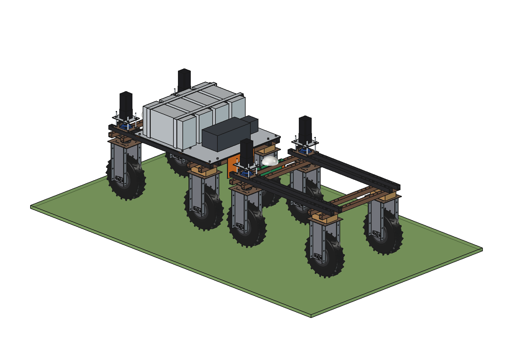
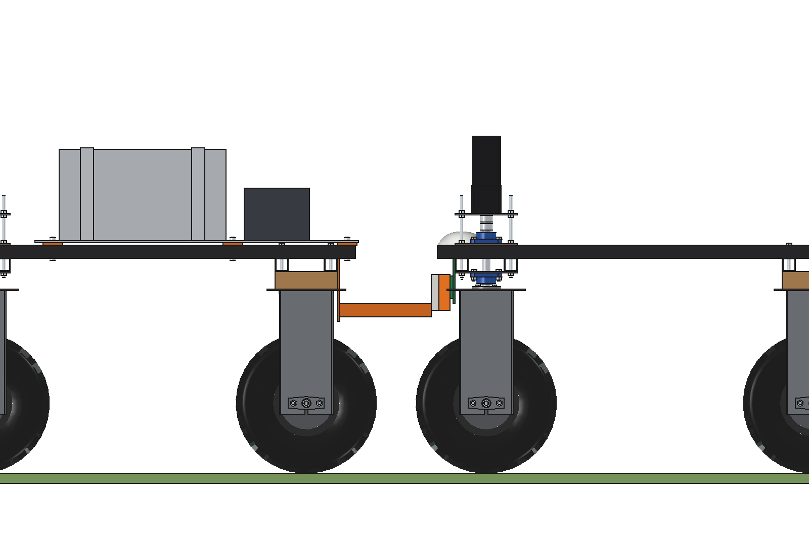
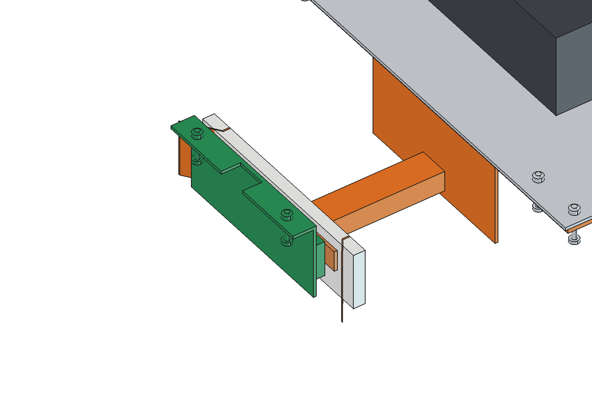
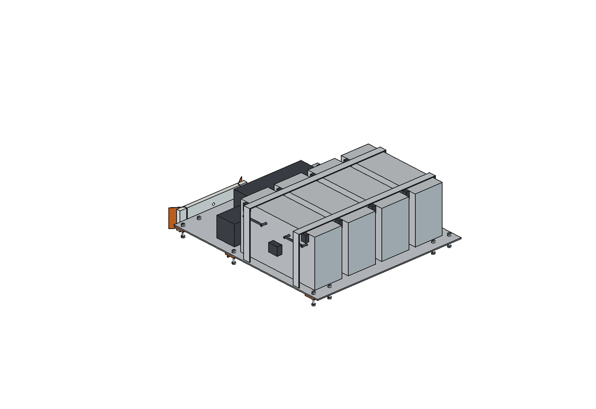

# Charging robot (simple)

A second Bruut OpenAgbot (standard robot) as a **mobile charger**. It carries 4 battery pods (the 48 V LiFePO4 pod of
the [battery pack](../../battery%20pack/simple/), 2.56 kWh each) on a deck on the upper beams, an isolated DC/DC
charger (54 V CC/CV, 1.5 kW) and, behind it on an arm under the rear beam, the contact head of the
[charging dock](../../charging%20dock/simple/) (PE head, 2 copper bars, V-funnel, all imported). A working robot with
the dock's contact bracket on its front beam drives nose-first into the charger's rear, exactly as into the fixed
dock, charges at the field edge or in the headland and goes back to work; the charger only goes to the shed when its
pods are low.

  

| Side, docked | Contact head with the working robot's bracket | Deck with the pods |
| --- | --- | --- |
|  |  |  |

## Build

- Deck: 3 flat bars 60 x 8 across the 4 upper beams (M10 in the grid holes y -625 / -275 / 275, clear of the
  wheel-unit frame bolts), aluminium deck plate 6 mm, 900 x 990.
- 4 pods (170 x 510 x 280, 16 cells 50 Ah each) standing side by side, handles and Anderson connectors to the right,
  2 hold-down straps; DC/DC charger 420 x 200 x 160 and the main switch / fuse box behind them.
- Rear: plate 6 mm on the rear face of the rear outer lower beam with a top flange (2 x M10), arm 60 x 40 x 3 back to
  the dock's contact head; the working robot docks with its centre 1550 mm behind the charger's.

Mass ~135 kg (pods 86 kg), centre of gravity z 779; charger robot 295 kg in all. Size 900 x 1269 x 532 mm.

## Key figures (`chg_calc.report()`)

| | |
| --- | --- |
| Energy on board | 10.2 kWh (9.2 kWh usable) |
| One charge of a working robot 20 -> 100 % | 1.52 kWh, 27.8 A, ~73 min; 1.62 kWh from the pods |
| Per trip | ~5.6 charges (own drive 2 x 1 km: 128 Wh); back to full at the shed in ~2.5 h (4 x 1 kW) |
| Inter-row hoe (1.5 h per charge) | 12.8 h of work per day instead of 9.8 h (driving to the shed); 1.5 charger trips per day |
| Grassland harrow / grass meter | 11.5 h instead of 8.6 h / 19.9 h instead of 17.9 h |
| Axle loads | 150 / 145 kg front / rear, 75 kg per tyre (x 3 reserve), side tilt limit 30 degrees |
| Checks | `check_interference()` [] (both robots and the dock bracket), `check_holes()` {}, `check_docking()` {} (working robot steered +-30) |

## Estimated, not measured

Robot battery 1.9 kWh usable, DC/DC efficiency 94 %, CV share 12 % at 40 % current, contact resistance 0.5 mOhm,
loads of the working implements, field-to-shed distance 1 km, tyre rating 230 kg, DC/DC and fuse-box masses. Not
modelled: cables between the pods and the DC/DC, the radio link and the docking software (as the fixed dock: RTK
approach, pilot handshake before power on).

## Files

`chg_params.py`, `chg_parts.py` (deck, pods via `bpk_parts`, straps, DC/DC, rear bracket, arm, head / funnel / bars
via `cdk_parts`, the working robot's bracket for the checks), `build_chg.py` (model with the docked working robot,
checks, `mass_properties`, `render_all()`, STEP of the charger parts), `chg_calc.py`, `run_in_freecad.py`,
`Charging_Robot.FCStd` / `.step`, `previews/`. See [RATIONALE.md](RATIONALE.md).
