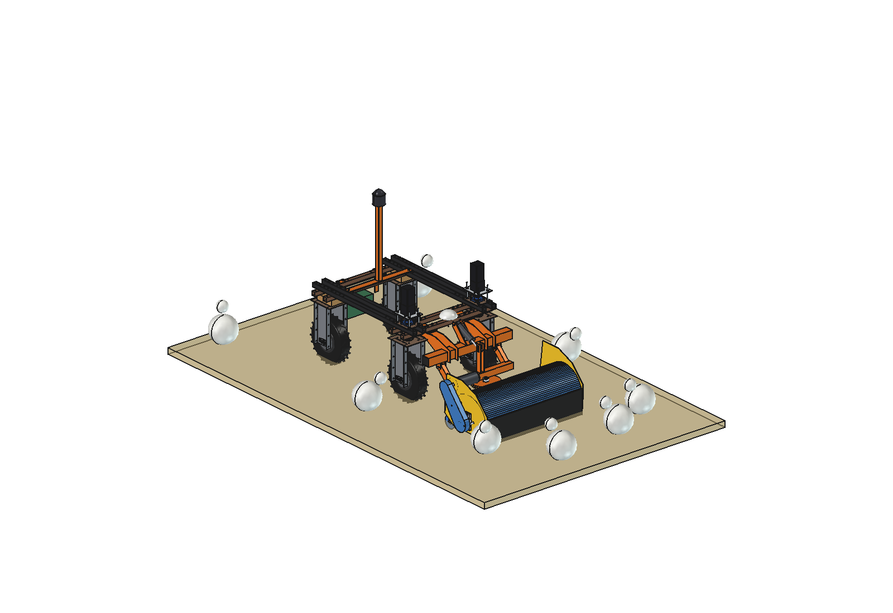
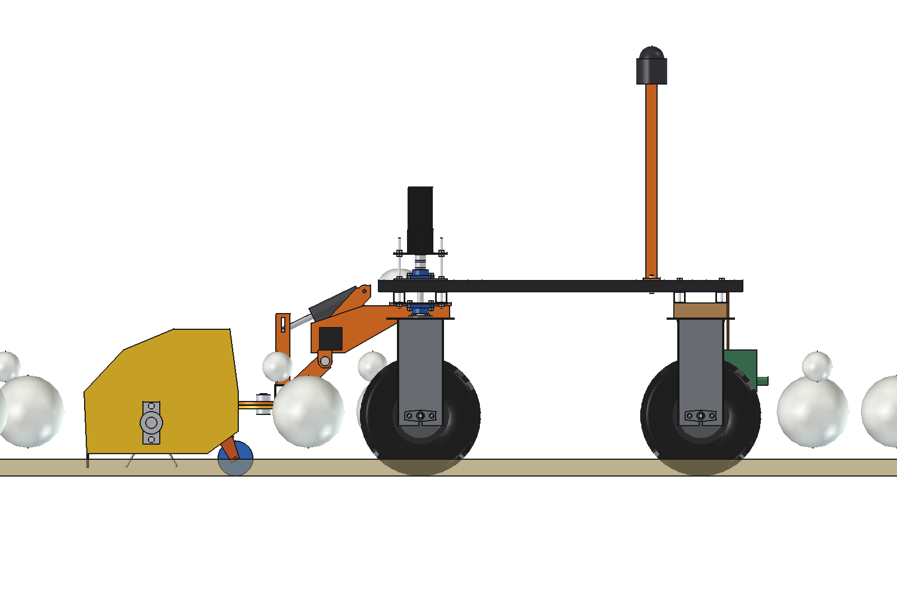
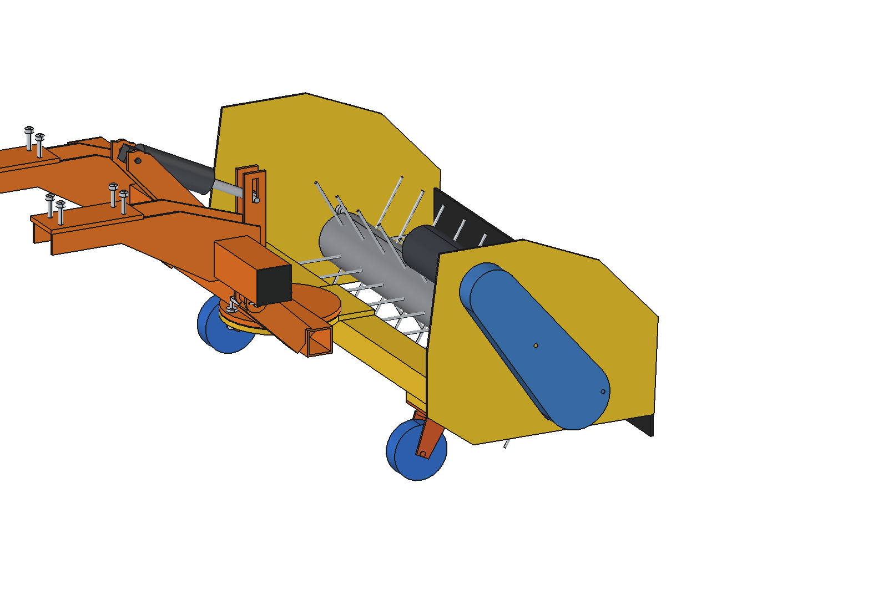
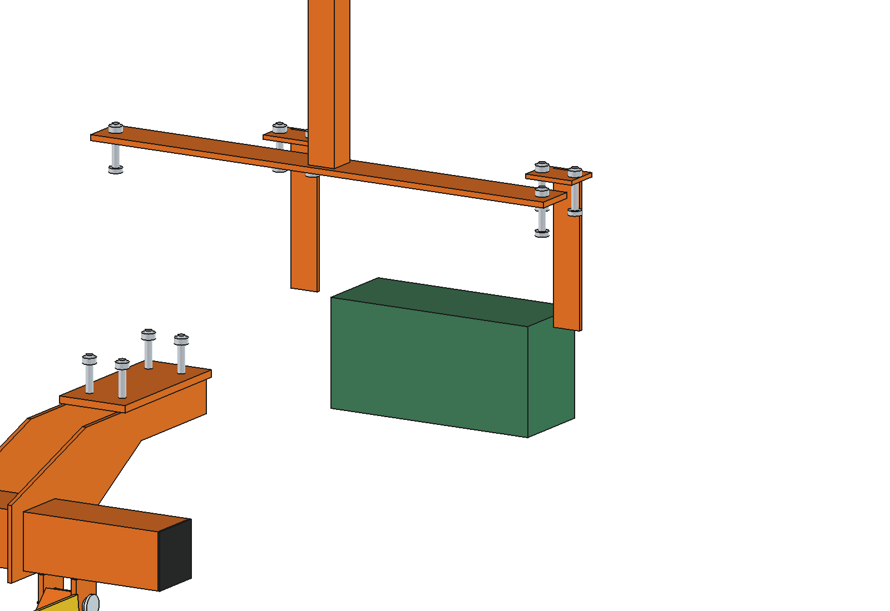

# Chicken house robot (simple)

The Bruut OpenAgbot (standard robot) drives slowly (0.3 m/s) through a broiler or layer house and
- **turns the litter**: the broom head of the [broom sweeper](../../broom%20sweeper/simple/README.md) (imported, on the
  push-blade arms) gets a tine rotor instead of the PP bristles: 6 rows of spring tines O6, tip circle O360, at
  150 rpm. The tips sweep the litter down to 10 mm above the concrete and never touch it. Turning loosens caked
  litter, dries it and lowers ammonia;
- **measures the climate at bird height**: a sensor box under the rear lower beam (NH3, CO2, temperature, relative
  humidity) draws air through an inlet at 300 mm;
- **watches the flock**: a 360 degree camera at 1.4 m logs bird distribution, dead or lame birds and floor eggs (with
  the position from UWB beacons in the house, as there is no GNSS indoors).

Floor eggs are logged, not picked up, in the simple variant.

  

| Side | Tine rotor (hood hidden) |
| --- | --- |
|  |  |

## Build

- **Broom sweeper** as it is (toolbar, lift arms, king pin, head frame, hood, castors, 48 V 1000 W drive), with the
  bristles replaced by 60 spring tines O6 welded into the core tube (rows staggered: 50 mm between tine tracks).
- **Sensor box** 300 x 120 x 150 on 2 hangers (6 mm) bolted to the rear outer lower beam at x +-175 / +-225.
- **Camera post** 40 x 40 x 3 on a flat bar across the inner upper beams at y -325 (grid holes), 360 degree camera at
  1.4 m.

Mass ~122 kg (most of it the broom). Same size as the broom sweeper plus the 1.49 m camera post.

## Key figures (`chk_calc.report()`)

| | |
| --- | --- |
| Rotor | 150 rpm, tips 2.8 m/s, 50 tine passes per metre of travel, tracks 50 mm apart |
| Tine depth | tips 10 mm over the concrete while turning (33 mm at rest in the work pose), litter 60 mm |
| Power | ~810 W for the rotor in caked litter (broom motor at ~81 %), ~880 W in total |
| House | 1500 m2 (100 x 15 m) in ~1.5 h at 0.3 m/s; ~2.2 h per charge, ~1.4 houses |
| Birds | ~360 birds per minute in front of the head at 18 per m2; a broiler walks away (0.5 m/s) faster than the robot comes |

Why and how these come out: see [RATIONALE.md](RATIONALE.md), including the list *Estimated, not measured*.

## Files

| File | Contents |
| --- | --- |
| `chk_params.py` | tine rotor, sensor box, camera post, work parameters (broom from `bsw_params`) |
| `chk_parts.py` | tines, hangers, sensor box, camera bar and post; litter and birds for the renders |
| `build_chk.py` | model (the broom with the tine rotor + sensors), checks (`check_interference`, `check_holes`, `check_poses`, `tine_floor`), mass, `render_all()`, STEP |
| `chk_calc.py` | rotor speed and power, house time and battery, birds |
| `run_in_freecad.py` | reload, build, print the key figures |
| `Chicken_House_Robot.FCStd`, `Chicken_House_Robot.step` | generated model (robot hidden in the FCStd) |
| `previews/` | images |
