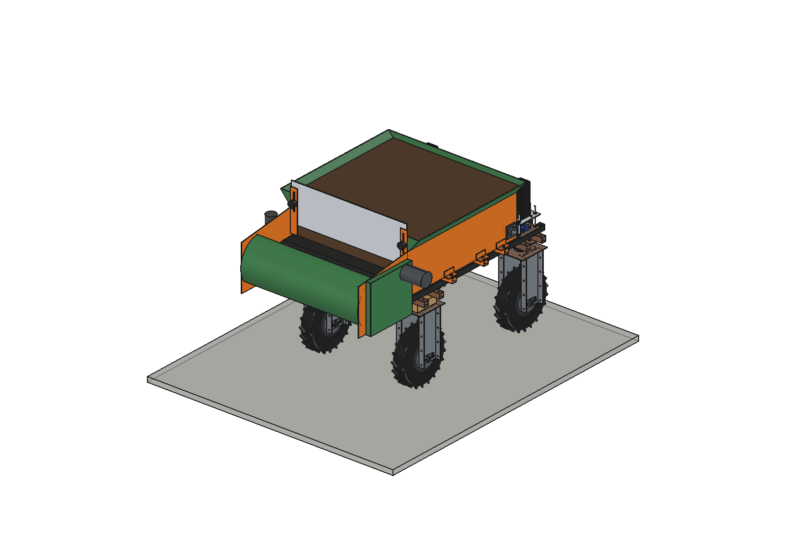
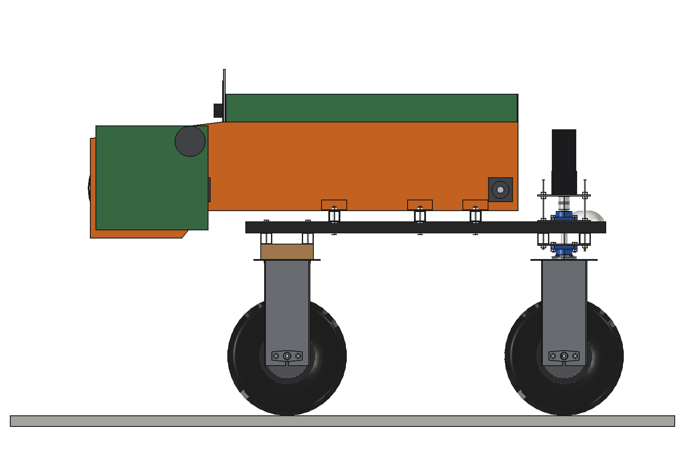
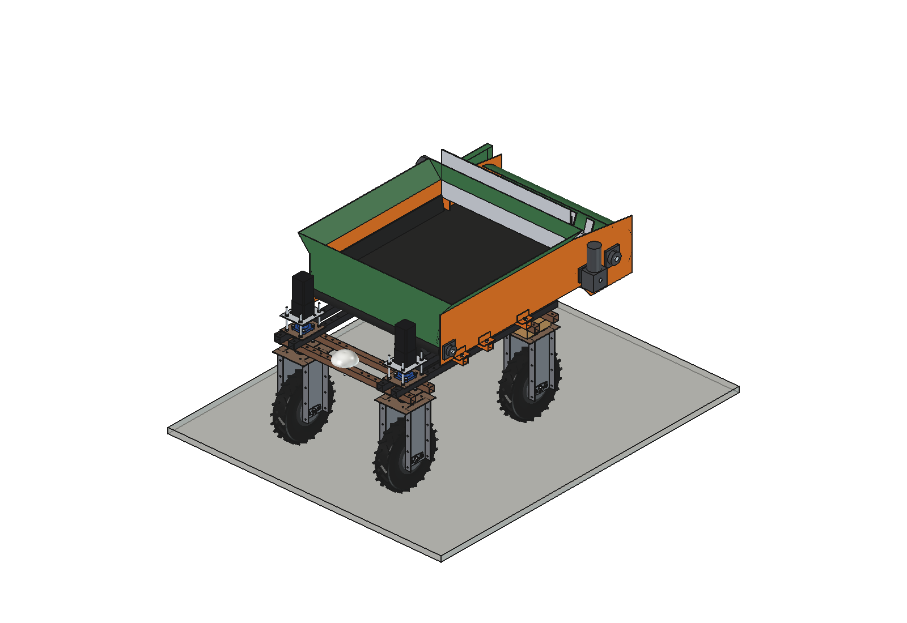
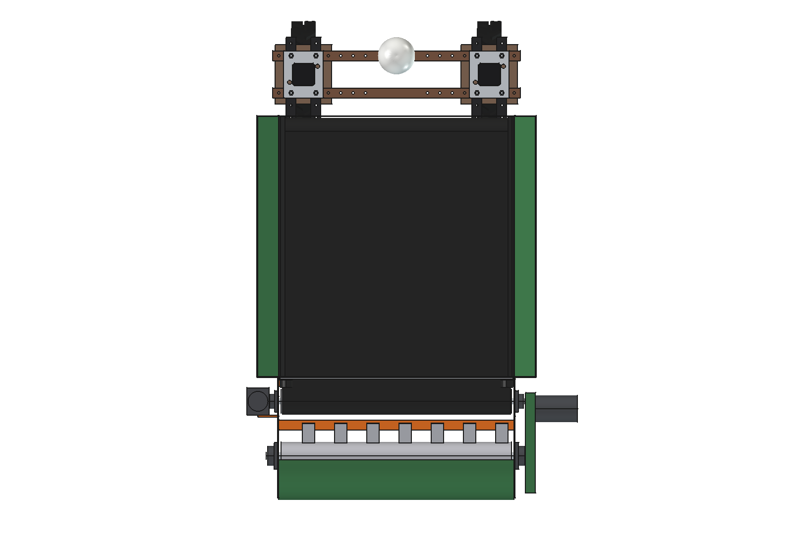
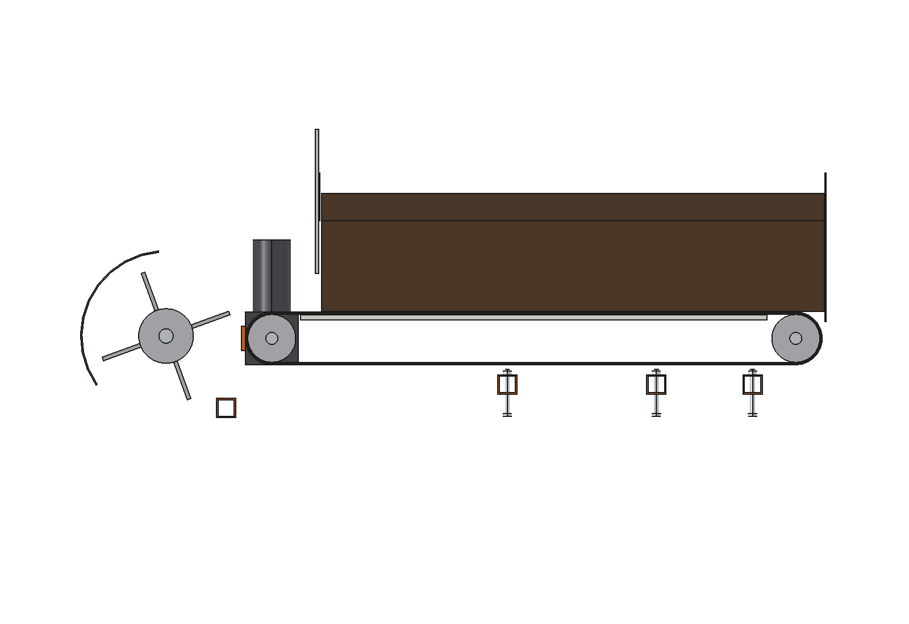
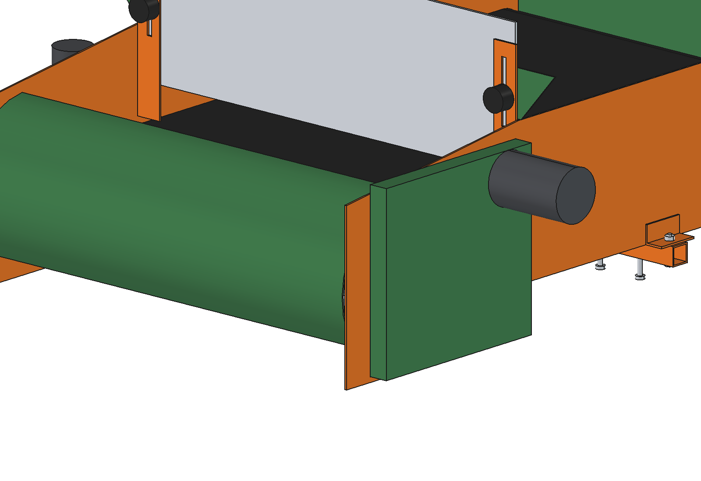

# Compost spreader (simple)

Bin on the upper beams of the Bruut OpenAgbot (standard robot) with a moving floor belt that carries compost backwards
under a slide gate to a beater rotor behind the robot. The beater breaks the compost up and throws it down in an even
layer, 1.1 m wide, over the bed between the wheel tracks: top-dressing of market-garden beds, orchard strips and
grassland. The dose follows the driving speed and a task map through the belt speed.

<p align="center">
  
</p>

| Side, full | Empty, front left |
| --- | --- |
|  |  |
|  |  |



## Build

- **Mount**: 3 bearers 40 x 40 x 3 across the upper beams (12 x M10 into the hole grid), angle feet outside the side
  plates bolted to the bearer ends (6 x M10).
- **Conveyor**: 2 side plates 4 mm (folded sheet), floor belt 920 x 5 (rubber, 2-ply) round 2 drums O100 (rear drum
  drives, front drum in take-up slots), UHMW-PE slide bed 10 mm under the top run, 4 x UCFL204. Belt drive: 24 V worm
  gearmotor 60:1 (~120 W) directly on the rear drum shaft with a torque arm.
- **Bin**: 299 l, 950 wide between the side plates up to z 1060, flared 3 mm walls to 1120 wide at z 1160, rubber
  skirts onto the belt edges. Slide gate 940 x 300 x 6 behind the rear wall, opening 30..150 mm above the belt, clamped
  by 2 star knobs in slotted guides.
- **Beater**: tube O114 x 4 with 28 paddles 50 x 8 in 4 staggered rows, tip O280, 300 rpm (4.4 m/s), stub shafts O30 in
  2 x UCFL206. 48 V 1 kW BLDC with a poly-V belt 1 : 5 (O50 / O250) under a guard on the right; a 3 mm hood over and
  behind the rotor turns the throw down onto the bed.

Mass 190 kg empty (cg y -513, z 874), 150 kg of compost. Size 1340 x 1551 x 610 mm (x, y, z of the spreader,
z 640..1250 with the gate). 52 mm from the rear unit frame bolts.

## Key figures (`csp_calc.report()`, moist green compost 600 kg/m3)

| | Grassland top-dress | Orchard strip | Market-garden bed |
| --- | --- | --- | --- |
| Dose | 1 kg/m2 (10 t/ha) | 2 kg/m2 | 3 kg/m2 (~5 mm) |
| Driving speed | 0.8 m/s | 0.5 m/s | 0.3 m/s |
| Gate / belt speed | 80 mm / 22.7 mm/s | 100 mm / 22.7 mm/s | 90 mm / 22.7 mm/s |
| One bin of 150 kg covers | 150 m2 (136 m) | 75 m2 (68 m) | 50 m2 (45 m) |
| Beater power | 678 W | 810 W | 744 W |
| Area per hour (4 min refill, 80 m travel) | 1132 m2 | 609 m2 | 393 m2 |
| Energy per bin / bins per battery | 57 Wh / 33 | 48 Wh / 39 | 46 Wh / 41 |

- Payload: 150 kg is the limit with moist compost (250 l, level z 1117); dry green compost (450 kg/m3) fills the bin at
  135 kg, rotted farmyard manure (750 kg/m3) reaches 150 kg at 200 l.
- Axle load: without ballast the front axle carries 22 % empty and 25 % full. With **1 counterweight plate per stack
  (66 kg, [counterweights](../../counterweights/simple/))** it is 35 % / 33 %.
- Full with ballast: 566 kg, cg 746 mm high, side tip angle 26.7 degrees; the hub motors climb 8 degrees
  continuously (12 degrees empty). A 10 degree slope full is over the continuous motor rating (margin 0.85).
- Belt pull with a full bin 444 N, 24 Nm on the drum at up to 5.2 rpm (27 W).

Why and how these come out: see [RATIONALE.md](RATIONALE.md), including the list *Estimated, not measured*.

## Files

| File | Contents |
| --- | --- |
| `csp_params.py` | all dimensions, robot interface, bin volume and fill level, compost types, doses, work parameters, masses |
| `csp_parts.py` | one function per part, robot coordinates |
| `build_csp.py` | model tree, `set_load()`, `set_gate()`, checks (`check_interference`, `check_poses`, `clearance`), mass, `render_all()`, STEP |
| `csp_calc.py` | capacity per compost, gate and belt setting per dose, belt pull, beater power, axle loads with ballast, tip angles, slope, area per hour and energy |
| `run_in_freecad.py` | reload, build, print the key figures |
| `Compost_Spreader.FCStd`, `Compost_Spreader.step` | generated model (robot hidden in the FCStd) |
| `previews/` | images |

## Use

```python
exec(open(r"F:\veldrobot\aanbouwdelen\compost spreader\simple\run_in_freecad.py").read())
import build_csp
build_csp.set_load(False)
build_csp.set_gate(150)
build_csp.check_interference()   # must be []
build_csp.check_poses()          # must be {}
```

The belt and the beater turn in place and only the gate changes position, so there is no animation.
