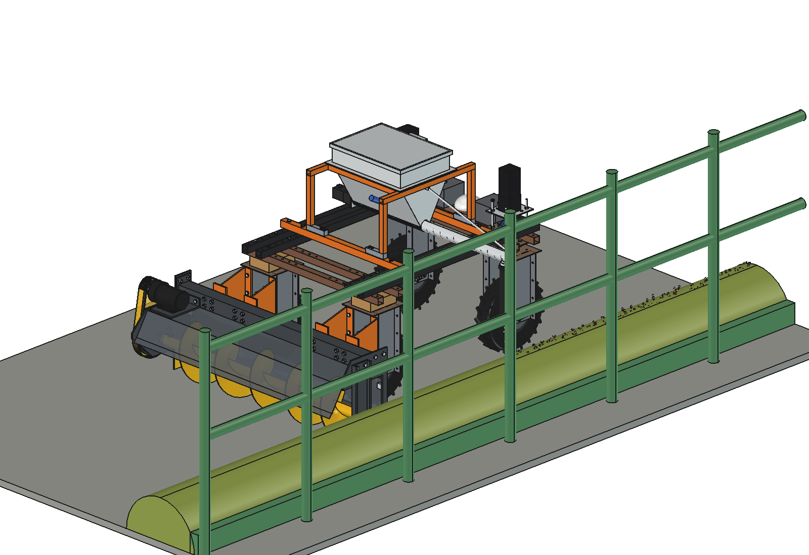
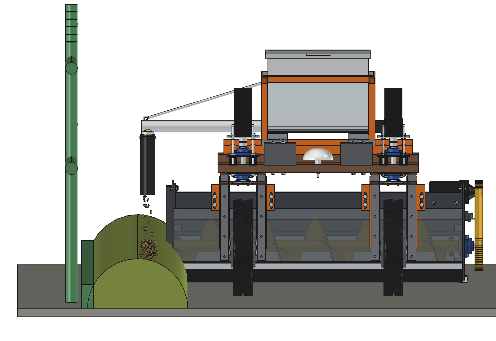
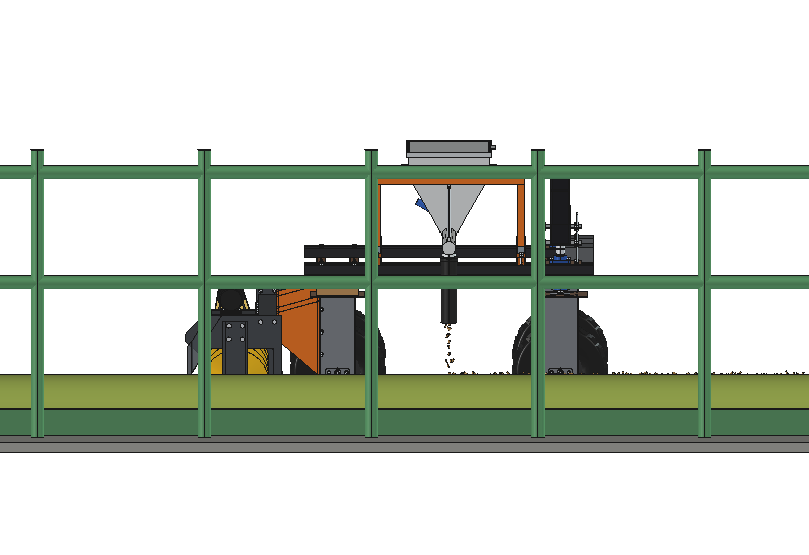
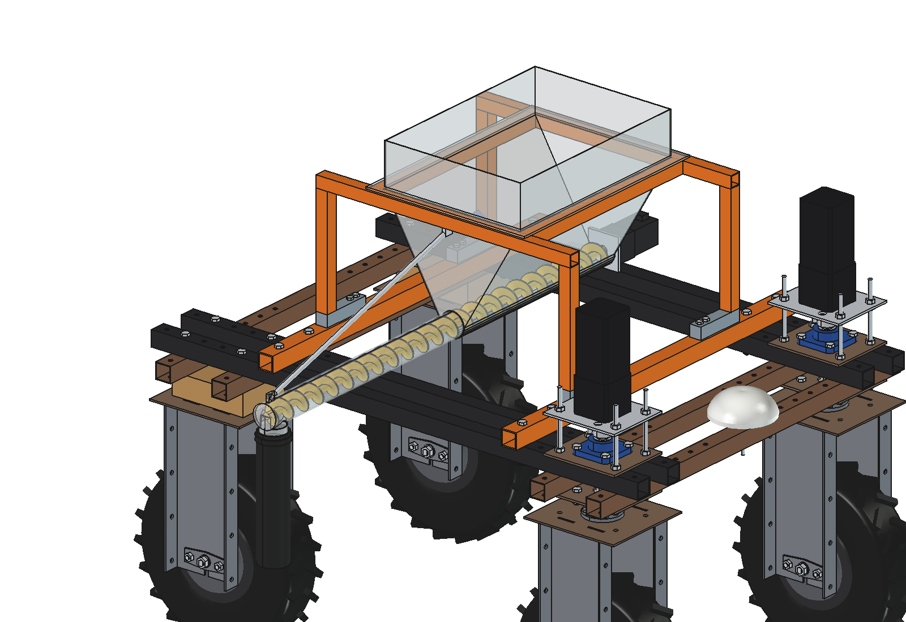
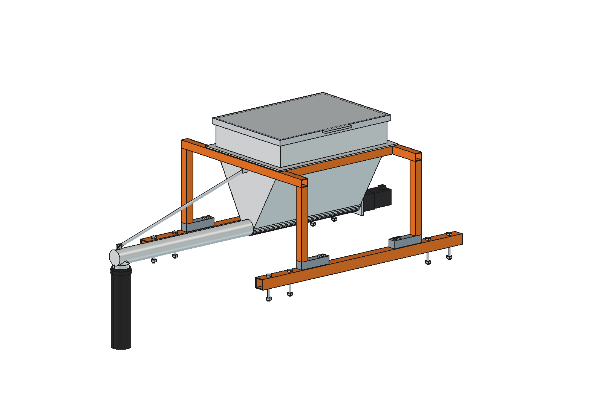
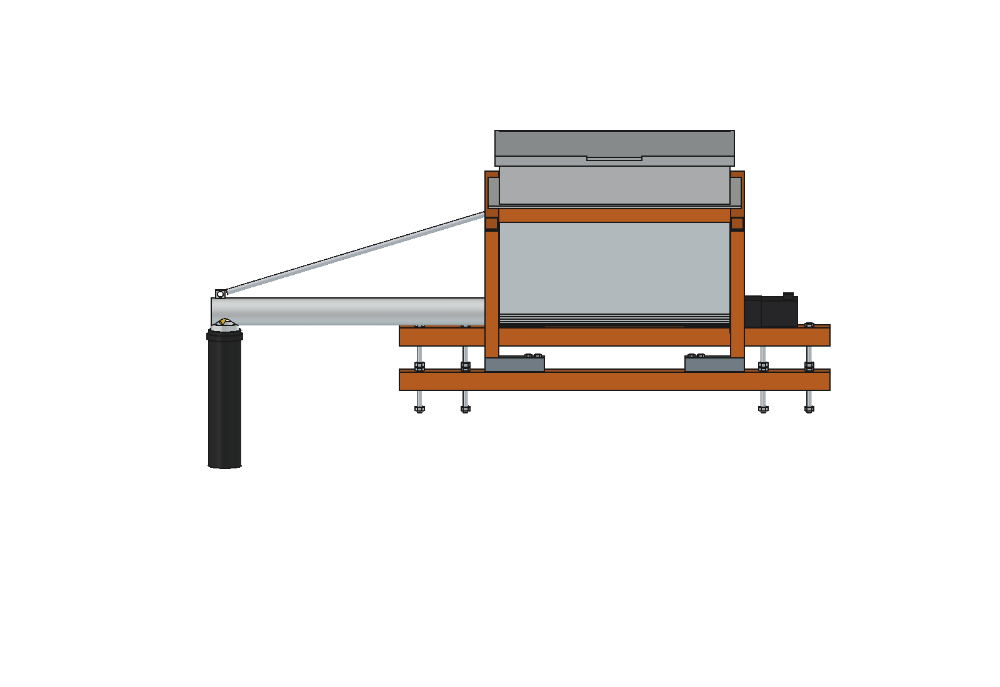

# Concentrate dispenser on the feed table (simple): FreeCAD model

Doses concentrate pellets or minerals on the feed along the feed fence while the robot pushes feed with the
[feed pusher auger V3](../../feed%20pusher%20auger/V3/README.md) (imported, not copied). A fresh line of concentrate on
the windrow that the pusher has just made draws the cows back to the fence; the dose per feeding place is set in the
route.

- **Hopper 47 l** (stainless 1.5 mm, 60° side walls, U-trough) in the **middle** of the robot, on 2 cross tubes over
  the upper beams at y ±325: 32 kg of pellets on the robot's centre do not change the balance of the feed pusher.
- **4 load cells** (shear beam 50 kg) under the hopper frame: the controller measures the loss in weight and corrects
  the auger speed, so the dose does not depend on the auger fill or the bulk density.
- **Metering auger** O54, pitch 50, in the trough and on in a tube O60 to x 880, past the right wheels and the
  discharge end of the feed pusher; a **rubber spout** drops the pellets onto the windrow at x 850.
- **NEMA 23 + 10:1 planetary** on the left end, bearing flange on the end wall; a tie rod carries the tube end.
- A capacitive level sensor warns before the hopper runs empty; hinged lid for filling from a bag or a silo spout.

Why it is designed this way: [RATIONALE.md](RATIONALE.md).

| | | |
| --- | --- | --- |
|  |  |  |
| along the fence: spout over the windrow | from the fence side | hopper and tube see-through: auger |
|  |  | |
| cross tubes, load cells, legs, frame | outlet, spout, drive | |

## Key figures

From the model (`build_cdd.mass_properties`, `check_interference`, `check_holes`) and `cdd_calc.report()`.

| | |
| --- | --- |
| Mass | 37 kg empty (mount 15 kg, hopper + tube 16 kg, drive 2.5 kg, auger 2.9 kg); 69 kg full of pellets |
| Hopper | 47 l: 32 kg pellets (0.68 kg/l) or 52 kg minerals |
| Auger | 28 g pellets per turn at 40 % fill (estimated; the load cells measure the real value) |
| Dose | 100 g per feeding place (0.75 m) at 0.35 m/s = 133 g/m, 47 g/s: auger 99 rpm, motor 985 rpm |
| Dose range | 5 … 150 g per place at the pushing speed (auger 5 … 150 rpm) |
| Accuracy (estimated) | ±2 % per 10 s window by loss-in-weight (467 g ± 9 g) |
| Drive | ~1.3 W running, 10 Nm at the auger available: > 30× reserve, enough for caked minerals |
| Herd of 120 | fence 90 m, 12 kg per round, 2.7 rounds per fill: ~3 fills a day at 8 rounds |
| Axle loads | +35 kg front and +35 kg rear when full: the feed pusher's 40 kg counterweight stays as it is |
| Size | 1359 × 690 × 712 mm (x from −470 to +889, top of the lid at z 1192) |

Checks: `check_interference()` = [] (also with the auger turned 90°, against the robot and the feed pusher),
`check_holes()`: the 8 M10 cross-tube bolts sit in the upper-beam grid holes at y ±325 without overlap.

## Files

| File | Contents |
| --- | --- |
| `cdd_params.py` | all dimensions; imports `fpa_params` of the feed pusher V3 (put first on `sys.path`: V1 / V2 use the same prefix) |
| `cdd_parts.py` | cross tubes, bolts, load cells, legs, frame, hopper, lid, level sensor, tube, spout, tie rod, drive, auger, scene |
| `build_cdd.py` | model with the robot and the feed pusher, `set_auger()`, checks, mass, `render_all()` |
| `cdd_calc.py` | capacity, g per turn, dose and auger speed, torque, loss-in-weight, rounds per fill, axle loads |
| `run_in_freecad.py` | reload, build, print the report |
| `Concentrate_Dispenser.FCStd`, `.step` | generated (STEP: the dispenser only) |

## Estimated, not measured

- Robot 161.5 kg (agbot comparison); feed pusher V3 masses from its own model.
- Bulk density of pellets 0.68 kg/l and minerals 1.1 kg/l; auger fill 40 %; material factor 2.5 for the running power;
  starting torque under a full hopper (Janssen factor 0.4, friction 0.45).
- Load-cell resolution 2 g per cell after filtering, 1 % residual vibration error while driving.
- Dose 100 g per place, 0.75 m per place, 8 rounds a day, pushing speed 0.35 m/s.
- Windrow top ~250 mm and the fence at x ~1150 from the robot centre (depends on the feed pusher's line).
