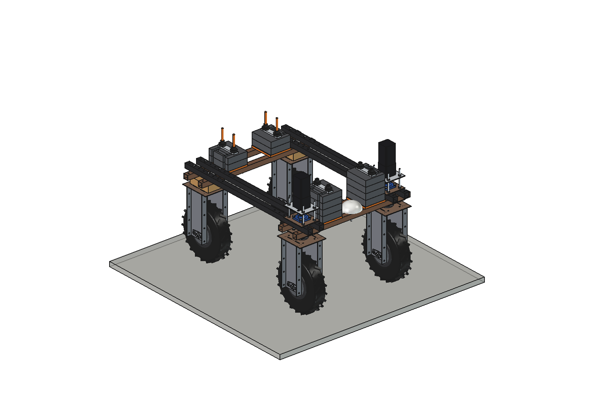
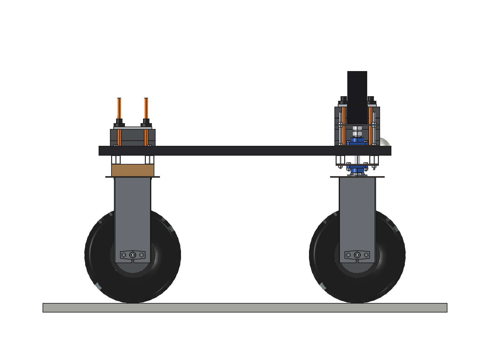
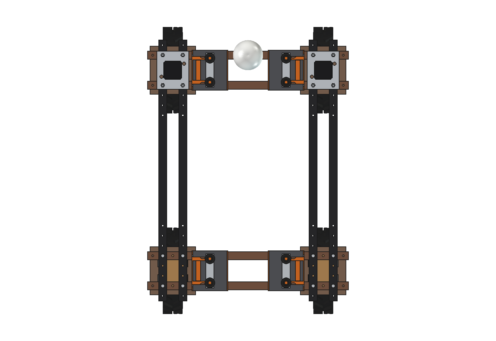
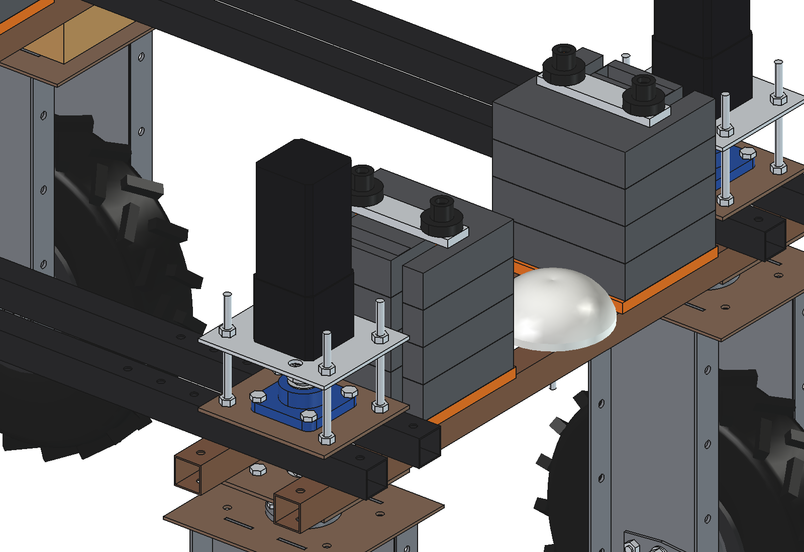
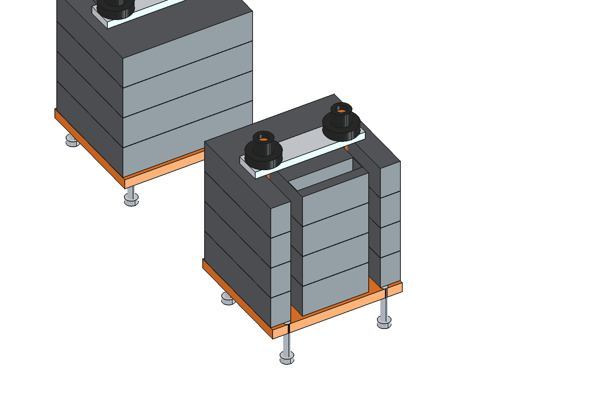

# Counterweights (simple)

Stackable 11 kg steel ballast plates on the lower cross beams of the Bruut OpenAgbot (standard robot), front and rear,
on both sides of the centre line. Plates slide onto two studs from the side and are held by a clamp bar and two knob
nuts: no tools, one person lifts one plate. 0..99 kg per axle end in 11 kg steps.

<p align="center">
  
</p>

| Side (4 plates front, 2 rear) | Top |
| --- | --- |
|  |  |
|  |  |

## Build (per stack, 4 stacks)

- **Base plate** 15 mm (180 x 200) on the two lower beams, 4 countersunk M10 in the hole grid, O32 holes over the nuts
  of the push blade / rear toolbar hanger bolts, 2 studs M16 welded in.
- **Plates** 170 x 200 x 50, open slots to the studs, hand grip; up to 4.
- **Clamp** flat bar 40 x 12 over both studs, 2 knob nuts M16.

Base set ~22 kg (4 stacks without plates), each plate 11 kg.

## Key figures (`cwt_calc.report()`)

| Implement (lifted) | Without ballast | Plates per stack | With |
| --- | --- | --- | --- |
| Grassland harrow | front 15 % | 1 front (33 kg) | front 25 % |
| Inter-row hoe | front 5 % | 2 front (55 kg) | front 21 % |
| Three-point hitch + cultivator | front 19 % | 1 front (33 kg) | front 29 % |
| Fertilizer spreader, full | front 13 % | 1 front (33 kg) | front 22 % |
| Push blade | rear 15 % | 1 rear (33 kg) | rear 25 % |

Stack top with 4 plates at 921 mm; 20 mm from the steering plates of the front units. No interference with the robot.

Why and how these come out: see [RATIONALE.md](RATIONALE.md), including the list *Estimated, not measured*.

## Files

| File | Contents |
| --- | --- |
| `cwt_params.py` | all dimensions, robot interface, implement masses to balance, masses from the model |
| `cwt_parts.py` | one function per part (base, bolts, plate, clamp), front or rear, left or right |
| `build_cwt.py` | model tree, `build(front=, rear=)` plates per stack, checks (`check_interference`, `clearance`), mass, `render_all()`, STEP |
| `cwt_calc.py` | axle loads and the fewest plates per stack for each implement |
| `run_in_freecad.py` | reload, build, print the key figures |
| `Counterweights.FCStd`, `Counterweights.step` | generated model, 2 plates per stack (robot hidden in the FCStd) |
| `previews/` | images |

## Use

```python
exec(open(r"F:\veldrobot\aanbouwdelen\counterweights\simple\run_in_freecad.py").read())
import build_cwt
build_cwt.build(front=4, rear=0)
build_cwt.check_interference()   # must be []
```
