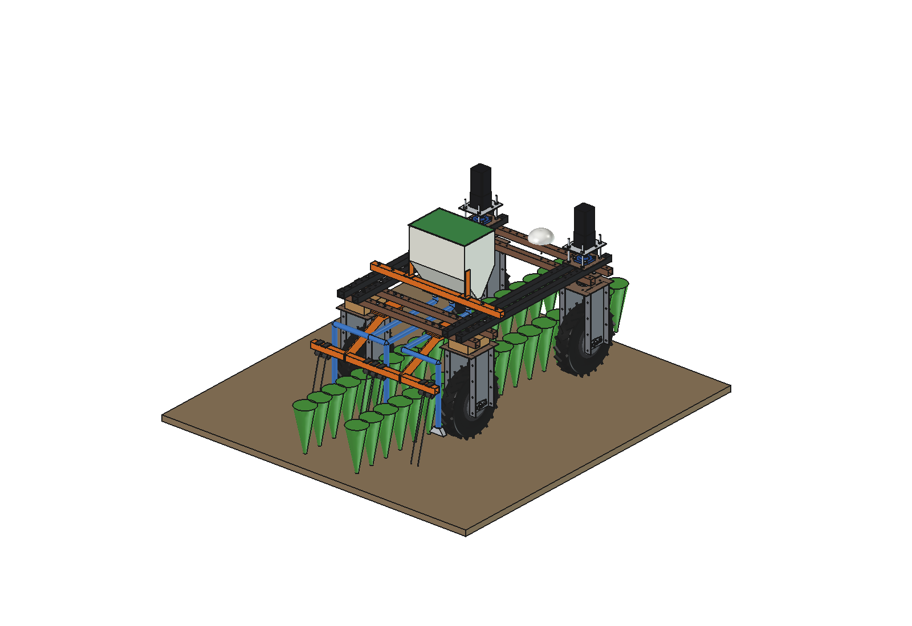
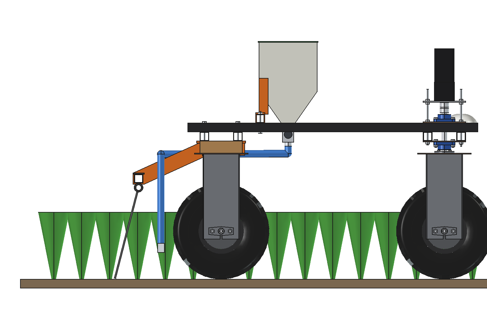
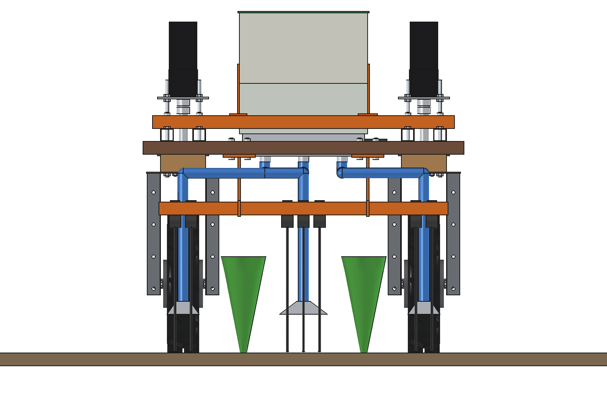
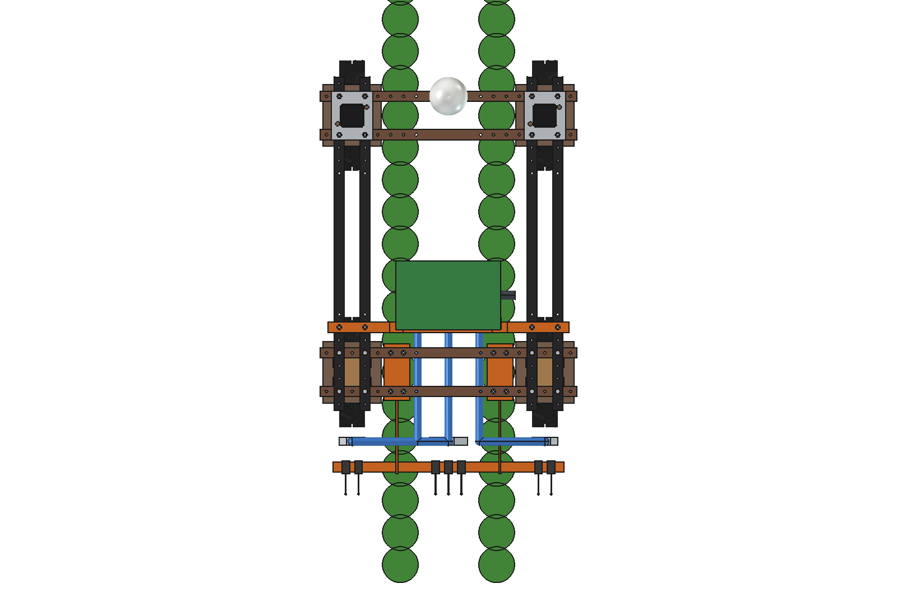
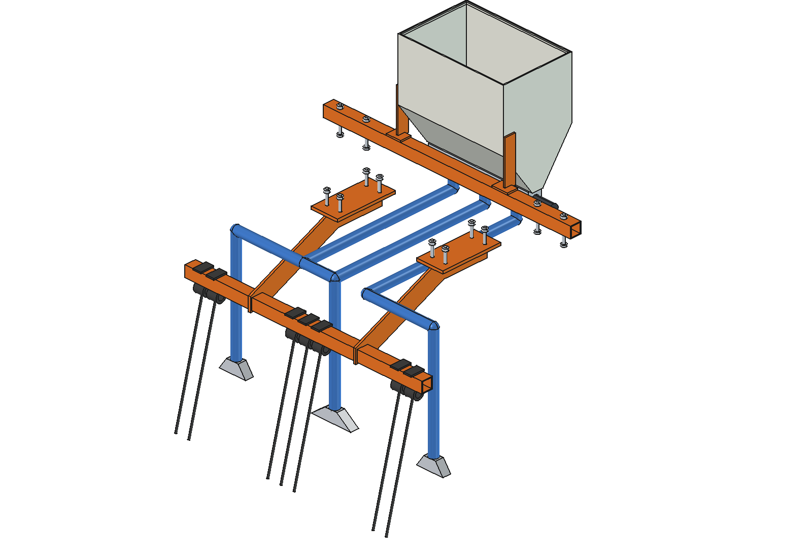

# Cover crop undersower (simple)

Sows a cover crop (green manure) into a standing crop of 2 rows, 375 mm apart, between the wheels of the Bruut
OpenAgbot (standard robot). A 28 l hopper on a bearer across the upper beams feeds 3 fluted metering cells on one
speed-following shaft; hoses take the seed to fishtail deflectors that lay it in 3 bands: the free inter-row in the
middle of the bed (150 mm) and the 2 wheel inter-rows behind the rear tyres (100 mm each). 7 spring tines on a bar high
over the crop scratch the seed in. Nothing comes into the space of the crop rows (checked).

<p align="center">
  
</p>

| Side | Rear |
| --- | --- |
|  |  |
|  |  |

## Build

- **Bearer** 40 x 40 x 3 across the 4 upper beams at y -325, 4 x M10 in the beam holes.
- **Hopper** PE 4 mm, 400 x 260, V-bottom at 55 degrees to an outlet slot, lid; on 2 flat-bar brackets on the bearer.
- **Metering**: aluminium housing under the slot (between the inner upper beams) with 3 fluted rollers O40 x 30
  (8 flutes, ~7.5 ml per turn) on one O10 shaft, 12 V gearmotor whose speed follows the driving speed.
- **Hoses** O32: the middle one straight back to x 0; the side ones back under the rear lower beams at x +-120, across
  over the crop row and the hanger at z 560, then down behind the rear tyres (x +-375). Fishtail deflectors 40 mm above
  the ground spread the seed into the band.
- **Tines**: bar 40 x 40 x 3 at z 430-470 (over a crop up to 400 mm) on 2 hangers under the rear lower beams
  (4 x M10 each); 7 spring tines O8: 3 in the middle band, 2 behind each wheel.

Mass 26 kg empty, ~47 kg with 28 l of rye. Size 940 x 913 x 1061 mm.

## Key figures (`ccu_calc.report()`)

| | |
| --- | --- |
| Sown | 3 bands, 47 % of the 0.75 m pass; the field rate goes into the bands (2.1 x the density there) |
| Roller speed, middle / side cell, 1 m/s | ryegrass 25 kg/ha 17 / 11 rpm; rye 100 kg/ha 36 / 24 rpm; clover 6 kg/ha 2 / 1.3 rpm |
| Area per fill | ryegrass 0.43 ha, clover 3.6 ha, phacelia 1.4 ha, rye 0.20 ha |
| Work rate | 0.22 ha/h (80 % field efficiency), ~370 W, ~1.1 ha per charge |
| Draft | 7 tines ~105 N + rolling ~160 N (hub motors 1100 N continuous) |
| Axle load front / rear, full | 86 / 121 kg (rear 59 %) |
| Clearance | 39 mm hose to rear tyre; crop rows (x +-187.5 +-80, up to 400 mm) untouched |

Why and how these come out: see [RATIONALE.md](RATIONALE.md), including the list *Estimated, not measured*.

## Files

| File | Contents |
| --- | --- |
| `ccu_params.py` | all dimensions, robot interface, crop rows, species, masses and hopper volume from the model |
| `ccu_parts.py` | one function per part, robot coordinates, crop for the images, row bands for the check |
| `build_ccu.py` | model tree (Mount, Seeder, Tines), checks (`check_interference`, `check_holes`, `check_steering`, `check_rows`, `clearance`), `hopper_volume()`, mass, `render_all()`, STEP |
| `ccu_calc.py` | bands, roller speed per species, area per fill, draft and power, axle loads |
| `run_in_freecad.py` | reload, build, print the key figures |
| `Cover_Crop_Undersower.FCStd`, `Cover_Crop_Undersower.step` | generated model (robot hidden in the FCStd) |
| `previews/` | images |

## Use

```python
exec(open(r"F:\veldrobot\aanbouwdelen\cover crop undersower\simple\run_in_freecad.py").read())
import build_ccu
build_ccu.check_rows()           # {}: nothing in the crop rows
build_ccu.check_interference()   # []
```

No moving axes besides the rollers (simple variant), so no animation.
