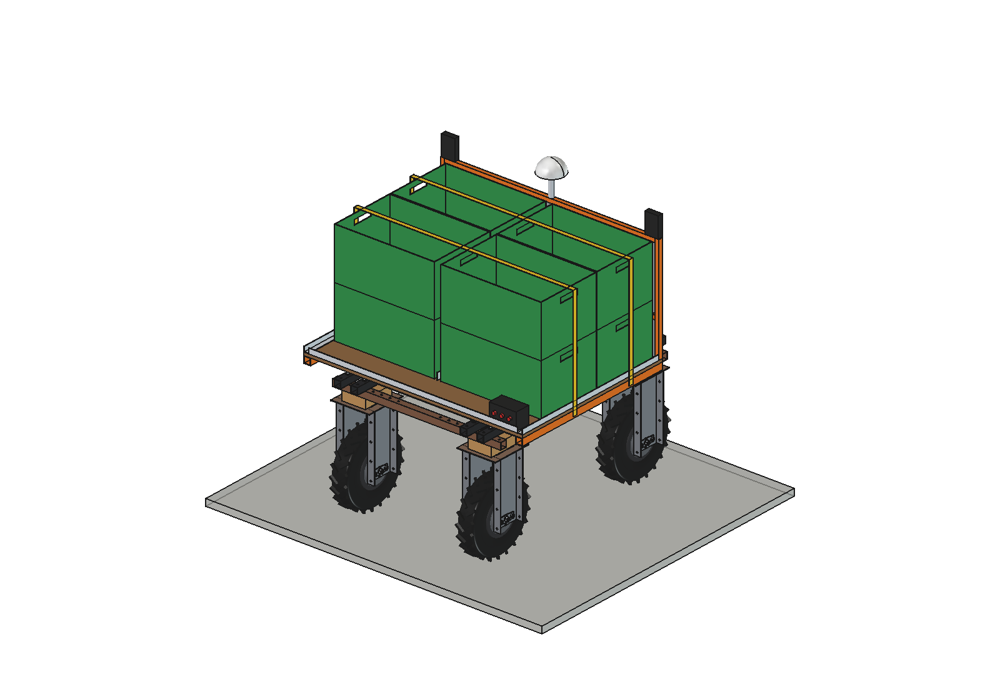
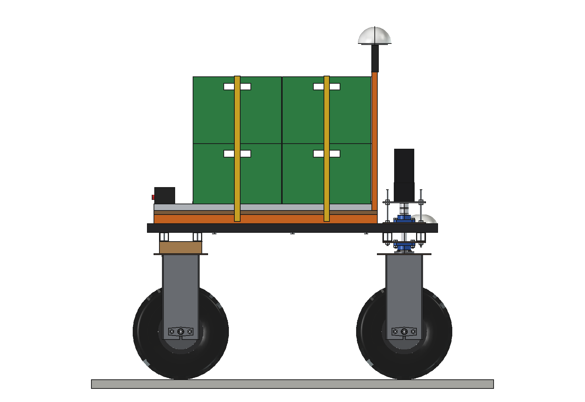
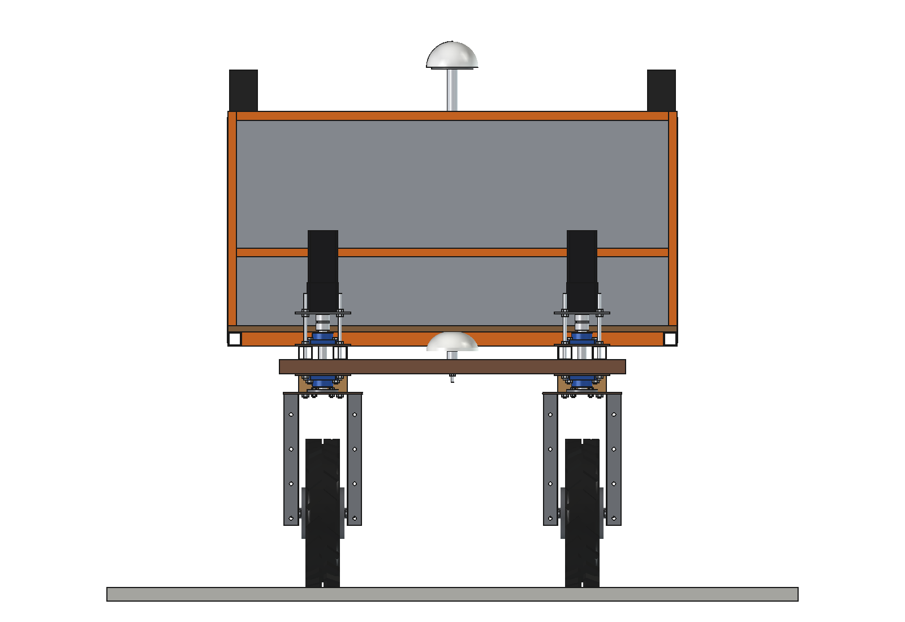
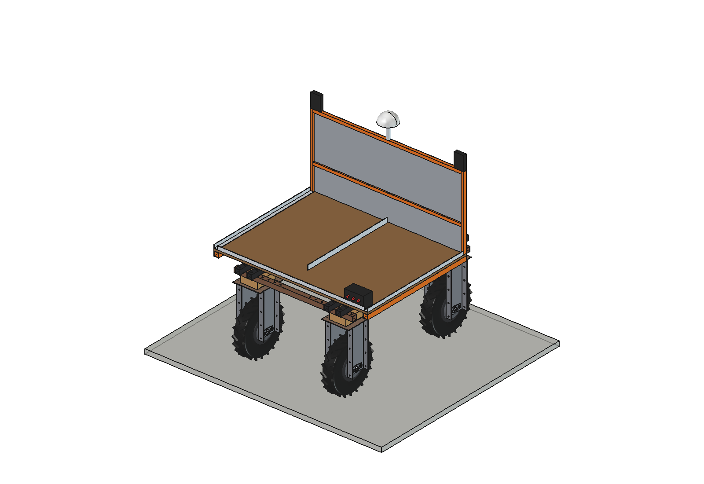
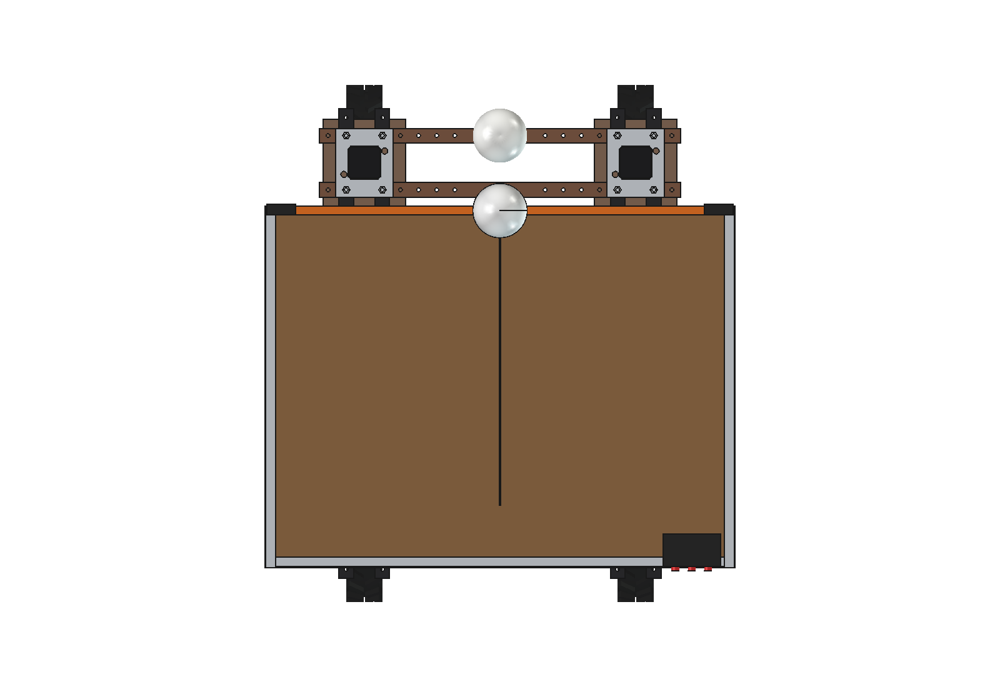

# Crate carrier (simple)

Flat deck on the upper beams of the Bruut OpenAgbot (standard robot) that carries 8 harvest crates (600 x 400 x 300,
2 x 2 per layer, 2 layers) from the rows to the field edge, following a picker (UWB) or on a fixed RTK route. The same
deck carries tools, stakes or water, which covers the *tool and material cart* idea.

<p align="center">
  
</p>

| Side, loaded | Front, loaded |
| --- | --- |
|  |  |
|  |  |

## Build

- **Deck**: 3 bearers 40 x 40 x 3 across the upper beams (12 x M10), 2 side rails 40 x 40 x 3, 18 mm film-faced plywood
  1300 x 1000; loading height 757 mm.
- **Crate guides**: angle 30 x 30 x 3 at the sides and the rear, a flat bar divider at x = 0, headboard (tube 25 x 25
  with a 50 x 50 x 3 mesh) 620 mm high in front of the crates, 2 ratchet straps.
- **Controls**: 2 UWB anchors on the headboard (follow-me), stop / go / follow button box at the rear corner, GNSS
  antenna moved up on a O30 mast to 1500 mm.

Mass ~51 kg without crates. Size 1304 x 1072 x 927 mm (x, y, z, deck with headboard and mast).

## Key figures (`ccr_calc.report()`)

| | Strawberries | Apples | Potatoes | Cabbage |
| --- | --- | --- | --- | --- |
| Payload, 8 crates | 49 kg | 141 kg | 157 kg (over 150: 7 crates) | 125 kg |
| Front axle share | 49 % | 48 % | 48 % | 48 % |
| cg height / side tip angle | 592 mm / 32 deg | 714 mm / 28 deg | 729 mm / 27 deg | 698 mm / 28 deg |
| 10 degree slope, motor margin | 1.86 | 1.37 | 1.31 | 1.44 |
| Shuttle 150 m: crates / kg per hour | 107 / 483 | 107 / 1717 | 107 / 1932 | 107 / 1503 |

~19 Wh per trip, ~100 trips per battery. Clearance of the deck to the rear unit frame bolts 34 mm, deck to the front
steering plates 25 mm.

Why and how these come out: see [RATIONALE.md](RATIONALE.md), including the list *Estimated, not measured*.

## Files

| File | Contents |
| --- | --- |
| `ccr_params.py` | all dimensions, robot interface (steering stacks, rear bolts, GNSS), crates, crops, work parameters, masses |
| `ccr_parts.py` | one function per part, robot coordinates |
| `build_ccr.py` | model tree, `set_load()`, checks (`check_interference`, `clearance`), mass, `render_all()`, STEP |
| `ccr_calc.py` | payload per crop, axle loads, tip angles, slope pull, shuttle capacity and energy |
| `run_in_freecad.py` | reload, build, print the key figures |
| `Crate_Carrier.FCStd`, `Crate_Carrier.step` | generated model (robot hidden in the FCStd) |
| `previews/` | images |

## Use

```python
exec(open(r"F:\veldrobot\aanbouwdelen\crate carrier\simple\run_in_freecad.py").read())
import build_ccr
build_ccr.set_load(False)
build_ccr.check_interference()   # must be []
```

Nothing moves, so there is no animation.
