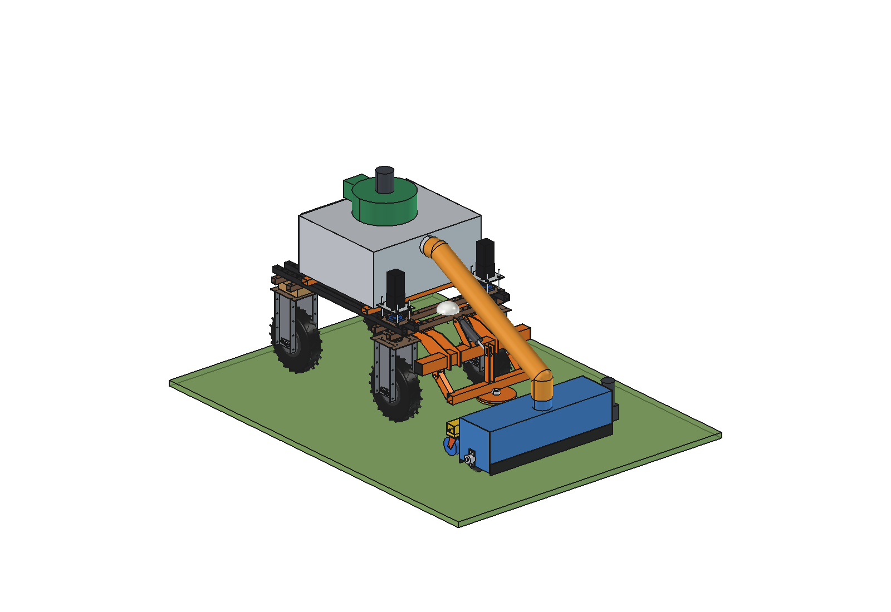
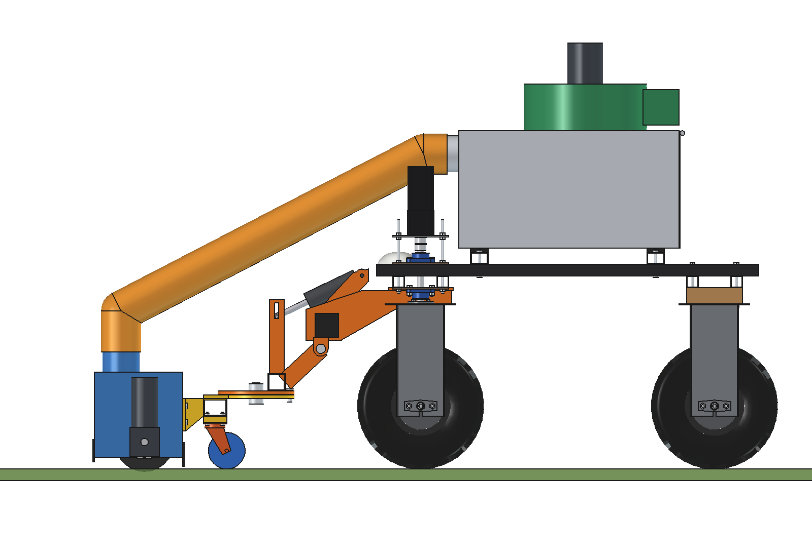
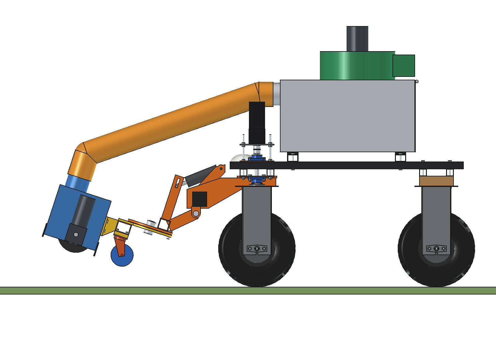
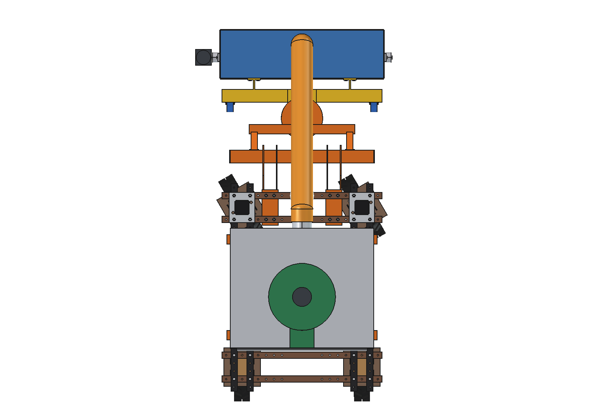
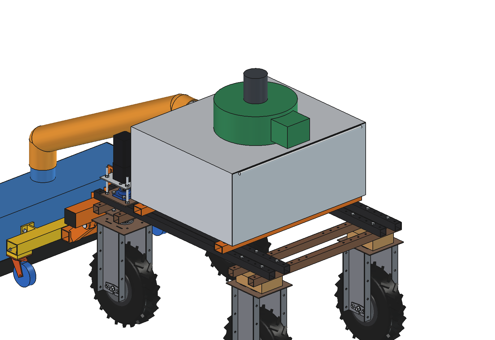
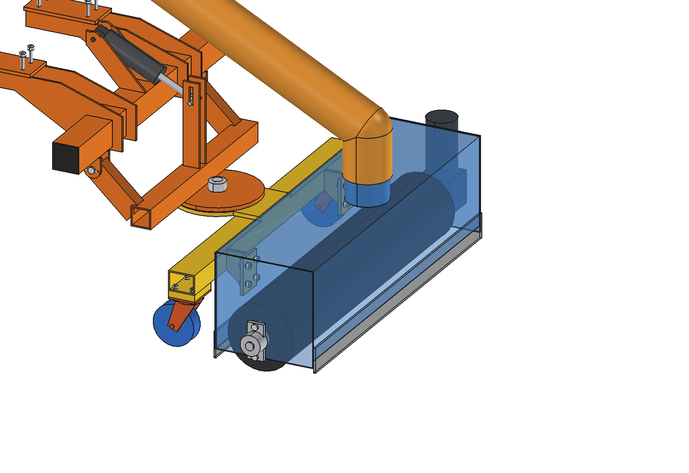

# Debris vacuum (simple)

Litter and shard vacuum for the Bruut OpenAgbot (standard robot). It picks up what is left on grassland and paths
after a festival (cups, cans, PET bottles, caps, cigarette butts) and glass shards of solar panels that a roof fire
spread over a field. A 1 m nozzle with a brush roller runs on 2 castors in front of the robot; a PU hose O125 takes
the litter up to a 270 l bin on the upper beams. The fan sits on the bin lid and sucks **clean** air out through a
screen, so glass and cans never pass the impeller. A liner bag in the bin comes out through the rear door.

The nozzle hangs on the head frame and castors of the [magnet sweeper](../../magnet%20sweeper/simple/README.md) and on
the toolbar, lift arms and king pin of the [push blade](../../push%20blade/simple/README.md) (all imported, not copied).

<p align="center">
  
</p>

| Work | Lifted 18 degrees (only with ballast) |
| --- | --- |
|  |  |
|  |  |



## Build

- **Mount, lift arms, carrier, king pin, lift actuator** from `push blade/simple` (3000 N actuator, as the broom).
  **Head frame and castors** from `magnet sweeper/simple`: the nozzle is bolted to its bracket flanges (8 x M10).
- **Nozzle**: steel 2 mm hood 1030 x 300 x 290, end plates 5 mm, rubber flaps 6 mm (front 25 mm, rear 10 mm over the
  ground), outlet stub O125 on top behind the brush.
- **Brush roller**: PP bristles O200 x 990 on a core tube O60 x 3, shaft O25 in 2 UCFL 205; right-angle worm gearmotor
  48 V 250 W on the left shaft end, 400 rpm (tip 4.2 m/s), 8 mm into the sward; it flicks the litter up into the air
  stream.
- **Hose**: PU O125 (wear-resistant for glass), ~1.4 m, from the outlet to the inlet stub in the bin front wall.
- **Bin**: aluminium 3 mm, 900 x 750 x 400 (270 l), on 6 PE pads on 2 cross bars 60 x 40 x 3 that are bolted to the
  4 upper beams at y +-300 (grid holes). Rear door hinged at the top; liner bag inside.
- **Fan**: centrifugal O420 x 160 on the lid with a 48 V 1.2 kW BLDC motor, perforated screen (3 mm) in the lid, outlet
  duct to the rear.

Mass ~156 kg (lift group 82 kg, bin with fan 45 kg, mount 22 kg, hose 4 kg).
Size 1231 x 2015 x 1462 mm (x, y, z).

## Key figures (`dvc_calc.report()`)

| | |
| --- | --- |
| Air | 0.27 m3/s (970 m3/h) at 22 m/s in the hose, 1.7 kPa, ~910 W fan (76 % of 1.2 kW) |
| Transport | all items carried: terminal speeds 3.9 (cup) .. 10.9 m/s (PV glass 50 x 50), hose >= 1.8 x |
| Brush | 4.2 m/s tip, ~240 W |
| Work rate | 0.89 m at 0.8 m/s: ~2560 m2/h (0.26 ha/h) |
| Power and battery | ~1.43 kW: **~1.3 h, ~0.34 ha per charge**; for a festival field use the hybrid range extender |
| Bin | ~15 kg litter per bag (60 kg/m3), a bag every ~0.6 ha at 25 kg/ha; shards up to 60 kg (~46 l) |
| Axle load front / rear, working | 88 / 109 kg empty, 116 / 140 kg with 60 kg in the bin; 116 kg on the castors |
| Lifted | rear 10 % without ballast (just enough for a hop); 6 plates (66 kg) for lifted transport |
| Lift actuator | ~2220 N, 3000 N rating |
| Clearance to the front tyres | 148 mm (carrier, lift -4) |

Why and how these come out: see [RATIONALE.md](RATIONALE.md), including the list *Estimated, not measured*.

## Files

| File | Contents |
| --- | --- |
| `dvc_params.py` | all dimensions; push-blade, broom and magnet-sweeper interface, air and work parameters, masses from the model |
| `dvc_parts.py` | one function per part (head frame and castors from `mgs_parts`), `hose(lift)` rebuilt per pose |
| `build_dvc.py` | model tree (Mount, Lift with Head and Brush, Actuator, Bin, Hose), `set_pose(lift)`, checks, mass, `render_all()`, STEP |
| `dvc_calc.py` | air flow, pressure and fan power, transport of each item, brush, axle loads and ballast, actuator, work rate |
| `run_in_freecad.py` | reload, build, print the key figures |
| `Debris_Vacuum.FCStd`, `Debris_Vacuum.step` | generated model (robot hidden in the FCStd) |
| `previews/` | images |

## Use

```python
exec(open(r"F:\veldrobot\aanbouwdelen\debris vacuum\simple\run_in_freecad.py").read())
import build_dvc
build_dvc.set_pose(lift=18)     # the hose follows the nozzle
build_dvc.check_poses()         # lift -4..18 x steering -30..30: must be {}
```

No animation (simple variant): the poses are checked statically with `check_poses()`.
