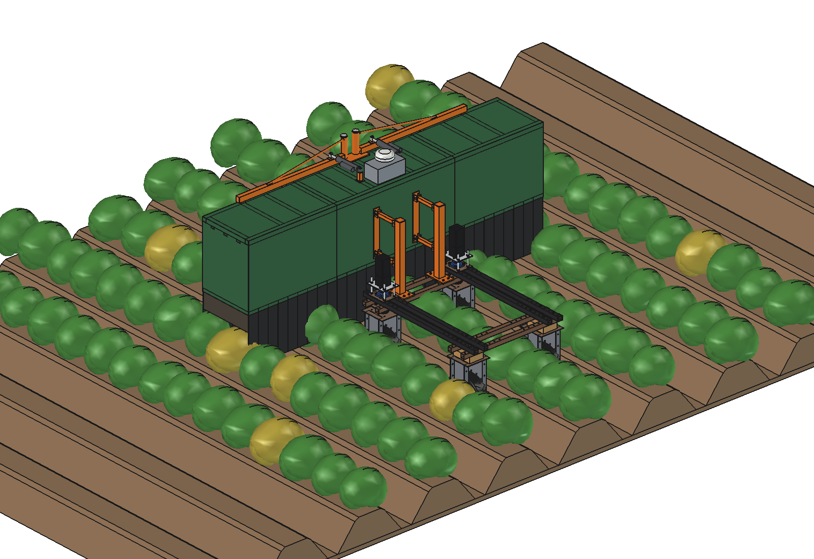

# Potato disease scout: design rationale

3 November 2026. Model: `Potato_Disease_Scout.FCStd` (FreeCAD 1.1, generated with `build_dsc.py`). The figures come
from the model, from `dsc_calc.py` and from the animation (`animate_dsc.summary()`). Where something is assumed or
estimated, this is stated.

---

## 1. Assignment

- Work out the disease scout idea: a hood ("bak") that goes over the plants, with cameras and a strong LED light
  inside to light the plant well and take a good picture of it.
- 3 m wide, with 2 folding wings, **1.20 m wide for transport**.
- For potatoes. Example: the Doorgrond Croptiscan.

The Croptiscan is a manned, diesel-hydraulic selection machine for seed potatoes (4, 8 or 12 rows, up to 5 km/h): RGB
cameras with their own lighting look for virus (PVY, leaf roll) and bacterial disease (blackleg), mark the sick
plants and store their GPS position. This design is the robot version: 4 rows, 1 m/s, no driver, the night included.

## 2. The design in brief

1. **Hood** in front of the robot: centre section 1.2 m, two wings of 0.9 m; aluminium sheet on a 40 × 40 frame,
   matt white inside. Rigid walls down to 0.80 m, black PVC strip curtains down to 0.35 m: the haulm passes through.
2. **10 cameras** (5 MP, 12 mm) on 300 mm pitch looking straight down, **20 LED strobe bars**, one in front of and one
   behind each camera. Flash 200 µs per image.
3. **4 castors** in the furrows carry the hood; a **parallelogram** from two posts on the robot's front beams pushes
   it and keeps it level.
4. **Wings swing forward** round a kingpin on the roof, 24 V actuator each: 1.20 m wide.
5. **Control box** on the roof (computer, PoE switch, strobe drivers) with the robot's **GNSS antenna** on it.

| Characteristic | Value |
| --- | --- |
| Working width | 3.0 m = 4 rows of 750 mm per pass |
| Image | 0.16–0.24 mm/px, 0.2 mm motion blur at 1 m/s |
| Capacity | 0.86 ha/h net, 3.9 ha per charge |
| Transport width | 1.20 m (wings forward, 7.4 s) |
| Mass (model) | 135 kg, of which 120 kg on its own castors |
| Parts, roughly | ≈ €11,800 (cameras and computer are 2/3 of it) |

## 3. Rows and width

The robot's track is 750 mm, the same as the potato row spacing: its wheels run in two furrows (x ±375) and it
straddles one ridge. With the robot's centre over a ridge, the ridges are at x 0, ±750, ±1500. A 3.0 m hood therefore
covers the ridges at 0 and ±750 completely and the ridges at ±1500 half. The next pass, 3.0 m over, sees the other
half of that row: **4 rows per pass, every plant seen** (the outer row from both sides, which is no loss: a
symptom on one side of a plant is often only visible from that side).

A hood centred on a 4-row bed (the classic 3 m planter) would put the robot's wheels on the ridges; that is not
possible with this track.

## 4. In front of the robot, on its own castors

| Option | For | Against |
| --- | --- | --- |
| **Hood in front, on castors, parallelogram** (chosen) | the cameras see the haulm before the robot drives through it (its beams are at 0.62 m, a closed crop is 0.75 m); camera height follows the ridges (castors in the furrows); the robot carries almost nothing (front 66 % instead of 60 %, rear 60 kg) | 4 castors and a parallelogram to build; the robot is 2.4 m longer folded |
| Hood rigid on the front of the robot | simple | 120 kg 0.55 m in front of the front axle: the rear wheels would carry ≈ 20 kg (no traction, steering overloaded); the camera height follows the robot's pitch |
| Hood behind the robot | steering free | the robot has driven through the haulm before it is photographed; same axle load problem the other way round |
| Hood over the robot, between the axles | no overhang, no axle load | the robot's beams and wheel units are in the image and in the hood; the wings cannot fold (see §6) |

The parallelogram (2 posts 60 × 60 on the front lower beams, 8 × M10, links 30 × 30 at z 900 and 1250) lets the
hood float ±60 mm and keeps it parallel to the robot (no pitch, no roll); the links only push (≈ 210 N: curtains
through the haulm and rolling resistance) and take a small pitch couple (48 N m working). The castors are in the
robot's own furrows (x ±375) and, one per wing, in the next furrows (x ±1125).

**The wing castors** were added after the first calculation: with only 2 castors under the centre the folded wings
put the centre of gravity of the hood 0.63 m in front of the castors; the parallelogram would pass that couple
(626 N m) to the robot and its rear axle would carry 1 kg. With a castor under each wing the folded hood stands on
two rows of castors (y 1.05 and 2.39 m) and the robot carries nothing of it. Working, the wing castor carries its
wing (27 kg) and keeps the wing tip at the right height over the ridges.

## 5. Cameras and light

**Resolution.** Late blight starts as lesions of a few mm, virus symptoms are a mosaic or rolled leaf margins:
0.2 mm/px is plenty, and a 5 MP camera over 300 mm gives that. A 12 mm lens on a 2/3" sensor (38.8° × 32.8°) gives,
from the lens at 1.30 m:

| Haulm top | Distance | Image across × along | mm/px | Overlap across | Depth of field (f/5.6) |
| --- | --- | --- | --- | --- | --- |
| 450 mm (young) | 848 | 597 × 500 | 0.24 | 297 | 386 |
| 600 mm | 698 | 492 × 411 | 0.20 | 192 | 262 |
| 750 mm (closed) | 548 | 386 × 323 | 0.16 | 86 | 161 |

The images overlap at every height, also over the gap between centre and wing. Straight down, so no perspective
correction and every plant is seen from above, as a grower looks at it. A higher hood would need fewer cameras but
would make the hood (and the folded wings) taller; a lower one would hit the closed crop.

**Flash instead of continuous light.** At 1 m/s a sharp image (≤ 1 px blur) needs an exposure of ≤ 0.2 ms. With f/5.6
for the depth of field and a gain of ISO 400 that needs ≈ 98 klx on the canopy: as much as full sun. Continuous LEDs of
that power would take ≈ 2.2 kW; flashed for 200 µs at ≤ 4.4 images per second it is 0.09 % of the time, ≈ 2 W on
average. The LEDs are overdriven during the pulse (strobe drivers with a capacitor bank in the control box).

**Why a hood at all.** With the flash alone the sun would still give shadows and changing colours. In the hood the
daylight is ≈ 3 % of the flash (estimated leak through the curtains), so images by day and by night look the same and
one detection model works at any hour. The white inside and the bars in front of and behind each camera give diffuse
light without hard shadows.

## 6. Folding: wings swing forward round a kingpin on the roof

A wing that folds **up** (hinge along the driving direction, as on the spot sprayer and the sickle bar mower) does not
work for a hood:

- the hood is a box 0.54 m deep and 0.65 m high plus curtains. Folded up, its height points outwards: with the hinge
  at the top the transport width becomes 1.2 + 2 × 0.65 = 2.5 m;
- the curtain strips (stiff in their own plane) would stick out sideways when the wing stands upright.

The wings therefore **swing forward about a vertical axis**: the curtains keep hanging the way they do in the field.
The kingpin sits on the front edge of the roof at x ±60, i.e. one hood depth (540 mm) inside the joint at x ±600:

- folded, a wing lies in front of the centre section at x 60 .. 600, so the hood is **exactly 1.20 m wide**;
- because the pivot is on the front line of the hood, the wing never enters the centre section on the way (the
  centre section is always on the inner side of the wing's inner edge) and there is no gap at the corner in the
  working position. A pivot at the corner of the joint would put the folded wing outside the centre (2.28 m).

`check_fit()` checks 0 .. 90° in steps of 10° and the cases one wing out, one in: no overlap. During the swing the
hood is up to 3.15 m wide (at ≈ 30°).

**Swing arm and actuator.** Each wing hangs on a sleeve on a Ø40 kingpin (C45) with a steel arm 40 × 50 × 2.5 along
the front edge of the roof, to x 1160, and a tie rod. A 24 V linear actuator (stroke 200, 330 mm retracted, 25 mm/s)
lies on the roof between a post at (±200, 970) and the arm: it extends 184 mm for 90° (7.4 s). The lever arm about the
kingpin goes from 151 down to 55 mm; with wind (10 m/s on the wing side), the curtains dragged through the haulm and
bushing friction ≤ 84 N m is needed, ≤ 1540 N: a 2500 N actuator (× 1.6). A longer lever does not help much (a search
over the pin positions gave at most 65 mm minimum arm) because of the 90° swing in the little room on the roof.

## 7. Mass and strength

| Group | Mass |
| --- | --- |
| Centre section (sheet, frame, 4 cameras, 8 LED bars, 2 castors, kingpins, control box) | 50 kg |
| Each wing (sheet, frame, 3 cameras, 6 LED bars, castor, swing arm) | 32 kg |
| Actuators | 2 × 2.8 kg |
| Posts and parallelogram | 15 kg |
| **Total** | **135 kg** |

The sheet (1.5 mm aluminium) and the frame are almost half of it; the steel swing arms 5–6 kg each (a first version
with a 40 × 60 × 3 arm to the wing tip and a Ø50 kingpin had 11 kg per arm). Worst case for the kingpin and arm is a
wing castor off the ground (a ditch on the headland): the wing then hangs on the kingpin only, 112 MPa in the pin and
117 MPa in the arm with a factor 2.5 for bumps; fine for C45 and S355.

## 8. Energy, capacity and data

- 1.08 ha/h gross, 0.86 ha/h with 80 % field efficiency at 1 m/s. The Croptiscan does ≈ 4 ha/h with 8 rows at up to
  5 km/h; the robot does a quarter, but day and night: ≈ 120 ha per week at 20 h a day, the same order as a manned
  machine's ≈ 100 ha per season.
- ≈ 110 W for the scout and ≈ 420 W driving: 4.5 h, 3.9 ha per 2.4 kWh charge.
- 44 images per second (221 MB/s raw): ≈ 23 ms per image for detection on a Jetson AGX Orin class computer. Only the
  suspect plants and 1 in 10 images are stored: ≈ 19 GB/h.

## 9. Not (yet) in this design

- **Marking in the field.** The Croptiscan marks sick plants; here they go into a map with photo and position. A
  paint marker per row or the [field marker](../../marker/simple/) on a second pass could follow.
- **Spot treatment** (UV-C light, spot spraying) of the suspect plants: other implements.
- A lock for the folded wings on the road, the float end stops and the height adjustment of the castor stems, seals
  at the centre/wing joint, cables.
- The detection model itself: which symptoms are visible from above, training images per variety, accuracy.
