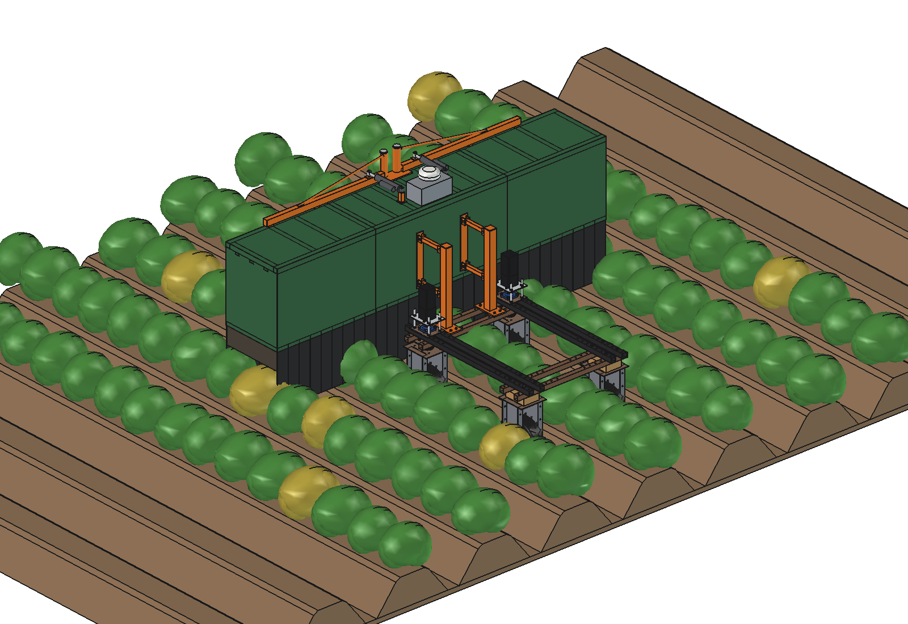
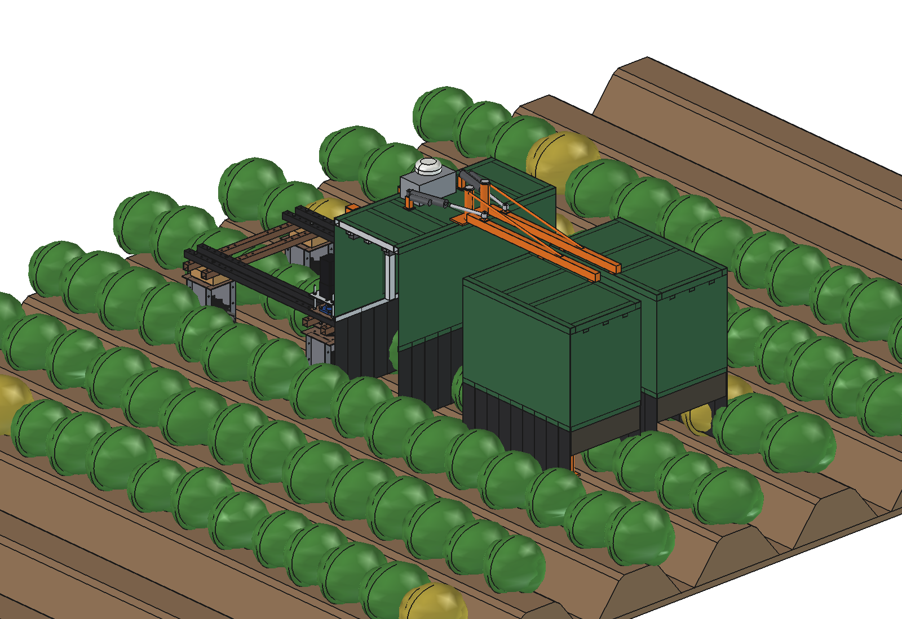
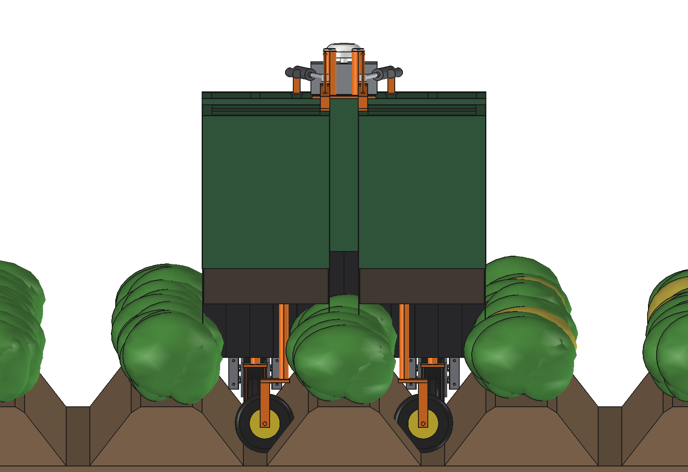
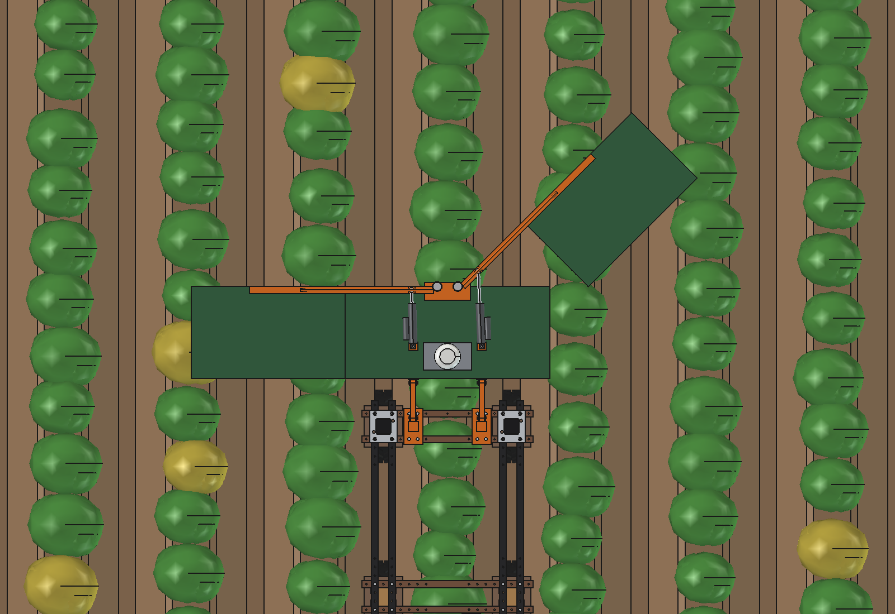
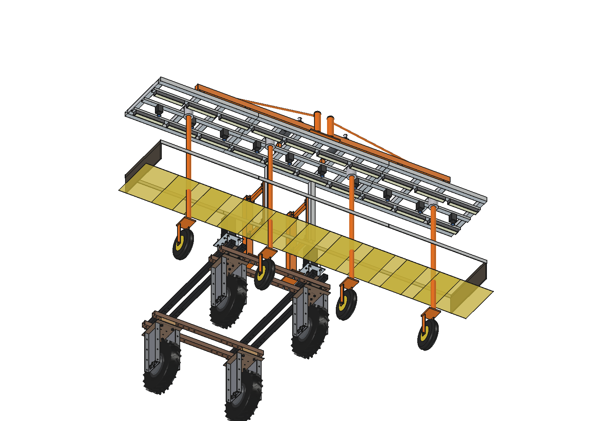
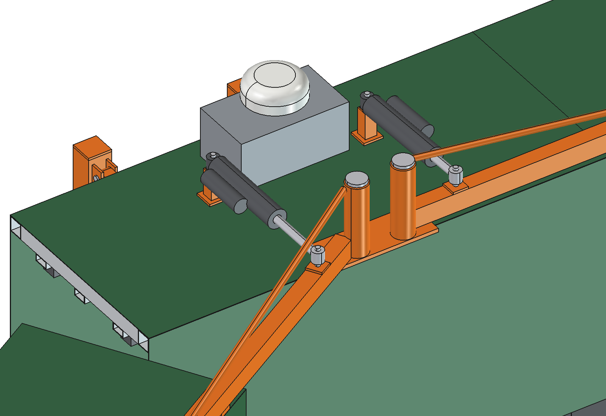
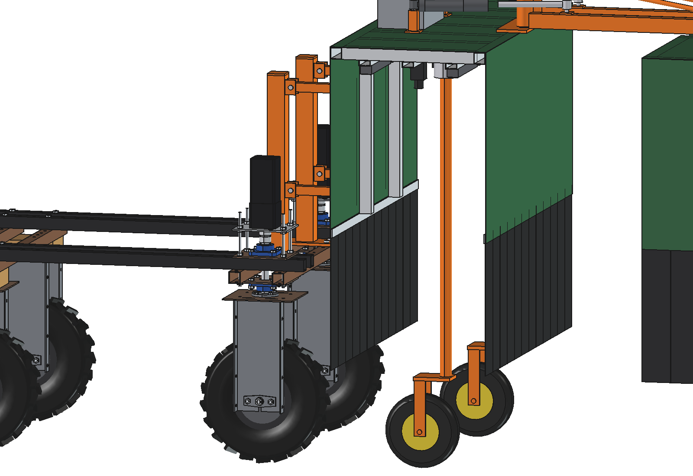
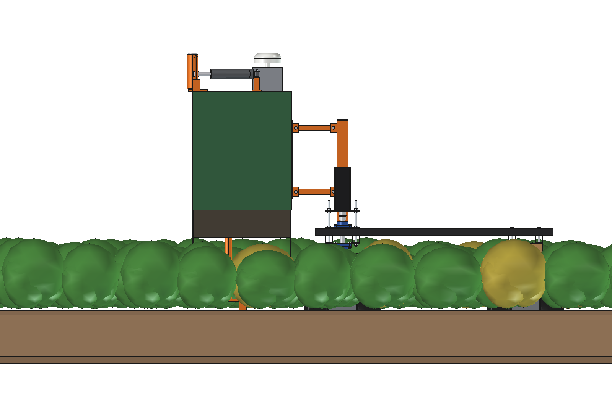
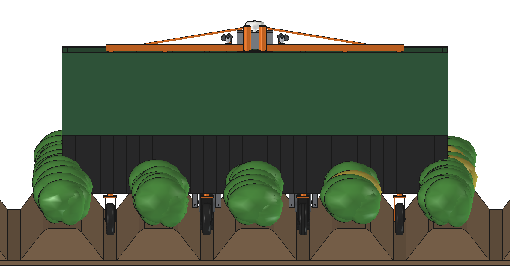

# Potato disease scout: FreeCAD model

Looks at **every potato plant** and finds the sick ones early: a light-tight **camera hood, 3.0 m wide**, in front of
the standard Bruut OpenAgbot, over **4 rows at 750 mm** (3 whole rows and the two halves at the ends; the next pass
sees the other half). The haulm passes through strip curtains into the hood; inside, **10 downward cameras** and
**20 LED strobe bars** take a sharp, evenly lit picture of the canopy, by day and by night. A vision computer on the
roof looks for virus (PVY mosaic, leaf roll), blackleg and late blight and stores every suspect plant with its GNSS
position. The idea follows the Doorgrond Croptiscan (a manned potato selection machine for seed potatoes), scaled down
to a robot.

- **Hood:** aluminium on a 40 × 40 frame, matt white inside. Centre section 1.2 m, **two wings of 0.9 m that swing
  forward** round a vertical kingpin on the roof, each with a 24 V linear actuator (7.4 s): **1.20 m wide** for the
  headland and the road.
- **Cameras:** 5 MP global shutter (2/3", 2448 × 2048), 12 mm lens, one per 300 mm, 1.3 m high: **0.16–0.24 mm per
  pixel** on the canopy, every plant in 2–3 images across and several along.
- **Light:** 2 LED bars per camera, flashed for 200 µs per image (≈ 98 klx on the canopy). The hood keeps daylight
  out to ≈ 3 %, so day and night images look the same. Average LED power ≈ 2 W.
- **Carried:** on **4 castors in the furrows** (2 under the centre in the robot's own furrows, 1 under each wing),
  pushed by a **parallelogram** (2 × 2 links) from two posts on the robot's front beams. The hood floats ±60 mm over
  the ridges at a constant camera height and puts (almost) no weight on the robot, also with the wings folded.
- **GNSS:** the hood would shade the robot's antenna, so that antenna moves onto the control box on the hood roof
  (right above the cameras: the image positions come straight from it).

Why it is designed this way is explained in [RATIONALE.md](RATIONALE.md).



The animation (`previews/animation_potato_scouting.gif`, not in git; see the main README) shows the robot scouting
8 m of 4 rows at 1 m/s: 158 plants photographed in 280 images, the 10 plants with symptoms get a red flag in the map
(in the field nothing is marked). At the headland both wings swing forward to 1.20 m.

| | | |
| --- | --- | --- |
|  |  |  |
| both wings swung forward: 1.20 m wide, 2.37 m long in front of the posts | folded, from the front: the hood stands on its 4 castors | from above: right wing at 45°, it swings round the kingpin at x 60 |
|  |  |  |
| skin hidden: 10 cameras, 20 LED bars, 4 castors; yellow = camera images at canopy height 600 | kingpins Ø40 on the roof, swing arms with tie rods, actuators, control box with the GNSS antenna | posts on the front beams, parallelogram, castor in the robot's furrow (wings folded) |
|  |  | |
| side view: the hood 65 mm in front of the steered tyres | from the front: castors in the furrows, curtains down to 350 over the ridges | |

## Key figures

From the model (`build_dsc.mass_properties`, `check_fit`, `clearance`, `size`), `dsc_calc.report()` and
`animate_dsc.summary()`. Robot 161.5 kg (agbot comparison, not weighed).

| | |
| --- | --- |
| Working width | 3.0 m = 4 rows of 750 mm per pass (3 whole rows under the hood, the outer rows half from each pass) |
| Hood | inside 3.0 m × 0.53 m, roof at 1.45 m, rigid walls down to 0.80 m, strip curtains down to 0.35 m (ridge top 0.25 m, haulm up to 0.75 m) |
| Cameras | 10 × 5 MP global shutter, 12 mm f/5.6, 38.8° × 32.8°; canopy at 450 / 600 / 750 mm: image 597 / 492 / 386 mm wide, 0.24 / 0.20 / 0.16 mm/px, depth of field 386 / 262 / 161 mm |
| Frame rate | 2.9–4.4 images/s per camera at 1 m/s (30 % overlap along the row); 44 images/s in total |
| Flash | 200 µs = 0.2 mm motion blur; needs ≈ 98 klx (f/5.6, gain ISO 400): 244,000 lm, 20 bars of 110 W during the flash, 0.09 % duty, ≈ 2 W average; daylight inside ≈ 3 klx (3 %) |
| Capacity | 1.08 ha/h gross, 0.86 ha/h net at 1 m/s; ≈ 40,000 plants/ha, 12 plants/s |
| Power | ≈ 110 W for the scout (computer 60, cameras 35, switch 12, flash 2) + 420 W driving: 4.5 h, 3.9 ha per charge; ≈ 120 ha per week at 20 h/day |
| Data | 221 MB/s raw on the computer (≈ 23 ms per image); 19 GB/h stored (all suspects + 1 in 10 images) |
| Swing | 0 → 90° in 7.4 s; actuator 330 → 514 mm (184 of 200 mm stroke); need ≤ 1540 N (wind 10 m/s, curtains through the haulm, bushing friction) on a 2500 N actuator (× 1.6) |
| Mass | 135 kg: hood 120 kg (centre 50, wings 32 each incl. castor, actuators 2.8 each), posts and parallelogram 15 kg |
| Castors (4 × 250 × 60, 150 kg) | working: 33 kg per centre castor, 27 kg per wing castor; folded: 32 / 28 kg (22 % of the rating); the robot carries only the posts and links |
| Robot axle loads | front 117 / rear 60 kg (66 % front) working, 112 / 65 kg folded (robot alone 60 % front) |
| Size | working 3000 × 953 (y 395 .. 1348) × 1670 mm high (antenna 1660); folded 1200 × 2365 (to y 2760) × 1670 |
| Stability | robot + hood (coupled in roll by the parallelogram): cg 822 mm high, tips sideways at 24° |
| Strength (× 2.5 for bumps) | kingpin 112 MPa and swing arm 117 MPa with the wing castor off the ground (C45 / S355); posts 12 MPa |
| Clearances | curtains 97 mm from the front tyres (also at 30° steering); posts and bolts 47 mm from the steering top plates at ±30°; castor fork 35 mm from the LED bars |
| Checks | `check_interference()` = [], `check_fit()` = {} over 0 .. 90° of both wings (and one wing out, one in) |

## How it scouts

1. The robot drives in the furrows at x ±375 (its own track = the row spacing); the hood runs in front of it over the
   undisturbed haulm, the castors in the same furrows and in the next ones (x ±1125).
2. Every 0.23–0.35 m of travel (wheel odometry) all cameras are triggered together with the LED flash: a 200 µs
   exposure, the same light day and night.
3. The vision computer finds the plants in each image and classifies them (healthy, mosaic / leaf roll, blackleg,
   late blight lesions, ...). Every image has the GNSS position of the antenna above it.
4. Suspect plants go into a map with photo and position: for the grower or inspector to check, rogue or treat.
   Marking in the field (paint dot, flag) is not part of this model (see RATIONALE).
5. At the headland the robot stops, both wings swing forward (7.4 s), it turns and the wings swing out again for the
   next pass, 3.0 m over.

## Parts list

Quantities for one scout. Prices are rough estimates (2026) to give an idea of the total, not quotes.

| Qty | Part | Specification | Price (est.) |
| --- | --- | --- | --- |
| 1 | Hood sheet | aluminium 1.5 mm, cut and folded: roofs, walls, end walls; outside painted, inside matt white | €450 |
| 1 | Hood frame | aluminium tube 40 × 40 × 2 (≈ 18 m), rails 40 × 20 × 2 (≈ 9 m), clamp flats 30 × 4, uprights | €260 |
| 1 | Strip curtains | black PVC 2 × 100 mm, ≈ 60 strips of 480 mm, 2 brush strips for the wing ends | €120 |
| 10 | Cameras | 2/3" 5 MP global shutter (IMX264 class), GigE PoE, IP67 housing | €4,500 |
| 10 | Lenses | 12 mm C-mount, f/1.8–16, set at f/5.6, protective window | €900 |
| 20 | LED bars | 260 mm, 24 × 5 W LEDs 5000 K CRI 90, aluminium profile with diffuser, strobe-rated | €1,600 |
| 1 | Control box | IP66 box: Jetson AGX Orin class computer, 12-port PoE switch, strobe drivers with capacitor bank, trigger board, DC-DC 48 → 24/12 V | €2,600 |
| 4 | Castors | pneumatic 250 × 60, swivel with Ø40 stem and housing, 150 kg | €240 |
| 1 | Steel parts | 2 posts 60 × 60 × 3, post plates 10 mm, ears, 4 links 30 × 30 × 3, kingpin plate, 2 kingpins Ø40 (C45), 2 swing arms 40 × 50 × 2.5 with sleeves and tie rods, headstock; galvanised | €550 |
| 2 | Swing actuators | 24 V linear actuator, 2500 N, stroke 200, IP66, end switches | €500 |
| | Bolts, pins | M10 (8), M8, pins Ø16 (8) and Ø12 (4), circlips | €60 |
| | **Total** | | **≈ €11,800** |

The robot's own GNSS antenna moves to the hood roof (no extra antenna). The detection model (training images per
variety and disease) is not part of this list.

## Files

| File | Contents |
| --- | --- |
| `Potato_Disease_Scout.FCStd`, `.step` | the model (generated; robot hidden in the FCStd, not in the STEP) |
| `dsc_params.py` | all dimensions, including the robot interface and the crop (ridges, plants) |
| `dsc_parts.py` | one function per part (right wing, castor and actuator; the left ones mirrored), ridges and plants for the renders |
| `build_dsc.py` | model tree, colours, swing pose, interference and swing check, clearances, mass, renders, STEP |
| `dsc_calc.py` | swing kinematics and actuator force, camera footprint and resolution, flash, capacity, power, data, castor and link loads, axle loads, stability, strength |
| `dsc_field.py` | process model for the renders and the animation: plants with symptoms, drive, photographed plants, swing |
| `animate_dsc.py` | animation on the robot: `build()`, `play()`, `stop()`, `summary()`, `render_all(folder)` |
| `make_gif_dsc.py` | frames to GIF with caption and camera panel |
| `run_in_freecad.py` | macro: reload, build, print the key figures |
| `previews/` | images and the GIF |

## Usage

In FreeCAD 1.1, run `run_in_freecad.py` (or in the Python console):

```python
import build_dsc
build_dsc.build()                       # FCStd + STEP
build_dsc.set_fold(left=90, right=90)   # swing the wings forward (degrees)
build_dsc.check_interference()          # []
build_dsc.check_fit()                   # {} over 0 .. 90 degrees
build_dsc.clearance()
build_dsc.mass_properties()
build_dsc.render_all()                  # previews/
```

Animation:

```python
import animate_dsc
animate_dsc.build(); animate_dsc.play()
animate_dsc.render_all(r"C:\temp\dsc_frames")
import make_gif_dsc; make_gif_dsc.main(r"C:\temp\dsc_frames", r"previews\animation_potato_scouting.gif")
```

## Estimated, not measured

- Robot mass 161.5 kg and its centre of gravity (agbot comparison); drive power 420 W at 1 m/s in the furrows with the
  hood.
- Crop: ridge 250 mm high, haulm top 450–750 mm above the furrow bottom, plants 330 mm apart. In the renders and the
  animation the haulm is kept at 600 mm (the robot's own beams are at 619 mm: in a closed, tall crop the robot body
  brushes the haulm behind the hood).
- Light: LED efficacy 110 lm/W in pulse overdrive, 65 % of the light reaching the canopy plane, sensor gain ISO 400
  equivalent, daylight leak 3 % through the curtains. Needs a test with the real bars and hood.
- Camera mass 0.35 kg, LED bar 0.55 kg, control box 5 kg, castor 4.5 kg, actuator 2.8 kg (catalogue class values).
- Curtain drag 30 N per metre through the haulm, castor rolling resistance 0.10 in a loose furrow, wind 10 m/s while
  swinging, bushing friction 0.15.
- Data: 1.2 MB per stored JPEG, 10 % of the images kept; ≈ 23 ms per image available on the computer.
- The detection itself (which symptoms are visible from above, training data per variety, accuracy) is not part of
  this model.
- Not modelled: cables, the float end stops of the parallelogram, the height adjustment of the castor stems, seals at
  the joint between centre and wing, a wing lock for the road.
