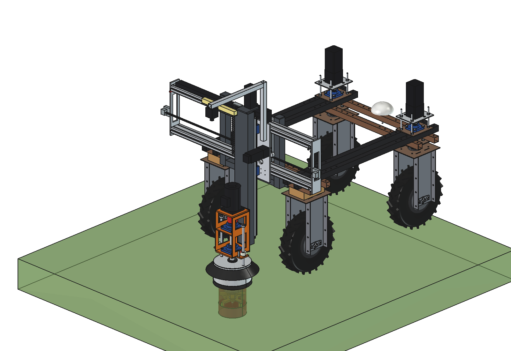
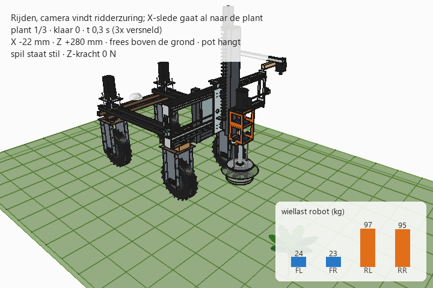

# Dockweed drill v1: FreeCAD model

The first version of the dockweed drill: a gantry behind the Bruut OpenAgbot with an X axis (stroke 1000 mm) and a
Z axis, a cutter Ø 180 at 1500 rpm in a pot Ø 250 that lands on the sward, and a mowing disc as second tool.
v1 runs the X slide on **2 aluminium profiles 40 × 80 with HGR15 rails** and 4 carriages. Process, Z axis, spindle,
pot, mounting on the robot, control and costs are the same as in [v2](../v2/README.md) (X axis on PTO tubes); the
full reasoning is in [../v2/RATIONALE.md](../v2/RATIONALE.md), what differs in v1 in [RATIONALE.md](RATIONALE.md).





## Files

| File | Contents |
| --- | --- |
| `Dockweed_drill_v1.FCStd` | the model in working position (x 150, cutter 150 deep); generated, do not edit by hand |
| `Dockweed_drill_v1.step` | STEP export of the implement |
| `dxf/*.dxf` | 18 cutting contours (laser/plasma) |
| `dwd1_params.py` | all dimensions, including the robot interface |
| `dwd1_parts.py` | one function per part, returns a `Part` shape in robot coordinates |
| `build_dwd1.py` | model tree, poses, interference and clearance check, mass, STEP/DXF export, images |
| `dwd1_calc.py` | spindle, cutting energy, axes, cycle, X guide (profile + rail), spindle shaft, axle loads, headstock bolts |
| `animate_dwd1.py` | animation: robot drives (gantry first), stops at 3 plants and treats them |
| `make_gif_dwd1.py` | frames to GIF with caption and a "wheel load" panel |
| `run_in_freecad.py` | macro: rebuild, print mass and key figures |
| `previews/` | images and the GIF |
| `legacy/` | the original single script (`dockweed_design.py`), its animation, requirements, renders and model, for reference |

## Axes

Robot coordinates (x = right, y = forward, z = up, ground = 0, origin = centre of the robot). The gantry hangs
behind the rear lower beam (rear face y = −595); the spindle is at y = −963. Parts are drawn with v = distance
behind that beam and mirrored to y (`dwd1_parts.to_robot`). The robot drives backwards while weeding.

## Rebuilding and using

```python
import build_dwd1
build_dwd1.build()                                   # working position, saves the FCStd
build_dwd1.build(x=-500, z=280, show_robot=True, save_path=None)
build_dwd1.check_interference(); build_dwd1.check_poses(); build_dwd1.clearance()
build_dwd1.mass_properties()
build_dwd1.render_all()                              # images, FCStd, STEP, DXF

import dwd1_calc
dwd1_calc.report()

import animate_dwd1
animate_dwd1.build(); animate_dwd1.play(); animate_dwd1.summary(); animate_dwd1.check_fit()
animate_dwd1.render_all(r"C:\temp\dwd1_frames")
import make_gif_dwd1
make_gif_dwd1.main(r"C:\temp\dwd1_frames", r"previews\animation_three_plants.gif")
```

## Model tree

```
dockweed_drill_v1
  headstock_robot_mount        2 x (top plate, clamp plate, back plate, 4 M10, upright 50x50x3, gusset), cross tube
  x_axis_alu_profiles_hgr15    2 profiles 40x80 (M8 + T-nut to the uprights), 2 HGR15 rails, aluminium end plates,
                               belt + clamps outside the end plates, limit switch, cable chain strip
  electrics_fixed              IP65 box on the cross tube
  x_carriage_moves_in_x        4 carriages HGH15CA, X slide, NEMA 23 + 5:1, pulley, Z carriages, camera ...
    z_carriage_moves_in_z      Z tube, rails, ball screw, Z motor, spindle bracket, spindle, motor, pot sensor
      tool_cutter_rotates_about_spindle
    pot_rests_on_ground
  cables_follow_x_and_z        cable chain, spiral cable
robot_reference_NOT_PART_OF_DESIGN
```

## Key figures

| Quantity | v1 | v2 |
| --- | --- | --- |
| Mass of the implement | **88.6 kg** (X axis 14.6, X carriage 10.4) | 96.4 kg |
| Moving mass X | 58.6 kg | 61.9 kg |
| Spindle position | y −963 | y −932 |
| Guide deflection at x ±500 | 0.85 mm (z, weight) / 0.53 mm (y, 600 N) | 0.45 / 0.96 mm |
| Guide friction | ≈ 16 N (rolling) | ≈ 190 N (sliding) |
| Axle load driving (front / rear) | 47 / 192 kg (battery forward 70 / 169) | 48 / 199 kg |
| Max. down force (x 0 / x ±500) | 975 / 860 N | 1050 / 920 N |
| Cycle | 23.6 s, 153 plants/h | same |
| Clearance pot to rear tyres | ≥ 108 mm | ≥ 82 mm |

No interference in working position and in the 6 end positions (x −500/0/+500 × driving position / 200 mm deep),
also against the real robot model in the animation document.

## Estimated, not measured

Same list as v2 ([../v2/README.md](../v2/README.md#estimated-not-measured)), plus: catalogue values of the
aluminium profile (2.8 kg/m, I = 14.3 / 45.6 cm⁴) and the HGR15 rail (1.45 kg/m, modelled as 15 × 15 steel for
stiffness); hole pattern of the carriages on the slide (4 × M4 on 38 × 30 assumed).
