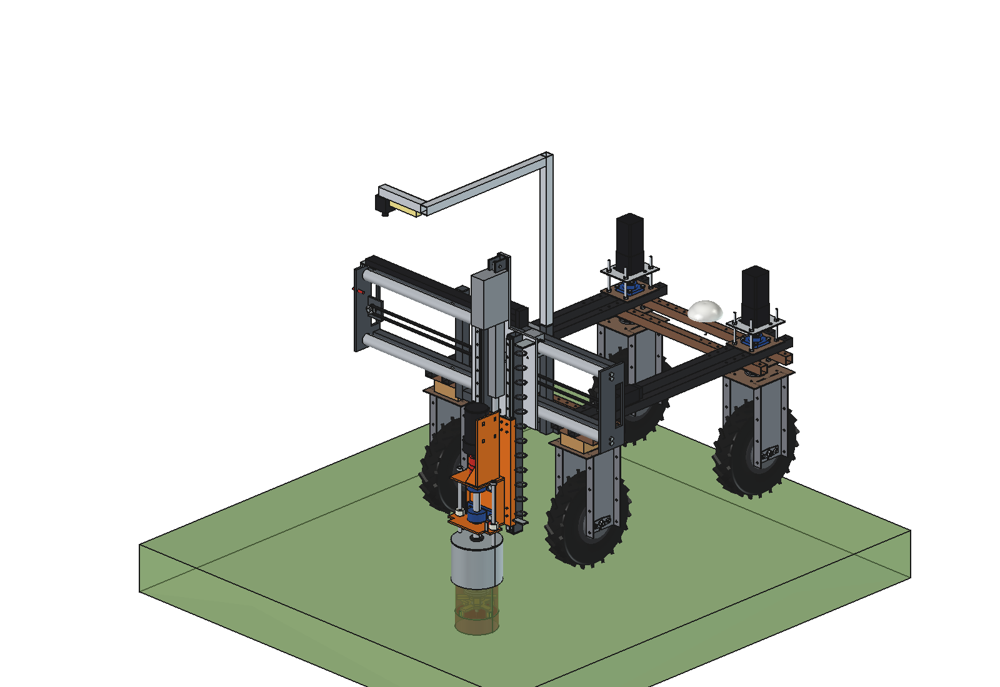
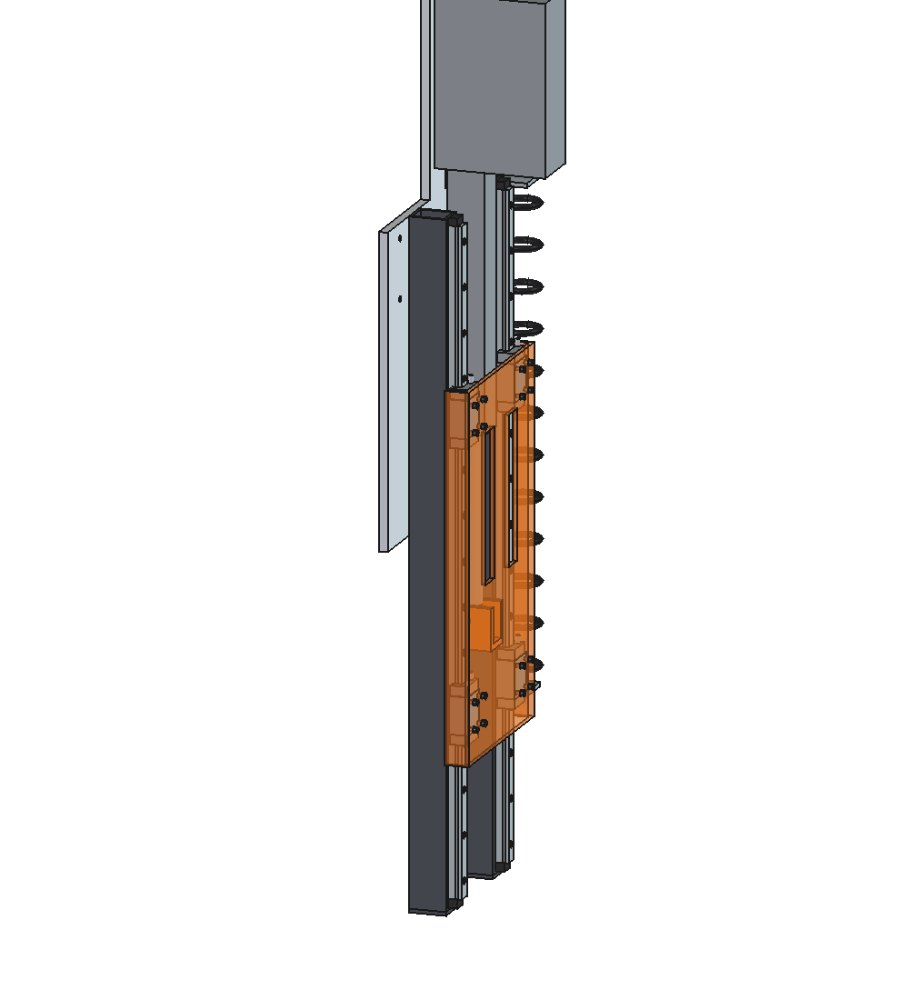
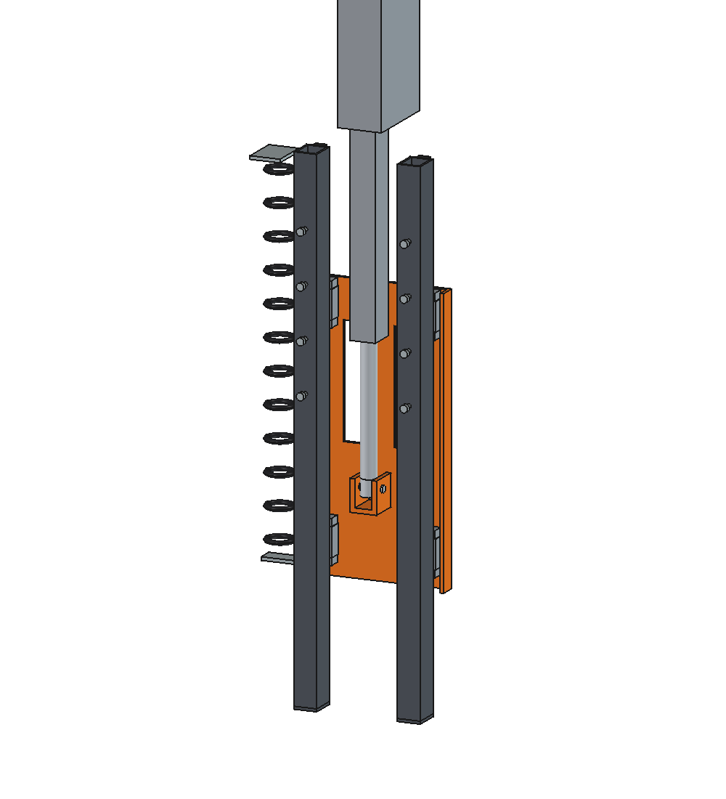
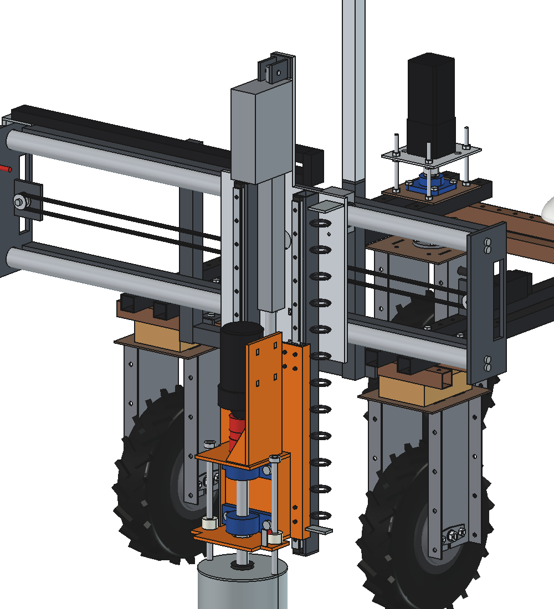
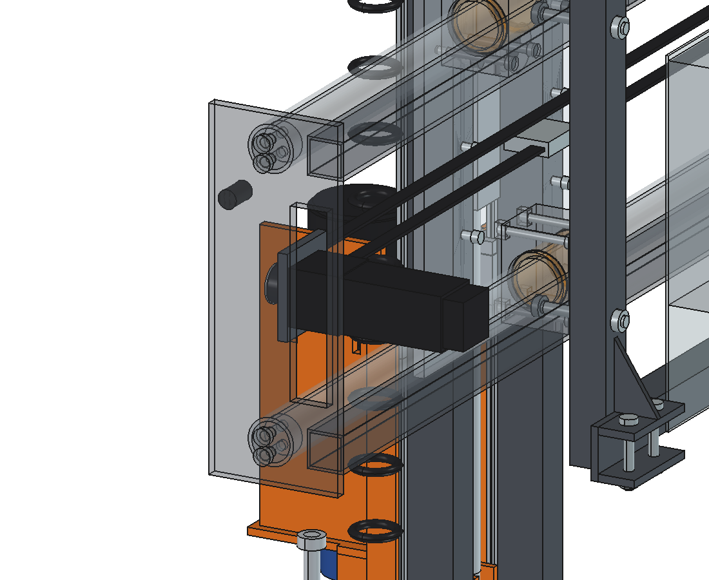
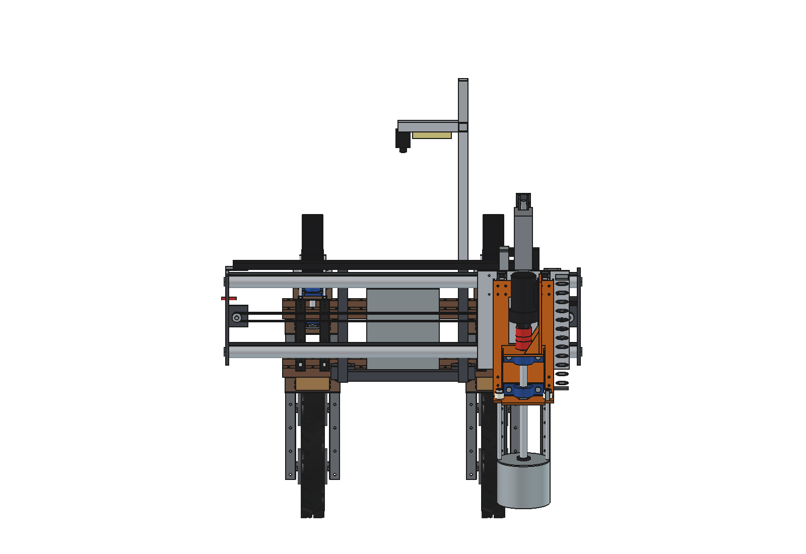

# Dockweed drill v10: FreeCAD model

v10 is **[v8](../v8/README.md)** with two changes: the **X motor sits fixed at the right end** as in
[v9](../v9/advanced/README.md), and the **Z axis runs on linear guides** after the photos in `inspiration/` (a sled with
the motor and two pillow blocks on two profile rails, the actuator bracket in the middle between the rails). The process
is unchanged: a cutter Ø 180 at 500 rpm from the 800 W gearmotor directly on a Ø 30 spindle in 2 × UCP 206, a
Ruud-style steel can Ø 219, a Linak LA36 as the Z drive and a fixed high camera. The robot drives straight; the X slide
moves the spindle over the plant (stroke 1000 mm, x −500..+500).

What is what:

1. **X axis as v8:** 2 precision tubes Ø 50 × 4 between 2 side plates 12 mm (plug + 2 × M10 per tube end), 2 cross
   beams 40 × 40 × 3 over the full width (1 × M12 per upright), 3 plain-bush housings on the slide (2 on the upper tube,
   1 in the middle of the lower one).
2. **X drive as v9:** NEMA 23 closed-loop + 5:1 **fixed** on a 10 mm bracket welded to the right side plate (gearbox and
   motor point towards the robot, between the cross beams), pulley 20T on the gearbox shaft; on the left a tension pulley
   on an M10 in a slot. The HTD5M 15 mm belt runs round both pulleys between the tubes, its lower run is clamped on the
   front of the slide. The slide carries no motor, pulley or idlers any more and the motor cable does not move.
3. **Z guide on linear rails (new):** 2 rail beams **RHS 50 × 40 × 4** stand at x ±90 against the back of the X slide
   (4 × M8 each through the slide) and hang down to z 205. On their back face 2 profile rails **HGR20** (885 long, M5
   every 60 mm), rubber end stops under and above. **4 carriages HGH20CA** (390 mm apart) carry the **Z sled**: a 6 mm
   plate bent into a U whose flanges cover the rails at the sides, like the rusty sled in the photo. The sled is also
   the back plate of the spindle bracket, so the spindle drive of v8 (lower plate, bearing plate with 2 × UCP 206, top
   plate, jaw coupling, motor plate, gearmotor) is welded straight onto it.
4. **LA36 as v8, between the rails:** the top pin on the extension of the X slide, the housing above the spindle motor,
   the outer tube between the rail beams; the rod eye pins into the bracket on the front of the sled, in the middle
   between the rails (the bracket with the hole in the photo).
5. **X slide:** aluminium 12 mm, 380 × 420 + the tab for the top pin (v8: 410, the X motor is gone): X housings and belt
   clamp on the front, rail beams, LA36 top bracket and spiral-cable bracket on the back.

Why: [RATIONALE.md](RATIONALE.md).













## Animations and videos

`animate_dwd10.py` (as `../v8/animate_dwd8.py`) builds `DWD10_on_robot_animation`: the robot drives straight and
backwards (gantry first) and stops at 3 dock plants at x −300, +330 and +40. While it drives, the X slide already runs
to the next plant; then the LA36 extends and the sled rolls down its rails until the can feels the sward, the cutter
plunges 150 mm at 500 rpm, dwells, rises while turning and the LA36 retracts. Power, Z force, actuator current and wheel
loads come from `dwd10_calc`.

`explode_dwd10.py` (as `../v7/explode_dwd7.py`) builds `DWD10_exploded_animation` (implement only): the drill comes
apart into its 104 parts and goes back together in 29 steps. The Z axis comes with the rest ghosted: rail beams, rails,
end stops, carriages, sled, carriage bolts and the LA36; then the spindle drive goes onto the sled, and at the end the
slide runs to x +300, the sled rolls down to 200 mm deep and back, and the slide returns.

```python
import animate_dwd10
animate_dwd10.build()
animate_dwd10.play()                                  # live, animate_dwd10.stop()
animate_dwd10.summary()
animate_dwd10.check_fit()                             # robot vs implement in the 6 X/Z end positions (empty)
animate_dwd10.render_all(r"C:\temp\dwd10_frames")
import make_gif_dwd10
make_gif_dwd10.main(r"C:\temp\dwd10_frames", r"previews\animation_three_plants_no_text.gif", text=False)
make_gif_dwd10.main(r"C:\temp\dwd10_frames", r"previews\animation_three_plants.gif")    # caption and wheel loads

import explode_dwd10
explode_dwd10.build()
explode_dwd10.play()                                  # live, explode_dwd10.stop()
explode_dwd10.render_all(r"C:\temp\dwd10_explode")
make_gif_dwd10.main_explode(r"C:\temp\dwd10_explode", r"previews\exploded_assembly_linear_guide.gif")   # step labels
make_gif_dwd10.main_explode(r"C:\temp\dwd10_explode", r"previews\exploded_assembly_linear_guide_no_text.gif", text=False)
```

| Animation | File | Contents |
| --- | --- | --- |
| Three plants, no text | `previews/animation_three_plants_no_text.gif` (also in `animations/`, not in git) | 271 frames, 68 s at 3× speed: drive, X to the plant, LA36 down, plunge 150 deep, rise, retract |
| Same with caption | `previews/animation_three_plants.gif` | the same frames with caption (spindle power, Z force, LA36 current) and a wheel-load panel |
| Exploded assembly, linear guide | `previews/exploded_assembly_linear_guide.gif` (and `_no_text.gif`) | 745 frames, 62 s real time: apart, together in 29 steps, the Z guide and LA36 with the rest ghosted, then a stroke in X and Z |

Both animations also exist as **videos without text** (MP4, 1280 × 720, 25 fps, H.264; also in
`animations/video's/`, not in git):

| Video | File | Contents |
| --- | --- | --- |
| Three plants | `previews/animation_three_plants.mp4` | 853 frames, 35.6 s at 2× speed (frame step 0.08 s) |
| Exploded assembly, linear guide | `previews/exploded_assembly_linear_guide.mp4` | 1519 frames, 62.2 s real time |

They are rendered at the video frame rate (camera turn and cutter spin per second stay the same) and encoded with
ffmpeg (PATH, `FFMPEG` or Kdenlive's copy):

```python
import animate_dwd10, explode_dwd10, make_video_dwd10 as MV
animate_dwd10.build()
animate_dwd10.render_all(r"C:\temp\dwd10_video", size=MV.SIZE, dt=MV.DT)
MV.main(r"C:\temp\dwd10_video", "plants")             # -> previews/animation_three_plants.mp4
explode_dwd10.build()
explode_dwd10.render_all(r"C:\temp\dwd10_explode_video", size=MV.SIZE, fps=MV.FPS)
MV.main(r"C:\temp\dwd10_explode_video", "exploded")   # -> previews/exploded_assembly_linear_guide.mp4
```

From `summary()`: X −300..+330, Z +200..−150, cutting power 681 W, LA36 up to 4.5 A, wheel loads 14–154 kg.

## Files

| File | Contents |
| --- | --- |
| `Dockweed_drill_v10.FCStd` | the model in working position (x 150, cutter 150 deep); generated, do not edit by hand |
| `Dockweed_drill_v10.step` | STEP export of the implement |
| `dxf/*.dxf` | 22 cutting contours (laser/plasma), including both side plates, the 2 drive brackets, the X slide and the flat blank of the sled (bend 2 × 90°) |
| `dwd10_params.py` | all dimensions; sections for the X axis (round tubes, housings, side plates), X slide, fixed X drive, Z rails (rail beams, HGR20, HGH20CA, sled), LA36, UCP 206, coupling size 28 |
| `dwd10_parts.py` | one function per part, returns a `Part` shape in robot coordinates |
| `build_dwd10.py` | model tree, poses, interference and clearance check (`carriage_travel()`, `pot_to_rails()`), mass, STEP/DXF export, images |
| `dwd10_calc.py` | as v8, with the Z guide on rails (`z_guide`: carriage loads, life, rail beam deflection, friction), the bolts of the rail beams (`rail_beam_bolts`) and the belt (`belt`) |
| `animate_dwd10.py` | animation: robot drives straight, X slide to 3 plants, treats them |
| `explode_dwd10.py` | exploded-view animation with the Z linear guide as the focus and a stroke in X and Z at the end |
| `make_gif_dwd10.py` | frames to GIF: `main` (caption and wheel-load panel, `text=False` for none), `main_explode` (step label or none) |
| `make_video_dwd10.py` | frames to MP4 (1280 × 720, 25 fps, no text) for both animations |
| `run_in_freecad.py` | macro: rebuild, print mass and key figures |
| `previews/` | images |
| `inspiration/` | the 3 photos of the sled on linear rails (not in git) |

Usage: `build_dwd10.build(x=..., z=...)` (x = spindle centre, z = underside of the tool, ground = 0),
`check_interference()`, `check_poses()`, `clearance()`, `carriage_travel()`, `pot_to_rails()`, `mass_properties()`,
`render_all()`. Driving position z = 200, deepest z = −200, x −500..+500. The calculations run without FreeCAD:
`"C:/Program Files/FreeCAD 1.1/bin/python.exe" -B dwd10_calc.py`.

## Model tree

```
dockweed_drill_v10
  headstock_robot_mount        2 x (top plate, clamp plate, back plate, 4 M10, upright 40x40x3, gusset), cross tube
  x_axis_round_tubes_fixed_drive_right
                               2 precision tubes D50x4, 2 cross beams 40x40x3 + 4 M12, plugs D42 + 8 M10, 2 side plates
                               12 mm, 2 drive brackets 10 mm, NEMA 23 + 5:1 (fixed), 2 pulleys 20T + shafts, upper belt
                               run, limit switch, end stop, chain bracket
  electrics_fixed, camera_fixed_high                                                   as v8
  x_carriage_moves_in_x        X slide alu 12 mm, 3 X housings + iglidur bushes + wipers + 12 M8, belt clamp, chain
                               driver, LA36 top bracket + pin + housing, spiral cable bracket
    z_rail_frame_fixed_on_x_slide
                               2 rail beams RHS 50x40x4 + end caps + 8 M8, 2 rails HGR20 + 30 M5, 4 rubber end stops
    z_sled_on_linear_guides_moves_in_z
                               sled 6 mm bent U, 4 carriages HGH20CA + 16 M5 + grease nipples, rod-eye bracket, LA36
                               rod + pin, spiral cable arm, spindle bracket (lower, side, bearing, top plates), 2 x UCP
                               206, spindle D30, jaw coupling, motor plate + gussets, 800 W gearmotor        (as v8)
      tool_cutter_rotates_about_spindle
    pot_rests_on_ground                                                                 as v8
  cables_and_belt_follow_x_and_z
                               cable chain (3 parts), spiral cable, lower belt run (clamped on the slide)
robot_reference_NOT_PART_OF_DESIGN
```

## Key figures (from `dwd10_calc.report()` and the model)

| Quantity | v10 | v8 |
| --- | --- | --- |
| Mass of the implement | **131.2 kg** | 127.0 kg |
| X moving / Z moving mass | 75.4 / 39.2 kg | 76.2 / 45.0 kg |
| Spindle position | x −500..+500, robot y −938 (438 behind the rear axle) | y −954 |
| Width over the side plates | 1470 mm | 1470 mm |
| Z guide | 2 rails HGR20 885 long on 2 RHS 50 × 40 × 4 (fixed on the slide), 4 carriages HGH20CA 390 apart on the sled | 2 tubes Ø 50 × 4 moving through 4 plain-bush housings |
| Carriage load, 300 N side force at max. depth | lower carriage 315 N across + 211 N radial = 526 N equivalent; static safety 53; L10 1.9 million km | bush 585 / 435 N |
| Cutter deflection at 300 N / 100 N side force (max. depth) | **1.8 / 0.6 mm** (rail beams 0.74 + spindle shaft 1.09 at 300 N) | 2.4 mm at 300 N |
| Rail beam bolts (4 × M8 per beam) | 548 N shear (slip 3600 N: 6.6×), 266 N tension at 300 N side force | — |
| Carriages to the rail ends | 6.2 mm (bottom, max. depth) / 11.2 mm (top, driving) | — |
| Z friction (balls + seals) | 26 N cutting, 14 N idle | about 380 N in the bushes |
| Actuator (LA36 24 V 1700 N) | push 241 N, lift 606 N (margin 7.0 / 2.8); 3.5 / 5.2 A | push 539 N, lift 711 N |
| LA36 heating (mean I², allowed 21.2 A²) | **13.1 A² back to back (60 %)**, OK from 13.5 s per plant; 4.8 A² at one plant per minute | 18.6 A² (88 %) |
| X guide (as v8) | tube deflection 0.96 mm down, 1.54 mm in v at x 0; 466 N per upper housing, 0.13 MPa | 1.0 / 1.65 mm, 490 N |
| X drive | belt 2.86 m round 2 pulleys 1380 apart, working force 500 N, holding 895 N; friction 348 N → 7.3 m/s² | omega drive on the slide, 7.0 m/s² |
| Cycle once stopped / plants per hour | 21.8 s (X while driving); 165 back to back, 139 at 2 m, 113 at 5 m | same |
| Axle load driving, x 0 (front / rear) | 37 / 245 kg (front 13 %); battery forward 59 / 222 kg | 37 / 240 kg |
| Lightest wheel driving at x ±500 | 11.3 kg | 11 kg |
| Max. down force before a wheel drops below 20 kg (x 0 / x ±500) | 1328 / 1171 N (limit 600 N) | 1292 / 1137 N |
| Cross beams 40 × 40 × 3 (cantilever 473) | 0.54 mm down, 1.3 mm in v, 73 MPa | 0.5 / 1.4 mm, 78 MPa |
| Headstock bolts | 2630 N per bolt at 2 g, safety 12.8 | 12.5 |
| Clearance | no interference in the 6 end positions (x −500 / 0 / +500 × z 200 / −200), also against the robot; rail frame ≥ 61 mm, X carriage ≥ 47 mm, X axis ≥ 41 mm, can ≥ 126 mm from the robot; can 13.5 mm from the rails when driving | ≥ 41 / 47 / 141 mm |

## Estimated, not measured

Same list as v8 ([../v8/README.md](../v8/README.md#estimated-not-measured)) for the X axis, spindle, LA36 and robot,
minus the Z bush housings, plus:
- HGR20 / HGH20CA dimensions and ratings from the HIWIN catalogue (H 30, W 44, L 77.5, C 17.75 kN, C0 27.76 kN, block
  0.30 kg, rail 2.21 kg/m): **check them on the rails and carriages you buy** (other makes differ by a few mm) and set
  `rail_*`, `blk_*`;
- rail beams RHS 50 × 40 × 4 as delivered (not machined): flatness and twist of the rail face over 900 mm; the rails are
  set against a straight edge and shimmed where needed;
- M5 tapped in the 4 mm wall of the rail beam (5 threads), M8 tapped (or rivet nut) in the front wall for the slide
  bolts; the joint to the slide is taken as fixed at the lowest bolt (z 725);
- seal friction 3 N per carriage (double seal + scraper), rolling friction 0.005;
- carriage stiffness (preload ZA, about 250 N/µm) neglected in the cutter deflection;
- X motor, gearbox and pulleys as v9 (1.6 / 0.9 / 0.3 kg), belt length about 2.86 m;
- robot mass 150 kg and its centre of gravity (as before).
