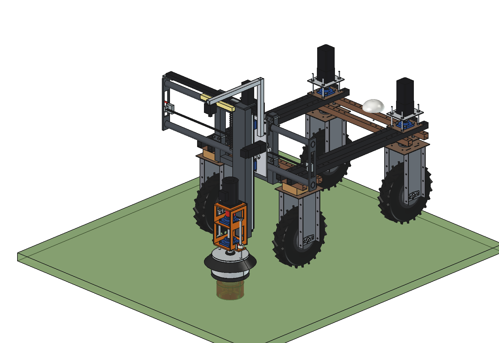
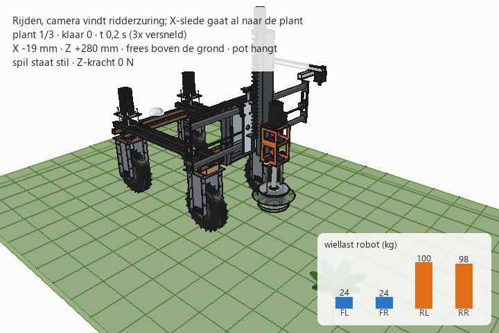

# Dockweed drill v2: FreeCAD model

Implement that grinds up broad-leaved dock **plant by plant**, behind the Bruut OpenAgbot. A gantry with an X axis
(left-right, stroke 1000 mm) and a Z axis (up-down). The robot is the Y axis: it stops with the plant under the
spindle. A fast cutter Ø 180 (1500 rpm) goes 150 mm deep and grinds up the root crown and the upper taproot. A pot
Ø 250 around it lands on the sward, keeps the soil in place and works as the ground probe. A mowing disc is the
second tool. Fully electric (48 V).

v2 runs the X slide on **2 PTO-shaft tubes** (lemon profile) with 3 sleeves of the matching outer tube, instead of
aluminium profiles with HGR15 rails ([../v1](../v1/README.md)). The gantry is mounted on the **real robot model**:
2 uprights on the 50 mm hole grid of the rear lower beam.
Why it is designed this way: [RATIONALE.md](RATIONALE.md).





## Files

| File | Contents |
| --- | --- |
| `Dockweed_drill_v2.FCStd` | the model in working position (x 150, cutter 150 deep); generated, do not edit by hand |
| `Dockweed_drill_v2.step` | STEP export of the implement (without robot and environment) |
| `dxf/*.dxf` | 20 cutting contours (laser/plasma) |
| `dwd2_params.py` | all dimensions, including the robot interface (from `agbot_params.py`) |
| `dwd2_parts.py` | one function per part, returns a `Part` shape in robot coordinates |
| `build_dwd2.py` | model tree, colors, poses, interference and clearance check, mass, STEP/DXF export, images |
| `dwd2_calc.py` | spindle, cutting energy, axes, cycle, PTO-tube guide, spindle shaft, axle loads, headstock bolts (pure Python) |
| `animate_dwd2.py` | animation: robot drives (gantry first), stops at 3 plants and treats them |
| `make_gif_dwd2.py` | frames to GIF with caption and a "wheel load" panel |
| `run_in_freecad.py` | macro: rebuild, print mass and key figures |
| `previews/` | images and the GIF |
| `legacy/` | the first single script `dockweed_design_v2.py` and its requirements, for reference (it writes into this folder with old names: do not run it here) |

## Axes

Same as the robot model: x = right, y = driving direction (front = +y), z = up, ground = z 0, mm. Origin = centre of
the robot. The gantry hangs behind the rear lower beam (`rear_outer`, rear face at y = −595); the spindle is at
y = −932. While weeding the robot drives **backwards** (gantry first), so the camera on the X slide sees the plant
before the spindle does.

Internally the parts are drawn in a gantry frame (x, v, z) with v = distance behind the rear face of the beam, then
mirrored to robot y (`dwd2_parts.to_robot`, y = −595 − v). `dwd2_params.py` uses v for the build-up behind the robot.

## Rebuilding and using

In FreeCAD's Python console (folder in `sys.path`, or via `run_in_freecad.py`):

```python
import build_dwd2
build_dwd2.build()                                   # working position, saves the FCStd
build_dwd2.build(x=-500, z=280, show_robot=True, save_path=None)   # driving position, with the robot
build_dwd2.build(x=250, z=30, tool="mower")          # mowing disc, pot on the ground
build_dwd2.check_interference()                      # overlapping parts, incl. the robot (must be empty)
build_dwd2.check_poses()                             # X -500/0/+500 x driving position/200 mm deep (all empty)
build_dwd2.clearance()                               # smallest distance per group to tyres, brackets and beams
build_dwd2.mass_properties()
build_dwd2.render_all()                              # images in previews/, saves, STEP and DXF
```

`x` = spindle centre (robot x, −500..500), `z` = underside of the tool (ground = 0; 280 = driving position,
−150 = standard depth). The pot hangs 30 mm below the cutter and stops on the ground (`build_dwd2.pot_rim`).

```python
import dwd2_calc
dwd2_calc.report()                                   # key figures
dwd2_calc.axle_loads(x=500, soil_force=300, pot_on_ground=True)
dwd2_calc.cycle()                                    # phases per plant
```

## Model tree

```
dockweed_drill_v2
  headstock_robot_mount        2 x (top plate, clamp plate, back plate, 4 M10, upright 50x50x3, gusset), cross tube
  x_axis_pto_tubes             2 PTO inner tubes, support flanges + ribs, end plates, belt, belt clamps, limit switch
  electrics_fixed              IP65 box on the cross tube
  x_carriage_moves_in_x        (Placement = x) sleeves, pads, scrapers, X slide, NEMA 23 + 5:1, pulley, Z carriages,
                               ball nut, cable chain driver, camera mast, camera, LED bar
    z_carriage_moves_in_z      (Placement = z) Z tube with HGR15 rails, ball screw, Z motor with brake,
                               spindle bracket (orange), 2x UCF207, shaft O35, BLDC 1.5 kW, pot sensor
      tool_cutter_rotates_about_spindle   (Placement = rotation about the spindle axis)
    pot_rests_on_ground        (Placement = pot height) pot, lid, rubber rim, splash flap, rods, set rings
  cables_follow_x_and_z        cable chain (shape follows x), spiral cable X slide -> Z slide (follows z)
robot_reference_NOT_PART_OF_DESIGN   robot from agbots/agbot design (hidden)
```

## Key figures (from `dwd2_calc.report()` and the model)

| Quantity | Value |
| --- | --- |
| Mass of the implement | **96 kg**: Z carriage + spindle 42, X axis 19, X carriage 14, headstock 8, electrics 6, pot 4, cutter 2.5 |
| Moving mass X / Z | 62 kg / 44 kg |
| Spindle | 1500 rpm, tip speed 14 m/s, 4.8 Nm, 750 W nominal / 1.5 kW peak; mowing 3000 rpm, 36 m/s |
| Plunge 25 mm/s | 0.25 mm per tooth; hole Ø 180 × 150 = 3.8 l; cutting power 0.4–1.4 kW (estimated) |
| Cycle | 23.6 s per plant: 153 plants/h, 168 if X moves while driving; ≈ 2.8 Wh per plant |
| Z axis / X axis | SFU1610 + 3 Nm: 1700 N (limit 600 N) / belt 5:1: 895 N holding force |
| PTO tubes | 544 mm², deflection 0.45 mm (Z, weight) and 0.96 mm (Y, 600 N Z force) at x = ±500, twist 0.36° |
| Spindle shaft Ø 35 | 300 N side force: 0.42 mm, 25 MPa; critical speed ≈ 5100 rpm |
| Axle load (robot 150 kg, estimated) | driving: front 48 / rear 199 kg (robot alone 75 / 75); battery forward 70 / 176 kg |
| Max. down force | 1050 N (x 0) / 920 N (x ±500) before the lightest wheel drops below 20 kg; limit 600 N |
| Headstock | 4 × M10 through the beam, 2060 N per bolt at 2 g: safety 16 |
| Clearance | pot ≥ 82 mm to the rear tyres in all positions; no interference in the 6 end positions |

## Animation


Builds a separate document `DWD2_on_robot_animation` with the robot from `agbots/agbot design` (not modified), the
implement and a field with 3 dock plants. The robot drives backwards at 0.5 m/s, stops with each plant under the
spindle line (the X slide already moves while driving), lowers until the pot feels the sward, plunges 150 mm,
dwells, rises while turning and drives on. Spindle power, Z force and wheel loads come from `dwd2_calc`.
The GIF plays at 3× speed (0.25 s per frame at 12 fps).

```python
import animate_dwd2
animate_dwd2.build()
animate_dwd2.play()                                  # live, animate_dwd2.stop()
animate_dwd2.summary()                               # time per plant, X/Z range, power, wheel loads
animate_dwd2.check_fit()                             # robot vs implement in the end positions (empty)
animate_dwd2.render_all(r"C:\temp\dwd2_frames")
import make_gif_dwd2
make_gif_dwd2.main(r"C:\temp\dwd2_frames", r"previews\animation_three_plants.gif")
```

Plants, speed and camera are at the top of `animate_dwd2.py` (`PLANTS`, `DT`, `CAM_WIDE`, `CAM_CLOSE`).

## Estimated, not measured

- Robot mass 150 kg and centre of gravity midway between the axles (`robot_kg`, `robot_cg_y`): weigh the robot.
- PTO tube dimensions (Sparex 1B inner 49 × 39.5 × 4.5, 2A outer 57.5 × 48 × 4) from dealer listings: measure.
- Specific cutting energy of soil + roots 0.5–2 MJ/m³ (standard 1), thrust 150 N + 1 N/mm depth, idle loss 80 W.
- Catalogue masses of purchased parts (`MASS_FIXED` in `build_dwd2.py`): motors, bearings, E-box, camera.
- Motor 48 V 1.5 kW 3000 rpm and its dimensions (generic BLDC); hole patterns of motors and carriages on the slides.
- Friction of the sleeves on the PTO tubes (μ 0.15, greased with the plastic strips).
- Robot: as in the robot model (steering stack, wooden blocks, hub motor and tyre replacements).
- The animation uses flat ground, a rigid robot and static wheel loads; no dynamics or slip.
