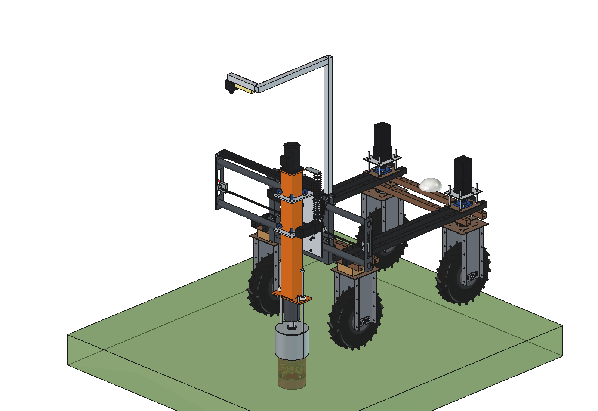
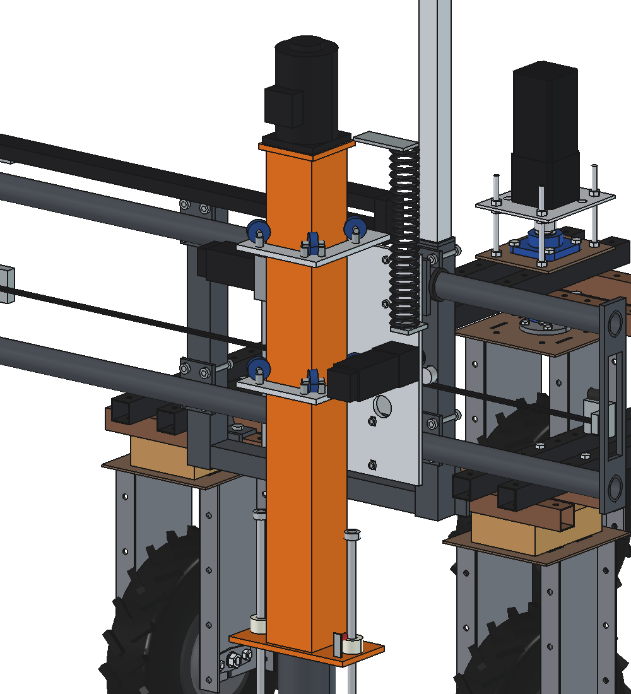
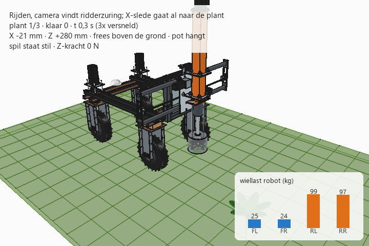

# Dockweed drill v3: FreeCAD model

Same machine as [v2](../v2/README.md) (gantry behind the Bruut OpenAgbot, X slide on PTO-shaft tubes, cutter Ø 180
at 1500 rpm), with a **different, cheaper up/down axis (Z)** and a **can like Robot Ruud's**:

- **Z = a mast with the spindle inside**, like a drill press. A square tube 100 × 100 × 3 rolls on **8 V-groove
  rollers on its corners** (2 cages of 4 on the X slide). The cutter shaft sits in a bearing cartridge under the mast;
  the spindle motor stands on top and drives through a Ø 40 tube inside the mast. No rails, no ball screw.
- **Drive:** rack M2 on the front of the mast, pinion on a **self-locking worm gearbox** NMRV030 i = 30 with a
  NEMA 23 **without** brake. The worm holds the mast when the power is off.
- **Can:** a piece of steel pipe DN200 (219.1 × 3.6, 180 high) with a 5 mm lid, hanging on 2 rods, instead of the
  stainless pot with rubber rim and splash flap.
- **Camera fixed and high** (2.1 m) on an aluminium mast on the right upright, like Ruud's boom: it sees the whole
  1 m strip, and the X slide no longer carries it.

Why: [RATIONALE.md](RATIONALE.md).







## Files

| File | Contents |
| --- | --- |
| `Dockweed_drill_v3.FCStd` | the model in working position (x 150, cutter 150 deep); generated, do not edit by hand |
| `Dockweed_drill_v3.step` | STEP export of the implement |
| `dxf/*.dxf` | 18 cutting contours (laser/plasma), including roller cage, mast bottom and top plate, can lid |
| `dwd3_params.py` | all dimensions, including the robot interface; mast, rollers, rack, worm and can in the Z section |
| `dwd3_parts.py` | one function per part, returns a `Part` shape in robot coordinates |
| `build_dwd3.py` | model tree, poses, interference and clearance check, mass, STEP/DXF export, images |
| `dwd3_calc.py` | as v2, plus `z_force_max`, `z_drive`, `worm_self_locking`, `z_guide` (roller loads, mast, drive tube) |
| `animate_dwd3.py` | animation: robot drives (gantry first), stops at 3 plants and treats them |
| `make_gif_dwd3.py` | frames to GIF with caption and a "wheel load" panel |
| `run_in_freecad.py` | macro: rebuild, print mass and key figures |
| `previews/` | images and the GIF |

Axes and usage are the same as v2 (`build_dwd3.build(x=..., z=...)`, `check_interference()`, `check_poses()`,
`clearance()`, `mass_properties()`, `render_all()`; `animate_dwd3.build()/play()/summary()/check_fit()`).
The spindle axis is the mast axis: robot y = −865.

## Model tree

```
dockweed_drill_v3
  headstock_robot_mount        as v2
  x_axis_pto_tubes             as v2
  electrics_fixed              as v2
  camera_fixed_high            aluminium mast 40x40 on the right upright, arm, crossbar, camera, LED bar
  x_carriage_moves_in_x        sleeves, X slide, X drive (as v2), 2 roller cages (alu 10 mm) with 8 V-rollers 6202,
                               worm gearbox NMRV030 i30 + NEMA 23, pinion M2 z20, cable chain driver
    z_mast_moves_in_z          mast 100x100x3 with rack M2, bottom plate with bearing cartridge (2x 6207),
                               spindle shaft O35, drive tube O40 + 2 jaw couplings, top plate, BLDC motor on top
      tool_cutter_rotates_about_spindle
    pot_rests_on_ground        steel can 219.1x3.6 with lid, rods, set rings
  cables_follow_x_and_z        cable chain; spiral cable from the X slide (x +150) to the mast head
robot_reference_NOT_PART_OF_DESIGN
```

## Key figures (from `dwd3_calc.report()` and the model)

| Quantity | v3 | v2 |
| --- | --- | --- |
| Mass of the implement | **95.0 kg** | 96.4 kg |
| Z moving mass / X moving mass | 35.0 / 57.2 kg | 44.0 / 61.9 kg |
| Spindle position | y −865 (67 mm closer to the robot) | y −932 |
| Height in driving position | ≈ 1.95 m (motor), camera 2.1 m | ≈ 1.8 m |
| Z force | 2060 N at plunge speed, 825 N at 100 mm/s (limit 600 N); self-locking | 1700 N, ball screw + brake |
| Z guide | lower cage 1540 N at 300 N side force (≈ 1090 N per roller, 6202 C0 3750 N); mast 0.28 mm | HGR15 |
| Drive tube in the mast | first critical speed ≈ 10,500 rpm (mowing 3000 = 29 %) | — |
| Spindle shaft Ø 35 | overhang 369 mm: 0.45 mm and 26 MPa at 300 N | 0.42 mm |
| PTO tubes, Y deflection at 600 N | 0.68 mm (shorter lever) | 0.96 mm |
| Can | 6.4 kg (more weight on the sward) | pot 4.2 kg |
| Axle load driving (front / rear) | 49 / 196 kg; battery forward 71 / 174 kg | 48 / 199 kg |
| Max. down force (x 0 / x ±500) | 1060 / 900 N | 1050 / 920 N |
| Clearance | can ≥ 60 mm to the rear tyres; no interference in the 6 end positions, also against the robot | pot ≥ 82 mm |
| Cycle | 23.6 s, 153 plants/h | same |
| Cost of the changed parts (indicative) | ≈ € 270–390 | ≈ € 305–440 |

## Estimated, not measured

Same list as v2 ([../v2/README.md](../v2/README.md#estimated-not-measured)), plus:
- V-groove rollers on the mast corners (6202-based, Ø 40, 90° groove, 6 mm deep): rolling on the corner radius of a
  cold-formed tube is not tested; try one cage first.
- Worm gearbox NMRV030 i = 30: lead angle ≈ 4.5° (self-locking assumed), efficiency 0.55; NEMA 23 torque 2.5 Nm at
  plunge speed (≈ 360 rpm) and 1.0 Nm at rapid (≈ 1430 rpm).
- Masses of rollers (0.12 kg each), worm gearbox (1.2 kg), couplings (1.4 kg for 2); bearing cartridge drawn as steel.
