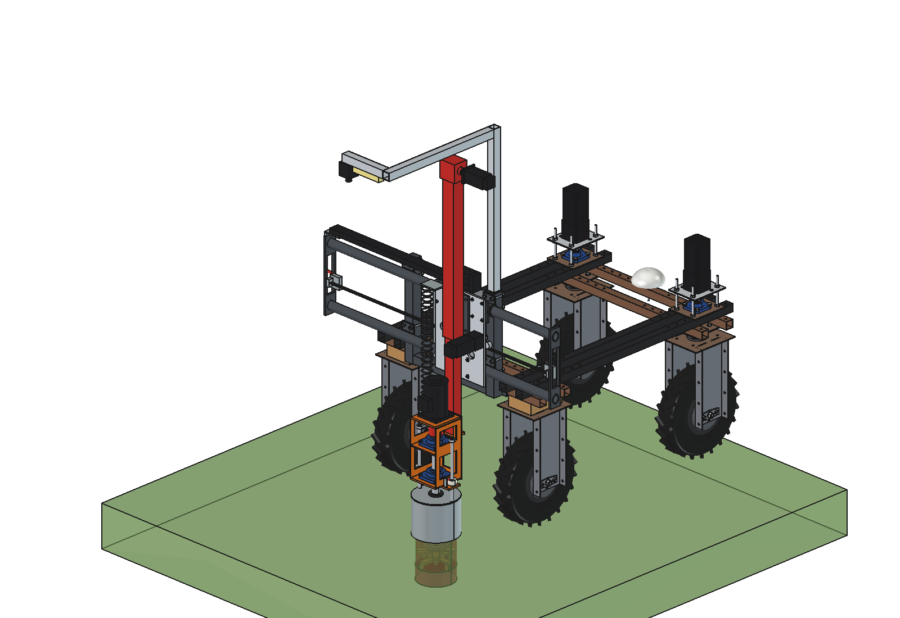
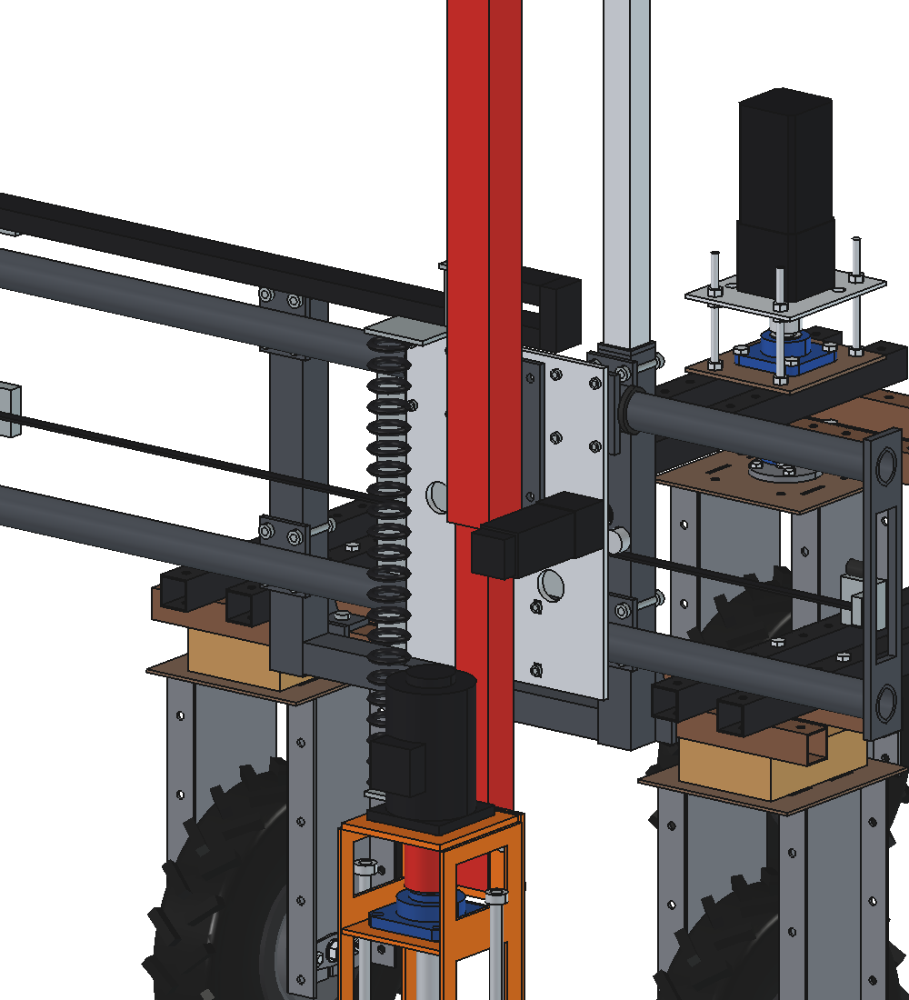
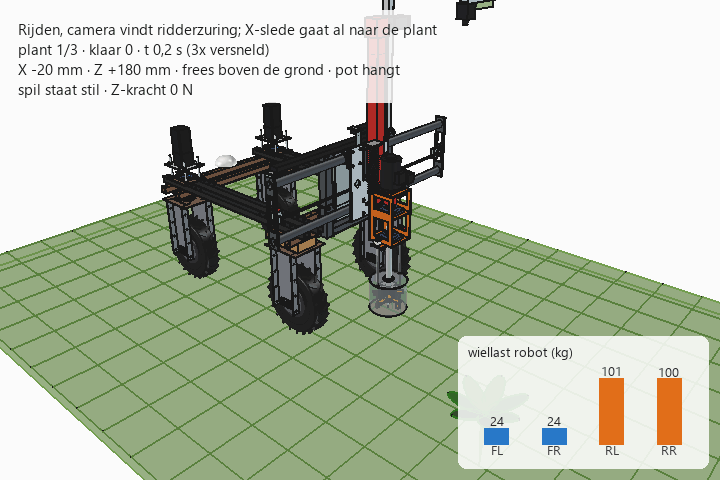

# Dockweed drill v4: FreeCAD model

Same machine as [v3](../v3/README.md) (gantry behind the Bruut OpenAgbot, X slide on PTO-shaft tubes, Ruud-style
steel can, fixed high camera), but the **up/down axis (Z) is a trailer jack**: a square side-wind **drop-leg jack**
(outer tube 2.5" / 65 mm, inner tube 2" / 50 mm, stroke 15" / 380 mm, trapezoidal screw with a bevel gear in the
head). The outer tube is bolted to the X slide; the inner tube carries the orange spindle bracket of v2. A NEMA 23 on
the crank shaft replaces the hand crank. The screw is self-locking, so no brake is needed.

Guide, screw, nut, gearbox and weather sealing come in one cheap, robust, off-the-shelf part.
Why, and what it costs in speed and accuracy: [RATIONALE.md](RATIONALE.md).







## Files

| File | Contents |
| --- | --- |
| `Dockweed_drill_v4.FCStd` | the model in working position (x 150, cutter 150 deep); generated, do not edit by hand |
| `Dockweed_drill_v4.step` | STEP export of the implement |
| `dxf/*.dxf` | 22 cutting contours (laser/plasma), including the jack mounting plate and the foot plate |
| `dwd4_params.py` | all dimensions; jack (tubes, stroke, lead, efficiency, motor torque) in the Z section |
| `dwd4_parts.py` | one function per part, returns a `Part` shape in robot coordinates |
| `build_dwd4.py` | model tree, poses, interference and clearance check, mass, STEP/DXF export, images |
| `dwd4_calc.py` | as v2, plus `z_force_max`, `z_drive`, `jack_self_locking`, `z_guide` (play and bending of the jack) |
| `animate_dwd4.py` | animation: robot drives (gantry first), stops at 3 plants and treats them |
| `make_gif_dwd4.py` | frames to GIF with caption and a "wheel load" panel |
| `run_in_freecad.py` | macro: rebuild, print mass and key figures |
| `previews/` | images and the GIF |

Axes and usage are the same as v2/v3 (`build_dwd4.build(x=..., z=...)`, `check_interference()`, `check_poses()`,
`clearance()`, `mass_properties()`, `render_all()`; `animate_dwd4.build()/play()/summary()/check_fit()`).
**Driving position is z = 180** (cutter underside above the ground) instead of 280: the jack has 380 mm stroke
(180 above to 200 deep). Spindle axis at robot y = −886.

## Model tree

```
dockweed_drill_v4
  headstock_robot_mount, x_axis_pto_tubes, electrics_fixed, camera_fixed_high      as v3
  x_carriage_moves_in_x        sleeves, X slide, X drive (as v2), jack mounting plate, jack outer tube with PE
                               guide bush, bevel gear head, screw, NEMA 23 on the crank shaft, spiral cable arm
    z_jack_inner_tube_moves_in_z   jack inner tube with PE guide ring and foot plate, spindle bracket (orange,
                                   as v2 but 40 mm higher), 2x UCF207, shaft O35, jaw coupling, BLDC motor
      tool_cutter_rotates_about_spindle
    pot_rests_on_ground        steel can 219.1x3.6 with lid, rods, set rings (as v3)
  cables_follow_x_and_z        cable chain; spiral cable from the motor plate up to the arm on the jack
robot_reference_NOT_PART_OF_DESIGN
```

## Key figures (from `dwd4_calc.report()` and the model)

| Quantity | v4 | v3 | v2 |
| --- | --- | --- | --- |
| Mass of the implement | 99.4 kg | 95.0 kg | 96.4 kg |
| Z moving mass | 32.3 kg | 35.0 kg | 44.0 kg |
| Height (fixed parts / camera) | jack head 1.76 m, camera 1.9 m | 1.95 m, 2.1 m | 1.8 m |
| Z force (plunge / rapid) | 620 / 450 N (limit 600 N) | 2060 / 825 N | 1700 N |
| Z rapid speed | **40 mm/s** (crank 400 rpm) | 100 mm/s | 100 mm/s |
| Cycle | **26.1 s, 138 plants/h** (151 with X while driving) | 23.6 s, 153/h | 23.6 s, 153/h |
| Cutter wobble at 300 N side force, 150 deep | **2.6 mm** (1.4 bending + 1.3 play) | 0.28 mm mast + rollers | HGR15 |
| Self-locking | trapezoidal screw (efficiency 0.3) | worm i30 | brake motor |
| Spindle shaft Ø 35 | overhang 396 mm: 0.56 mm, 28 MPa, critical 4400 rpm | 0.45 mm | 0.42 mm |
| Axle load driving (front / rear) | 48 / 201 kg; battery forward 70 / 179 kg | 49 / 196 kg | 48 / 199 kg |
| Max. down force (x 0 / x ±500) | 1080 / 940 N | 1060 / 900 N | 1050 / 920 N |
| Clearance | can ≥ 78 mm to the rear tyres; no interference in the 6 end positions, also against the robot | 60 mm | 82 mm |
| Cost of Z axis + spindle bearing housing (indicative) | ≈ € 240–340 | ≈ € 235–335 | ≈ € 275–380 |

## Estimated, not measured

Same list as v2/v3, plus (all from typical 7000 lb drop-leg jacks, **check on the jack you buy**):
- tube sizes 65 × 65 × 4 / 50 × 50 × 5, stroke 380 mm, retracted length, head size;
- lead 6 mm per crank turn in the fast gear, efficiency 0.27 (screw 0.3 × bevel gear 0.9);
- max. crank speed 450 rpm (the jack is made for hand cranking: check heat and wear of screw and nut);
- play between the tubes 0.3 mm after shimming with PE strips (as delivered often 1–2 mm);
- NEMA 23 torque 2.2 Nm at 250 rpm and 1.6 Nm at 400 rpm; jack head mass 2.5 kg.
