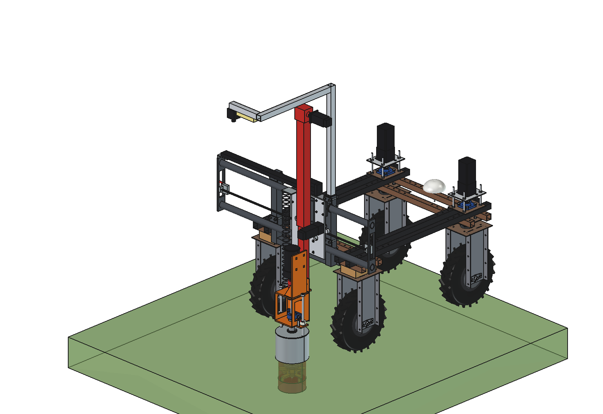
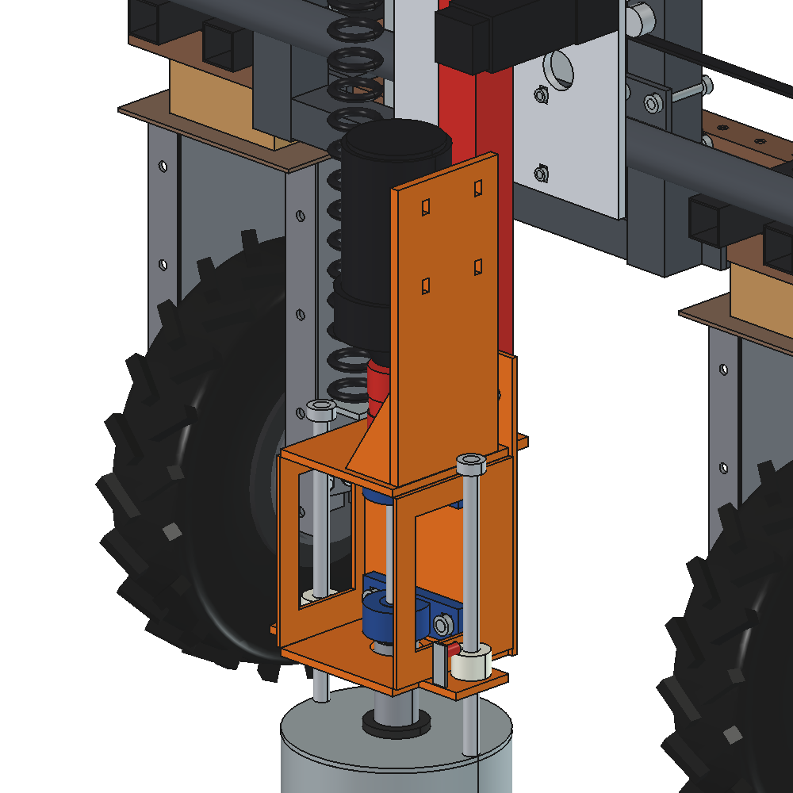

# Dockweed drill v5: FreeCAD model

Same machine as [v4](../v4/README.md) (gantry behind the Bruut OpenAgbot, X slide on PTO-shaft tubes, drop-leg
trailer jack as the Z axis, Ruud-style steel can, fixed high camera, spindle Ø 20 in 2 × UCP 204), but the
**800 W gearmotor sits directly above the spindle** and drives it through a **flexible jaw coupling** (size 24,
bores 19 / 20). No chain, no sprockets, no chain guard.

The motor stands upright on the spindle axis, shaft down. Its foot faces +x and is bolted to a standing 10 mm motor
plate on the top plate of the spindle bracket, with two gussets. The -x side stays free for the spiral cable, the
front for the outer tube of the jack.

Consequence: the cutter turns at the motor speed, **500 rpm** (v4: 1500 rpm via the chain). See
[RATIONALE.md](RATIONALE.md).





v5 has **no animation of its own**: the motion is the same as v4 (`../v4/animate_dwd4.py`).

## Files

| File | Contents |
| --- | --- |
| `Dockweed_drill_v5.FCStd` | the model in working position (x 150, cutter 150 deep); generated, do not edit by hand |
| `Dockweed_drill_v5.step` | STEP export of the implement |
| `dxf/*.dxf` | 24 cutting contours (laser/plasma), including the bearing plate, motor plate and gusset |
| `dwd5_params.py` | all dimensions; spindle section: UCP 204, jaw coupling, 800 W gearmotor, motor plate |
| `dwd5_parts.py` | one function per part, returns a `Part` shape in robot coordinates |
| `build_dwd5.py` | model tree, poses, interference and clearance check, mass, STEP/DXF export, images |
| `dwd5_calc.py` | as v4, with `spindle()` for the direct drive and `coupling()` (motor torque against the coupling) |
| `run_in_freecad.py` | macro: rebuild, print mass and key figures |
| `previews/` | images |

Usage as v4: `build_dwd5.build(x=..., z=...)`, `check_interference()`, `check_poses()`, `clearance()`,
`mass_properties()`, `render_all()`. Driving position z = 180, spindle axis at robot y = −886.

## Model tree

```
dockweed_drill_v5
  headstock_robot_mount, x_axis_pto_tubes, electrics_fixed, camera_fixed_high      as v3/v4
  x_carriage_moves_in_x        sleeves, X slide, X drive, jack mounting plate, jack outer tube, head, screw,
                               NEMA 23 on the crank shaft, spiral cable arm (as v4)
    z_jack_inner_tube_moves_in_z   jack inner tube with PE guide ring and foot plate, spindle bracket (orange):
                                   lower plate, standing bearing plate with 2x UCP 204, shaft O20 + tube 42.4x4,
                                   top plate, jaw coupling size 24, standing motor plate with 2 gussets,
                                   800 W gearmotor on the spindle axis
      tool_cutter_rotates_about_spindle
    pot_rests_on_ground        steel can 219.1x3.6 with lid, rods, set rings (as v3)
  cables_follow_x_and_z        cable chain; spiral cable from the top plate up to the arm on the jack
robot_reference_NOT_PART_OF_DESIGN
```

## Key figures (from `dwd5_calc.report()` and the model)

| Quantity | v5 (direct) | v4 (chain 38T → 12T) |
| --- | --- | --- |
| Mass of the implement | 102.2 kg | 105.9 kg |
| Z moving mass | 35.1 kg | 38.8 kg |
| Cutter speed | **500 rpm**, tip 4.7 m/s | 1500 rpm, tip 14.1 m/s |
| Cutter torque (nominal / peak) | **15.3 / 30.6 Nm**, 800 W nominal | 4.7 / 9.4 Nm, 735 W |
| Chip per tooth (25 mm/s plunge, 4 teeth) | 0.75 mm | 0.25 mm |
| Mower | 500 rpm, tip 6 m/s: does not mow | 1500 rpm, 18 m/s |
| Jaw coupling size 24 | 35 Nm nominal / 70 Nm max: 2.3 × motor peak | — |
| Spindle shaft | Ø 20 + tube 42.4 × 4: 2.35 mm at 300 N, critical 2160 rpm (cutter **23 %**) | same, cutter 69 % |
| Height of the motor top (driving position) | 1.11 m | 0.81 m |
| Axle load driving (front / rear) | 47 / 205 kg; battery forward 69 / 183 kg | 43 / 213 kg |
| Max. down force (x 0 / x ±500) | 1110 / 970 N | 1160 / 1010 N |
| Z force (plunge / rapid) | 620 / 450 N, lifting 35 kg needs 345 N | 620 / 450 N, 380 N |
| Cycle | 26.1 s, 138 plants/h (as v4) | same |
| Clearance | can ≥ 78 mm to the rear tyres; no interference in the 6 end positions, also against the robot | same |

## Estimated, not measured

Same list as v4, plus:
- jaw coupling size 24: diameter 55, length 78, hubs 30, spider 18, 0.55 kg (catalogue values, check the bought one);
- motor output 500 rpm and 48 V from the listing, not from the type plate; foot width 90 and hole distance across 70
  (M8) assumed; mass 9 kg;
- idle loss 40 W at 500 rpm;
- the cutting energy per volume is the same as v4 (rpm-independent model); at 500 rpm the cutter crushes less finely,
  that is not in the model.
