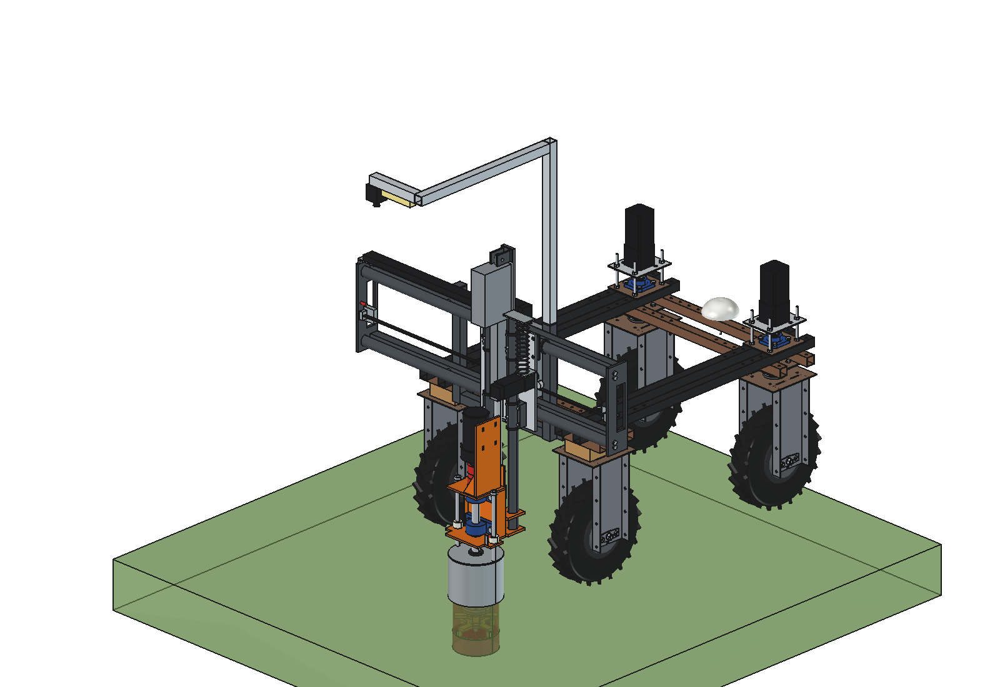
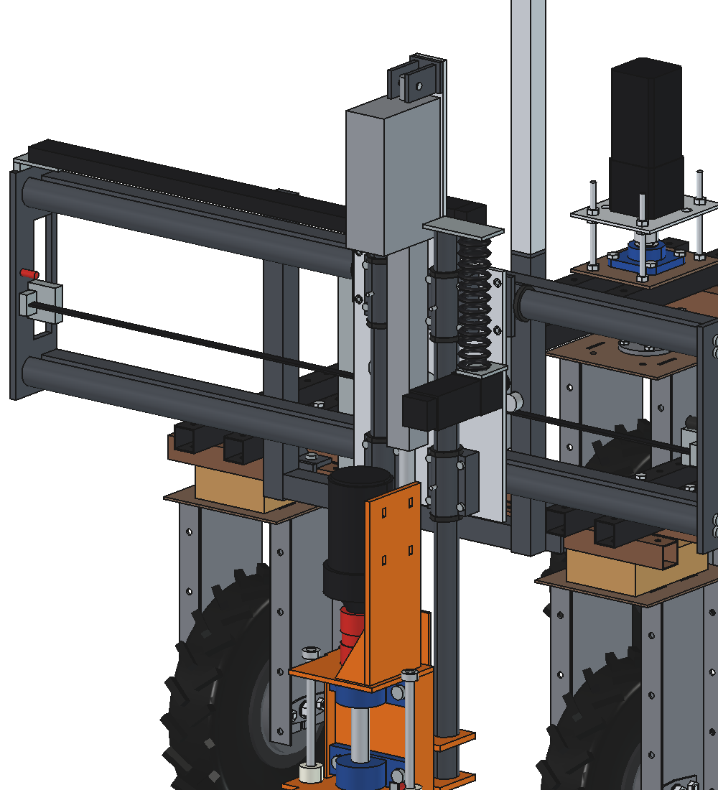
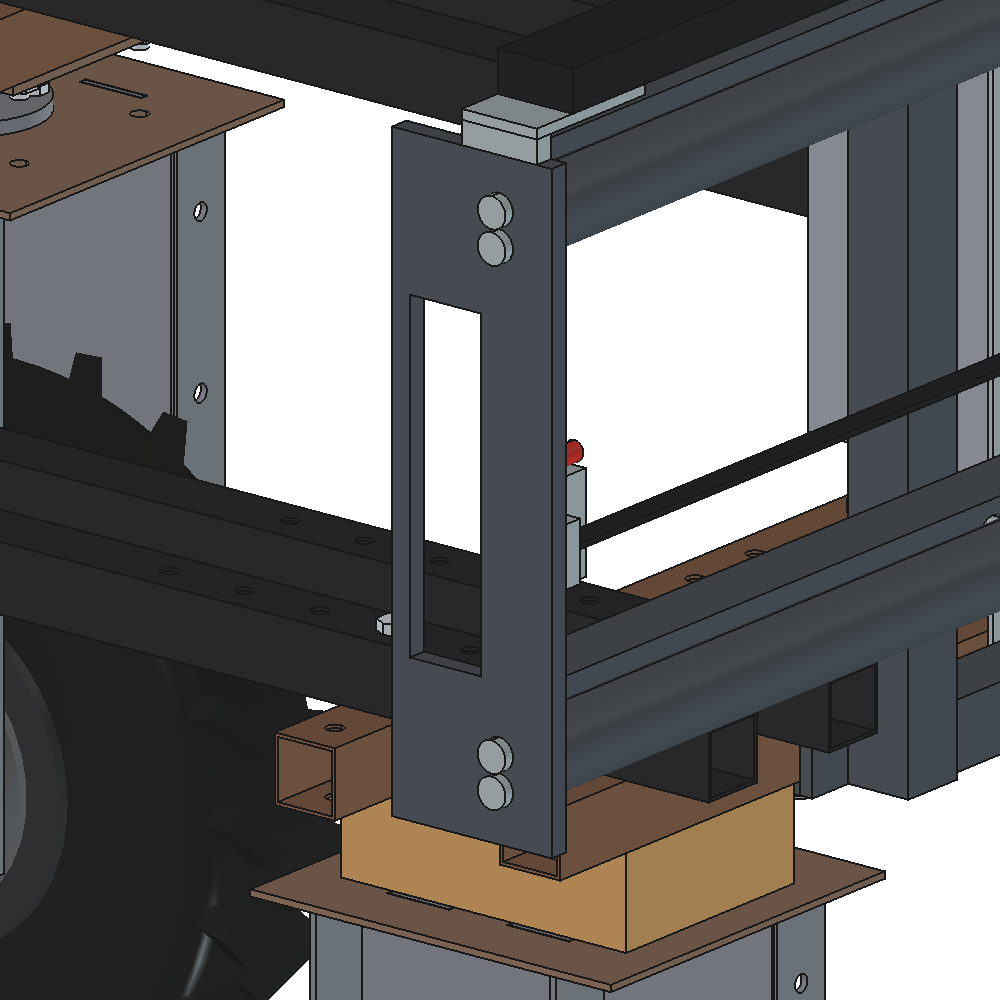

# Dockweed drill v6: FreeCAD model

Same machine as [v5](../v5/README.md) (gantry behind the Bruut OpenAgbot, X slide on PTO-shaft tubes, Ruud-style
steel can, fixed high camera, 800 W gearmotor directly on the spindle), with four changes:

1. **Frame of 40 × 40 × 3 tubes.** The uprights are 40 × 40 × 3 (v5: 50 × 50 × 3). Two cross beams 40 × 40 × 3 run
   behind the uprights at the height of the PTO tubes, held with 1 × M12 per crossing.
2. **PTO tubes bolted between two side plates.** The side plates are 12 mm, welded to the ends of the cross beams.
   Each tube end has a welded plug tapped 2 × M10, and the bolts go in from outside through the side plate. Four
   bolts out and the tube comes free. There are no support ribs any more, so the sleeves are closed (no sawn slot).
3. **Z axis: two upright PTO tubes, actuator and spindle in the middle.** Two PTO inner tubes (49 × 39.5 × 4.5, the
   same profile as the X axis) stand at x ±64 and slide down with the Z carriage through 2 × 2 outer-tube sleeves on
   the X slide (sleeves in steel saddle blocks, 300 mm apart). Between the tubes, at x 0, sits a **Linak LA36**
   (24 V, 1700 N, 20 mm spindle, stroke 400, built-in length 650, from `parts/actuator`) pin to pin: the back
   fixture on a tab in the middle of the X slide (pin z 1420), the rod eye in a bracket on the spindle bracket. Its
   housing points backwards, 10 mm above the spindle motor in the driving position. Retracted = driving position.
   Power comes from a 48 → 24 V converter (20 A).
4. **Spindle Ø 30 in 2 × UCP 206** (v5: Ø 20 in UCP 204 with a 42.4 tube over it). The shaft is solid C45, welded
   into the spindle flange. Jaw coupling **size 28** (bores 30 / 19), because size 24 bores to 28 mm at most.







## Animation

`animate_dwd6.py` (based on `../v4/animate_dwd4.py`) builds `DWD6_on_robot_animation`: the robot drives backwards
and stops at 3 dock plants. For each plant the actuator extends until the can feels the sward, the cutter plunges
150 mm at 500 rpm, dwells, rises while turning, and the actuator retracts. The caption shows spindle power, Z force
and actuator current (LA36 datasheet curve), plus a wheel-load panel, all from `dwd6_calc`. There is no mowing animation, because 500 rpm
is too slow for the mowing disc.

```python
import animate_dwd6
animate_dwd6.build()
animate_dwd6.play()                                  # live, animate_dwd6.stop()
animate_dwd6.summary()
animate_dwd6.check_fit()                             # robot vs implement in the end positions (empty)
animate_dwd6.render_all(r"C:\temp\dwd6_frames")
import make_gif_dwd6
make_gif_dwd6.main(r"C:\temp\dwd6_frames", r"previews\animation_three_plants.gif")
```

| Animation | File | Contents |
| --- | --- | --- |
| Three plants | `previews/animation_three_plants.gif` (also in `animations/`, not in git) | 271 frames, 68 s at 3× speed: drive, X to the plant, LA36 extends the two PTO tubes down, plunge 150 deep, rise, retract |

**Important:** with this cycle the actuator runs **70 %** of the time, and the LA36 is rated for **20 %** duty at
full load (4 min on, 16 min off). See [RATIONALE.md](RATIONALE.md) § 3 before you buy one.

## Files

| File | Contents |
| --- | --- |
| `Dockweed_drill_v6.FCStd` | the model in working position (x 150, cutter 150 deep); generated, do not edit by hand |
| `Dockweed_drill_v6.step` | STEP export of the implement |
| `dxf/*.dxf` | cutting contours (laser/plasma), including the side plate and the X slide with the extension |
| `dwd6_params.py` | all dimensions; sections for the X frame, Z guide tubes + LA36 (datasheet values), UCP 206, coupling size 28 |
| `dwd6_parts.py` | one function per part, returns a `Part` shape in robot coordinates |
| `build_dwd6.py` | model tree, poses, interference and clearance check, mass, STEP/DXF export, images |
| `dwd6_calc.py` | as v5, plus LA36 (force incl. sleeve friction, speed, current, duty cycle), converter, Z guide (sleeve loads, tube stress and deflection, friction), tubes between the side plates, cross beams, Ø 30 shaft with L10 |
| `animate_dwd6.py` | animation: robot drives (gantry first), stops at 3 plants and treats them |
| `make_gif_dwd6.py` | frames to GIF with caption (incl. actuator current) and a "wheel load" panel |
| `run_in_freecad.py` | macro: rebuild, print mass and key figures |
| `previews/` | images |

Usage as v5: `build_dwd6.build(x=..., z=...)`, `check_interference()`, `check_poses()`, `clearance()`,
`mass_properties()`, `render_all()`. Driving position z = 200 (actuator retracted), deepest z = −200, spindle axis
at robot y = −934.

## Model tree

```
dockweed_drill_v6
  headstock_robot_mount        2 x (top plate, clamp plate, back plate, 4 M10, upright 40x40x3, gusset), cross tube
  x_axis_pto_tubes_between_side_plates
                               2 PTO inner tubes, 2 cross beams 40x40x3 + 4 M12, 2 side plates 12 mm,
                               tube plugs (tapped M10), 8 tube bolts M10, belt, belt clamps, limit switch, end stop
  electrics_fixed, camera_fixed_high                                                   as v5
  x_carriage_moves_in_x        sleeves (closed), pads, scrapers, X slide with extension, X drive, 4 HGH15CA carriages,
                               actuator top bracket + pin, actuator body (housing, tube, motor), spiral cable bracket
    z_tube_on_rails_moves_in_z Z tube 120x60x3, flat risers 25x8, 2 HGR15 rails, rod eye bracket, actuator rod + pin,
                               spindle bracket (orange): back plate, lower plate, side plates, standing bearing plate
                               with 2x UCP 206, top plate, shaft O30, jaw coupling size 28, motor plate + 2 gussets,
                               800 W gearmotor
      tool_cutter_rotates_about_spindle
    pot_rests_on_ground        steel can 219.1x3.6 with lid, rods, set rings (as v5)
  cables_follow_x_and_z        cable chain; spiral cable from the X slide (above the X motor) to the top of the right Z tube
robot_reference_NOT_PART_OF_DESIGN
```

## Key figures (from `dwd6_calc.report()` and the model)

| Quantity | v6 | v5 |
| --- | --- | --- |
| Mass of the implement | 122.9 kg (with HGR15 rails: 118.5) | 102.2 kg |
| X moving / Z moving mass | 74.5 / 44.4 kg | 64.7 / 35.1 kg |
| Cutter | 500 rpm, 15.3 Nm (30.6 peak), as v5 | same |
| Jaw coupling | size 28: 95 / 190 Nm, 6.2 × motor peak | size 24: 2.3 × |
| Spindle shaft | Ø 30 solid: 1.09 mm at 300 N, 46 MPa, critical 3180 rpm (cutter 16 %) | Ø 20 + tube: 2.35 mm, 23 % |
| UCP 206 lower bearing | 1170 N at 300 N side force; L10 > 100 000 h even if that force were continuous | — |
| Z stroke | 400 (driving 200 above ground, 200 deep) | 380 |
| Actuator (LA36 24 V, 1700 N) | push 545 N while plunging (600 N on the cutter − weight + 380 N sleeve friction); lift 705 N; margin 3.1 / 2.4, self-lock 2200 N | — |
| Actuator speed / current | 66 mm/s down, 64 mm/s up (datasheet 72 no load, 52 at 1700 N); 4.9 A plunging, 5.7 A lifting | jack 40 mm/s |
| **Actuator duty** | **16.8 s running in a 24.0 s cycle = 70 %**, allowed 20 % → 43 plants/h at most | — |
| Converter 48 → 24 V | 20 A (480 W); LA36 4.9 A working, ≈ 12.4 A at 1700 N + 20 % | — |
| Z guide (2 PTO tubes, sleeves 300 apart) | 585 / 435 N per lower / upper sleeve at 300 N side force, +124 N from the spindle behind the actuator; tube stress 30–35 MPa; cutter deflects 2.3 mm (x) / 1.7 mm (v) at 300 N; friction μ 0.15: 380 N cutting, 60 N idle | jack bushes |
| PTO tubes (span 1376) | slide at x 0: 0.75 mm down, 1.31 mm in v (simply supported; fixed 0.19 / 0.33) | 0.45 / 0.96 at x ±500 |
| Tube bolts M10 | 265 N shear per bolt | — |
| Cross beams 40 × 40 × 3 | cantilever 438 mm: 0.78 mm down, 0.57 mm in v, 51 MPa | — |
| Cycle | 24.0 s, 150 plants/h (165 if X moves while driving), **if** the Z drive can do it | 26.1 s, 138/h |
| Axle load driving (front / rear) | 39 / 234 kg; battery forward 62 / 211 kg | 47 / 205 kg |
| Lightest wheel driving at x ±500 | 12 kg | — |
| Max. down force (x 0 / x ±500) | 1265 / 1110 N | 1110 / 970 N |
| Headstock bolts | 2480 N per bolt at 2 g, safety 13.6 | — |
| Clearance | can ≥ 122 mm to the rear tyres; no interference in the 6 end positions, also against the robot | ≥ 78 mm |

## Estimated, not measured

Same list as v5, plus:
- LA36: dimensions and figures from the datasheet in `parts/actuator` (built-in length 250 + stroke, housing 76 ×
  148 × 230, rod eye Ø 27.8, back fixture Ø 25.2, pins Ø 12.2, 72 / 52 mm/s, 2.4 / 10.3 A, 20 % duty, 6.0 kg).
  Estimated: outer tube 44.5 × 50, inner tube Ø 28, the 25 mm from the back pin to the housing and the 45 mm from the
  rod eye to the end of the outer tube (retracted); check on the delivered actuator and set `act_*`;
- sleeve friction μ 0.15 (greased steel on steel), the spindle bracket taken as rigid in the deflection estimate;
- UCP 206: catalogue dimensions (bolt distance 121, foot 165 × 48, shaft height 42.9, M14), foot thickness 17 and
  housing diameter 80 estimated, 1.4 kg, C 19.5 kN;
- jaw coupling size 28: Ø 65, length 90, hubs 35, spider 20, 95 / 190 Nm, 0.95 kg (catalogue values, check the bought one);
- converter 0.6 kg;
- the PTO tube is treated as a beam between two supports; the real end fixity (plug, 2 × M10, 12 mm plate) lies
  between simply supported and fixed.
