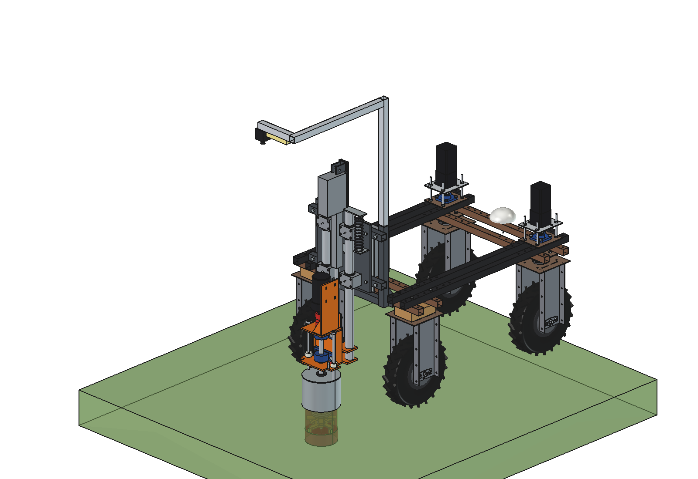
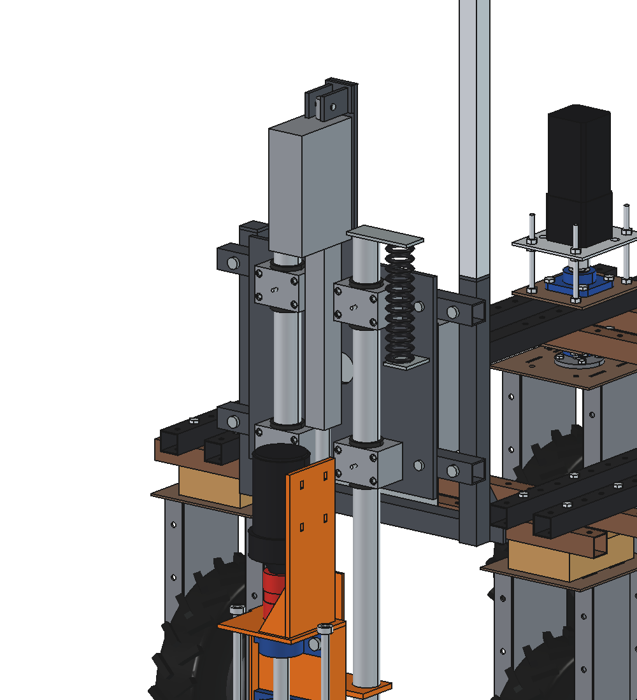
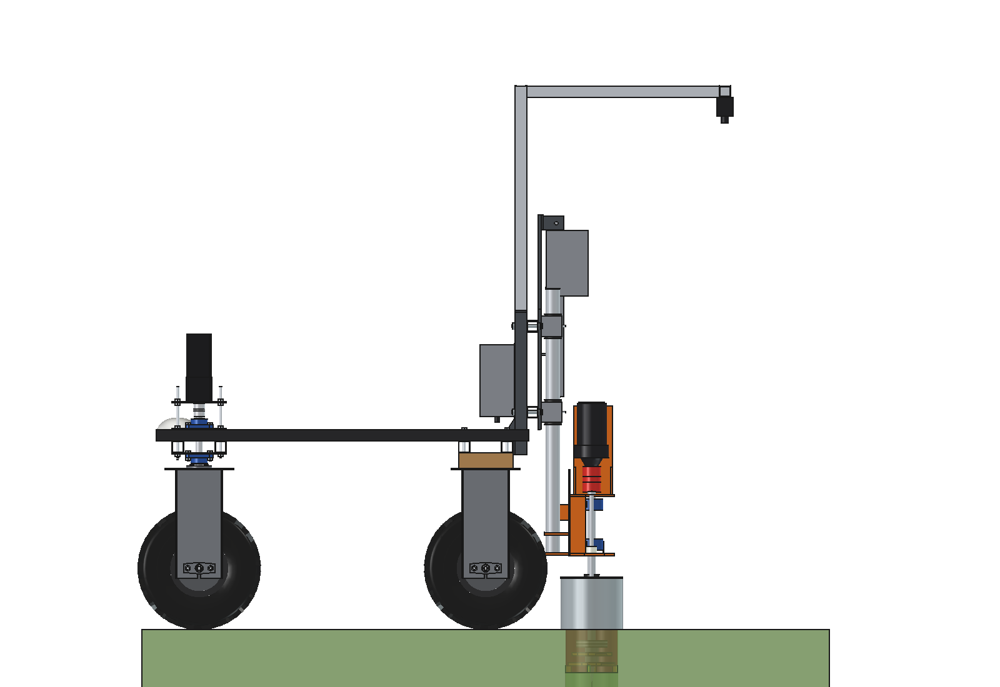

# Dockweed drill v7: FreeCAD model

Same process as [v6](../v6/README.md) (cutter Ø 180 at 500 rpm from the 800 W gearmotor directly on a Ø 30 spindle in
2 × UCP 206, Ruud-style steel can Ø 219, Linak LA36 as the Z drive, fixed high camera), but **without an X axis**:
the spindle sits fixed at x 0 behind the robot and moves **only up and down**. The robot itself puts the spindle
over the plant: sideways by steering on the way to it, along the row by stopping.

**Status:** v7 is above all the design of the **Z part**. It will still get an X axis later; until then the robot
steers. The mount plate is the future interface to the X slide.

What changes against v6:

1. **No X axis.** The PTO tubes, side plates, X slide, belt drive, cable chain and the X motor are gone. Two cross
   beams 40 × 40 × 3 behind the uprights (1 × M12 per crossing, as v6) carry a fixed **Z mount plate** (steel 10 mm,
   4 × M10).
2. **Z guide: 2 round precision tubes Ø 50 × 4** (E355, cold drawn seamless, EN 10305-1) at x ±90, sliding in
   **4 plain-bush housings** (iglidur / POM bush Ø 50, with rubber wipers and a grease nipple), bolted from behind
   into the mount plate with 4 × M8 each. No lemon profile, no sawn sleeves, no saddle blocks.
3. **Tubes welded, not bolted:** they stand on the lower yoke and pass through the clamp plate, both welded, with the
   tubes held in the housings as a jig so they come out parallel. No tapped plugs.
4. Everything sits 64 mm closer to the robot (spindle at robot y −870, v6 −934) and the implement is 23 kg lighter.

Why: [RATIONALE.md](RATIONALE.md).







## Animation

`animate_dwd7.py` (based on `../v6/animate_dwd6.py`) builds `DWD7_on_robot_animation`: the robot drives backwards
(implement first) to 3 dock plants that lie off the centre line (x −220, +180, +20). Because there is no X axis,
the robot **steers** each leg as a sine S-curve (`dwd7_calc.s_curve`: steering angle 0 at start and end), so that it
stops with heading 0 and the fixed spindle exactly over the plant. The front wheels steer with Ackermann angles
(inner wheel ≤ 30°) and every wheel rolls its own distance; a yellow line on the ground shows the rear-axle path.
Then the Z cycle as v6: the LA36 extends until the can feels the sward, plunge 150 mm at 500 rpm, dwell, rise while
turning, retract. The caption shows the offset to the plant, steering angle and heading while driving, and spindle
power, Z force and LA36 current while working; panels show the two front-wheel angles and the wheel loads. All
figures come from `dwd7_calc`.

```python
import animate_dwd7
animate_dwd7.build()
animate_dwd7.play()                                  # live, animate_dwd7.stop()
animate_dwd7.summary()
animate_dwd7.check_fit()                             # robot vs implement in the Z end positions (empty)
animate_dwd7.render_all(r"C:\temp\dwd7_frames")
import make_gif_dwd7
make_gif_dwd7.main(r"C:\temp\dwd7_frames", r"previews\animation_three_plants_steering.gif")
```

| Animation | File | Contents |
| --- | --- | --- |
| Three plants, steering | `previews/animation_three_plants_steering.gif` (also in `animations/`, not in git) | 296 frames, 74 s at 3× speed: S-curve to each plant (heading up to 18°, inner wheel up to 28.5°), stop on the plant, LA36 down, plunge 150 deep, rise, retract |
| Same, without text | `previews/animation_three_plants_steering_no_text.gif` | the same frames without caption and panels (`make_gif_dwd7.main(..., text=False)`) |
| Exploded assembly, LA36 focus | `previews/exploded_assembly_la36.gif` (and `_no_text.gif`) | 560 frames, 47 s real time: the drill comes apart into its 77 parts, then goes back together in 17 steps; the LA36 comes last in 6 steps with the rest ghosted, then makes a full stroke (driving height to 200 mm deep and back) |

`explode_dwd7.py` builds `DWD7_exploded_animation` (implement only, plus a ground plate for the stroke). Every
part has an offset in `EXPLODE`; `STEPS` and `ACT_STEPS` set the assembly order and the step labels:

```python
import explode_dwd7
explode_dwd7.build()
explode_dwd7.play()                                  # live, explode_dwd7.stop()
explode_dwd7.render_all(r"C:\temp\dwd7_explode")
import make_gif_dwd7
make_gif_dwd7.main_explode(r"C:\temp\dwd7_explode", r"previews\exploded_assembly_la36.gif")              # with step labels
make_gif_dwd7.main_explode(r"C:\temp\dwd7_explode", r"previews\exploded_assembly_la36_no_text.gif", text=False)
```

Both animations also exist as **videos without text** (MP4, 1280 × 720, 25 fps, H.264; also in
`animations/video's/`, not in git):

| Video | File | Contents |
| --- | --- | --- |
| Three plants, steering | `previews/animation_three_plants_steering.mp4` | 929 frames, 38.6 s at 2× speed (frame step 0.08 s) |
| Exploded assembly, LA36 focus | `previews/exploded_assembly_la36.mp4` | 1148 frames, 47.4 s real time |

They are rendered at the video frame rate (camera turn and cutter spin per second stay the same) and encoded with
ffmpeg (PATH, `FFMPEG` or Kdenlive's copy):

```python
import animate_dwd7, explode_dwd7, make_video_dwd7 as MV
animate_dwd7.build()
animate_dwd7.render_all(r"C:\temp\dwd7_video", size=MV.SIZE, dt=MV.DT)
MV.main(r"C:\temp\dwd7_video", "steering")
explode_dwd7.build()
explode_dwd7.render_all(r"C:\temp\dwd7_explode_video", size=MV.SIZE, fps=MV.FPS)
MV.main(r"C:\temp\dwd7_explode_video", "exploded")
```

From `summary()`: spindle exactly on every plant at the stop (0 mm), front wheels at most 24° (centre) / 28.5°
(inner), steering rate up to 43°/s, wheel loads 24–101 kg, LA36 mean I² 8.3 A² over the run (allowed 21.2 A²).

## Files

| File | Contents |
| --- | --- |
| `Dockweed_drill_v7.FCStd` | the model in working position (cutter 150 deep); generated, do not edit by hand |
| `Dockweed_drill_v7.step` | STEP export of the implement |
| `dxf/*.dxf` | 19 cutting contours (laser/plasma), including the Z mount plate, yoke and clamp plate |
| `dwd7_params.py` | all dimensions; sections for the cross beams and mount plate, Z guide tubes and bush housings, LA36, UCP 206, coupling size 28 |
| `dwd7_parts.py` | one function per part, returns a `Part` shape in robot coordinates |
| `build_dwd7.py` | model tree, poses, interference and clearance check, mass, STEP/DXF export, images |
| `dwd7_calc.py` | as v6 without the X axis, plus round-tube Z guide, cross beams, LA36 heating per plant interval (`act_thermal`), steering to the plant (`lateral_run`, `min_radius`, sine S-curve `s_curve` / `s_curve_length`, `steer_angle`, `ackermann`) |
| `animate_dwd7.py` | animation: robot steers to 3 plants off the centre line, stops on each and treats it |
| `explode_dwd7.py` | exploded-view animation: apart, back together piece by piece, LA36 last with a full stroke |
| `make_gif_dwd7.py` | frames to GIF: `main` (steering animation, caption and panels, `text=False` for none), `main_explode` (step label or none) |
| `make_video_dwd7.py` | frames to MP4 (1280 × 720, 25 fps, no text) for both animations |
| `run_in_freecad.py` | macro: rebuild, print mass and key figures |
| `previews/` | images |

Usage: `build_dwd7.build(z=...)` (z = underside of the tool, ground = 0), `check_interference()`, `check_poses()`,
`clearance()`, `mass_properties()`, `render_all()`. Driving position z = 200 (actuator retracted), deepest z = −200.
The calculations run without FreeCAD: `"C:/Program Files/FreeCAD 1.1/bin/python.exe" -B dwd7_calc.py`.

## Model tree

```
dockweed_drill_v7
  headstock_robot_mount        2 x (top plate, clamp plate, back plate, 4 M10, upright 40x40x3, gusset), cross tube
  z_frame_fixed                2 cross beams 40x40x3 + 4 M12, Z mount plate 10 mm + 4 M10, 4 bush housings with
                               iglidur bush D50, wipers, grease nipples, 16 M8, actuator top bracket + pin,
                               LA36 body (housing, outer tube), spiral cable bracket
  electrics_fixed, camera_fixed_high                                                   as v6
  z_two_round_tubes_slide_in_z 2 precision tubes D50x4, lower yoke, clamp plate, rod eye bracket, actuator rod + pin,
                               spindle bracket (orange): back plate, lower plate, side plates, bearing plate with
                               2x UCP 206, top plate, shaft O30, jaw coupling size 28, motor plate + 2 gussets,
                               800 W gearmotor
    tool_cutter_rotates_about_spindle
  pot_rests_on_ground          steel can 219.1x3.6 with lid, rods, set rings (as v6)
  cables_follow_z              spiral cable from the mount plate to the top of the right Z tube
robot_reference_NOT_PART_OF_DESIGN
```

## Key figures (from `dwd7_calc.report()` and the model)

| Quantity | v7 | v6 |
| --- | --- | --- |
| Mass of the implement | **99.9 kg** | 122.9 kg |
| Z moving mass | 45.0 kg | 44.4 kg (X moving 74.5 kg) |
| Spindle position | x 0 fixed, robot y −870 (370 mm behind the rear axle) | x −500..+500, y −934 |
| Z guide | 2 tubes Ø 50 × 4 (I = 154 000 mm⁴) in 4 plain bushes, 300 mm apart; bush pressure 0.17 MPa | 2 PTO tubes in 4 steel sleeves |
| Cutter deflection at 300 N side force, 150 deep | 1.3 mm guide + 1.1 mm shaft = **2.4 mm** | 2.3 mm guide + 1.1 mm shaft |
| Actuator (LA36 24 V, 1700 N) | push 539 N, lift 711 N (margin 3.2 / 2.4), 65 / 64 mm/s, 5.0 / 5.6 A | 545 / 705 N |
| Cycle once stopped at the plant | **21.8 s** (no X move) | 24.0 s |
| Plants per hour | 165 back to back, 139 at 2 m apart, 113 at 5 m apart | 150 (165 with X while driving) |
| LA36 heating (mean I², allowed 21.2 A² = 10.3² × 20 %) | 18.6 A² back to back (88 %), **6.8 A² at one plant per minute (32 %)**; OK from 19 s per plant | — |
| Steering to the plant (steer max 30°, R 1732 mm) | 250 mm sideways needs 1.3 m of travel (2 arcs), 1.5 m (smooth) or 1.8 m (sine, as the animation); 500 mm needs 1.8–2.6 m | X axis ±500 |
| Axle load driving (front / rear) | 49 / 201 kg (front 19.5 %); battery forward 71 / 179 kg | 39 / 234 kg |
| Max. down force before a wheel drops below 20 kg | 1100 N (limit 600 N) | 1265 / 1110 N |
| Cross beams 40 × 40 × 3 | 0.02 mm at 600 N Z force | — |
| Headstock bolts | 1820 N per bolt at 2 g, safety 18.5 | 13.6 |
| Clearance | can ≥ 250 mm to the rear tyres; no interference at z 200 / 0 / −150 / −200, also against the robot | ≥ 122 mm |

## Estimated, not measured

Same list as v6 ([../v6/README.md](../v6/README.md#estimated-not-measured)), without the X axis items, plus:
- bush housings for Ø 50 (type drylin RJUM-06 / SC50 with a plastic bush): width 100, length 70, bore centre 42 from
  the mounting face, bush outside Ø 60, 1.2 kg each, 4 × M8 at ±40 / ±22: **check on the housing you buy** and set
  `zg_house*`, `zg_hc`;
- bush friction μ 0.15 (iglidur on a ground or drawn tube, dry to lightly greased);
- precision tube Ø 50 × 4 E355: straightness and surface as delivered (cold drawn, not ground);
- LA36 heating: the I²·R rule above only covers copper loss; idle losses, sun on the housing and the longest
  on-time in a row are not in it. Ask Linak for this load profile;
- steering speed of the front wheels: the animation needs up to 43°/s; the speed of the robot's steering stepper is
  not known;
- steering accuracy: the robot must stop within ±40 mm of the plant across the row (`position_tol`); RTK and the
  camera are assumed to get there, not tested;
- the mount plate is drawn as a full 10 mm plate (13 kg); it can be lightened or made 8 mm.
