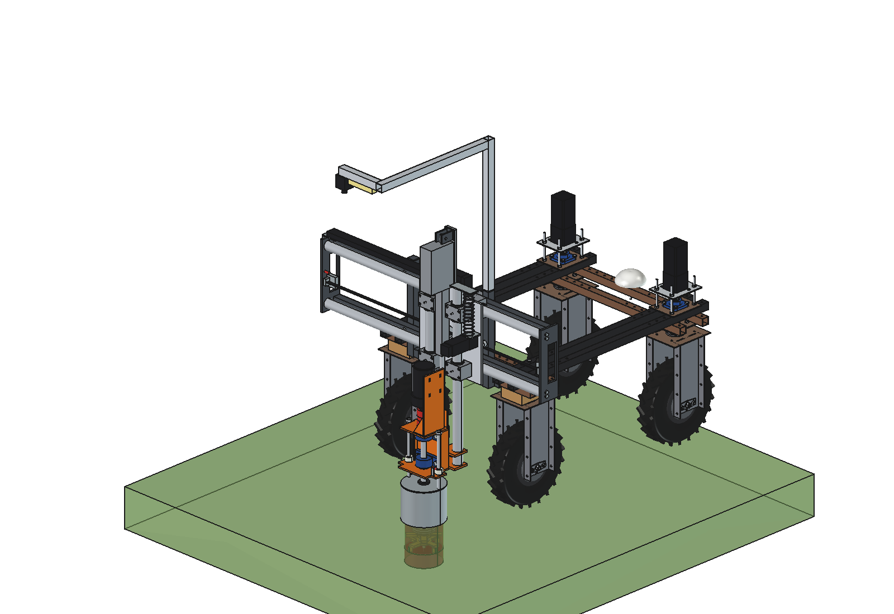
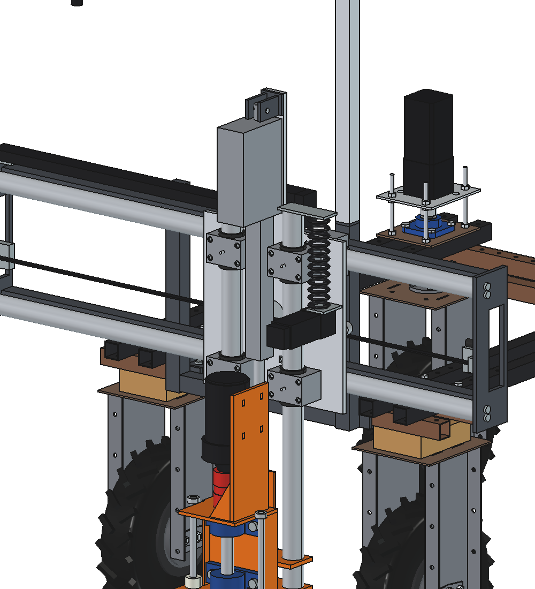
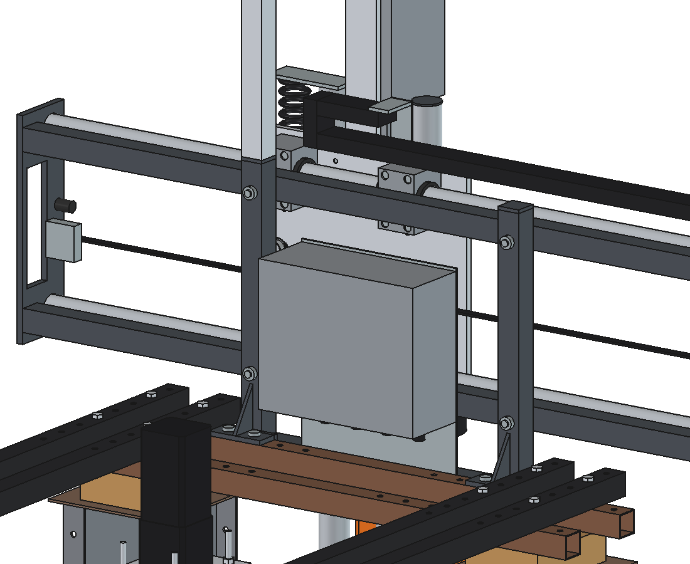
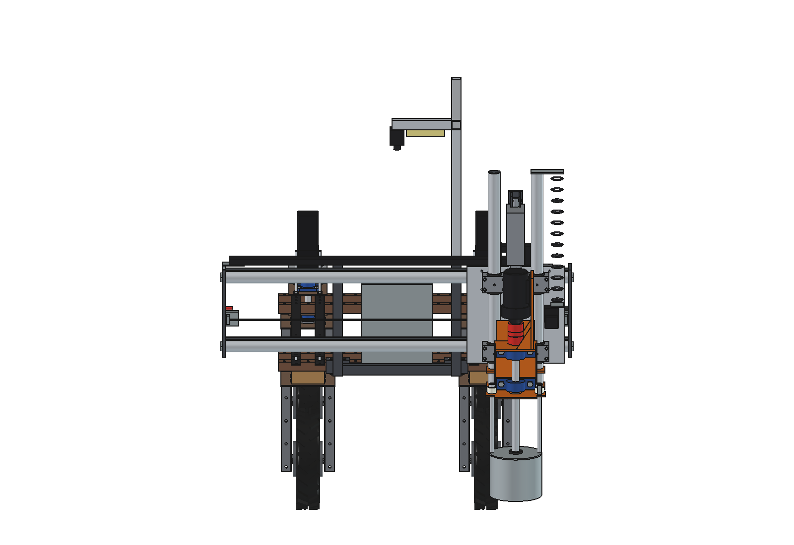

# Dockweed drill v8: FreeCAD model

v8 puts the **Z part of [v7](../v7/README.md)** on the **X axis of [v6](../v6/README.md)**, with **round tubes instead
of PTO tubes**. The process is unchanged: a cutter Ø 180 at 500 rpm from the 800 W gearmotor directly on a Ø 30
spindle in 2 × UCP 206, a Ruud-style steel can Ø 219, a Linak LA36 as the Z drive and a fixed high camera. The robot
drives straight again; the X slide moves the spindle over the plant (stroke 1000 mm, x −500..+500).

What is what:

1. **Z part as v7:** 2 precision tubes Ø 50 × 4 (E355, EN 10305-1) at x ±90 in 4 plain-bush housings (iglidur bush,
   wipers, grease nipple), lower yoke and clamp plate welded to the tubes, LA36 in the middle, spindle bracket,
   motor and can unchanged.
2. **X axis as v6:** 2 cross beams 40 × 40 × 3 over the full width (1 × M12 per upright), welded to 2 side plates
   12 mm; the 2 guide tubes are bolted between the side plates with a welded plug and 2 × M10 per end; HTD5M belt
   clamped on the side plates, omega around a pulley and 2 idlers on the slide; NEMA 23 closed-loop + 5:1 on the
   slide; cable chain on top; limit switch and end stop.
3. **Round X tubes:** the same tube Ø 50 × 4 as the Z axis, and the **same plain-bush housings**: 2 on the upper
   tube (x ±120) and 1 in the middle of the lower tube (slotted holes in z, so 3 points and no double guidance).
   One tube type, one housing type and one bush type for both axes.
4. **The v7 mount plate became the X slide** (aluminium 12 mm, 410 × 420 + the tab for the actuator pin): X housings
   on the front, Z housings, X motor, actuator bracket and spiral-cable bracket on the back.
5. The X motor sits at x 152, between the right Z tube and the slide edge, so the slide is 410 wide (v6: 300) and
   the side plates are 1470 apart (v6: 1400).

Why: [RATIONALE.md](RATIONALE.md).









## Animation

`animate_dwd8.py` (based on `../v6/animate_dwd6.py`) builds `DWD8_on_robot_animation`: the robot drives straight
and backwards (gantry first) and stops at 3 dock plants at x −300, +330 and +40. While it drives, the X slide already
runs to the next plant; then the LA36 extends until the can feels the sward, the cutter plunges 150 mm at 500 rpm,
dwells, rises while turning and the LA36 retracts. Power, Z force, actuator current and wheel loads come from
`dwd8_calc`.

```python
import animate_dwd8
animate_dwd8.build()
animate_dwd8.play()                                  # live, animate_dwd8.stop()
animate_dwd8.summary()
animate_dwd8.check_fit()                             # robot vs implement in the 6 X/Z end positions (empty)
animate_dwd8.render_all(r"C:\temp\dwd8_frames")
import make_gif_dwd8
make_gif_dwd8.main(r"C:\temp\dwd8_frames", r"previews\animation_three_plants_no_text.gif", text=False)
make_gif_dwd8.main(r"C:\temp\dwd8_frames", r"previews\animation_three_plants.gif")    # with caption and wheel loads
```

| Animation | File | Contents |
| --- | --- | --- |
| Three plants, no text | `previews/animation_three_plants_no_text.gif` (also in `animations/`, not in git) | 271 frames, 68 s at 3× speed: drive, X to the plant, LA36 down, plunge 150 deep, rise, retract |
| Same with caption | `previews/animation_three_plants.gif` | the same frames with caption (spindle power, Z force, LA36 current) and a wheel-load panel |
| Video, no text | `previews/animation_three_plants.mp4` (also in `animations/video's/`, not in git) | 852 frames, 1280 × 720, 25 fps, H.264, 35.6 s at 2× speed (frame step 0.08 s) |

The video is rendered at its own frame step and size, then encoded with ffmpeg (PATH, `FFMPEG` or Kdenlive's copy):

```python
import animate_dwd8, make_video_dwd8
animate_dwd8.build()
animate_dwd8.render_all(r"C:\temp\dwd8_video", size=make_video_dwd8.SIZE, dt=make_video_dwd8.DT)
make_video_dwd8.main(r"C:\temp\dwd8_video")         # -> previews/animation_three_plants.mp4
```

From `summary()`: X −300..+330, Z +200..−150, cutting power 681 W, wheel loads 14–151 kg.

## Files

| File | Contents |
| --- | --- |
| `Dockweed_drill_v8.FCStd` | the model in working position (x 150, cutter 150 deep); generated, do not edit by hand |
| `Dockweed_drill_v8.step` | STEP export of the implement |
| `dxf/*.dxf` | 20 cutting contours (laser/plasma), including the side plate and the X slide with the tab |
| `dwd8_params.py` | all dimensions; sections for the X axis (round tubes, housings, side plates, belt), X slide, Z guide, LA36, UCP 206, coupling size 28 |
| `dwd8_parts.py` | one function per part, returns a `Part` shape in robot coordinates |
| `build_dwd8.py` | model tree, poses, interference and clearance check, mass, STEP/DXF export, images |
| `dwd8_calc.py` | as v7 without the steering, plus the X axis of v6 for round tubes: tube deflection and bush loads (`guide`), belt force, tube bolts, cross beams, axle loads with x |
| `animate_dwd8.py` | animation: robot drives straight, X slide to 3 plants, treats them |
| `make_gif_dwd8.py` | frames to GIF: without text (`text=False`) or with caption and wheel-load panel |
| `make_video_dwd8.py` | frames to MP4 (1280 × 720, 25 fps, 2× speed, no text) with ffmpeg |
| `run_in_freecad.py` | macro: rebuild, print mass and key figures |
| `previews/` | images |

Usage: `build_dwd8.build(x=..., z=...)` (x = spindle centre, z = underside of the tool, ground = 0),
`check_interference()`, `check_poses()`, `clearance()`, `mass_properties()`, `render_all()`. Driving position
z = 200, deepest z = −200, x −500..+500. The calculations run without FreeCAD:
`"C:/Program Files/FreeCAD 1.1/bin/python.exe" -B dwd8_calc.py`.

## Model tree

```
dockweed_drill_v8
  headstock_robot_mount        2 x (top plate, clamp plate, back plate, 4 M10, upright 40x40x3, gusset), cross tube
  x_axis_round_tubes_between_side_plates
                               2 precision tubes D50x4, 2 cross beams 40x40x3 + 4 M12, plugs D42 + 8 M10, 2 side plates
                               12 mm, belt HTD5M + clamps, limit switch, end stop, chain bracket
  electrics_fixed, camera_fixed_high                                                   as v6 / v7
  x_carriage_moves_in_x        X slide alu 12 mm, 3 X housings + iglidur bushes + wipers + 12 M8, NEMA 23 + 5:1,
                               pulley + 2 idlers, chain driver, 4 Z housings + bushes + wipers + 16 M8, LA36 top
                               bracket + pin + housing, spiral cable bracket
    z_two_round_tubes_slide_in_z                                                        as v7
      tool_cutter_rotates_about_spindle
    pot_rests_on_ground                                                                 as v7
  cables_follow_x_and_z        cable chain (3 parts) and the spiral cable
robot_reference_NOT_PART_OF_DESIGN
```

## Key figures (from `dwd8_calc.report()` and the model)

| Quantity | v8 | v6 | v7 |
| --- | --- | --- | --- |
| Mass of the implement | **127.0 kg** | 122.9 kg | 99.9 kg |
| X moving / Z moving mass | 76.2 / 45.0 kg | 74.5 / 44.4 kg | — / 45.0 kg |
| Spindle position | x −500..+500, robot y −954 (454 behind the rear axle) | y −934 | x 0, y −870 |
| Width over the side plates | 1470 mm | 1400 mm | — |
| X guide | 2 tubes Ø 50 × 4 (I 154 000 mm⁴, span 1446), 3 plain bushes | 2 PTO tubes, 3 steel sleeves | — |
| X tube deflection, slide at x 0 (simply supported; fixed) | 1.0 mm down, 1.65 mm in v (0.24 / 0.41) | 0.75 / 1.31 mm | — |
| X bush load / pressure | 490 N per upper housing, 0.14 MPa | — | — |
| X belt force / acceleration | 895 N, friction 366 N → 7.0 m/s² | 895 N | — |
| Z guide (as v7) | 585 / 435 N per lower / upper housing at 300 N side force; cutter 1.3 + 1.1 = 2.4 mm | 2.3 + 1.1 mm | same as v8 |
| Actuator (LA36 24 V 1700 N) | push 539 N, lift 711 N (margin 3.2 / 2.4); 4.9 / 5.7 A | same | same |
| Cycle once stopped | 21.8 s with X while driving, 24.0 s with X after the stop | 24.0 s | 21.8 s |
| Plants per hour | 165 back to back, 139 at 2 m, 113 at 5 m apart | 150 / 165 | 165 / 139 / 113 |
| LA36 heating (mean I², allowed 21.2 A²) | 18.6 A² back to back (88 %), 6.8 A² at one plant per minute | — | same |
| Axle load driving, x 0 (front / rear) | 37 / 240 kg (front 13 %); battery forward 59 / 218 kg | 39 / 234 kg | 49 / 201 kg |
| Lightest wheel driving at x ±500 | 11 kg | 12 kg | — |
| Max. down force before a wheel drops below 20 kg (x 0 / x ±500) | 1292 / 1137 N (limit 600 N) | 1265 / 1110 N | 1100 N |
| Cross beams 40 × 40 × 3 (cantilever 473) | 0.5 mm down, 1.4 mm in v, 78 MPa | 0.78 / 0.57 mm, 51 MPa | — |
| Headstock bolts | 2700 N per bolt at 2 g, safety 12.5 | 13.6 | 18.5 |
| Clearance | no interference in the 6 end positions (x −500 / 0 / +500 × z 200 / −200), also against the robot; X carriage ≥ 47 mm, X axis ≥ 41 mm, can ≥ 141 mm from the robot | ≥ 122 mm | ≥ 250 mm |

## Estimated, not measured

Same list as v7 ([../v7/README.md](../v7/README.md#estimated-not-measured)) and the X axis items of v6, plus:
- X housings: the same drylin-type housing for Ø 50 as the Z axis, now with the shaft along x; width 100 (in z),
  length 70 (in x), bore 42 from the mounting face, 32 in front of the tube, 1.2 kg each, 4 × M8 at ±22 / ±40:
  **check on the housing you buy** and set `xg_house`, `xg_hc`, `xg_house_bolt`;
- load split on the X tubes: the upper tube takes 2/3 of the weight (2 of the 3 housings), estimated;
- plug Ø 42 × 25 welded in the X tube ends with 2 × M10 (as v6); the real end fixity lies between simply supported
  and fixed;
- X slide aluminium 12 mm with Helicoil M8 for the housings: check the thread pull-out with the real housing bolts;
- X motor, gearbox, pulley and idlers as v6 (1.6 / 0.9 / 0.15 / 0.1 kg);
- robot mass 150 kg and its centre of gravity (as before).
