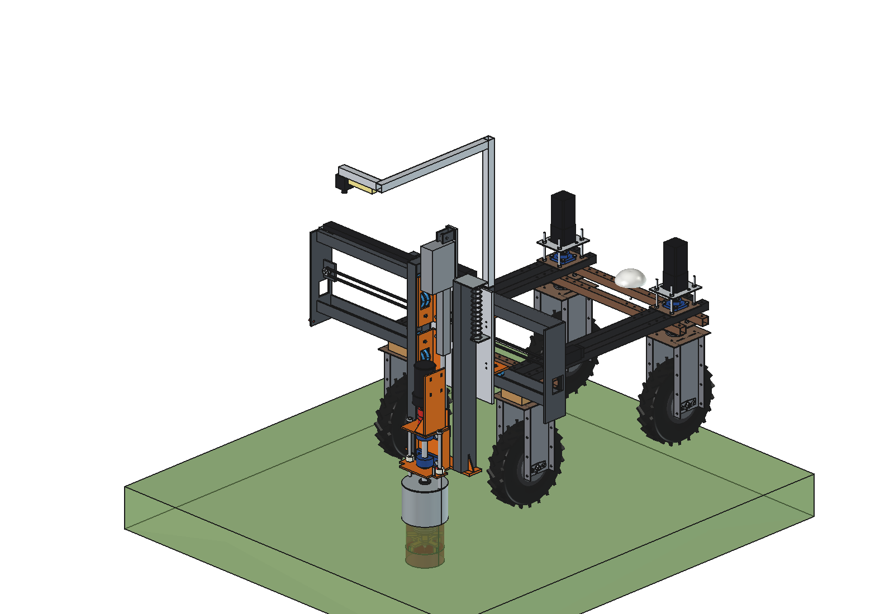
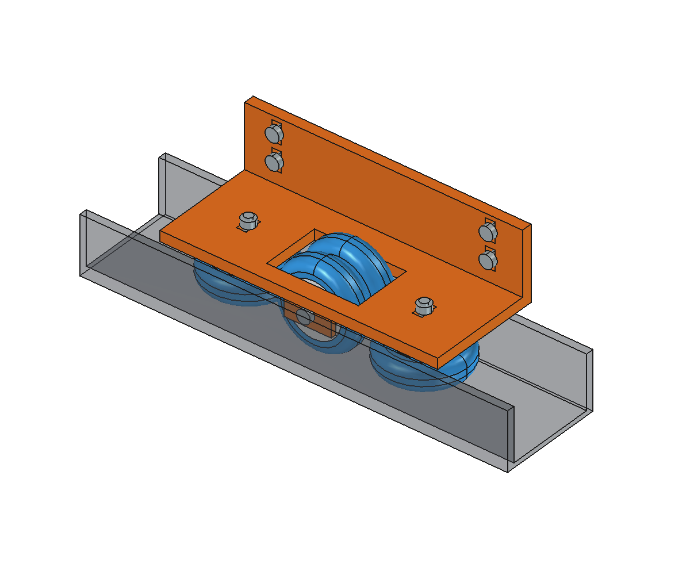
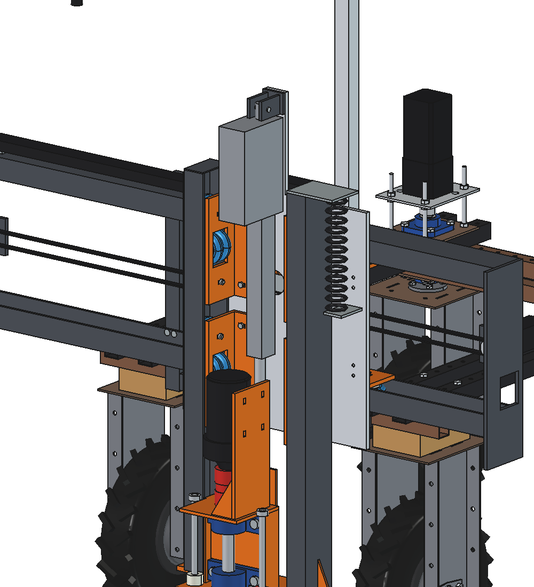
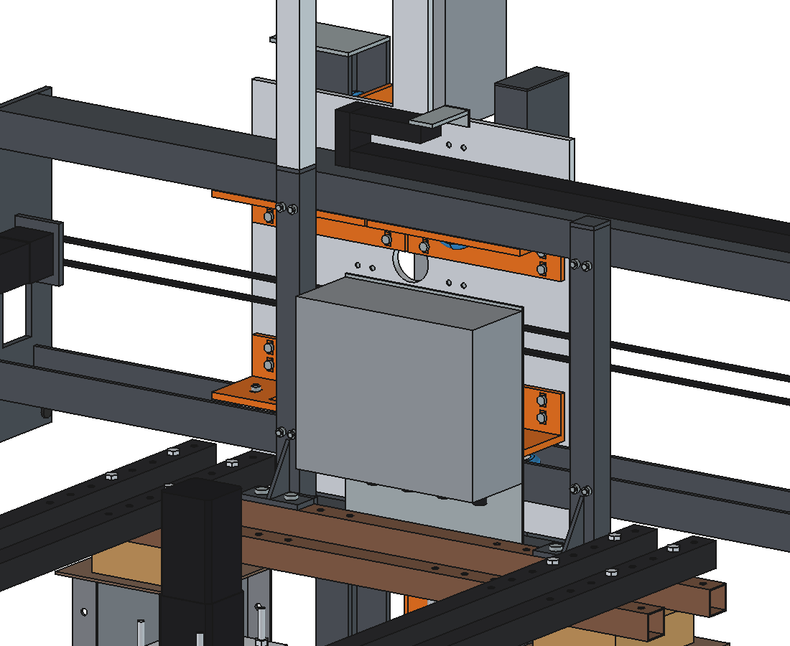
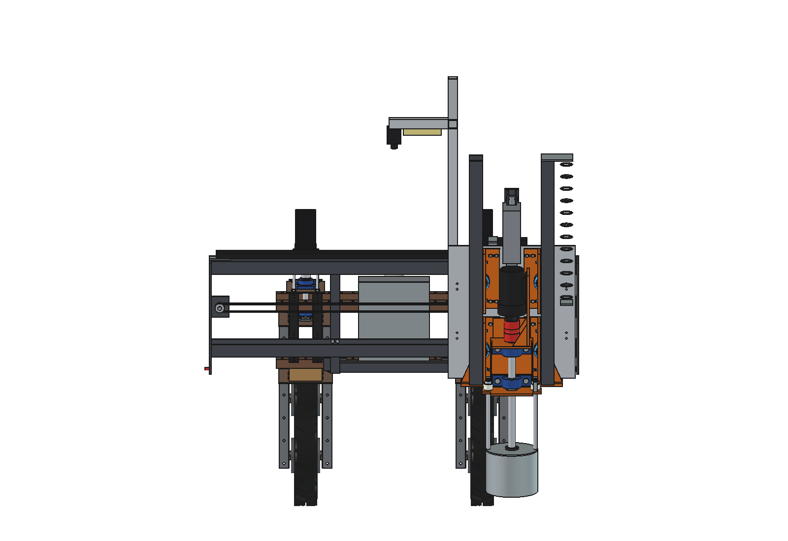

# Dockweed drill v9 advanced: FreeCAD model

The simple variant (2 wheels per side in a 25 mm track, everything in 4 mm steel) is in [../simple](../simple/README.md).

v9 puts **both axes on skate wheels running in U profiles**, after the sketches in `../inspiration/`: two UPE 100
channels per axis with the openings towards each other, a carriage with wheels in both channels, the **Linak LA36**
in the middle of the Z axis and on the X axis a belt round a pulley at each end with the **motor fixed at one end**.
The design aims at easy installation rather than the least material. Process, spindle, 800 W gearmotor, can, cutter,
LA36 and headstock are those of [v8](../../v8/README.md).

What is what:

1. **One wheel block, 8 times** (4 on X, 4 on Z): a 10 mm steel L bracket with 4 skate wheels Ø 80 × 24 (**90A**,
   2 × 608ZZ each; first drawn with the 78A set the user picked, switched to 90A on request): 2 **flange wheels**, one against each flange of the channel (no play
   across the channel), and 2 **web wheels** on one M8 through two ears, rolling on the web. Everything rolls. The
   flange-wheel axles sit in slots (± 4 mm) and the block bolts on with 4 × M8 in slots (± 5 mm): set each wheel
   against its running face, tighten, done. 32 wheels = 4 sets of 8.
2. **X axis:** 2 UPE 100 (EN 10365, parallel flanges), the lower one open upwards (carries the weight on its web,
   20 drain holes), the upper one open downwards, welded to 2 end plates = one **X frame**. It hangs straight on the
   2 uprights with 2 × M8 countersunk through the front flange per crossing (8 bolts, heads flush, outside the wheel
   track). No cross beams any more.
3. **X drive:** NEMA 23 closed-loop + 5:1 **fixed** on a bracket at the right end plate, pulley 20T; tension pulley on
   an M10 in a slot at the left end; HTD5M 15 mm belt between the channels, clamped to the front of the slide. The
   slide carries no motor and the motor cable does not move.
4. **Z axis:** 2 UPE 100 standing at x ± 175, openings towards x 0, welded on the lower yoke of the spindle bracket
   with a gusset outside each: they move with the spindle (as the tubes of v8). The 4 Z blocks sit on the back of the
   X slide at z 760 and 1060; the LA36, the spindle bracket back plate and the rod-eye bracket fit between the web
   wheels (|x| ≥ 95).
5. **X slide** aluminium 12 mm, 540 × 580 + the tab for the top actuator pin: X blocks on the front, Z blocks,
   LA36 bracket and spiral-cable bracket on the back.

Why: [RATIONALE.md](RATIONALE.md).











## Animation

`animate_dwd9.py` (as `../../v8/animate_dwd8.py`) builds `DWD9_on_robot_animation`: the robot drives straight and
backwards and stops at 3 dock plants at x −300, +330 and +40; the X slide runs to the next plant while driving, the
LA36 extends until the can feels the sward, the cutter plunges 150 mm at 500 rpm, dwells, rises and retracts.

```python
import animate_dwd9
animate_dwd9.build()
animate_dwd9.play()                                  # live, animate_dwd9.stop()
animate_dwd9.summary()
animate_dwd9.check_fit()                             # robot vs implement in the X/Z end positions (empty)
animate_dwd9.render_all(r"C:\temp\dwd9_frames")
import make_gif_dwd9
make_gif_dwd9.main(r"C:\temp\dwd9_frames", r"previews\animation_three_plants_no_text.gif", text=False)
make_gif_dwd9.main(r"C:\temp\dwd9_frames", r"previews\animation_three_plants.gif")    # with caption and wheel loads
```

| Animation | File | Contents |
| --- | --- | --- |
| Three plants, no text | `previews/animation_three_plants_no_text.gif` (also in `animations/`, not in git) | 271 frames, 68 s at 3× speed |
| Same with caption | `previews/animation_three_plants.gif` | the same frames with caption (spindle power, Z force, LA36 current) and a wheel-load panel |

A video goes as in v8 with `make_video_dwd9.py` (not rendered for v9 yet).

## Files

| File | Contents |
| --- | --- |
| `Dockweed_drill_v9.FCStd` | the model in working position (x 150, cutter 150 deep); generated, do not edit by hand |
| `Dockweed_drill_v9.step` | STEP export of the implement |
| `dxf/*.dxf` | 24 cutting contours, including the X end plate, drive bracket, X slide and the 3 plates of the wheel block |
| `dwd9_params.py` | all dimensions; sections for the skate wheel, UPE 100, wheel block, X frame and drive, X slide, Z channels |
| `dwd9_parts.py` | one function per part in robot coordinates; the wheel block is drawn once in the local frame of its channel (u, s, d) and placed 8 times (`block_frames()`) |
| `build_dwd9.py` | model tree, poses, interference and clearance check, mass, STEP/DXF export, images (`render_block_detail()` for the block picture) |
| `dwd9_calc.py` | as v8, with the wheel compression (`wheel`, `wheel_deflection`), Z guide on wheels (`z_guide`), X guide on wheels (`guide`), X frame bolts (`channel_bolts`) |
| `animate_dwd9.py`, `make_gif_dwd9.py`, `make_video_dwd9.py` | animation, GIF and MP4 |
| `run_in_freecad.py` | macro: rebuild, print mass and key figures |
| `previews/` | images |

Usage: `build_dwd9.build(x=..., z=...)` (x = spindle centre, z = underside of the tool, ground = 0),
`check_interference()`, `check_poses()`, `clearance()`, `mass_properties()`, `render_all()`. Driving position
z = 200, deepest z = −200, x −500..+500. The calculations run without FreeCAD:
`"C:/Program Files/FreeCAD 1.1/bin/python.exe" -B dwd9_calc.py`.

## Model tree

```
dockweed_drill_v9
  headstock_robot_mount        as v8 (uprights 40x40x3 to z 1130, 2 M8 holes per channel)
  x_axis_two_UPE100_facing_each_other
                               UPE 100 lower (open up) + upper (open down), 8 M8 DIN 7991, 2 end plates 10 mm,
                               2 drive brackets, NEMA 23 + 5:1 (fixed), 2 pulleys 20T + shafts, upper belt run,
                               limit switch, end stop, cable chain bracket
  electrics_fixed, camera_fixed_high                                                   as v8
  x_carriage_moves_in_x        X slide alu 12 mm; x/z wheel blocks (4 + 4): plates, 16 + 16 wheels, hubs, M8 axles
                               and mount bolts; belt clamp, chain driver, LA36 top bracket + pin + housing,
                               spiral cable bracket
    z_two_UPE100_roll_in_z     2 UPE 100, cap, yoke 12 mm, 2 gussets, rod eye bracket, LA36 rod, spindle bracket,
                               2 x UCP 206, spindle, jaw coupling, gearmotor                         (as v8)
      tool_cutter_rotates_about_spindle
    pot_rests_on_ground                                                                 as v8
  cables_follow_x_and_z        cable chain (3 parts), spiral cable, lower belt run (clamped on the slide)
robot_reference_NOT_PART_OF_DESIGN
```

## Key figures (from `dwd9_calc.report()` and the model)

| Quantity | v9 | v8 |
| --- | --- | --- |
| Mass of the implement | **170.1 kg** | 127.0 kg |
| X moving / Z moving mass | 108.8 / 56.2 kg | 76.2 / 45.0 kg |
| Spindle position | x −500..+500, robot y −947 (447 behind the rear axle) | y −954 |
| Width over the end plates | 1570 mm | 1470 mm |
| Guides | 4 × UPE 100, 8 wheel blocks, 32 skate wheels 80 × 24 90A | 4 round tubes, 7 plain-bush housings |
| Wheel compression (90A, estimated) | 1.3 mm at 600 N (≈ 460 N/mm; 78A: 1.9 mm at 400 N); 608 bearings 4.6× static margin | — |
| X: web wheel (weight) / flange wheel (moment + 600 N Z force) | 267 N static, 0.8 mm sink / 439 N | — |
| X: 300 N side force at x 500 | web wheel 849 N peak, upper web wheels hold 316 N | — |
| X channel deflection at x ± 500 | 0.2 mm down, 0.03 mm in v | 1.0 / 1.65 mm |
| X belt force / acceleration | 895 N, rolling resistance 42 N → 7.8 m/s² | 895 N, 7.0 m/s² |
| Z: wheel loads at 100 N / 300 N side force | flange 319 / 709 N, web 195 / 585 N | — |
| Cutter deflection at 100 N / 300 N side force | **4.4 / 9.7 mm** (wheels, no preload; profiles 0.5 mm; with 78A 7.7 / 16.6) | 2.4 mm at 300 N |
| X frame bolts (M8 8.8 countersunk) | 659 N tension per bolt, safety 33 | — |
| Actuator (LA36 24 V 1700 N) | push 126 N, lift 768 N (margin 13.5 / 2.2) | 539 / 711 N |
| LA36 heating (mean I², allowed 21.2 A²) | 15.1 A² back to back (71 %), OK from 15.6 s per plant | 18.6 A² |
| Cycle once stopped / plants per hour | 21.8 s; 165 back to back, 139 at 2 m, 113 at 5 m | same |
| Axle load driving, x 0 (front / rear) | **26 / 294 kg (front 8 %)**; battery forward 49 / 272 kg | 37 / 240 kg |
| Lightest wheel driving at x ± 500 | **6.8 kg** | 11 kg |
| Max. down force before a wheel drops below 20 kg (x 0 / x ± 500) | 1655 / 1506 N (limit 600 N) | 1292 / 1137 N |
| Headstock bolts | 3145 N per bolt at 2 g, safety 10.7 | 12.5 |
| Clearance | no interference in the 6 end positions (x −500 / 0 / +500 × z 200 / −200), also against the robot; all 32 wheels 0.3 mm from their running face; X axis ≥ 6.5 mm (lower channel over the upper robot beams), X carriage ≥ 26 mm, can ≥ 134 mm from the robot | ≥ 41 / 47 / 141 mm |

**Front axle:** with 8 % of the weight on the front axle when driving, the robot cannot steer reliably. Put the
battery forward and add [counterweights](../../../counterweights/simple/README.md) at the front (about 30..40 kg
brings the front back to the v8 share); see RATIONALE §5.

## Estimated, not measured

Same list as v8 ([../../v8/README.md](../../v8/README.md#estimated-not-measured)) for spindle, LA36 and robot, minus the
plain-bush items, plus:
- skate wheel stiffness: E 20.8 MPa from 90A (Gent), tread 14 mm, contact width 15 mm; allowed 600 N per wheel
  continuous, 1500 N short peak; rolling resistance 0.015; hub + bearings 35 g per wheel. **Measure a wheel.**
- UPE 100 drawn without the root radius (r 10); check the real flange spacing (85 nominal) before setting the wheels;
- wheel block 10 mm steel (~3.7 kg each); 8 mm would do and saves ~6 kg;
- countersunk M8 seating in the 7.5 mm UPE flange;
- belt length ~3.06 m, belt stiffness, tension slot ± 10 mm;
- side force on the cutter: 100 N normal (estimated), 300 N design peak;
- robot mass 150 kg and its centre of gravity (as before).
