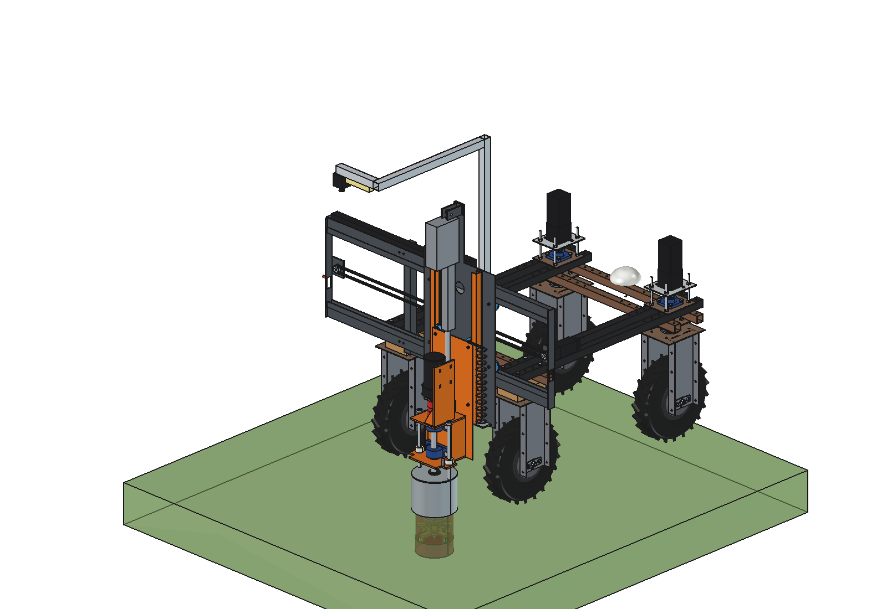
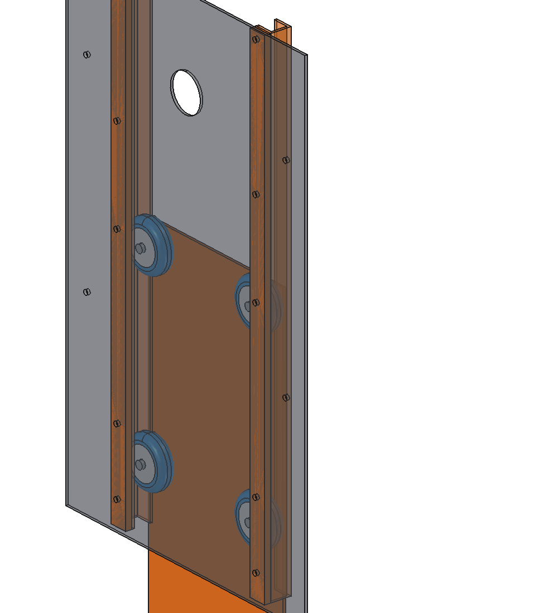
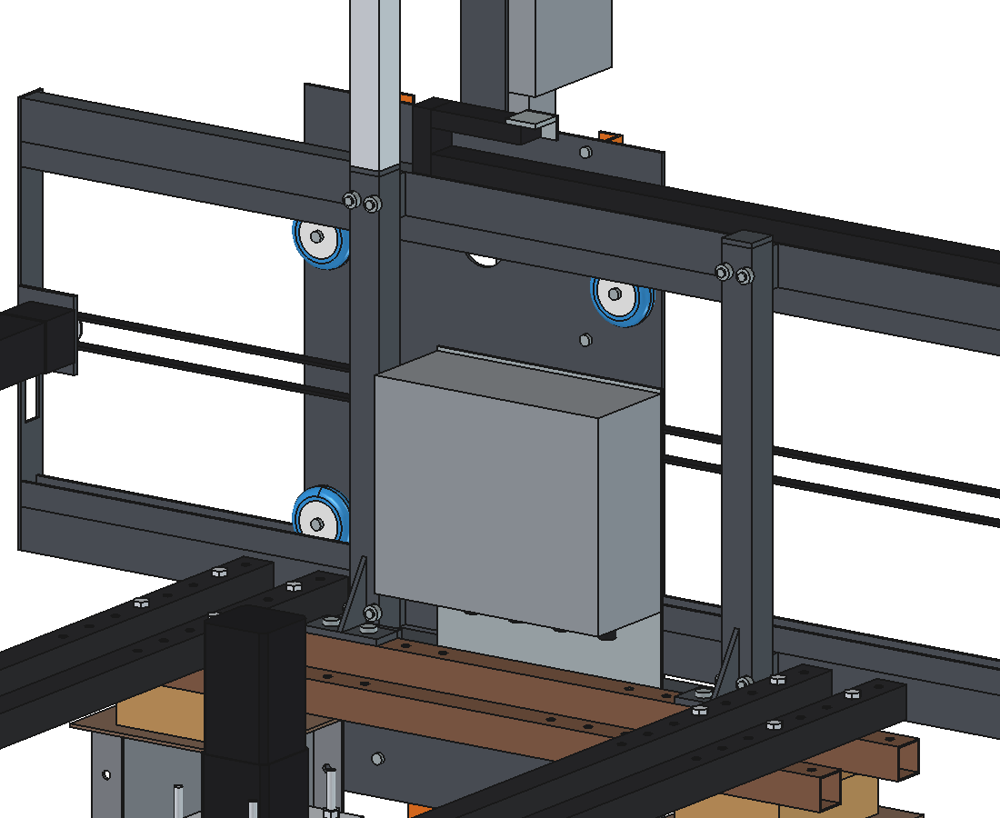
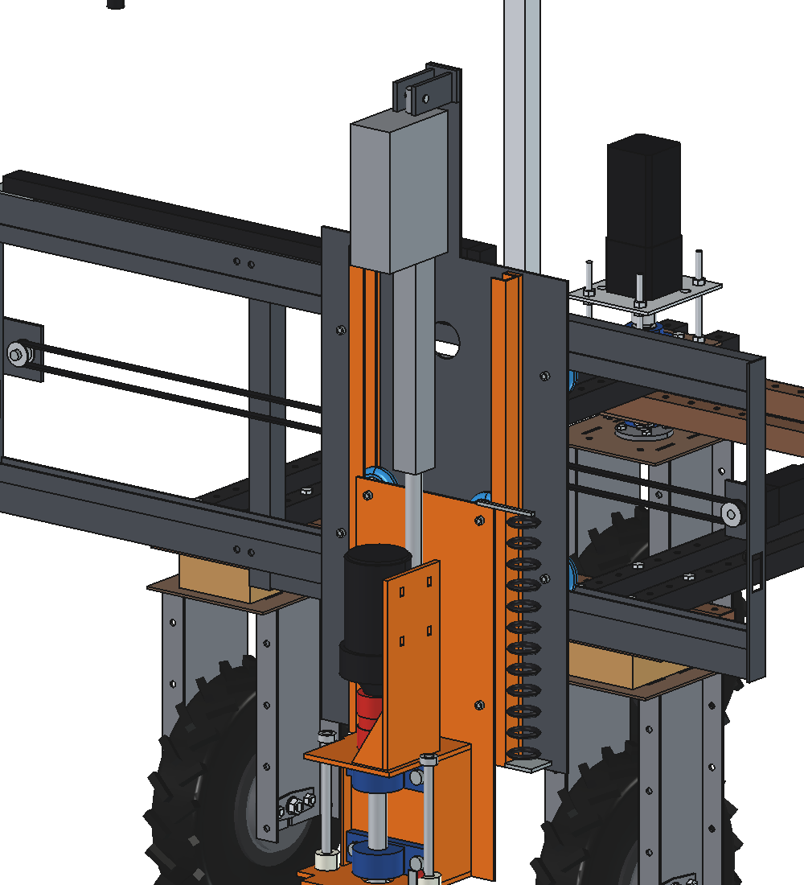
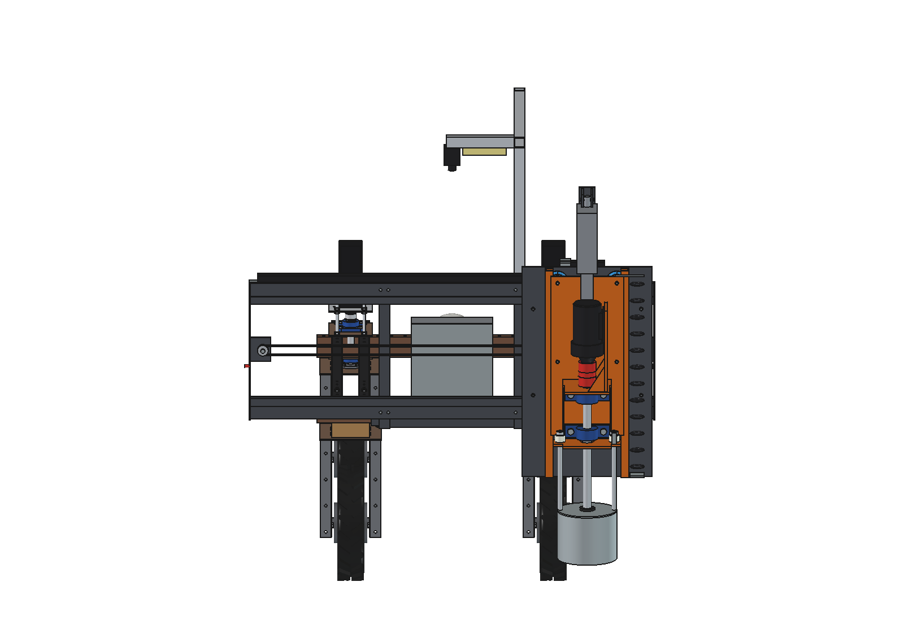

# Dockweed drill v9 simple: FreeCAD model

The simple variant of v9. The heavy variant with UPE 100 channels and 8 wheel blocks is
[../advanced](../advanced/README.md). Process, spindle, 800 W gearmotor, can, cutter, LA36 and headstock are those of
[v8](../../v8/README.md).

**Status:** model, images, STEP, DXF and the animation are done. `dwd9s_calc.py` is still **provisional**: it only
has the process, LA36 and axle-load parts the animation needs (masses from this model). The guide calculations
(side force of the wheels on the flanges, friction, 608 axial load, play at the cutter, 4 mm plates) follow on
request.

What is what (brief: "2 wheels in the U profile, the U profiles stay fixed on the same plate as the actuator, the
plate with the drill has 2 wheels on each side that run down in a 25 mm U profile; the same for the X axis; 4 mm
steel is strong enough"):

1. **Track:** bent U in 4 mm steel, **25 mm inside** and 25 deep. The skate wheel (Ø 80 × 24, **90A**, 2 × 608ZZ)
   rolls with its tread on the web; the two flanges keep it sideways with 0.5 mm per side. All wheel axles run
   front to back (along v), one M8 per wheel with a spacer to the plate.
2. **Z axis:** 2 tracks stand **fixed on the X slide** (the same plate that carries the LA36) at x ± 150, open
   towards the middle, welded on a 10 mm strip (tapped M8, bolted from the front of the slide). The **drill plate**
   (4 mm, at the same time the back plate of the spindle bracket) has 2 wheels on each side at 690 and 990 mm above
   the cutter and rolls down in the tracks. The LA36 sits behind the drill plate, its rod eye on a bracket on the
   back of the plate.
3. **X axis:** 2 tracks, the lower one open upwards (carries the weight), the upper one open downwards, each welded
   on a beam 50 × 30 × 4. The beams sit on the 2 uprights with a 10 mm shim and 2 × M10 per crossing, and 2 end
   plates of 4 mm tie them together. The X slide (4 mm) has 4 wheels, 2 per track at x ± 200.
4. **X drive** as advanced: NEMA 23 + 5:1 fixed at the right end, tension pulley on the left, belt clamped to the
   slide.











## Animation

`animate_dwd9s.py` (as advanced) builds `DWD9S_on_robot_animation`: the robot drives backwards and stops at 3 dock
plants at x −300, +330 and +40; the X slide runs to the next plant while driving, the LA36 lowers the drill plate
until the can feels the sward, the cutter plunges 150 mm at 500 rpm, dwells, rises and retracts.

```python
import animate_dwd9s
animate_dwd9s.build()
animate_dwd9s.play()                                  # live, animate_dwd9s.stop()
animate_dwd9s.summary()
animate_dwd9s.check_fit()                             # robot vs implement in the X/Z end positions (empty)
animate_dwd9s.render_all(r"C:\temp\dwd9s_frames")
import make_gif_dwd9s
make_gif_dwd9s.main(r"C:\temp\dwd9s_frames", r"previews\animation_three_plants_no_text.gif", text=False)
make_gif_dwd9s.main(r"C:\temp\dwd9s_frames", r"previews\animation_three_plants.gif")
```

| Animation | File | Contents |
| --- | --- | --- |
| Three plants, no text | `previews/animation_three_plants_no_text.gif` (also in `animations/`, not in git) | 271 frames, 68 s at 3× speed |
| Same with caption | `previews/animation_three_plants.gif` | caption (spindle power, Z force, LA36 current) and a wheel-load panel; the LA36 current has no guide friction yet |

From `summary()`: X −300..+330, Z +200..−150, cutting power 681 W, robot wheel loads 17–139 kg, front axle
47–59 kg. `check_fit()` is empty in all 6 end positions.

## Files

| File | Contents |
| --- | --- |
| `Dockweed_drill_v9_simple.FCStd` | the model in working position (x 150, cutter 150 deep); generated, do not edit by hand |
| `Dockweed_drill_v9_simple.step` | STEP export of the implement |
| `dxf/*.dxf` | 19 cutting contours, including the X slide 4 mm, the drill plate 4 mm, end plate and drive bracket |
| `dwd9s_params.py` | all dimensions; sections for the track, X frame and drive, X slide, Z tracks and drill plate |
| `dwd9s_parts.py` | one function per part in robot coordinates (`track_x`, `track_z`, `_wheel`, `_axle`, ...) |
| `build_dwd9s.py` | model tree, poses, interference and clearance check, mass, STEP/DXF export, images |
| `dwd9s_calc.py` | provisional: process, LA36, cycle and axle loads (no guide yet) |
| `animate_dwd9s.py`, `make_gif_dwd9s.py`, `make_video_dwd9s.py` | animation, GIF and MP4 |
| `run_in_freecad.py` | macro: rebuild and print the mass |
| `previews/` | images |

Usage: `build_dwd9s.build(x=..., z=...)` (x = spindle centre, z = underside of the tool), `check_interference()`,
`check_poses()`, `clearance()`, `mass_properties()`, `render_all()`. Driving position z = 200, deepest z = −200,
x −500..+500.

## Model tree

```
dockweed_drill_v9_simple
  headstock_robot_mount        as v8, uprights to z 1180, 2 x M10 holes per beam
  x_axis_two_tracks_on_beams   2 tracks U25 4 mm on beams 50x30x4, shims 10 mm, 8 M10, end plates 4 mm,
                               drive brackets 6 mm, NEMA 23 + 5:1 (fixed), pulleys, upper belt run, limit switch,
                               end stop, chain bracket
  electrics_fixed, camera_fixed_high                                                   as v8
  x_carriage_moves_in_x        X slide 4 mm, 4 wheels 80x24 90A + M8 axles, 2 fixed Z tracks U25 4 mm on 10 mm
                               strips + 10 M8, belt clamp, chain driver, LA36 top bracket + pin + housing,
                               spiral cable bracket
    z_drill_plate_rolls_in_z   4 wheels + M8 axles, drill plate 4 mm (= spindle bracket back plate), rod eye bracket,
                               LA36 rod, spindle bracket, 2 x UCP 206, spindle, coupling, gearmotor
      tool_cutter_rotates_about_spindle
    pot_rests_on_ground
  cables_follow_x_and_z        cable chain, spiral cable, lower belt run
robot_reference_NOT_PART_OF_DESIGN
```

## Key figures from the model

| Quantity | v9 simple | v9 advanced | v8 |
| --- | --- | --- | --- |
| Mass of the implement | **117.6 kg** | 170.1 kg | 127.0 kg |
| X moving / Z moving mass | 72.0 / 38.8 kg | 108.8 / 56.2 kg | 76.2 / 45.0 kg |
| Wheels | 8 (4 X, 4 Z) | 32 | — |
| Spindle position | robot y −861, 361 mm behind the rear axle | y −947 | y −954 |
| Width over the end plates | 1500 mm | 1570 mm | 1470 mm |
| Axle load driving, x 0 (front / rear), from `dwd9s_calc` | **47 / 221 kg** (front 17.5 %) | 26 / 294 kg | 37 / 240 kg |
| Lightest robot wheel driving at x ± 500 | 14.4 kg | 6.8 kg | 11 kg |
| Interference | none in the 6 end positions (x −500 / 0 / +500 × z 200 / −200), also against the robot; all 8 wheels 0.3 mm from the web | | |
| Clearance to the robot | X axis 3 mm (beams behind the upper robot beams), X carriage 17 mm (slide 10 mm above the rear tyres), Z carriage 21 mm, can 55 mm | | |

The spindle comes 86 mm closer to the robot than in advanced, because the Z tracks sit right behind the slide and
the drill plate is also the back plate of the spindle bracket.

## Estimated, not measured

As advanced ([../advanced/README.md](../advanced/README.md#estimated-not-measured)), plus:
- the track is drawn as a sharp-cornered U; a bent 4 mm U has an inner radius of ~4–6 mm, so check that the
  25 mm stays 25 mm over the full depth;
- the side of the skate wheel runs against the flange (sliding, not rolling): friction and wear still to be
  calculated.
