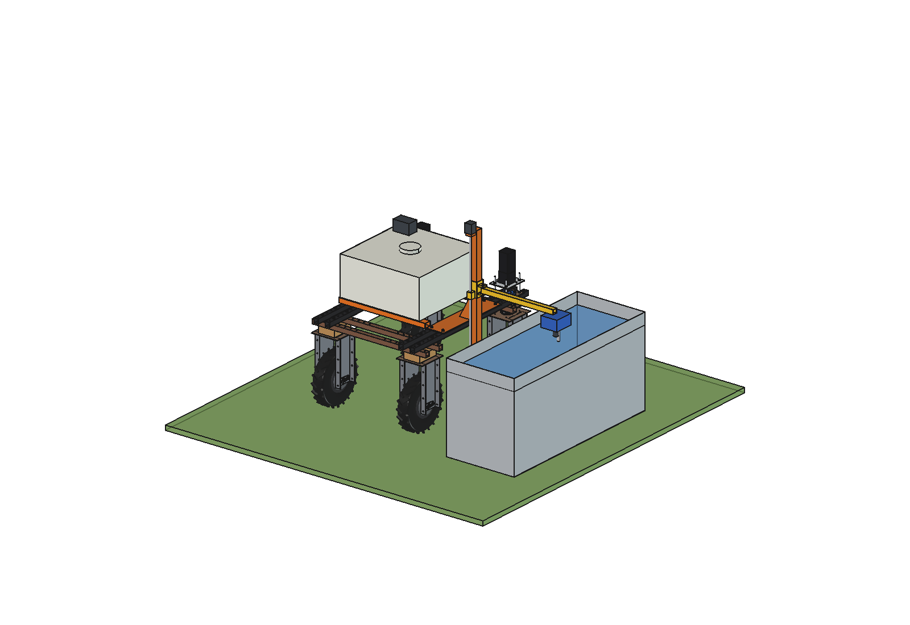
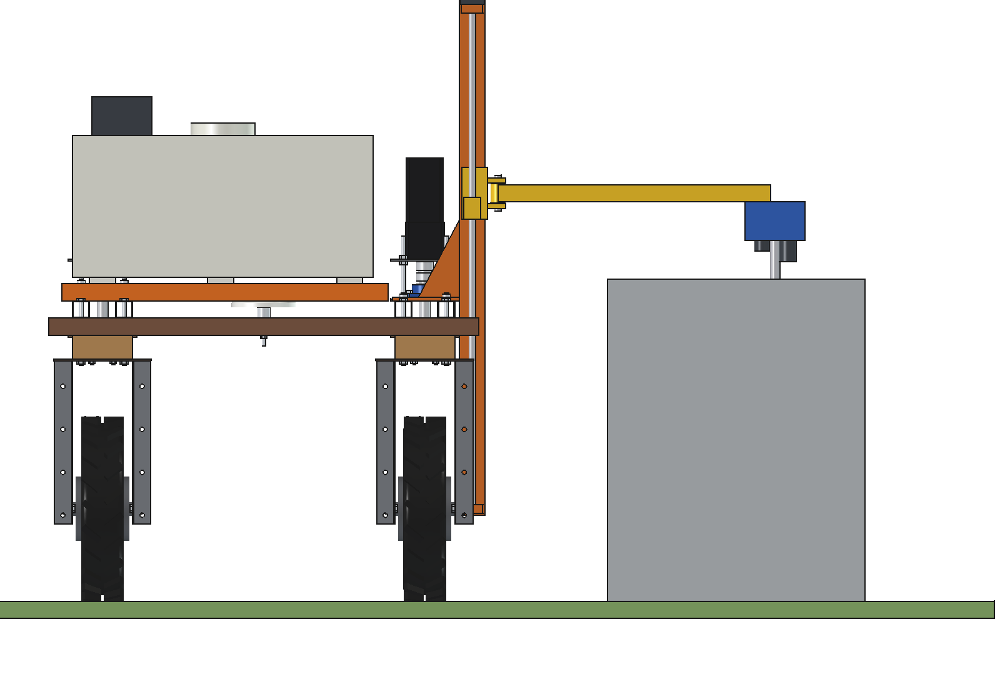
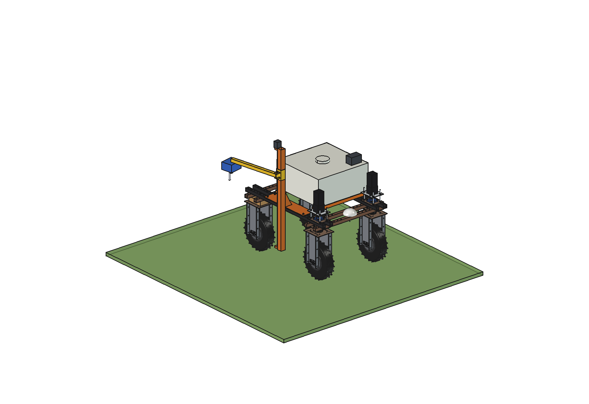
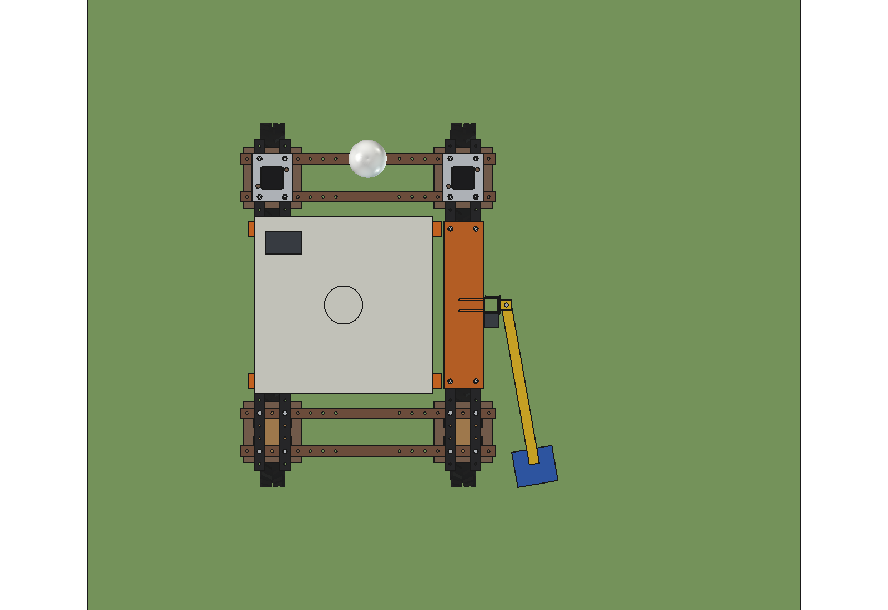
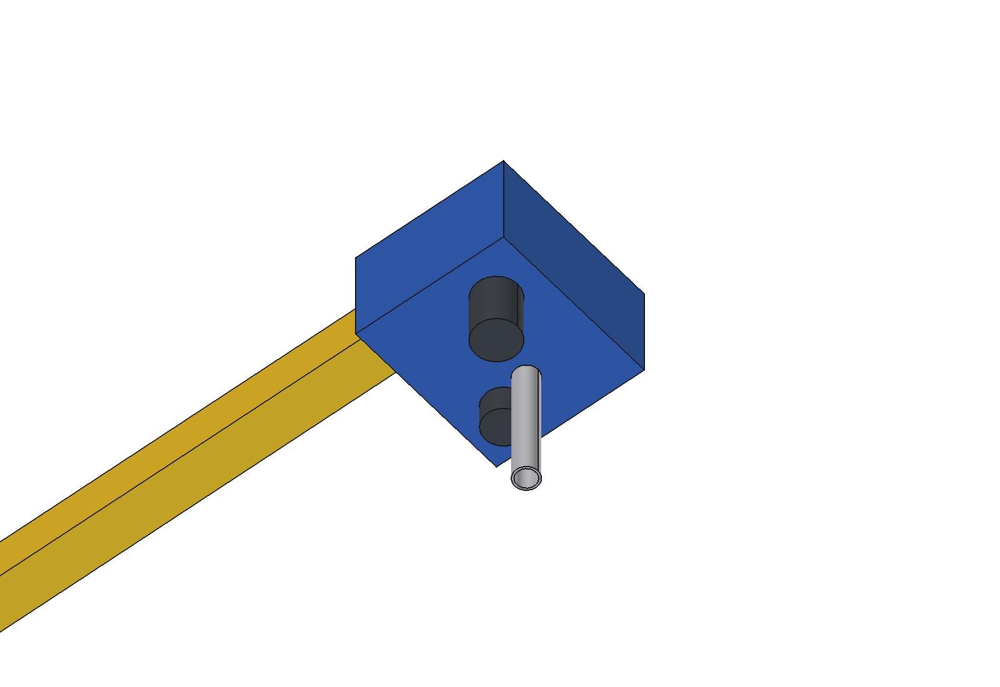

# Drinking trough check (simple)

The Bruut OpenAgbot (standard robot) visits the drinking troughs in a field at stored GNSS positions. It parks with
the trough 300 mm to its right, lowers a sensor head over the water and
- **measures the level** with an ultrasonic sensor looking down (+-5 mm with moving water);
- **photographs** the water and the trough (dirt, algae, a dead animal, a float valve stuck open or shut);
- **tops up** the trough from its own 160 l tank (24 V diaphragm pump, 20 l/min, nozzle in the head) when the float
  valve or the supply has failed, and reports it.

The mast, the carriage on the lead screw and the spring hinge are those of the
[fence inspector](../../fence%20inspector/simple/README.md) (imported, not copied); only the arm is longer (to x 1180)
and carries the head. The tank sits on 2 cross bars on the left upper beams. While driving the head goes up and the
arm swings back along the robot. Scrubbing the trough is not in the simple variant.

<p align="center">
  
</p>

| Measuring (rear view) | Driving: head up, arm swung back |
| --- | --- |
|  |  |
|  |  |

## Build

- **From the fence inspector**: base plate on the right upper beams, mast 60 x 60, Tr16 x 4 lead screw with a NEMA 23
  stepper, C-carriage and spring hinge.
- **Arm**: tube 40 x 40 x 3, 635 mm from the hinge; **head** (ABS 140 x 160 x 90) under the arm end with an ultrasonic
  level sensor, a camera and a 3/4" fill nozzle pointing down.
- **Tank**: PE 700 x 700 x 330 (160 l) on 6 PE pads on 2 cross bars 60 x 40 x 3 bolted to the left upper beams at
  y +-300 (the right beams carry the mast plate); **pump** 24 V diaphragm 20 l/min on the lid.

Mass ~43 kg empty (mast, tank and bars 37 kg, carriage and arm 5 kg), 203 kg robot + check empty, 363 kg full.
Size 1730 x 700 x 1266 mm (x, y, z) with the arm out.

## Key figures (`dck_calc.report()`)

| | |
| --- | --- |
| Level | +-5 mm (sensor 3 mm, moving water 4 mm) = +-4 l in a 0.85 m2 trough; 30 cows drink ~1.7 l/min, so a falling level shows within minutes |
| In the trough | nozzle 70 mm and sensor 140 mm above the water (rim 750, water 650), clear of the trough walls |
| Top-up | 85 l per 100 mm, ~4 min; 1.9 such top-ups per tank; the tank alone waters 30 cows for ~1.5 h (an emergency, not a supply) |
| Balance | rear 50 %; right wheels 56 % empty, 48 % full (the water sits left of the centre) |
| Round of 6 troughs, 2.5 km | ~59 min, ~170 Wh: ~11 rounds per charge |

Why and how these come out: see [RATIONALE.md](RATIONALE.md), including the list *Estimated, not measured*.

## Files

| File | Contents |
| --- | --- |
| `dck_params.py` | arm, head, tank, trough and work parameters (mast and carriage from `fin_params`), masses from the model |
| `dck_parts.py` | arm, head, sensors, nozzle, tank, bars, pump; trough and water for the renders; mast parts from `fin_parts` |
| `build_dck.py` | model tree (Mount, Carriage with Arm), `set_pose(z, swing)`, checks (`check_interference`, `check_holes`, `check_poses`, `check_trough`), mass, `render_all()`, STEP |
| `dck_calc.py` | level accuracy, top-up, balance with a full and empty tank, round time and energy |
| `run_in_freecad.py` | reload, build, print the key figures |
| `Drinker_Check.FCStd`, `Drinker_Check.step` | generated model (robot hidden in the FCStd) |
| `previews/` | images |

## Use

```python
exec(open(r"F:\veldrobot\aanbouwdelen\drinker check\simple\run_in_freecad.py").read())
import build_dck
build_dck.set_pose(z=1100, swing=80)   # driving
build_dck.check_poses()                # height x swing x steering -30..30: must be {}
build_dck.check_trough()               # no hits on the trough walls
```

No animation (simple variant).
