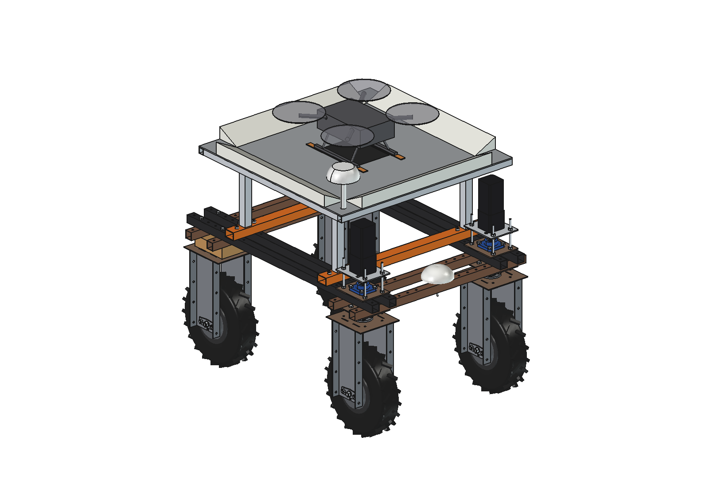
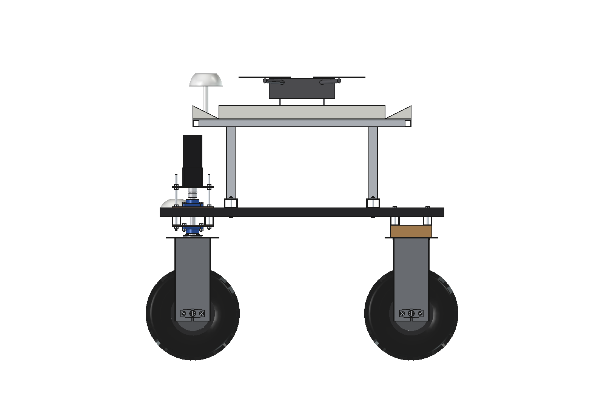
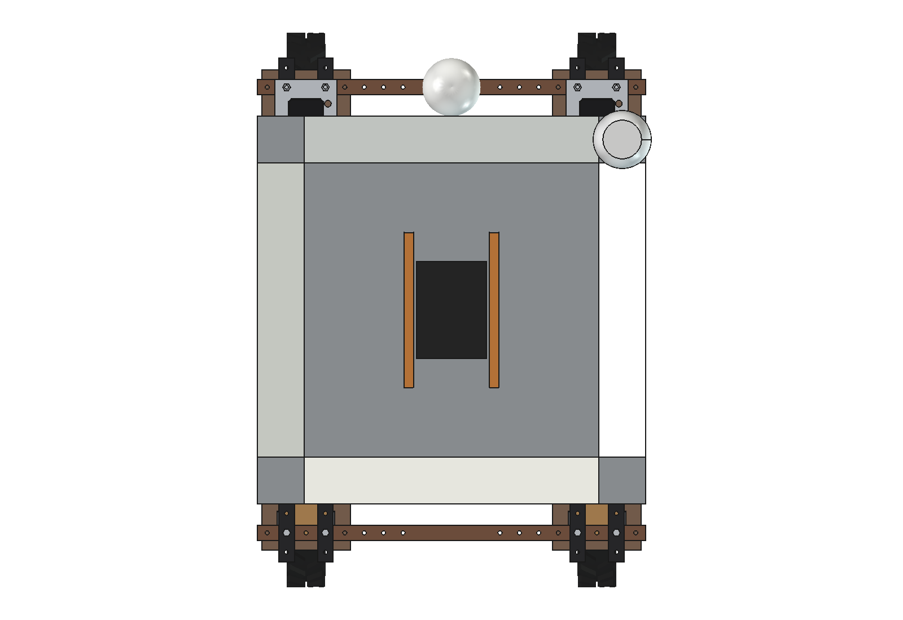
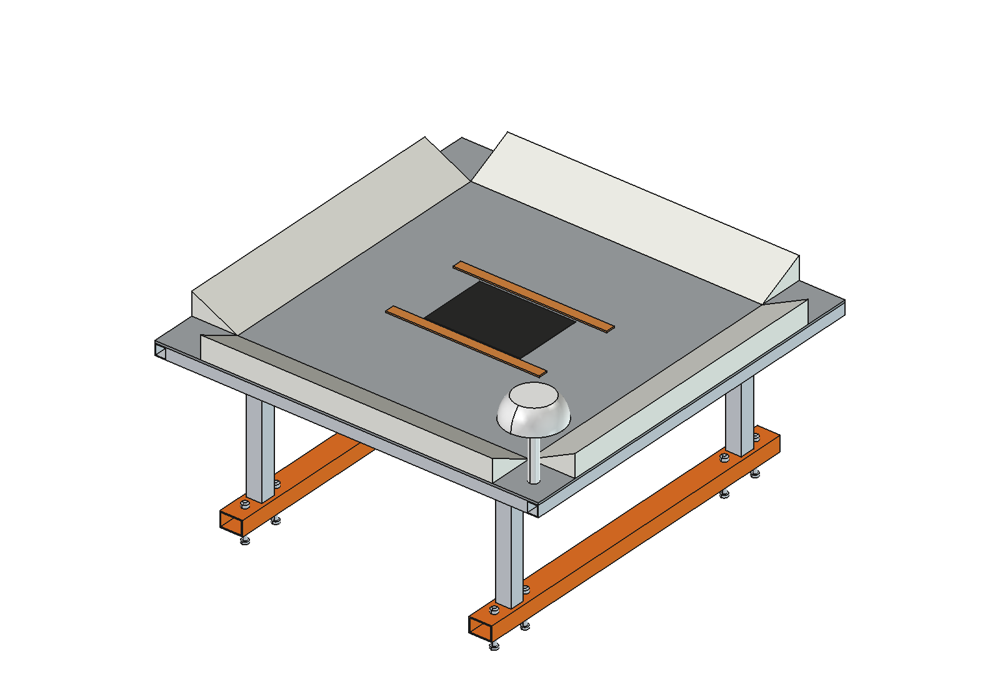

# Drone combination (simple)

A landing platform that turns the Bruut OpenAgbot (standard robot) into a mobile base station for a mapping drone
(Mavic-3-class, ~1 kg, 77 Wh). The drone takes off from the robot, maps the plot from 100 m, lands back on the
platform, sends its images over the robot's link and charges from the robot battery while the robot works the task
map. The pair can scout and work in turns all day without anyone coming out to the field.

  

| Side | Platform from above (tag, charging strips, wedges) |
| --- | --- |
|  |  |

## Build

- **Supports**: 2 cross bars 60 x 40 x 3 over all 4 upper beams at y +-325 (M10 into the grid holes), 4 aluminium
  posts 40 x 40 x 3 at x +-375 between the beams of each side.
- **Platform**: aluminium plate 1000 x 1000 x 6 at z 1100 on a 30 x 30 frame, 68 mm above the steering stacks.
- **Guide wedges**: 4 PE wedges 120 x 60 along the edges (corners open): a drone that lands off-centre slides into the
  760 mm flat landing zone.
- **Charging**: 2 copper strips under the skids (a contact adapter in the drone's landing gear) with magnets beneath
  that also hold the drone in the wind.
- **Landing aid**: AprilTag plate between the strips (RTK for the approach, the tag for the last metres).
- **GNSS**: the robot's antenna moves from its dome (now under the platform) to a short post on a platform corner.

Mass ~42 kg. Size 1015 x 1015 x 659 mm; the robot is 1.11 m high at the platform, 1.31 m with the antenna post.

## Key figures (`drn_calc.report()`)

| | |
| --- | --- |
| Landing | typical error 0.1 m lands in the flat zone; up to 0.25 m off is caught by the 27 degree wedges |
| Mapping per flight | 100 m altitude, 180 m swath, 54 m line spacing: ~97 ha per flight (25 % reserve), 3.4 cm/px |
| Charging | ~88 Wh from the robot (4.6 % of its battery), ~60 min at 100 W; ~6 flights from 30 % of the robot battery |
| Wind | 7.6 N on the drone at 12 m/s, held by 15 N (skid friction + strip magnets) |

Why and how these come out: see [RATIONALE.md](RATIONALE.md), including the list *Estimated, not measured*.

## Files

| File | Contents |
| --- | --- |
| `drn_params.py` | platform, supports, wedges, strips, tag, GNSS post, drone and flight parameters |
| `drn_parts.py` | one function per part; `drone()` stand-in for the renders |
| `build_drn.py` | model tree (Platform), checks (`check_interference`, `check_holes`, `check_steering`), mass, `render_all()`, STEP |
| `drn_calc.py` | landing catch, area per flight, charging energy and time, wind hold |
| `run_in_freecad.py` | reload, build, print the key figures |
| `Drone_Combination.FCStd`, `Drone_Combination.step` | generated model (robot hidden in the FCStd) |
| `previews/` | images |
