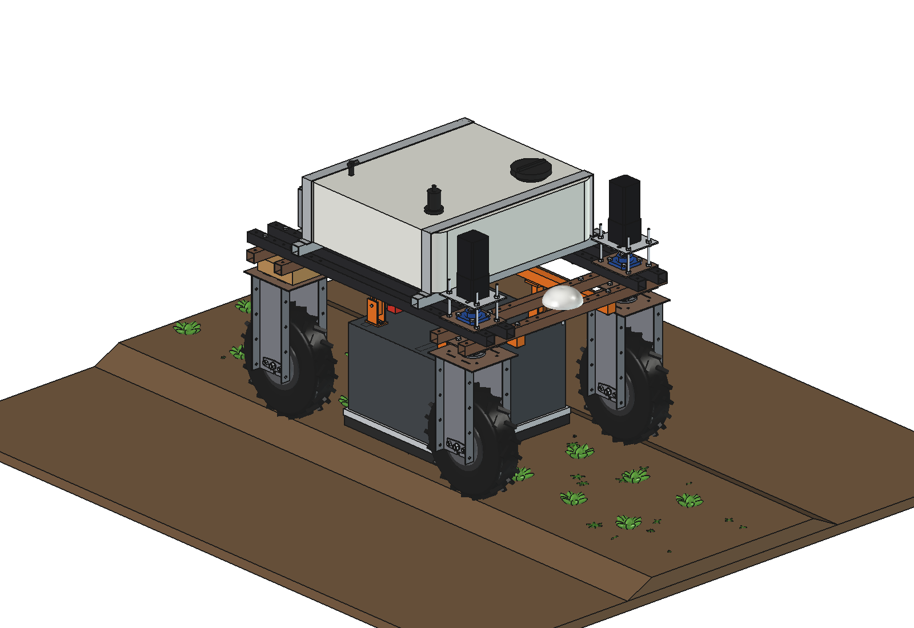
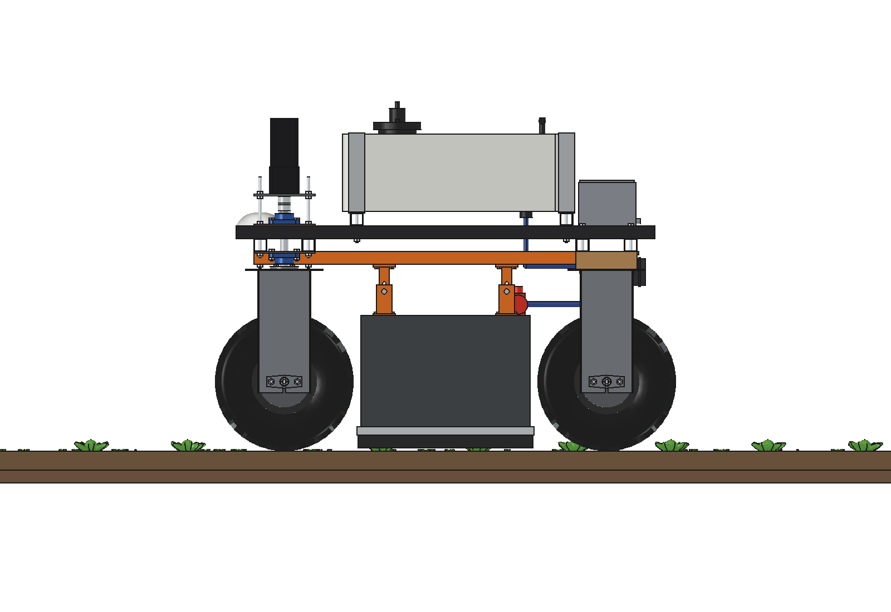
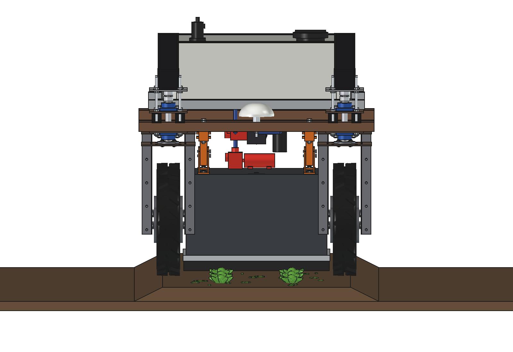
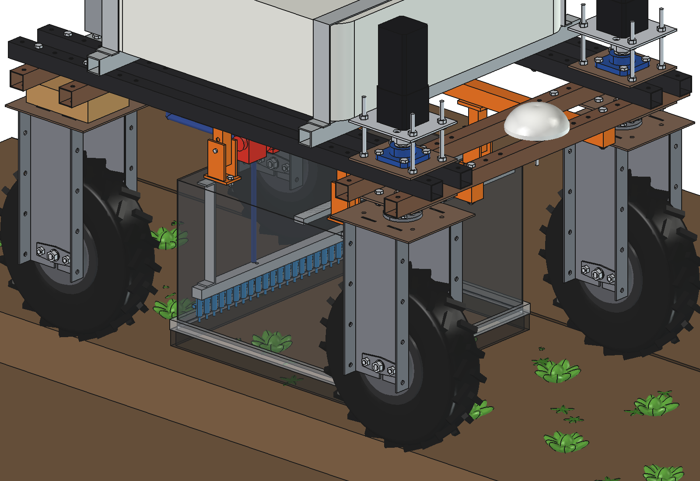
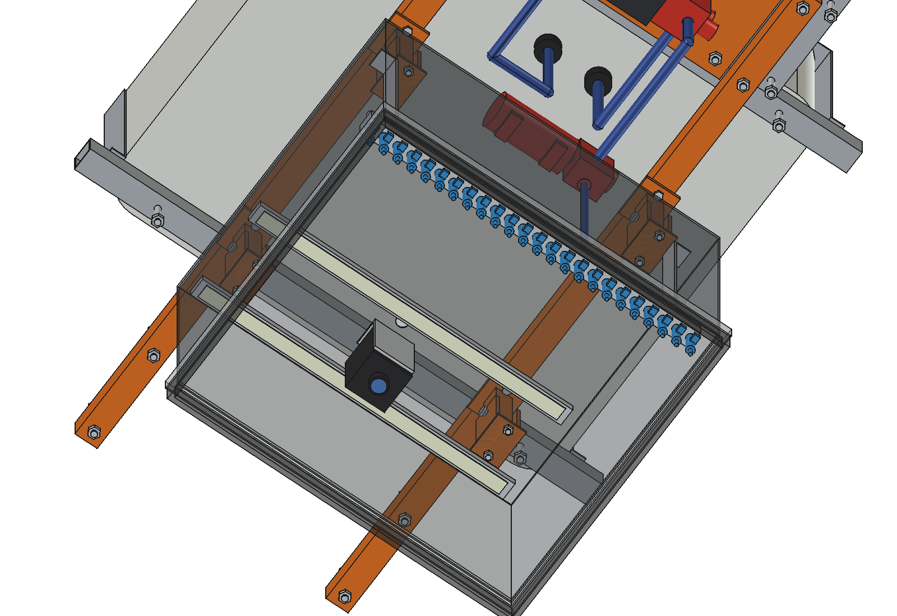
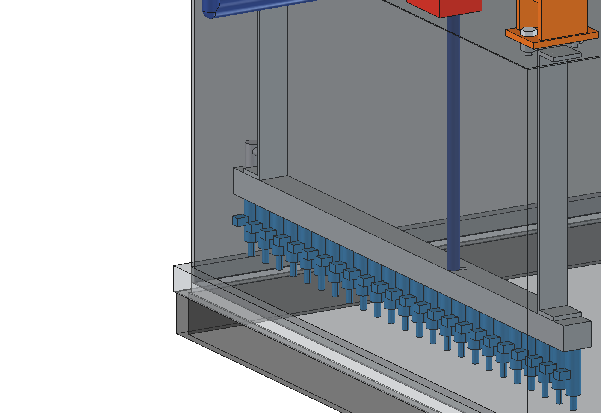
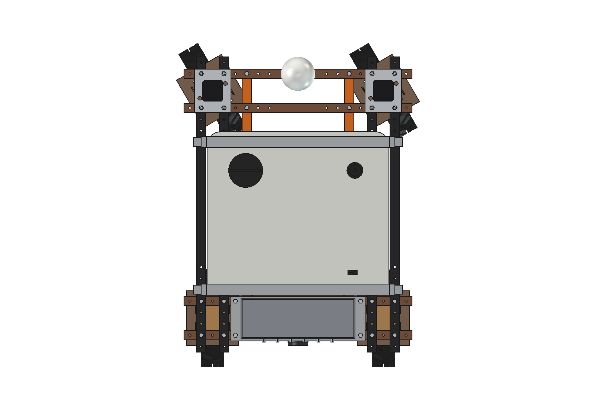
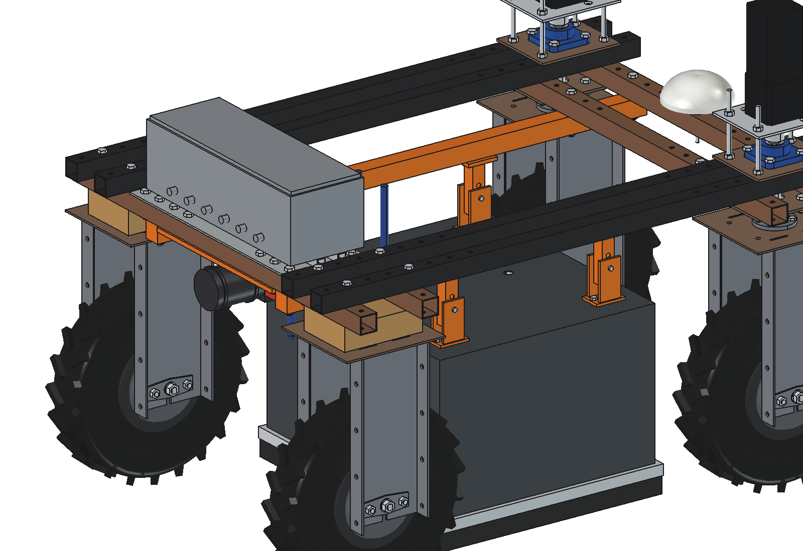

# Drop-on-demand boom (simple)

Hooded drop-on-demand weeder for the Bruut OpenAgbot (standard robot), for row crops on beds. A dark aluminium hood
hangs under the belly of the robot, between the wheels, over one bed of 0.6 m. Inside: a camera looking straight down
at the front half, 2 LED bars (constant light, day and night), and at the rear a rail of **24 solenoid micro-injectors
at 25 mm pitch** that fire single coarse drops of **5 ul** straight down onto every weed the camera found. The drops
fall 80 mm inside a closed hood: no drift, and ~3 l/ha instead of ~200 l/ha for a broadcast pass.

Tank (120 l), pump, filter, regulator, hoses and the control box are the spot sprayer's
([spotspray unit/boom](../../spotspray%20unit/boom/README.md), imported, not copied); its folding boom and camera mast
are not used. Swap: take the boom and mast off the spot sprayer, bolt the 2 belly rails on.

<p align="center">
  
</p>

| Side | Front, over the bed |
| --- | --- |
|  |  |
|  |  |
|  |  |



## Build

- **Belly rails**: 2 x square tube 40 x 40 x 3 along y under the lower beams at x +-225 (grid holes), 4 x M10 each.
  At the rear the bolts also go through the control-box base plate of the spot sprayer (4 extra holes). Inside the
  sub plate (x +-200) and the wheel brackets / wooden blocks (from x 261).
- **Hanger posts**: 4 x square tube 30 x 30 x 2 on 8 mm foot plates (2 x M8 into rivet nuts in the rail).
  The hood hangs on them with M10 cross-pins through U-brackets: **3 height steps** of 25 mm (skirt 35 / 60 / 85 mm
  above the ground, injector tips 55 / 80 / 105).
- **Hood**: aluminium 2 mm, 600 x 524 x 360 mm, open at the bottom, a nylon brush strip (50 mm) in a U-holder round the
  skirt. It stays inside the steering sweep of the front tyres (29 mm at 30 degrees) and in front of the rear tyres.
- **Camera**: global-shutter 5 MP (as on the spot sprayer) with f = 3.5 mm, straight down at y 175, lens 293 mm above
  the ground: 707 x 591 mm image, 0.29 mm/px. LED bars 2 x 24 W under the top sheet.
- **Injector rail**: aluminium manifold 590 x 30 x 25 (bore O10) on 2 brackets, 24 micro-injectors (O14 body,
  O6 nozzle, 0.3 mm orifice, 12 V peak-and-hold), bleed valve at the left end.
- **Liquid**: spot-sprayer pump and regulator (3 bar) -> hose to a low-pressure regulator (0.5 bar) and an
  accumulator on the hood top -> short hose through the top sheet into the manifold.
- **Control box** (spot sprayer's): vision computer, now with a 24-channel injector driver.

Mass ~74 kg empty (hood 17 kg, mount 29 kg, tank group 21 kg, plumbing 6 kg). Size 920 x 1215 x 1074 mm (x, y, z;
the width is the tank).

## Key figures (`ddb_calc.report()`)

| | |
| --- | --- |
| Camera | 707 x 591 mm on the ground, 0.29 mm/px, blur 0.05 mm at 0.1 ms exposure; injector line out of the image |
| Time from first sight to the injector line | 0.93 s at 0.5 m/s (needed 0.17 s: 2 frames + 60 ms detection + driver); max ~2.7 m/s |
| Drop | O2.1 mm (5 ul), falls 80 mm in 62 ms, hits at 1.6 m/s (Weber 76: no splash); fired 31 mm early |
| Aim | +-2.5 mm along (odometry 0.5 % over 465 mm, jitter, pixels), +-12.5 mm across (pitch): weeds from ~25 mm |
| Dose | 1 / 3 / 7 drops on a 15 / 43 / 70 mm weed; 15 ul per average weed |
| Per hectare (20 weeds/m2) | ~3 l/ha against 200 l/ha broadcast: **98.5 % less**; 30 l in the tank = ~10 ha |
| Firing | 20 Hz per injector at 0.5 m/s (25 mm drop grid), max ~200 Hz; peak 0.14 l/min with all 24 firing (pump 9.5) |
| Power | ~430 W (drive 300, computer 40, LEDs 48, pump 28, injectors 14) |
| Capacity | 0.6 m x 0.5 m/s: 0.08 ha/h (1350 m of bed per hour), ~4.4 h, ~0.36 ha / 6 km of bed per charge |
| Axle load front / rear | 133 / 132 kg with 30 l; 175 / 180 kg with 120 l (max 90 kg per wheel) |

Why and how these come out: see [RATIONALE.md](RATIONALE.md), including the list *Estimated, not measured*.

## Animation

| Animation | Shows |
| --- | --- |
| `previews/animation_drop_on_demand.gif` (generated, not in git; also in `animations/`) | the robot drives 6.4 m over a lettuce bed at 0.5 m/s; the hood is see-through. Weeds get an orange ring when the camera has confirmed them, the injectors above them fire short jets and the weed gets blue wet dots; drops within 40 mm of a lettuce are not fired, a weed with only such drops is left for the in-row weeder (red ring). Panel: the 24 injectors from behind. 31 weeds, 86 drops, 0.43 ml against 77 ml broadcast. |

```python
import animate_ddb
animate_ddb.build(); animate_ddb.play()
animate_ddb.render_all(r"C:\temp\ddb_frames")
import make_gif_ddb; make_gif_ddb.main(r"C:\temp\ddb_frames", r"previews\animation_drop_on_demand.gif")
```

## Files

| File | Contents |
| --- | --- |
| `ddb_params.py` | all dimensions; robot interface and the spot-sprayer parts via `ssp_params`; field and work parameters; masses from the model |
| `ddb_parts.py` | one function per part, robot coordinates, middle height step; lettuce, weed, drop, bed for the renders |
| `build_ddb.py` | model tree (tank from build_ssp), `set_height(dz)`, checks (`check_interference`, `check_holes`, `check_poses`, `clearance`, `ground_contact`), mass, `render_all()`, STEP |
| `ddb_calc.py` | camera, latency, drop flight and splash, aim, dose per weed / ha, firing and flow, power, capacity, axle loads |
| `ddb_field.py` | process model: bed, lettuce, weeds, drive, detection, drop plan with crop keep-out, liquid used |
| `animate_ddb.py`, `make_gif_ddb.py` | animation on the robot, frames to GIF with caption and injector panel |
| `run_in_freecad.py` | reload, build, print the key figures |
| `Drop_On_Demand_Boom.FCStd`, `Drop_On_Demand_Boom.step` | generated model (robot hidden in the FCStd) |
| `previews/` | images |

## Use

```python
exec(open(r"F:\veldrobot\aanbouwdelen\drop on demand boom\simple\run_in_freecad.py").read())
import build_ddb
build_ddb.check_interference()  # []
build_ddb.check_holes()         # {}
build_ddb.check_poses()         # height -25 / 0 / 25 x steering -30 / 0 / 30: {}
build_ddb.clearance()           # 28.9 mm, hood to the front tyre at 30 degrees steering
```
