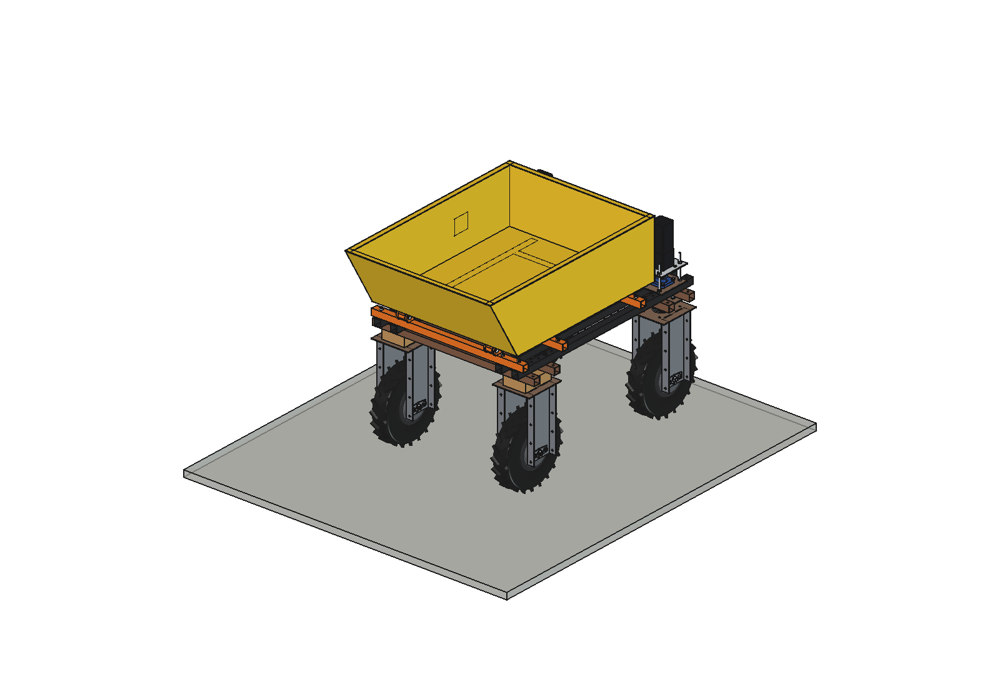
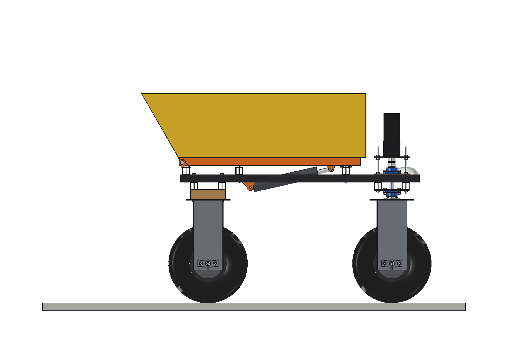
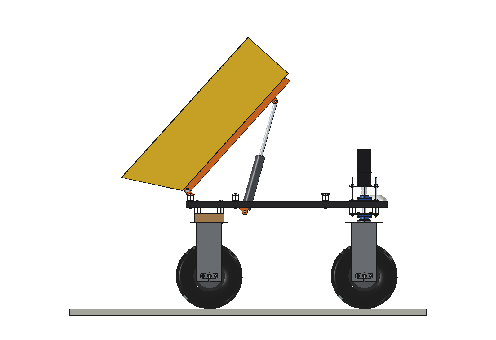
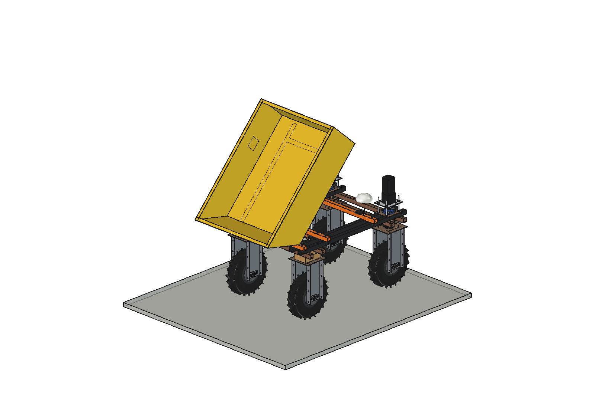
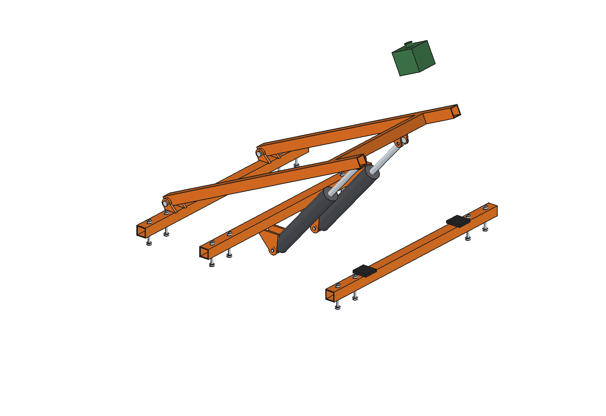

# Dumper barrow (simple)

Tipping skip on the upper beams of the Bruut OpenAgbot (standard robot): a 353 l steel bin with a sloping rear lip on a
subframe that hinges at the rear end of the robot. Two 24 V actuators tip it backwards to 48 degrees and the load slides
out behind the rear wheels. For soil, gravel, compost, wood chips, weeds and prunings; follows a person or an RTK route.

  

| Side, down | Side, tipped 48 degrees |
| --- | --- |
|  |  |
|  |  |

## Build

- **Mount**: 3 bearers 40 x 40 x 3 across the upper beams (front with rubber rest pads, middle with the actuator lugs,
  rear with the hinge lugs), 12 x M10.
- **Subframe**: 2 rails 40 x 40 x 3 at x +-270 with hinge bosses (pins O20), a cross tube with the actuator rod lugs.
- **Bin**: 2 mm steel, 900 x 1020 floor, 350 high, rear lip at 30 degrees, rim angle 30 x 30; a stop / go / follow /
  tip button box on the left wall.
- **Tipping**: 2 x 24 V 3000 N actuators, stroke 300 (451..740 used), 0..48 degrees.

Mass 72 kg (tipping part 51 kg). No interference down and over the tip range; 45 mm from the steering stacks.

## Key figures (`dmb_calc.report()`)

| | Wet soil / gravel | Compost | Wood chips | Green waste |
| --- | --- | --- | --- | --- |
| Load | 150 kg (~100 l) | 150 kg (250 l) | 106 kg (full) | 53 kg (full) |
| Front axle share | 39 % | 39 % | 40 % | 42 % |
| Actuator force (each) | 2.1 kN | 2.1 kN | 1.6 kN | 1.1 kN |
| cg at full tip (rear axle at y -500) | y -221 | y -243 | y -229 | y -180 |
| 10 % slope margin | 1.26 | 1.26 | 1.42 | 1.69 |
| kg per hour (100 m, 5 min loading) | 950 | 950 | 671 | 336 |

Tip time ~36 s, ~13 Wh per trip.

Why and how these come out: see [RATIONALE.md](RATIONALE.md), including the list *Estimated, not measured*.

## Files

| File | Contents |
| --- | --- |
| `dmb_params.py` | all dimensions, robot interface, tipping kinematics (`rotate`, `act_length`), bin volume, loads |
| `dmb_parts.py` | one function per part, robot coordinates (tipping part drawn down) |
| `build_dmb.py` | model tree, `set_pose(deg)`, checks (`check_interference`, `check_poses`, `clearance`), mass, `render_all()`, STEP |
| `dmb_calc.py` | load per material, axle loads, actuator force and tip stability, slope, kg per hour |
| `run_in_freecad.py` | reload, build, print the key figures |
| `Dumper_Barrow.FCStd`, `Dumper_Barrow.step` | generated model (robot hidden in the FCStd) |
| `previews/` | images |
