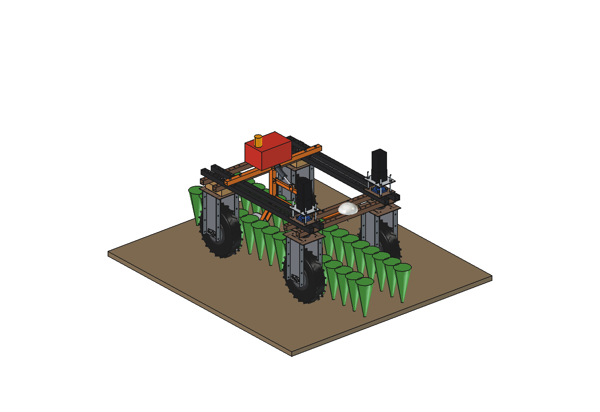
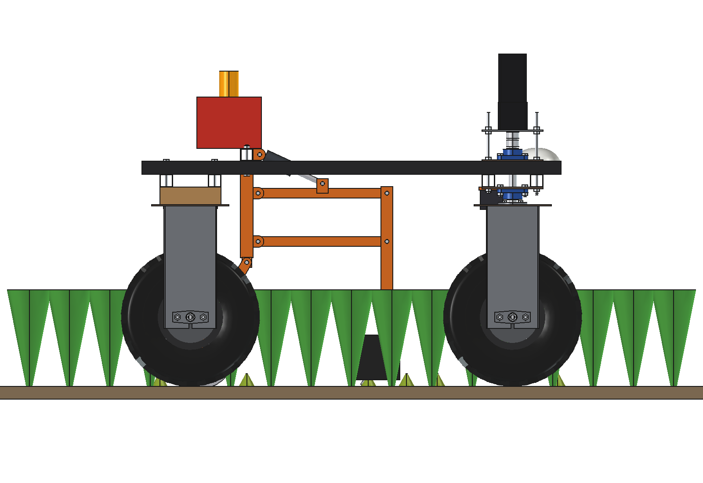
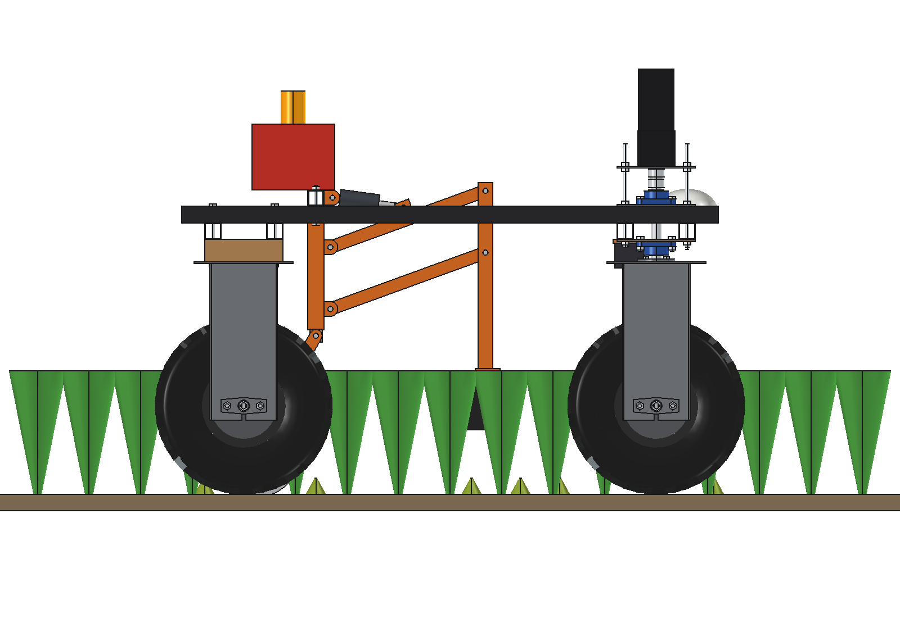
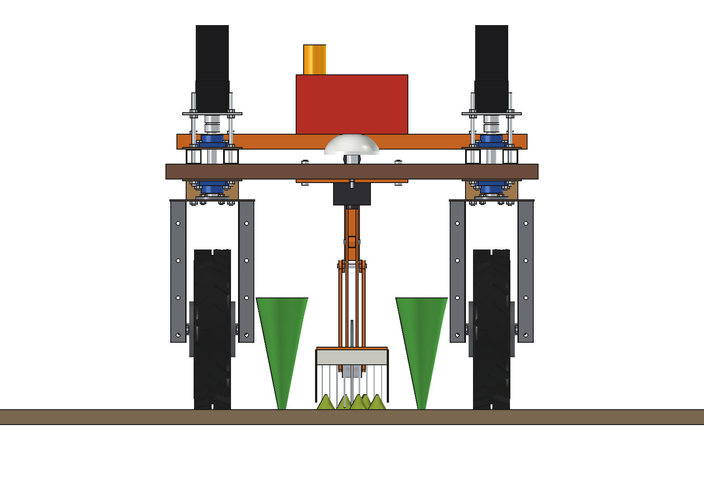
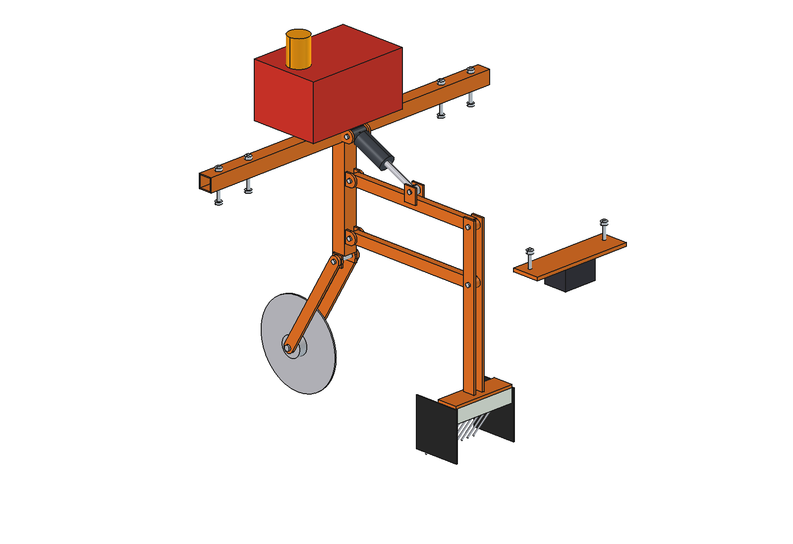

# Electric weeder (simple)

Spot electric weed control in the free middle inter-row of a 2-row bed (rows 375 apart) under the Bruut OpenAgbot
(standard robot). A camera under the front beam finds weeds in the band; when a weed comes under the applicator, a
5 kV generator fed from the 48 V battery switches on a comb of spring-steel fingers that drags over the band. The
current runs through the weed and its root into the soil and back through a coulter disc. A parallel-arm lift takes
the comb off the ground on headlands and roads; HV is only on while a weed is under the comb.

<p align="center">
  
</p>

| Work (fingers on the soil) | Lifted 20 degrees (comb 137 mm up) |
| --- | --- |
|  |  |
|  |  |

## Build

- **Bearer** 40 x 40 x 3 across the 4 upper beams at y -325 (beam holes); **HV box** (48 V -> 5 kV generator, contactor,
  insulation monitor) and a warning beacon on top.
- **Post** 40 x 40 x 3 at x 0 under the bearer down to z 400, with lugs for the 2 arms, the actuator and the coulter arm.
- **Parallel lift**: upper and lower arm 20 x 30 x 2, 400 long, pins O12; the carrier (2 plates 6 mm and a foot plate)
  stays vertical. 24 V actuator (stroke 55) from lugs on the bearer to a lug on the upper arm.
- **Applicator**: PE holder 190 x 60 x 40 (insulation), 9 spring-steel fingers O4 dragging back over a 180 mm band,
  rubber curtains on both sides.
- **Earth return**: coulter disc O250 x 4 at x 0 behind the post, 10 mm in the soil, on 2 arm plates 8 mm.
- **Camera** under the inner front lower beam at x 0 (plate with 2 x M10; the GNSS stud is further forward).

Mass ~27 kg. Size 940 x 1080 x 989 mm. Everything below 400 mm stays out of the crop rows (`check_rows()`).

## Key figures (`elw_calc.report()`)

| | |
| --- | --- |
| Generator | 5 kV, 3 kW while a weed is under the comb |
| Contact at 0.2 m/s | 0.6 s per weed, up to 1.8 kJ |
| Highest speed per weed stage | cotyledon 0.72 m/s, 4-leaf 0.24 m/s, rosette 50 mm 0.09 m/s |
| Spot mode, 4-leaf weeds, 5 / 20 / 50 per m2 of band | 590 / 180 / 75 m2 of band per charge (0.25 / 0.07 / 0.03 ha of field); HV on 9 / 36 / 90 % of the time |
| Weeds per charge | ~3000-3800 (4-leaf) |
| Broadcast (HV always on, 60 kWh/ha of band) | 0.13 ha of field per charge, for comparison |
| Work rate | 104 m2 of band per hour, 0.043 ha of field per hour at 0.2 m/s |
| Lift | 137 mm at 20 degrees; actuator 174-222 mm in a 170 + 55 stroke |

Spot electric weeding pays off where weeds are few and the crop is sensitive (organic vegetables, the inter-row in the
bed), and early: cotyledon weeds take a third of the energy and allow 0.7 m/s.

Why and how these come out: see [RATIONALE.md](RATIONALE.md), including the list *Estimated, not measured*.

## Files

| File | Contents |
| --- | --- |
| `elw_params.py` | all dimensions, robot interface, crop rows, lift geometry (`act_length`), electrical and work parameters |
| `elw_parts.py` | one function per part, robot coordinates, work pose; crop and weeds for the images, row space for the check |
| `build_elw.py` | model tree (Mount, Return, Lift with UpperArm / LowerArm / Carrier, Actuator), `set_pose(lift)`, checks (`check_interference`, `check_holes`, `check_poses`, `check_rows`, `check_steering`, `ground_contact`, `clearance`), mass, `render_all()`, STEP |
| `elw_calc.py` | contact time and energy per weed, speed per weed stage, spot and broadcast energy per charge, work rate, actuator |
| `run_in_freecad.py` | reload, build, print the key figures |
| `Electric_Weeder.FCStd`, `Electric_Weeder.step` | generated model (robot hidden in the FCStd) |
| `previews/` | images |

## Use

```python
exec(open(r"F:\veldrobot\aanbouwdelen\electric weeder\simple\run_in_freecad.py").read())
import build_elw
build_elw.set_pose(20)          # lifted
build_elw.check_poses()         # {} over lift -4..20
build_elw.check_rows()          # {}
```

No animation yet (simple variant).

**Safety**: high voltage near people and animals. The control switches HV only on a detected weed with the comb down,
stops it when the robot stops or a person is detected (camera / lidar), and the beacon shows when HV is armed. Follow
the rules for electric weeding machines in your country before use.
