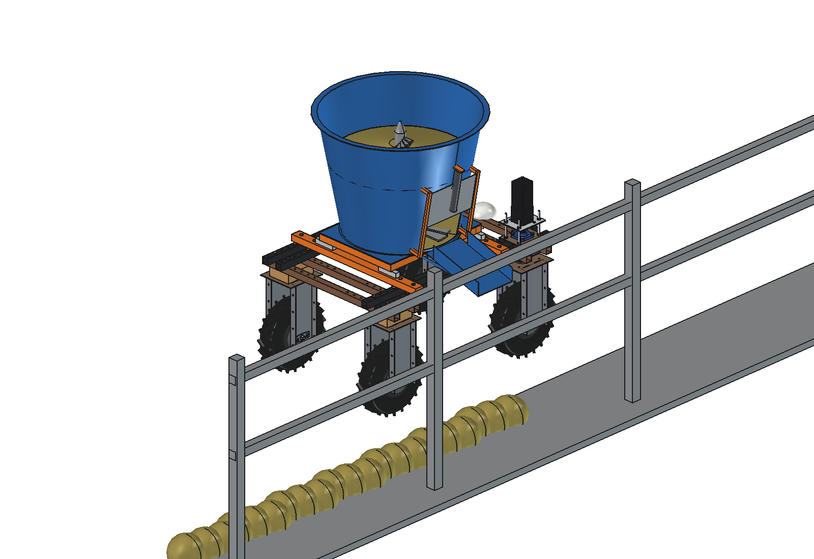
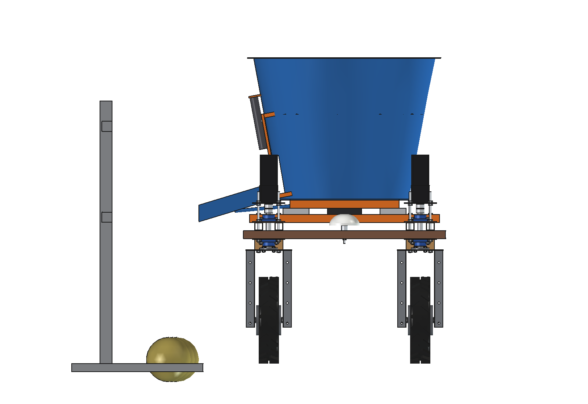
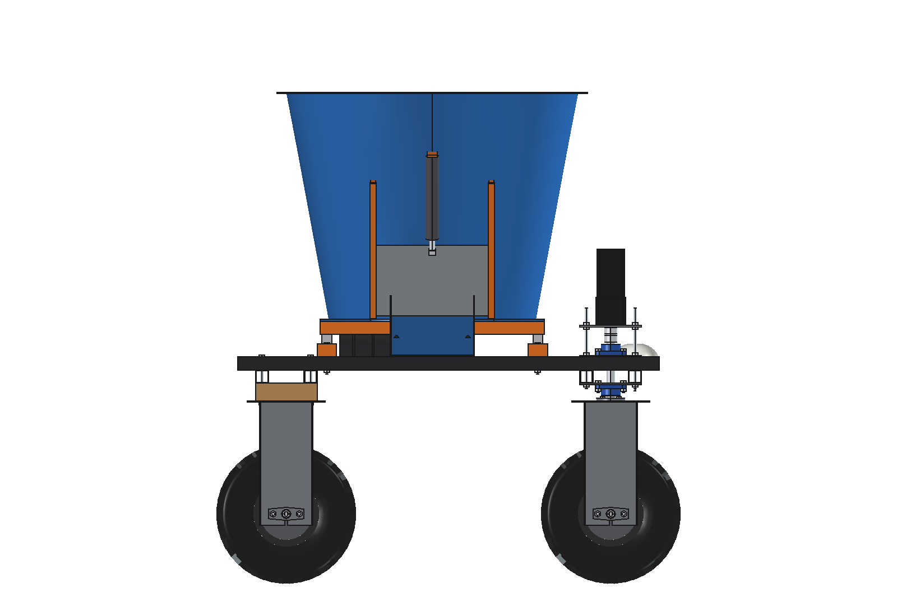
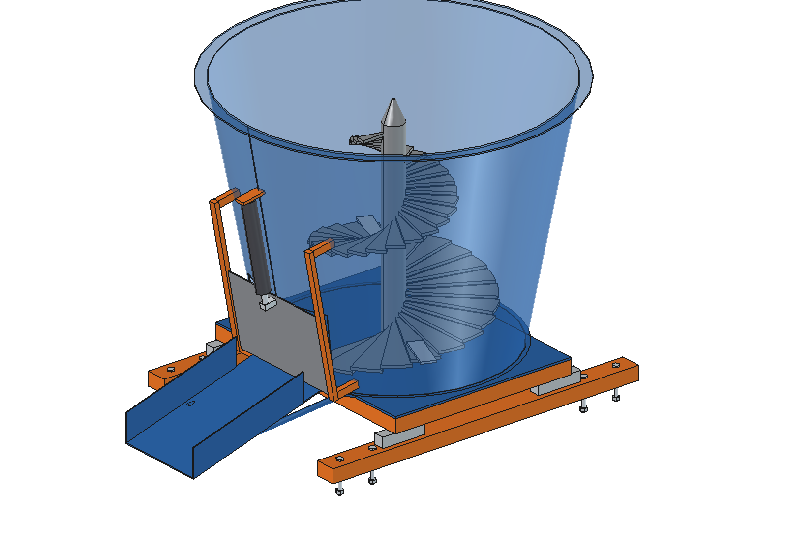
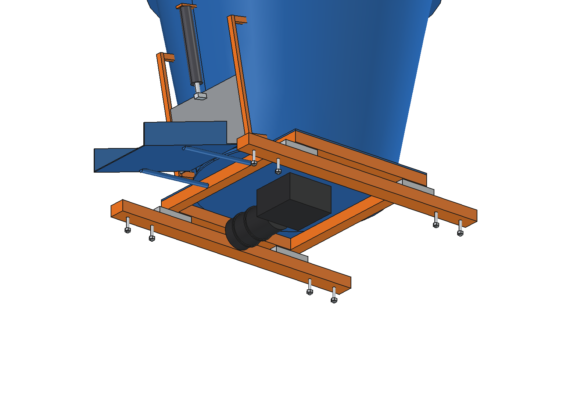

# Feed mixing and distribution wagon (simple)

A small vertical mixer on the Bruut OpenAgbot (standard robot): loaded at a feed kitchen (by hand or from a hopper),
weighed, mixed and laid along the feed fence several times a day. Sized for calves, young stock and small groups,
not for the whole herd.

- **Frame**: 2 cross tubes 60 x 40 x 3 on the upper beams (y -375 and 275, grid holes, 2 x M10 per beam).
- **Weighing**: 4 single-point load cells (300 kg each) at x +-240 between the cross tubes and a square sub-frame
  40 x 40 with a 6 mm floor; a junction box with the weighing indicator.
- **Bin**: cone O640 -> O900, 700 mm high, 2 mm steel, 0.33 m3, centred at y -50 (clear of the steering stacks and
  the GNSS dome), with a top rim.
- **Auger**: shaft O60 with a conical flight of 2 turns (r 290 -> 90, 8 mm) and 2 knives, 30 rpm; a planetary
  gearbox (i = 100) under the floor and a 48 V 2 kW motor lying along y under the floor.
- **Discharge**: a door on the right that slides up along the sloping cone wall on 2 guides (24 V actuator), and a
  chute out to x 720: the robot drives along the feed fence with its right side to it.

<p align="center">
  
</p>

| Front | Side |
| --- | --- |
|  |  |
|  |  |

## Key figures (`fmw_calc.report()`)

| | |
| --- | --- |
| Bin | 0.33 m3, ~92 kg of TMR per batch (85 % full, 330 kg/m3) |
| Mixing | ~1.4 kW at the auger (5 kW/m3), 445 Nm at 30 rpm; motor 78 % of rated |
| Batch | 6 min mixing, 3 min discharge, 6 min driving: ~250 Wh |
| Per charge | ~6.4 batches, ~590 kg of feed: ~74 calves (8 kg) or ~13 cows (45 kg) per day |
| Mass | 136 kg (bin, auger and drive 123 kg on the load cells) |
| Full | 390 kg, front share 51 %, 99 kg per wheel at most, cg 811 mm high, side tip 24 degrees |
| Load cells | 215 kg weighed: 54 kg per cell, factor 2.8 at a 2 g bump |

Checks: `check_interference()` [], `check_poses()` {} (door open, auger angles, front wheels at +-30 degrees),
`check_holes()` [] (8 cross-tube bolts in upper-beam grid holes). See [RATIONALE.md](RATIONALE.md), including the
list *Estimated, not measured*.

## Usage

```python
exec(open(r"F:\veldrobot\aanbouwdelen\feed mixer wagon\simple\run_in_freecad.py").read())
import build_fmw
build_fmw.set_door(1.0); build_fmw.set_auger(30)
build_fmw.check_interference(); build_fmw.check_poses(); build_fmw.check_holes()
build_fmw.render_all()
```

```bash
"C:/Program Files/FreeCAD 1.1/bin/python.exe" -B fmw_calc.py
```

## Files

| File | Contents |
| --- | --- |
| `fmw_params.py` | frame, load cells, bin, auger, drive, door and chute, operation |
| `fmw_parts.py` | one function per part; door parts drawn upright and tilted onto the cone wall; feed and fence for the renders |
| `build_fmw.py` | model tree (door and auger as sub-Parts), checks, mass, `render_all()`, STEP |
| `fmw_calc.py` | volume and load, mixing power and torque, energy per batch, animals per charge, axle loads, load cells |
| `run_in_freecad.py` | reload, build, print the key figures |
| `Feed_Mixer_Wagon.FCStd`, `Feed_Mixer_Wagon.step` | generated model (robot hidden in the FCStd) |
| `previews/` | images |
