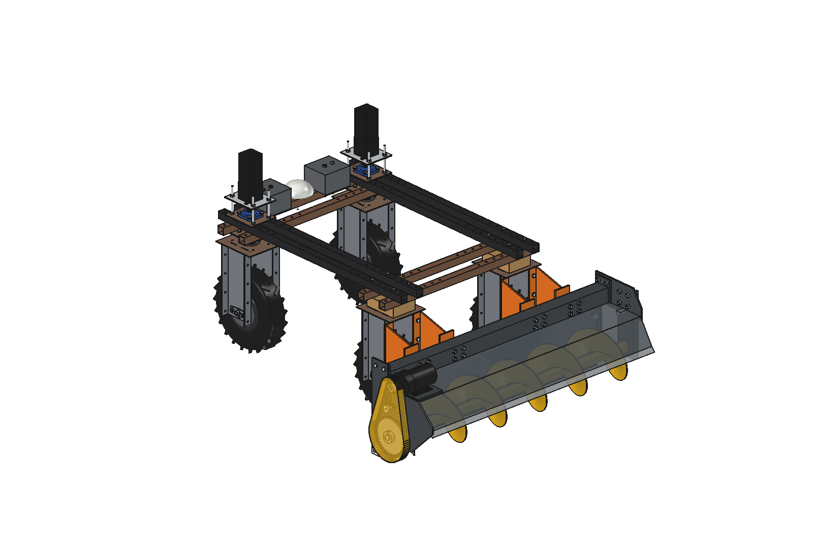
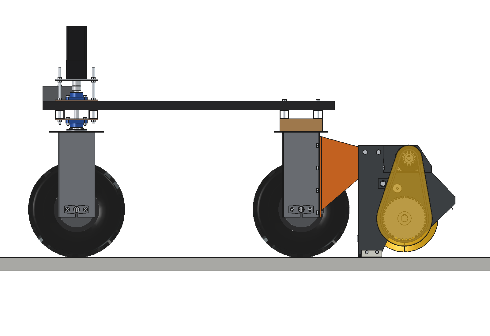
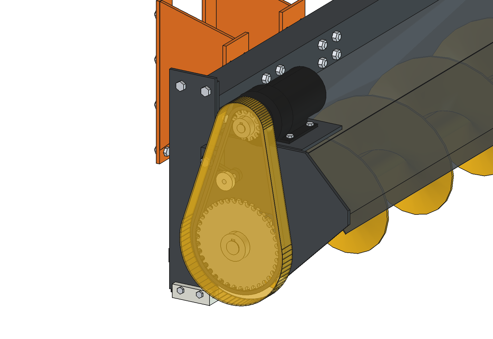
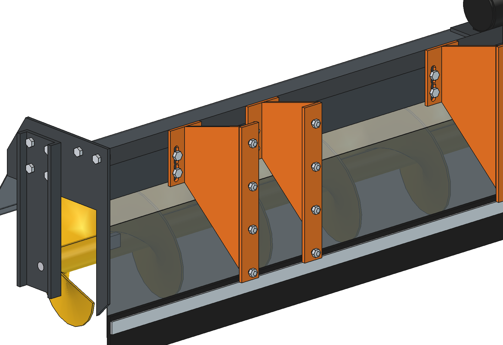
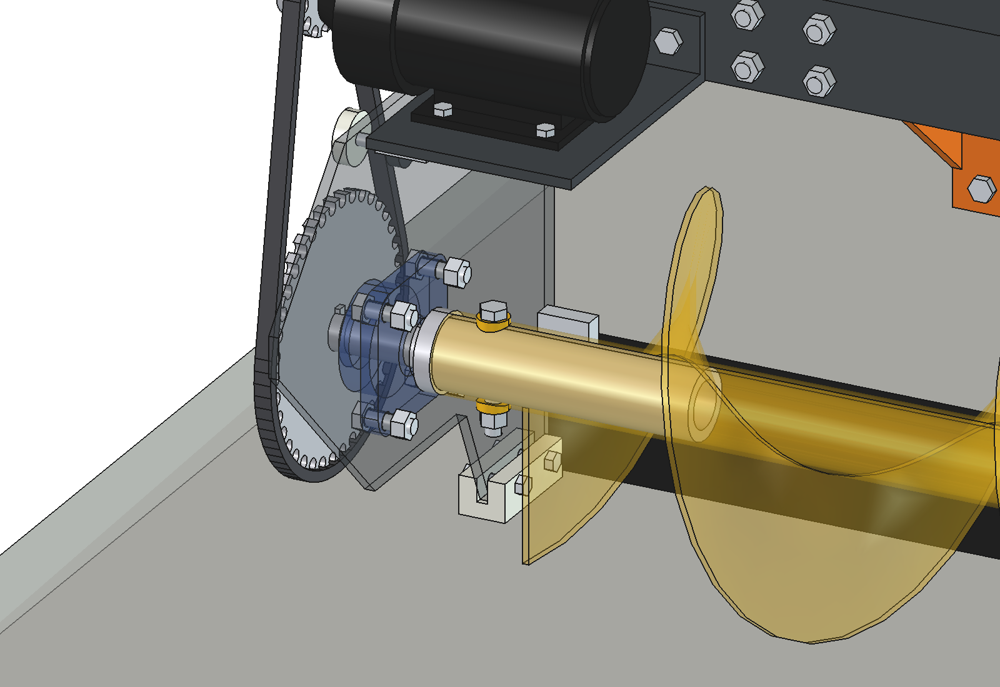
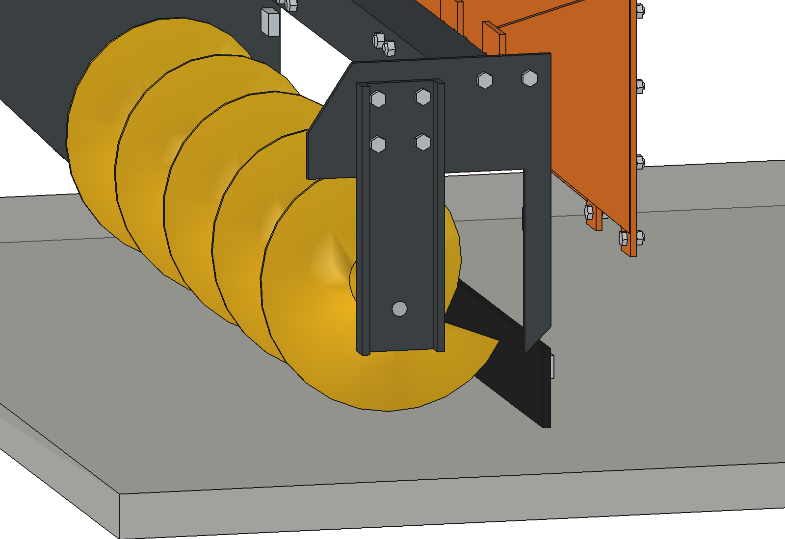

# Feed pusher auger V3: design rationale

18 October 2026 (V3; V2 from 16 October, V1 from 5 October 2026). Model: `Feed_Pusher_Auger_V3.FCStd` (FreeCAD 1.1,
generated with `build_fpa.py`). The figures come from the model, from `fpa_calc.py` and from the animation
(`animate_fpa.summary()`). Where something is assumed or estimated, this is stated.

---

## 0. V3: the existing auger

V3 builds the V2 frame around the auger that is already in the shed, so that it does not have to be made. Its
dimensions are measured (`../parts_list/auger_specs.txt`); everything else in V2 stays, and § 1 – 7 below still apply
(text written for V2; where V2 figures differ, this section takes precedence).

| | V2 | V3 (existing auger) |
| --- | --- | --- |
| Flight | Ø320 | **Ø300** (pitch 260, 5 mm estimated) |
| Core tube | 60.3 × 4 with a welded bearing housing | **Ø60 × 3, ID 54, 1420 long** (x −700 … 720) |
| Drive bush spigot | Ø52 | **Ø53.7** (0.3 mm play), collar Ø60 |
| Shear bolt | M6 4.6 at x −640 | **M12** at 35 mm from the tube end (x −665), between two welded rings, lock nut |
| Free end | Ø25 pin in 2 × 6205-2RS | **Ø20 pin** (35 out of the strap) in a **plastic ring** Ø54 / Ø20 × 30 |
| Floor gap flight | 15 mm | **25 mm** (axis kept at z 175) |
| Mass rotor / pusher | 29.4 / 116.1 kg | **25.1 / 111.3 kg** |

Choices:

- **Axis height kept at z 175.** Lowering it by 10 mm would bring the floor gap back to 15 mm, but hood, side plates,
  glide shoe and strap are all drawn around z 175. With 25 mm a thin layer of feed stays behind; if that is a problem,
  lower `auger_z` and check hood, flap and skid again.
- **Tube shifted 5 mm to the right** (−700 … 720 instead of −705 … 715): the end of the tube is then 8 mm from the
  hanging strap, so the 35 mm pin runs 27 mm into the 30 mm plastic ring. The collar of the drive bush becomes
  13 mm long (−713 … −700).
- **Welded rings for the shear bolt:** the bolt head and the lock nut sit on a flat face instead of on the round tube,
  as on the old auger (photo). Ø24, flat face 35 mm from the axis. The rings and the bolt turn with the rotor; the
  check in 8 rotor positions (every 45°) shows no contact with the frame.
- **Plastic ring as plain bearing:** the pin stands still, the ring turns around it. Load (own weight + half the
  circumferential force at the starting torque) 1.2 kN: pressure 2.2 MPa on 20 × 27 mm, sliding speed 0.10 m/s,
  pv 0.22 MPa·m/s. That is within what PE-UHMW can carry dry (roughly 0.1 – 0.2 MPa·m/s continuous, more for short
  peaks), but at the limit: in normal running (14.7 Nm at 12 kg of feed) the load is much lower. Bending stress in the
  Ø20 pin 33 MPa.
- **Shear bolt M12 does not protect any more.** In double shear at r 27 mm an M12 4.6 breaks at about **1090 Nm**,
  5.6 × the starting torque (196 Nm). Before that, the Ø30 journal would see 257 MPa torsion (at the keyway) and the
  chain only 2 × safety. So the M12 is a fixing, not a shear bolt. Protection then has to come from the motor current
  limit in the controller (§ 4.8). Alternative: a turned sleeve in the Ø12.4 hole with an M6 4.6 (breaks at ~250 Nm,
  as in V2).

---

## 1. Assignment

- Develop the advanced design further.
- Replace the round, rolled trough with a square folded sheet-metal hood, as in the simple version.
- Make the mounting fit on the wheel modules, through the four holes.
- Put the motor on its feet on the square plate.
- Put the feed pusher on the agbot, on the side of the fixed motors. The rotating steering mechanisms are then at the
  back.
- Animate the feed pushing: pushing the feed sideways, the forces on the auger and the reaction of the robot.

V2 (16 October 2026), two improvements on V1:

- No shaft through the auger. On the side opposite the motor a suspension: a plate with a welded-on pin in the
  middle, bolted to the side plate (like the old suspension in the shed).
- On the motor side a bearing with a bush through it: the sprocket teeth on the outside, and on the inside a piece
  that runs 20 cm into the auger, with a shear bolt.

## 2. What has changed compared with the first advanced design

| Was | Now | Why |
| --- | --- | --- |
| Round hood (rolled, 3 mm) | **One 2 mm sheet with 4 bends** (press brake), blank 1440 × 774 mm | No rolling work. The bends make the sheet stiff enough. Thinner is possible because the hood no longer carries anything (§ 4.2) |
| Separate motor tower on the side plate | **Foot-mounted gearmotor (B3)** on an 8 mm motor plate on top of the hood, with an upstanding edge against the beam | The chain pull goes through the beam into the frame. The motor sits high and dry, out of the feed |
| Arms with a mounting plate on an assumed cross beam | **4 arms on the wheel modules**, each with **4 × M10 through the 4 holes** in the rear flange of the wheel bracket's side plate | Those holes are already in every wheel bracket. Nothing has to be drilled in the robot frame |
| Continuous Ø30 shaft | **V2: drive bush on the left** (Ø30 journal, Ø52 spigot 200 mm into the core tube), **pin plate on the right** with a fixed pin and bearings inside the auger | No shaft through the auger. Pulling the pin plate (4 nuts) frees the right end (§ 4.5) |
| Two identical side plates | **Bearing plate with an open discharge on the right** | The feed must be able to leave on the fence side |
| M10 pins | **V2: one M6 4.6 shear bolt** through core tube and drive bush spigot | Protection against jamming (§ 5.3) |
| None | **Chain tensioner** (arm + nylon wheel on a rubber torsion element) | The centre distance is fixed by the foot-mounted motor |
| None | **Counterweight 2 × 20 kg** at the front | Without a counterweight too little load remains on the steered wheels (§ 4.7) |

## 3. The design in brief

1. **Auger:** Ø320 flight, pitch 260, 5 mm, on a 60.3 × 4 core tube.
   - Right-handed.
   - Turns at 95 rpm (V2, 12T → 38T), with the front going up. The feed is lifted instead of being pressed under the flight, and goes to +x (the feed fence).
2. **Bearings:** UCF206 on the outside of the 8 mm side plate (left, fixed side, with the drive bush). Right: a hanging
   strap on the outside of the 8 mm end plate, its Ø25 pin in 2 × 6205-2RS inside the end of the auger (§ 4.5).
3. **Hood:** 2 mm, 4 bends.
   - On the robot side a 10 mm rubber scraper flap hangs down to 5 mm above the floor.
   - On the left there is a PE glide shoe as protection.
4. **Beam:** 80 × 80 × 3 tube on the hood. Welded end plates with 2 × M12 into the side plate and the right end plate; the nuts are accessible above the beam.
5. **Drive (V2):** 800 W gearmotor with a foot (AliExpress, drawing in `parts/800 watt motor`), 300 rpm assumed.
   - The motor stands with 4 × M8 on an 8 mm motor plate on top of the hood. That plate is fixed to the beam with 2 × M10.
   - Chain 10B-1 (5/8"), 12T → 38T (i = 3.17, chosen for torque), with tensioner. Both sprockets keyed: motor Ø19 h6 with key 6 × 6 × 25, drive bush Ø30 with key 8 × 7 × 30.
   - 2 mm chain guard.
6. **Mounting:** 4 arms of 8 mm, orange in the images. Each arm has:
   - an adapter plate with 4 × M10 on the rear flange of a wheel bracket;
   - a gusset;
   - an end plate with 4 × M12 through the beam, in 30 mm slotted holes. These let you adjust the height by ±15 mm when the glide shoe and the flap wear.
7. **Counterweight:** 2 blocks of 20 kg on the front lower beam, with M10 through the hole grid.

| Characteristic | Value |
| --- | --- |
| Working width | 1440 mm between the plates, flight 1420 mm |
| Feed pusher dimensions | 1600 × 619 × 598 mm (w × l × h), behind the robot: y −566 to −1185 |
| Clearance | hood 48 mm, flap 59 mm and arms 17 mm to the rear tires; flight 15 mm above the floor |
| Mass (model) | 118 kg feed pusher (rotor 28 kg) + 40 kg counterweight |
| Auger | 95 rpm, feed 0.27 m/s along the auger (theoretical 0.41 m/s) |
| Capacity | 13 kg per m of auger, 3.5 kg/s (13 t/h). At 0.30 m/s driving that is up to 12 kg of feed per m of feeding alley |
| Auger torque | 78 Nm nominal, 196 Nm peak at start-up (800 W, 300 rpm assumed). The shear bolt breaks at 252 Nm |
| Power | 160 W electrical at 5 kg of feed in the auger, 520 W at 20 kg. Maximum 25 A in the animation |

## 4. Design choices

### 4.1 On the side of the fixed wheel motors

The rear wheels are fixed and have no steering stack. There is therefore room behind the wheel brackets, and the
brackets have a flange with holes there. The front wheels have a steering head with a stepper motor, bearings and
threaded rods at (±50, ±75). That head and the steering sweep of ~30° must stay clear (AGENTS.md).

When pushing feed the robot drives with the auger first (towards −y) and the front wheels steer from behind, like a
forklift. The advantage of steering at the back is that the auger stays close to the fence. A small steering
deflection at the back hardly rotates the auger relative to the fence.

### 4.2 Folded hood instead of a round trough

- **Sheet:** one sheet of 1440 × 774 mm, 2 mm thick, with 4 bends. The centre line runs from the rear wall (robot side,
  60 to 315 mm high) via an inclined bend to the top plate at 370 mm. Then it slopes down to a lip at
  217 mm, in front of the auger.
- **Clearances:** between flight and hood there is 33 mm or more everywhere. The sloping front bend is 200 mm from the
  centre; the feed rolls against it there and back into the auger.
- **Why 2 mm is enough:** the hood carries nothing. The beam carries the auger via the end plates. The motor plate is
  supported by an upstanding edge against the beam. The hood only holds back the feed and is attached to the plates with
  folded angles. That saves 9 kg compared with 3 mm.

### 4.3 Mounting on the wheel modules, through the four holes

Each side plate of a wheel bracket has an outward-folded 40 × 4 mm flange at the front and the back. In that flange are
**4 M10 holes (Ø10.4) at 100 mm pitch**, at 200, 300, 400 and 500 mm above the ground. The rear flanges of the two
rear wheel modules are at y = −582. That makes 4: inside and outside each rear wheel, at
x = ±283 and ±467.

One arm goes on each flange:
- **Adapter plate:** 50 × 360 × 8 mm, with the 4 M10 × 35 bolts and the nuts on the inside of the flange.
- **Gusset:** 8 mm, on the side of the plate facing away from the tire. 17 mm of clearance to the tire remains.
- **End plate:** 90 × 129 × 8 mm, with 4 × M12 through the beam, in slotted holes.

Why this way:
- **Nothing to drill or weld on the robot:** the same holes are in every wheel bracket. No extra bolts through
  the beams, and the steering heads stay clear.
- **Four arms instead of two:** the load goes into the bracket via both side plates of each wheel bracket. No
  twisting on a single flange.
- **Forces (`fpa_calc.mount_check`):** at 2 × the own weight (shocks) the moment on the flanges together is
  690 Nm. The top bolt gets 516 N of tension. The bearing stress in the 4 mm flange is 3.5 MPa. This is ample.

### 4.4 Foot-mounted motor on the hood

- **Motor (V2):** 800 W gearmotor with a foot, as on the drawing in `parts/800 watt motor`: 260 long over the shaft,
  gearbox Ø120, body about Ø105, shaft Ø19 h6 with a 6 × 6 key, 35 mm out of the gearbox nose, 64 mm above the underside of
  the foot; foot 115 long with holes 80 apart. It stands on the left half of the hood, the output shaft pointing
  outwards over the side plate. The gearbox clears the side plate (top z 380) by 3 mm, so no hole is needed.
  side plate does not need a hole for the shaft. Between motor and auger there is a 12T → 38T chain (i = 3.17): more torque, auger under 100 rpm.
- **Motor plate:** 8 mm, with 20 mm slotted holes for aligning the sprockets. The upstanding edge is fixed to the beam with
  2 × M10. This way the chain pull (up to 2.0 kN peak) does not go through the thin hood.
- **Chain tensioner:** the centre distance (300 mm) is fixed. A tensioner on the slack side takes up the stretch: an
  arm on the side plate with a Ø40 nylon wheel inside the loop and a rubber torsion element.
- **Chain guard:** 2 mm, around the sprockets and the chain, on the outside of the left side plate.

### 4.5 Rotor support (V2): drive bush left, hanging strap right

The core tube is an open 60.3 × 4 tube; V1's welded-in discs and stub shafts are gone.

- **Left, drive bush (fixed side).** One turned part from Ø65 C45:
  - Ø30 h9 journal through the UCF206 (set screws locate the rotor axially), keyway 8 mm for the 38T sprocket (Taper-Lock 2012 with bush 2012-30 in practice);
  - Ø60.3 collar (x −713 … −705) that sits against the end face of the core tube and takes the axial push of the feed;
  - Ø52 spigot, hollow (ID 36), **200 mm** into the core tube (ID 52.3, 0.3 mm play). The long engagement takes the
    bending at the left end, so no inner discs are needed.
  - **M6 4.6 shear bolt** straight through core tube and spigot at x = −640 (pitch/4 from the start of the flight: the
    flight is to the side there, head and nut stay free). Hole 5.3 mm; a spare bolt is all you need to replace it.
- **Right, hanging strap (free side).** Like the old suspension in the photo:
  - The right end plate (8 mm) is larger than on V1: forward to v −120 and up to above the beam. Below z 350 and in
    front of v 170 it is cut away, open at the bottom and the front. That cutout is larger than the Ø320 flight
    (15 mm above, 10 mm on the robot side), so the auger can slide out through it. The plate keeps a leg on the robot
    side (v 170 … 205, down to z 105) for the hood angle on the back wall.
  - Strap 10 mm, 110 wide, from z 120 to 475, with two 30 mm bent-up lips (press brake) for stiffness. It hangs on
    4 × M12 (v ±30, z 395 / 455) in the end plate above the cutout. The bolts are above the swept area of the flight
    (radius 160 around the axis), so ordinary hex bolts are fine; the nuts sit above the hood.
  - Ø25 h6 pin pushed through the strap and welded on both sides, 58 mm long, straight through the cutout into the
    auger.
  - Bearings: 2 × 6205-2RS (25 × 52 × 15) in a turned bearing housing, Ø60.3 like the core tube and butt-welded to it,
    bore 52 H7 over 30 mm, shoulder Ø42 behind. The flight runs on over the housing.
  - The pin stands still and so does the load direction: the inner rings may be a sliding fit on the pin. The rotor
    floats axially on the pin; the left side locates.
- **Removing the auger:** take out the shear bolt, 4 nuts off, take off the strap with the pin. The right end of the
  auger then rests on the floor. Slide the auger 200 mm to the right off the spigot and through the cutout, then
  lift it out. Hood, beam and end plates stay together.
- **Discharge:** the cutout also leaves the open end more open than on V1. Only the 110 mm strap stands in front of
  the end of the auger.

### 4.6 Open discharge on the fence side

- **Discharge:** on the right there is no full side plate but an end plate with a cutout (V2, § 4.5). It only fills the part above the
  flight and a leg on the robot side; in front of that only the hanging strap stands. The flight runs to 13 mm
  from the strap, so that the feed falls out on the fence side.
- **Feed fence:** in the animation the auger stands 230 mm from the kerb of the feed fence. The feed falls between the
  end of the flight and the fence onto the floor, and forms a new edge there within reach of the cows.
- **Other side of the feeding alley:** with a turnaround at the end of the alley the other fence is on the right side
  of the robot again. One direction of rotation is therefore enough.

### 4.7 Weight, axle loads and counterweight

The feed pusher (V2) weighs 116 kg and its centre of gravity hangs 376 mm behind the rear axle (y = −876). The motor is on the
left, so the centre of gravity is also 120 mm to the left of the centre.

| Axle load (kg) | rear | front |
| --- | --- | --- |
| robot alone (assumed 150 kg, centred) | 75.0 | 75.0 |
| with feed pusher | 233.9 | **31.6** |
| with feed pusher + 2 × 20 kg counterweight | 230.9 | 74.8 |

Without a counterweight the front wheels are left with 16 kg per wheel. At a grip of 0.6 they can then take at most 90 N
of side force per wheel. That is too little to steer reliably on a wet, dirty feeding alley. With the
40 kg counterweight on the front lower beam (y = 575) the front axle goes back to 74 kg.

Possible improvement: put the battery or other heavy parts of the robot at the front, then the blocks are not needed.
The right/left load distribution (RL 132, RR 103 kg) comes from the motor being on the left. That is acceptable.

### 4.8 Speed control on motor current

- **Problem:** the capacity is 3.5 kg/s (V2, 95 rpm). At 24 kg/m and 0.30 m/s, 7.2 kg/s comes in. That goes well, except
  where the feed lies heavy: then the auger fills up and pushes feed ahead of itself.
- **Control:** the robot measures the auger motor current (filtered, 0.3 s).
  - Below 18 A it drives at 0.30 m/s.
  - Above that it slows down, linearly to 25 % of the driving speed at 30 A.
- **In the animation** the speed drops to 0.18 m/s at the clump and the thick part of the strip. The current then does not
  exceed 25 A, below the motor's nominal 33 A.

## 5. Calculations (`fpa_calc.py`)

### 5.1 Capacity

- **Free cross-section:** π/4 · (0.320² − 0.060²) = 0.078 m².
- **Content per metre of auger:** 0.078 m² × 280 kg/m³ × fill factor 0.6 = **13.0 kg per m of auger**.
- **Speed along the auger (V2):** pitch × speed × transport efficiency = 0.26 × 1.58 × 0.65 = **0.27 m/s**. An open
  auger on the floor does not reach the theoretical 0.41 m/s, because the feed rotates along with it.
- **Capacity:** 13.0 × 0.27 = 3.5 kg/s, or 13 t/h (V1 at 150 rpm: 5.5 kg/s). At 0.30 m/s that is 12 kg per m of feeding alley; with more feed the speed control slows the robot down (about 0.2 m/s).
- **Per metre of feeding alley:** at 0.30 m/s driving that is **18 kg/m**. More feed per metre means driving slower (§ 4.8).

### 5.2 Torque and power

The feed in the auger (mass m) slides over the floor with velocity (v_ax, −v_robot) relative to the floor.

- **Friction with the floor:** μ·m·g = 0.5·m·g. That friction is divided over two directions:
  - **F_ax:** the side force on the auger, away from the fence. F_ax = μ·m·g · v_ax / |v|.
  - **F_push:** the pushing force against the driving direction. F_push = μ·m·g · v_robot / |v|.
- **Shaft torque:** the power for the transport follows from the CEMA formula P = λ·m·g·v_ax, with λ = 4 for fibrous
  material. From that follows T = T₀ + P / ω.
  - T₀ = 2 Nm for the bearings and the chain.
  - Check: the screw formula F_ax · r_m · tan(α + ρ) gives less. The helix angle at the mean radius is α = 23.5°.
- **Electrical power:** η = 0.9 (gearbox) × 0.97 (chain) × 0.8 (motor) = 0.70.

| feed in the auger | F_ax | F_push | torque | P_el | current at 24 V |
| --- | --- | --- | --- | --- | --- |
| 5 kg | 20 N | 14 N | 7.3 Nm | 164 W | 6.8 A |
| 10 kg | 40 N | 28 N | 12.6 Nm | 282 W | 11.8 A |
| 20 kg | 80 N | 57 N | 23.1 Nm | 520 W | 21.7 A |
| 30 kg | 120 N | 85 N | 33.7 Nm | 757 W | 31.5 A |

The torque per kg of feed does not depend on the speed, so the torque column still holds; power is about 0.63 × and the current at 48 V
about a third of the table (table: V1, 150 rpm, 24 V). The nominal motor (V2: 800 W, 25.5 Nm at an assumed 300 rpm, 12T → 38T) gives 78 Nm on the auger. That is enough for more than 60 kg of feed in
the auger.

### 5.3 Protection

- **Starting torque:** 2.5 × nominal = 196 Nm. The torsional stress in the Ø30 journal of the drive bush is then
  46 MPa (including a factor 1.25 for the keyway). C45 allows about 100 MPa.
- **M6 4.6 shear bolt (V2):** double shear in the gap between spigot and core tube (radius 26.1 mm). It breaks at
  2 × 0.6 × 400 × 20.1 × 0.0261 = **252 Nm**: 1.3 × the starting torque with 12T → 38T. If the bolt breaks at start-up, use soft start in the controller rather than a heavier bolt. (With a plain Ø30 shaft in a sleeve the radius is 15 mm: use M8 4.6, about 263 Nm.)
  - Because the bolt now sits at a larger radius than on V1's Ø30 stub (15 mm), a smaller bolt is needed for about
    the same breaking torque (V1: M6 at 145 Nm). An M6 4.6 here would break only at 252 Nm.
  - At the breaking torque the journal sees 42 MPa and the spigot 8 MPa.
- **Chain 10B-1 (V2):** breaking load 22.2 kN. At the starting torque (2.0 kN chain pull) that is a safety factor of 11, at the breaking torque 8.5. The same 2.0 kN pulls sideways on the motor shaft, about 25 mm from the gearbox nose: check the allowed radial load with the seller and mount the sprocket close to the nose.
- **Key 6 × 6 on the Ø19 motor shaft (V2):** contact pressure 2T / (d (h − t1) (l − b)) = 56 MPa at the nominal torque and
  141 MPa at the starting torque. A steel sprocket hub takes about 150 MPa, so the start-up is the limit; another reason
  for soft start. Use a sprocket with a long hub (at least 25 mm).
- **Pin (V2):** 1170 N radial (half the rotor weight + half the circumferential force at the starting torque) at 28 mm
  from the strap: bending stress 21 MPa in the Ø25 pin. The 2 × 6205 have a static safety of 13.
- **Hanging strap (V2):** the same 584 N at 220 mm below the lower bolt row gives 6 MPa in-plane bending in the
  110 × 10 strap (lips not counted). A vertical load only pulls on the strap.
- **Software (recommended, not yet built):** the controller stops the motor if the current stays above 35 A for longer than 2 s.

### 5.4 Rotor deflection

The 60.3 × 4 core tube (I = 2.8·10⁵ mm⁴) spans 1.5 m between the bearings. The load is the own weight plus half
the circumferential force at the starting torque. With a pinned support that gives a deflection of
**0.9 mm** and a bending stress of 23 MPa. A continuous shaft is therefore not needed.

### 5.5 Forces on the robot and the reaction (`robot_reaction`)

The starting point is static equilibrium of robot + feed pusher (+ counterweight).

- **Wheel loads:** from the moments about the x axis (length) and the y axis (transverse), with the weight of all parts.
  - F_push acts 60 mm above the floor. That pushes the nose down slightly.
  - F_ax gives a small transverse load transfer.
  - That transverse load transfer is divided per axle in proportion to the axle load.
- **Side forces:** the side forces of the floor together cancel F_ax. Their moment about the vertical axis cancels the
  moment of F_ax (at 1.1 m behind the robot centre) and of F_push.
  - The auger is far behind the rear axle. The rear axle therefore has to deliver **more** side force than F_ax.
  - The front axle pushes the other way: approximately F_rear ≈ 1.45 · F_ax and F_front ≈ −0.45 · F_ax.
- **Skew and steering:** tires deliver side force through a small slip angle. The tire stiffness is 0.12 per degree
  per N of wheel load.
  - The rear wheels are fixed. The robot therefore runs at a small angle ψ = F_rear / C_rear.
  - The front wheels steer against it with δ = F_front / C_front − ψ.
- **Drive force per wheel:** F_push in proportion to the wheel load, plus 3 % rolling resistance.

**Result of the animation** (24 kg/m feed, 4 m feeding alley):

| | range during the feed pushing |
| --- | --- |
| feed in the auger | 1 – 23 kg, of which up to 15 kg above capacity (pushed ahead of the auger) |
| shaft torque, current | 3 – 27 Nm, 3 – 25 A (max. 598 W) |
| force of feed on auger | up to 105 N sideways (away from the fence), up to 52 N against the driving direction |
| floor side force | rear axle up to 152 N, front axle up to −46 N |
| robot skew / steering correction | up to 0.53° / up to −1.05° |
| grip utilisation (max. over all wheels) | 13 % |
| driving speed | 0.30 m/s, automatically back to 0.18 m/s at the clump |
| picked up and laid against the fence | 92 kg |

What this means:
- **Forces:** the forces on the robot are small. Grip is used for at most 13 %. The feed itself is light; what
  counts is the **leverage**: 105 N at 1.1 m behind the centre demands 150 N from the rear wheels.
- **Skew:** the robot runs about half a degree skew and the front wheels steer one degree against it. A GNSS or
  line follower that holds the course does that automatically.
- **Current:** the auger motor is the limiting factor, not the grip. That is why the speed is controlled on the motor
  current (§ 4.8).

## 6. Assumptions (not measured)

| Assumption | Value | Influence |
| --- | --- | --- |
| Robot | 150 kg, centre of gravity in the middle, 450 mm high | axle loads, counterweight |
| Bulk density of feed | 280 kg/m³ | capacity, height of the strip |
| Friction feed–concrete | 0.5 | F_ax, F_push |
| Auger resistance factor λ | 4 | torque, current |
| Transport efficiency / fill factor | 0.65 / 0.6 | capacity |
| Tire stiffness, grip | 0.12 /° per N, 0.6 | skew, steering correction, grip utilisation |
| Rolling resistance | 3 % | drive force |
| Gearmotor (V2) | 9 kg, 800 W; output rpm, voltage, foot width (90) and cross hole distance (70, M8) not on the drawing | mass, torque, foot holes |
| Feed in the feeding alley | 24 ± 6 kg/m, 600–950 mm from the fence | animation |

## 7. Open points

- **Measure:** measure the robot weight and centre of gravity. Then determine the counterweight again with `fpa_calc.axle_loads()`,
  or move the battery forward.
- **Calibrate:** calibrate λ and the transport efficiency against the current at a known quantity of feed (scale and a
  current clamp).
- **Height:** determine the right floor clearance of the flight (now 15 mm) and the flap on an uneven floor. It can be adjusted
  with the slotted holes in the end plates.
- **Wheel bracket:** check whether the rear flange of the wheel bracket is straight enough for a flat adapter plate.
  If not, use a 1 mm shim.
- **Safety:** consider a bumper or contact strip on the hood lip (animals, people). The auger leads.
