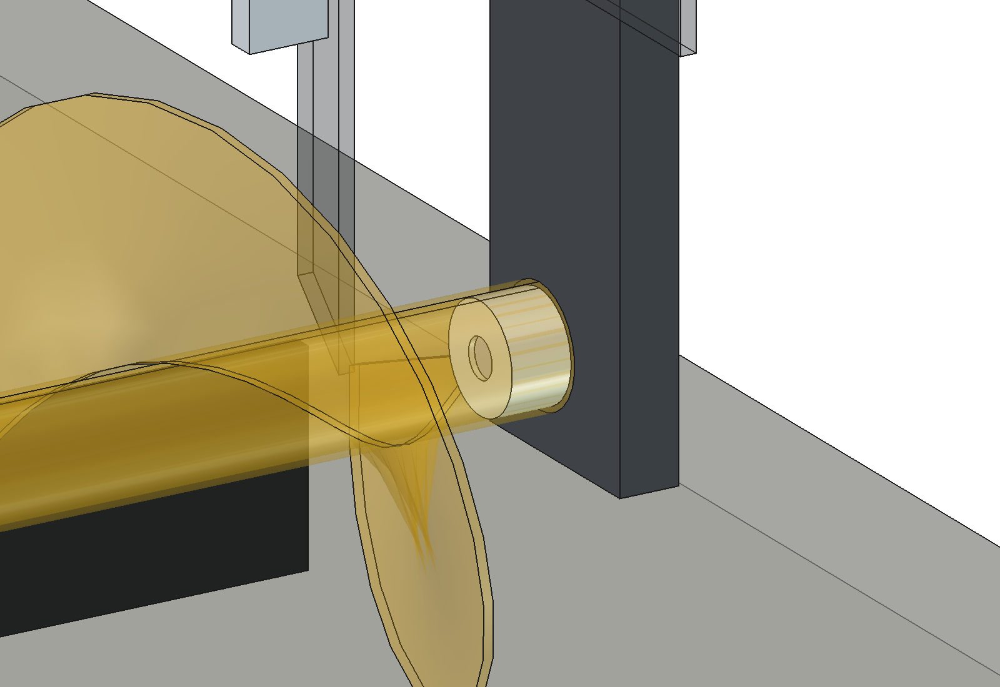
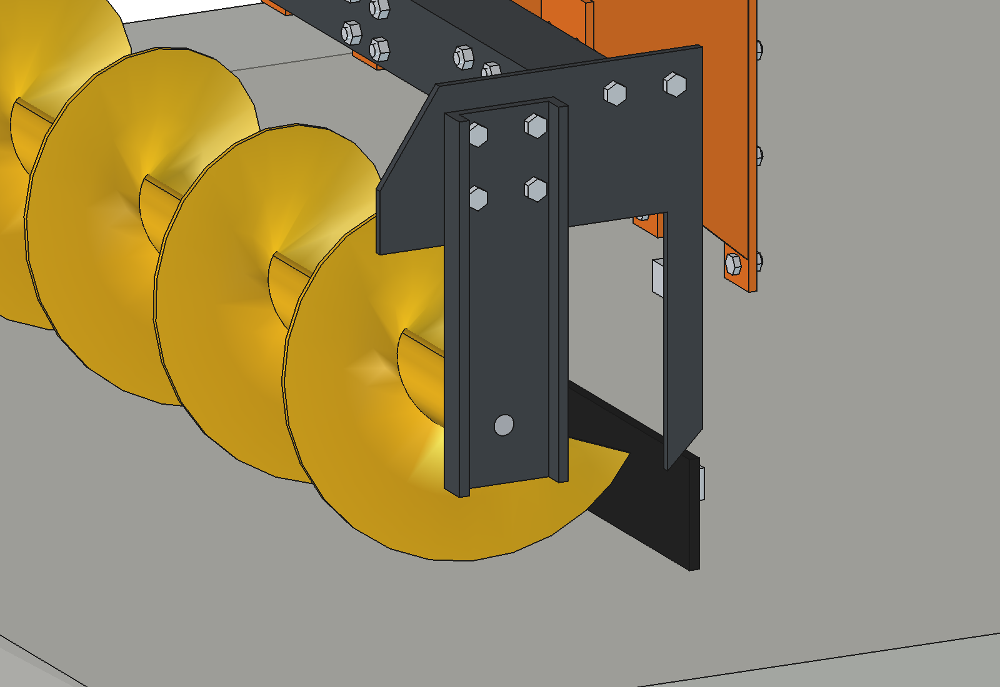

# Feed pusher auger V3: FreeCAD model

Feed pusher auger for the Bruut OpenAgbot. It sits at the back of the robot, on the side of the fixed wheel motors.
When pushing feed, the robot drives with the auger first; the steering heads are then at the back.
The auger picks up the pushed-away feed and carries it sideways to the feed fence. There it falls through the open end
plate onto the floor.

- **Hood:** one 2 mm folded sheet with 4 bends, as in the simple version. There is no rolled round trough any more.
- **Drive:** an 800 W gearmotor with a foot (V2, dimensions from `parts/800 watt motor`) on a motor plate on top of the hood. A 10B-1 chain with a tensioner runs
  along the left side plate to the auger.
- **Mounting:** 4 arms, each with 4 × M10 through the 4 holes in the rear flange of the side plates of the rear
  wheel modules.

Why it is designed this way is explained in [RATIONALE.md](RATIONALE.md).

## V3 compared with V2

V3 is V2 with the existing auger (wokkel), measured in [../parts_list/auger_specs.txt](../parts_list/auger_specs.txt)
(stand-alone model in [../parts_list](../parts_list/README.md)). Frame, hood, drive and mounting are unchanged.

- **Auger:** Ø300 flight (was Ø320) on a Ø60 × 3 core tube (ID 54, was 60.3 × 4), 1420 long, x −700 … 720. The flight
  runs from 60 mm after the drive end to 10 mm before the free end. Pitch 260 and 5 mm thickness are still estimated.
  The axis stays at z 175, so the flight is now 25 mm above the floor (was 15).
- **Drive end:** the drive bush spigot is now Ø53.7 (0.3 mm play in ID 54), collar Ø60. The shear bolt is the
  existing **M12** through the Ø12.4 hole 35 mm from the end of the tube. Above and below the hole are **two welded
  rings** (Ø24, flat face 5 mm above the tube), so that the bolt head and the lock nut (DIN 985) sit square, as on the
  old auger. Bolt M12 × 90.
- **Free end:** no bearings and no bearing housing any more. A **wear-resistant plastic ring** (Ø54 / Ø20 × 30) sits
  in the end of the core tube and turns on a **fixed Ø20 pin** that sticks 35 mm out of the hanging strap (27 mm in
  the ring; the tube end is 8 mm from the strap).
- **Calculations:** see the key figures below. Note: the M12 shear bolt breaks at a far higher torque than V2's M6,
  so it no longer protects the Ø30 journal and the chain (see RATIONALE).

| Drive end: M12 shear bolt between the welded rings (rotor transparent) | Pin Ø20 in the plastic ring |
| --- | --- |
|  |  |


## V2 compared with V1 (still valid)

V2 is V1 (the former `advanced` design) with a different rotor support. No shaft runs through the auger any more:

- **Free end (right, open discharge):** the right end plate is larger (up to the top of the beam and forward to
  v −120). It has a cutout, open at the bottom and front, that the whole auger can pass through. The pin sits on a
  **hanging strap** like the old suspension in the shed: 10 mm with two bent-up lips, bolted with 4 × M12 to the end
  plate above the cutout, with a welded-on pin (V3: Ø20 in the plastic ring of the auger, V2 had Ø25 in 2 × 6205-2RS).
- **Removing the auger:** shear bolt out, 4 nuts off, take off the strap with the pin, slide the auger 200 mm to
  the right off the spigot and through the cutout. The frame stays together.
- **Drive end (left):** the UCF206 stays. Through it runs a stepped **drive bush** (one turned part, C45): Ø30
  journal with the keyway for the 38T sprocket, a collar against the end of the core tube, and a hollow spigot that
  runs **200 mm** into the core tube. One shear bolt through core tube and spigot transmits the torque (V3: M12, see above).
- **Sprockets:** 12T on the Ø19 motor shaft, 38T on the Ø30 journal (10B-1, i = 3.17): auger 95 rpm, 78 Nm nominal.
  See `parts/Kettingwielen` for where to buy them.




## Files

| File | Contents |
| --- | --- |
| `Feed_Pusher_Auger_V3.FCStd` | the model, with the robot model hidden next to it. Generated, so do not edit by hand |
| `Feed_Pusher_Auger_V3.step` | the feed pusher only, in robot coordinates |
| `fpa_params.py` | all dimensions, including the robot interface and the operating parameters |
| `fpa_parts.py` | one function per part; each function returns a `Part` shape |
| `build_fpa.py` | model tree, colors, collision check, clearance to the tires, mass, images, STEP |
| `fpa_calc.py` | capacity, torque, power, shear bolt, chain, deflection, wheel loads, side forces and skew (pure Python) |
| `fpa_feed.py` | feed model: height field in the feeding alley, picking up, transport along the auger and ejection at the fence (Python + numpy) |
| `animate_fpa.py` | animation: robot + feed pusher along the feed fence, with forces per frame |
| `make_gif_fpa.py` | frames to GIF with a caption, a force panel (top view) and the feed distribution along the auger |
| `run_in_freecad.py` | macro: open in FreeCAD and run (F6) to rebuild the model and print the key figures |
| `previews/` | images and the GIF |

## Axes

Same as the robot model: x = right, y = driving direction of the robot (front = +y), z = up, ground = z 0, mm.
The origin is the centre of the robot. The implement is therefore directly in robot coordinates; no offset is needed.

- Auger axis at y = −960 and z = 175. The flight (Ø300) runs up to 25 mm above the floor.
- Feed fence on the +x side: the auger feeds towards +x.
- When pushing feed the robot drives towards −y.

## Rebuilding and using

In FreeCAD's Python console (folder in `sys.path`, or via `run_in_freecad.py`):

```python
import build_fpa
build_fpa.build()                        # builds, saves FCStd and STEP (robot hidden)
build_fpa.build(show_robot=True, save_path=None, step_path=None)
build_fpa.check_interference()           # overlap among parts and with the robot (must be empty)
build_fpa.clearance()                    # smallest distance of hood / flap / arms to the rear tires
build_fpa.mass_properties()              # mass and centre of gravity
build_fpa.render_all()                   # all images in previews/, save, STEP
```

```python
import fpa_calc
fpa_calc.report()                        # key figures
fpa_calc.robot_reaction(-80, 40)         # wheel loads, side forces, skew at 80 N sideways and 40 N backwards
fpa_calc.axle_loads()                    # axle loads without/with feed pusher and counterweight
```

## Animation

Builds a separate document `FPA_V3_on_robot_animation` with:

- the robot model from `agbots/agbot design` (those files are not modified);
- the feed pusher;
- a concrete floor and a feed fence with a kerb;
- a strip of feed that the cows have pushed away.

That strip lies 600 to 950 mm from the fence, at about 24 kg/m. It has a spot where feed has already been eaten and a clump of 10 kg.

Per frame (8 per second, with 5 sub-steps):
- **Feed:** the feed model picks up feed at the front of the flight and carries it in 25 mm cells to the fence,
  limited by the capacity. Anything more is pushed ahead of the auger. At the fence it falls onto the floor
  and settles into an edge.
- **Auger:** from the mass in the auger follow the torque, the power and the motor current.
- **Forces on the robot:** the side force away from the fence (red) and the pushing force against the driving direction.
- **Robot:** according to `fpa_calc.robot_reaction` the load changes per wheel. The side force of the floor differs per
  wheel (blue). The robot runs a fraction skew, because the rear wheels are fixed, and the front wheels steer against it.
- **Speed control:** above 18 A motor current the robot drives slower, to a minimum of 25 % of the driving speed.

```python
import animate_fpa
animate_fpa.build()
animate_fpa.play()                       # live, animate_fpa.stop()
animate_fpa.summary()                    # range of mass, torque, current, forces, skew, speed
animate_fpa.render_all(r"C:\temp\fpa_frames")
import make_gif_fpa
make_gif_fpa.main(r"C:\temp\fpa_frames", r"previews\animation_feed_pushing.gif")
make_gif_fpa.main(r"C:\temp\fpa_frames", r"previews\animation_feed_pushing_clean.gif", overlay=False)  # without text
```

Driving plan, control and camera are at the top of `animate_fpa.py` (`SPEED`, `I_SET`, `I_MAX`, `CAM_A/B/C`).
The feed is in `fpa_feed.FeedField._init_windrow`.

## Model tree

```
Feed_pusher (feed_pusher_auger)
  Mount          4 arms (adapter plate on the wheel bracket flange + gusset + end plate with slotted holes) and bolts
  Frame          2 mm hood, 80x80x3 beam with end plates, left side plate, right end plate with auger cutout (open discharge),
                 folded angles, rubber flap + clamp strip, PE glide shoe, motor plate
  Bearings       UCF206 left; right: hanging strap (10 mm, 2 lips) + welded Ø20 pin + 4 × M12
  Drive          800 W gearmotor with foot, Ø19 h6 output shaft + key 6x6, 12T sprocket, 10B-1 chain, tensioner, chain guard
  Auger_rotor    drive bush (Ø30 journal + key 8x7, Ø53.7 × 200 spigot), core tube Ø60 × 3 × 1420, Ø300 flight pitch 260,
                 2 welded rings + M12 shear bolt with lock nut, plastic ring Ø54/Ø20 × 30, 38T sprocket (rotates along)
  Counterweight  2 blocks of 20 kg on the front lower beam
Robot (hidden in the FCStd; for checking only)
```

## Estimated, not measured

- Robot: 150 kg with the centre of gravity in the middle (same as the liquid fertilizer applicator).
- Feed: bulk density 280 kg/m³, friction 0.5 on concrete, auger resistance factor λ = 4 (CEMA, fibrous).
- Auger: transport efficiency 0.65 and maximum fill factor 0.6.
- Tires: tire stiffness 0.12 per degree per N of wheel load and grip 0.6.
- Gearmotor (V2, 800 W): mass 9 kg, output 300 rpm (not on the drawing, check the type plate), foot width 90 and cross
  hole distance 70 (M8), body Ø105 and nose shape estimated from the photo. Length 260, gearbox Ø120, shaft Ø19 h6 + key 6,
  35 out, 64 above the foot, foot 115 with holes 80 apart are from the drawing.
- Robot bracket: the dimensions of the flange holes come from `agbot_parts.side_plate`.
- V3 auger: flight pitch 260 and thickness 5, start/end of the flight, the welded rings (Ø24, 5 mm above the tube,
  from the photo), M12 × 90 and the bolt class (4.6 assumed), plastic ring material PE-UHMW. Measured: length 1420,
  tube Ø60 / ID 54, flight Ø300, hole Ø12.4 at 35 mm, plastic ring Ø20 × 30, pin Ø20 × 35.
- Radial load on the pin (own weight + half the circumferential force at the starting torque); shear strength of the
  bolt taken as 0.6 × Rm.

See RATIONALE § 6.
