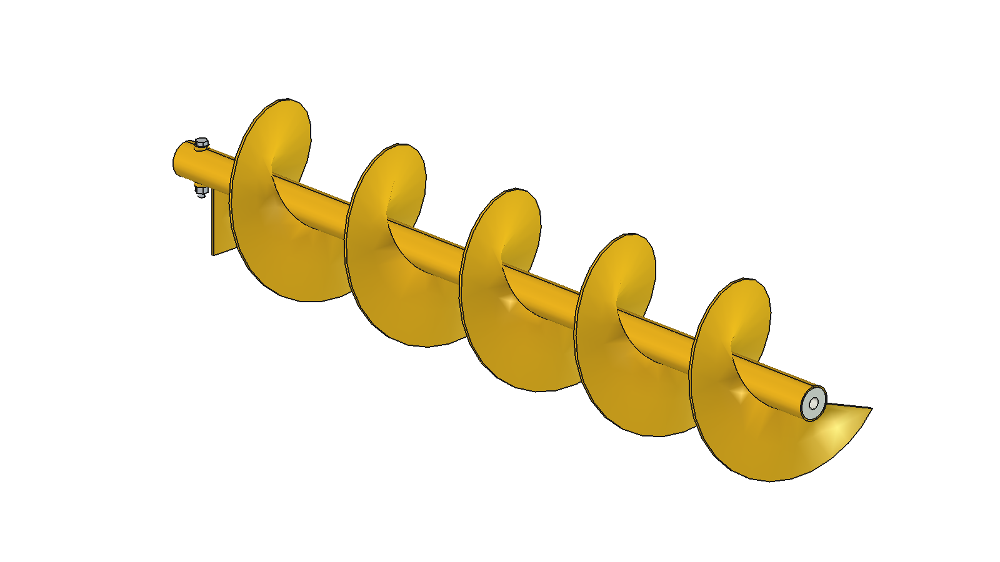
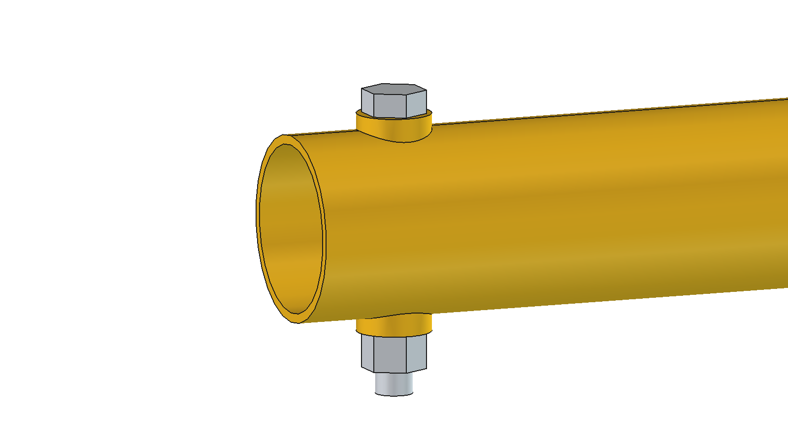
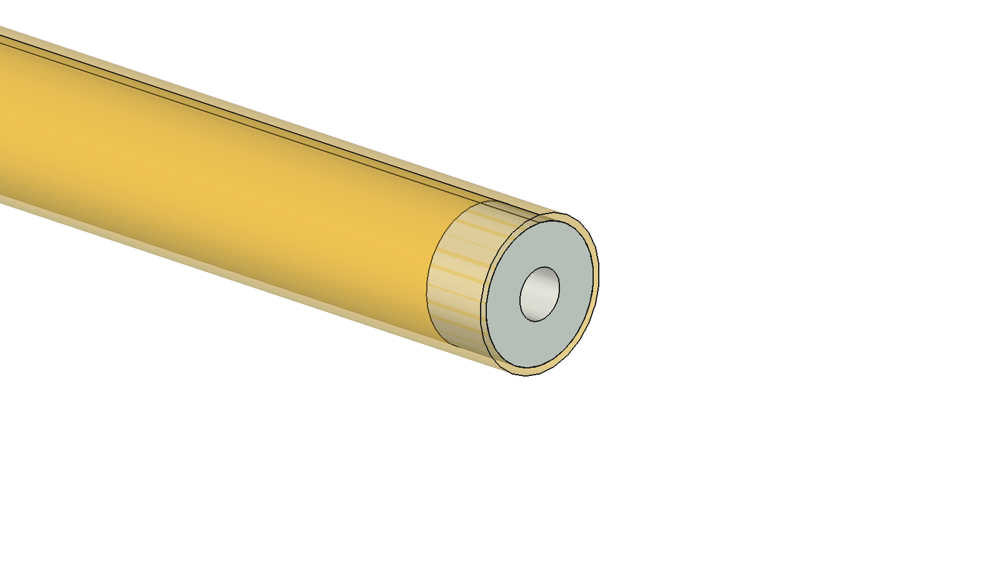

# Wokkel (auger): FreeCAD model from the measured specs

Stand-alone parametric model of the auger itself, built from [auger_specs.txt](auger_specs.txt). It is not placed
on the robot; V1/V2 contain the full feed pusher. The fixed pin (Ø20 × 35) at the passive end belongs to the
suspension, not to the auger, and is not drawn.

| Drive end: two welded rings, M12 shear bolt with lock nut | Passive end: plastic ring (tube transparent) |
| --- | --- |
|  |  |

## Parts

| Object | What | Dimensions |
| --- | --- | --- |
| `core` | core tube | Ø60 × 3 (ID 54), length 1420; Ø12.4 cross hole for M12 at 35 mm from the drive end |
| `blade` | flight, right-handed (feeds towards the passive end) | Ø300, pitch 260, 5 mm thick |
| `bolt_bosses` | 2 rings welded on the tube above and below the shear bolt hole, flat top so the bolt head and lock nut sit square | Ø24, flat face at 35 mm from the axis (5 mm above the tube) |
| `wear_bush` | wear-resistant plastic ring in the tube, passive end | Ø54 / bore Ø20, 30 long, flush with the tube end |
| `shear_bolt` | M12 shear bolt with lock nut through the cross hole (illustration) | M12 × 90, DIN 985 nut |

Tree: `auger` → `rotor` (all parts; turns together).

## Axes

Own frame: x = auger axis, x 0 = drive end face, x 1420 = passive end face; axis at y 0, z 0. mm.

## Key figures

- Mass rotor 20.0 kg (tube 6.0, flight 13.8, rings 0.03, plastic ring 0.06, bolt 0.12).
- Interference check: empty.

## Files

| File | Contents |
| --- | --- |
| `auger_specs.txt` | measured specs (source) |
| `Auger.FCStd`, `Auger.step` | generated model; do not edit by hand |
| `aug_params.py` | all dimensions (measured and estimated, marked) |
| `aug_parts.py` | one function per part |
| `build_aug.py` | `build()`, `check_interference()`, `mass_properties()`, `render_all()` (images in `previews/`, needs the GUI) |
| `run_in_freecad.py` | macro: rebuild and print interference and mass |

## Estimated, not measured

- Flight pitch 260 and thickness 5 (taken from V2).
- Flight runs from x 60 (clear of the shear bolt hole) to x 1410.
- Welded rings: Ø24, flat face 5 mm above the tube (from the photo of the old auger, not measured).
- Plastic ring material PE-UHMW (density 0.95) for the mass.
- Length of the M12 shear bolt (90) and lock nut height (12).
