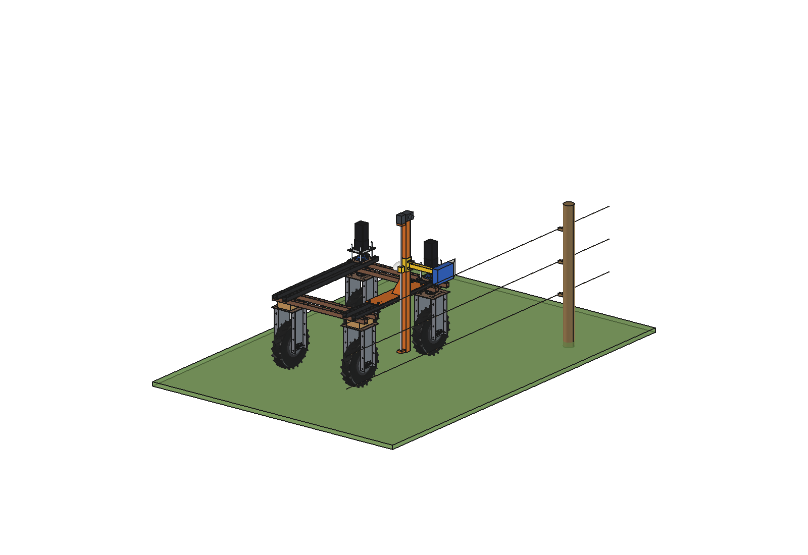
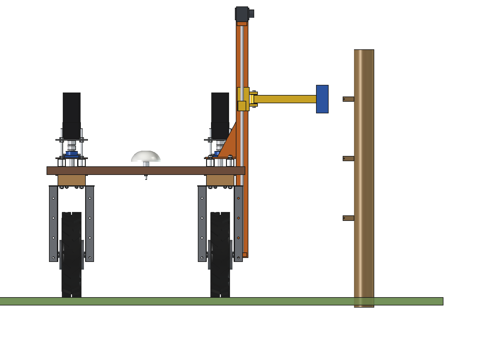
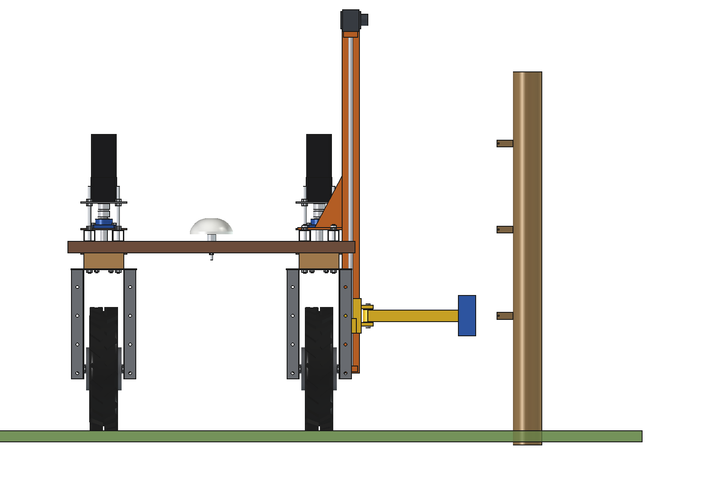
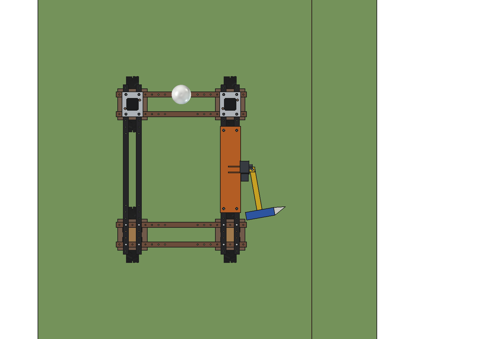
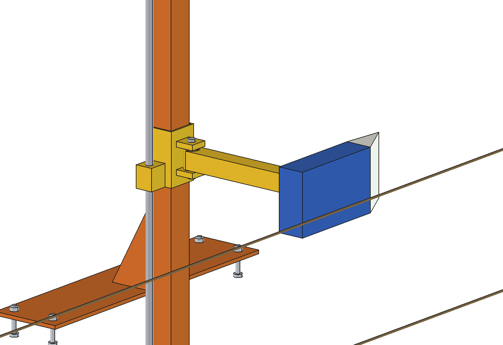

# Fence inspector (simple)

Electric-fence inspector for the Bruut OpenAgbot (standard robot). The robot drives along the fence with the fence
line 1.0 m to the right of its centre. A sensor head on a side arm stays 80 mm from the live wire **without touching
it**: a capacitive E-field plate reads the voltage of every energizer pulse and a pickup coil reads the pulse current.
With one pulse per second at 1 m/s that is a reading per metre, logged with the GNSS position: the map shows where the
voltage drops below 3 kV, where it is gone (break), and where current disappears (short to a post, vegetation, an
earth wire). A camera on top of the mast photographs every post for a work list (lean, broken insulator).

The head rides on a carriage on a vertical mast (lead screw Tr16 x 4 with a stepper) and follows any wire between
300 and 1100 mm. The arm hangs on a spring hinge and swings back (up to 80 degrees) when it meets a branch or an
obstacle. Straightening posts is not in the simple variant.

<p align="center">
  
</p>

| Head at the top wire (1000 mm) | Head at the low wire (400 mm) |
| --- | --- |
|  |  |
|  |  |

## Build

- **Base plate** 8 mm on the 2 right upper beams, 4 x M10 into the grid holes at y +-300; 2 gussets 8 mm.
- **Mast** 60 x 60 x 3 at x 485, y 0 (between the axles, outside the steering sweep), z 200..1400.
- **Lift**: lead screw Tr16 x 4 behind the mast in 2 bearing blocks, NEMA 23 stepper on top (40 mm/s, 20 s over the
  full range). **Carriage**: C-shaped sleeve 80 x 80 x 4 with PE glides (open on the plate side, so it passes the
  base plate), nut block and hinge lug.
- **Arm**: tube 40 x 40 x 3 on a vertical hinge pin O16 with a torsion spring, out to x 860.
- **Sensor head** (ABS 60 x 220 x 140): E-field plate 50 x 50 on a 1 nF integrator, pickup coil 500 turns, ToF
  distance sensor to the wire; PE bumper nose in front.
- **Camera** on the mast top, looking right at the posts.

Mass ~23 kg (mast and plate 18 kg, carriage and arm 4 kg). Size 620 x 660 x 1266 mm (x, y, z).

## Key figures (`fin_calc.report()`)

| | |
| --- | --- |
| Field at the plate (6 kV fence) | 10-12 kV/m, ~0.23-0.27 V on the integrator |
| Voltage accuracy | ~+-9 % (ToF distance +-4 mm at 80 mm, other wires ~8 %): a drop under 3 kV is found |
| Pulse current at the coil | 2.5-37.5 uT for 1-15 A, 1.3-19 mV from the coil |
| Resolution | 1 reading per metre (1 pulse/s at 1 m/s), 4 between posts at 4 m |
| Carriage | 40 mm/s, 20 s from 300 to 1100 mm |
| Range | 3.6 km/h, ~163 W: ~11.6 h, ~42 km of fence per charge |
| Load | centre of gravity 60 mm to the right: 58 % on the right wheels |
| Clearances | head 80 mm from the wire, posts and insulators never touched (they are behind the wire); arm swung back 80 degrees at 300 mm stays 66 mm from the front tyre at full lock |

Why and how these come out: see [RATIONALE.md](RATIONALE.md), including the list *Estimated, not measured*.

## Files

| File | Contents |
| --- | --- |
| `fin_params.py` | all dimensions, sensor and work parameters, masses from the model |
| `fin_parts.py` | one function per part, robot coordinates; `fence()` for the renders |
| `build_fin.py` | model tree (Mount, Carriage with Arm), `set_pose(wire_z, swing)`, checks (`check_interference`, `check_holes`, `check_poses`, `clearance`), mass, `render_all()`, STEP |
| `fin_calc.py` | E-field and plate signal, voltage accuracy, current pickup, resolution, carriage speed, range, side load |
| `run_in_freecad.py` | reload, build, print the key figures |
| `Fence_Inspector.FCStd`, `Fence_Inspector.step` | generated model (robot hidden in the FCStd) |
| `previews/` | images |

## Use

```python
exec(open(r"F:\veldrobot\aanbouwdelen\fence inspector\simple\run_in_freecad.py").read())
import build_fin
build_fin.set_pose(wire_z=400, swing=0)
build_fin.check_poses()     # height 300..1100 x swing 0..80 x steering -30..30: must be {}
```

No animation (simple variant): the poses are checked statically with `check_poses()`.
